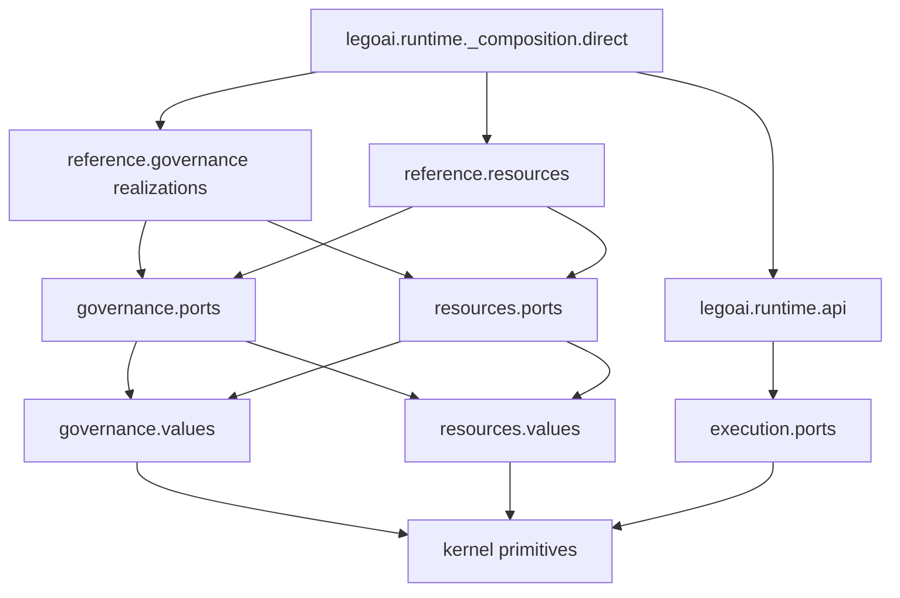
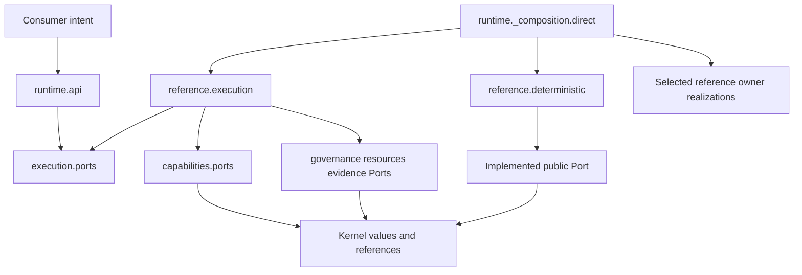

# ADR-002 — Reference Package Structure and Minimal Kernel Mapping

**ADR ID:** ADR-002  
**Status:** PROPOSED — FOR CANONICAL REVIEW  
**Date:** 2026-09-16  
**Decision class:** A — Foundational implementation blocker  
**Priority:** P0  
**Reversibility:** Type 2  
**Decision owner:** Architecture / Reference-runtime maintainer  
**Depends on:** ADR-001 — Python, conventional GIL-enabled CPython 3.14  
**Blocks:** Source/package structure and dependency implementation  
**Supersedes / superseded by:** None  
**Acceptance:** Pending architectural review; the selection below is a proposed decision, not implementation authorization or conformance proof.

**Authority:** [intent.md](../intent.md) 1.0 → [SPEC.md](../SPEC.md) 0.1.0 → [ARCHITECTURE.md](../architecture/ARCHITECTURE.md) 0.1.0 → [CONTRACTS.md](../contracts/CONTRACTS.md) 0.1.0 → [PLUGIN-SPEC.md](../plugin-spec/PLUGIN-SPEC.md) 0.1.0 → [SECURITY.md](../security/SECURITY.md) 0.1.0 → [EVALUATION.md](../evaluation/EVALUATION.md) 0.1.0 → [CONFORMANCE.md](../conformance/CONFORMANCE.md) 0.1.0 → [ADR-INDEX.md](ADR-INDEX.md) 0.1.0 → [ADR-001.md](ADR-001.md) → this ADR.

**Governing requirements:** ARCHITECTURE §§1.2, 4–6, AR-01–23 and its exhaustive §5.2 matrix; SPEC S-01–12, E-01–11, C-01–06, D-01–05, B-01–04, A-01–05, §§4.12, 5, 10–12.2; CONTRACTS §§7–32; PLUGIN-SPEC §§4–13; SECURITY §§6–24; EVALUATION §§1–3, 22; CONF-001–003, 011, 021–027, 048–059, 076–079; ADR-INDEX ADR-002 and §§6, 12, 16; ADR-001's substrate and boundary constraints.

**Related risks:** R-01/R-02/R-05/R-06/R-07/R-08; CR-04/CR-06/CR-07; Dependency explosion; Hidden implementation coupling; Extensions becoming de facto core; Shared-host escape; Version coexistence conflicts; Configuration drift; Hidden evaluator dependency; Implementation-specific test overfitting; Composition gap. Mechanism/proof work remains with the later ADRs and governing owners.

## 1. Context and authority review

The ten governing documents were reviewed in authority order. They already define the logical owners, Kernel anchors, allowed dependencies and optional capabilities. This ADR maps those decisions into Python source boundaries; it does not redefine them. Source import cycles are avoidable even where two logical owners may interact through separate published contracts.

**Acceptance metadata discrepancy:** ADR-001's checked-in header and acceptance paragraph still say Proposed/pending, while the current user instruction explicitly establishes its Python/CPython 3.14 decision as accepted and binding for ADR-002. The latest commit changes ADR-INDEX's status rather than ADR-001's header. This ADR proceeds under the explicit instruction; it does not silently edit either source or claim their metadata is synchronized. No semantic contradiction was found, and no package choice requires an upstream semantic amendment. Updating historical acceptance metadata is separate work.

The maintainer is one developer. A logical plane need not become an independently released Python distribution or a network service. Conversely, putting everything into generic `core`, `services`, `models` and `utils` files would conceal ownership and make conformance harder. The choice must balance a small release surface with mechanically enforceable internal boundaries.

## 2. Decision question and constraints

How should the first Python reference implementation be organized so the accepted logical architecture is visible, the Kernel stays minimal, imports remain acyclic, and contributions remain replaceable?

The governing rule remains: **Lego AI owns contracts; Plugins own implementations; Applications own intent.** “Owns” here does not override canonical business ownership or state stewardship. A reference realization of Resource Accounting still implements that logical owner's responsibilities, even though its executable contribution is packaged by an owning Plugin.

This ADR does not choose configuration algorithms, persistence, loading/discovery, IAM/Policy/Secrets backends, dispatch/arbitration, deduplication, event delivery, workflow/Agent engines, Model providers, serialization, protocols, deployment topology or a DI framework. Python package visibility is not security authority. Standard-library types are implementation vocabulary, not new canonical wire schemas.

## 3. Kernel inclusion test

For each proposed Kernel item, ask:

1. Does a deterministic governed Capability still need its shared meaning if Models, Agents, Workflows, Memory, Evaluation and external integrations are absent?
2. Does ARCHITECTURE §4.2 explicitly anchor that meaning in the Kernel, even if its optional full subsystem is absent?
3. Does it define shared identity/reference/context/version/contract semantics rather than own mutable operating state?
4. Can it depend only on a lower-level Kernel value or a narrow standard-library facility, without importing a domain owner or implementation?

The first test is not a license to delete explicit Kernel anchors such as Event fact meaning. A tiny fact/causal-reference vocabulary may be shared without importing event delivery. The inclusion test controls implementation bulk: an unused semantic anchor must not instantiate an operating subsystem. No mutable universal Kernel object is introduced. “Kernel coordinates” means shared contract coordination rules, not a central scheduler, service locator, registry or authority engine.

### 3.1 Exact Kernel contents

`legoai.kernel` is a public implementation-facing abstraction package. The following **modules** are the selected initial locations; these are proposed file locations, not code created here.

| Module | Included shared meaning | Explicitly excluded | Derivation / minimality |
|---|---|---|---|
| `identity` | Stable identity/kind/scope vocabulary | Identity verification, Principal issuance | ARCHITECTURE §4.2; deterministic attribution needs identity |
| `references` | Scoped, version/revision-pinned references and causal links | Record lookup, content retrieval, access decisions | References are not owning objects or grants |
| `versions` | Contract version/compatibility/revision primitives | Release pipelines and compatibility databases | Shared version interpretation must not be duplicated |
| `context` | Immutable execution envelope/context anchors, Principal/Tenant references | Context admission, credential checking, mutable Execution state | ARCHITECTURE §4.2; operational context is universally governed |
| `errors` | Canonical error category/recoverability semantics | SDK exception classes and error logging backend | SPEC §10; errors shared across Ports |
| `effects` | Canonical none/partial/completed/unknown meaning and effect references | Dispatch, deduplication or compensation execution | E-06–11; shared meaning without effect owner state |
| `lifecycle` | Expected-revision/transition-attribution primitives | Per-entity state machine drivers or global lifecycle manager | ARCHITECTURE §4.2; concept-specific states remain with owners |
| `capabilities` | Capability identity, requirement/offer/binding semantic anchors; dependency declarations | Catalog state, lookup, ranking, dependency closure computation | ARCHITECTURE §§1.2, 4.2 preserve registry/resolution meaning |
| `ports` | Port identity/version and common interaction-contract vocabulary | All domain operation implementations or a universal invoker | Domain Port operations belong in owner packages |
| `extensions` | Namespace/owner/version/requiredness references | Registry allocation authority or extension execution | SPEC C-06; shared extension interpretation |
| `configuration` | Configuration revision/reference and validation/extension anchors | Effective configuration assembly, overlays, files, stores | ARCHITECTURE §4.2; Application Composition owns effective configuration |
| `provenance` | Source/version/attribution/causation reference primitives | Audit storage, lineage capture, retention decisions | Shared attribution is needed without an evidence backend dependency |
| `events` | Fact identity/type/version/causation/scope anchors | Broker, subscriptions, delivery attempts and consumer processing | Event semantic anchor survives without mandatory event runtime |

Internal Kernel imports must form a DAG. Identity/version/reference/error/effect leaves precede composed envelope/descriptor vocabulary; any precise type relation is designed without circular owner references. No Kernel module imports `legoai.capabilities`, `execution`, `governance`, `plugins`, `reference` or another non-Kernel group. The per-owner operation protocols below reuse these anchors; they do not duplicate them. There is no second generic `contracts.py` containing all concepts.

### 3.2 Explicit Kernel exclusions

The following belong to logical owners and their realizations: Catalog and resolver implementations; Policy/authorization engines; resource balances/reservations/settlements; Plugin manager, registry/activation/health state; Workflow and Agent drivers; Model interactions; Context assembly, Memory and Retrieval state; Artifact repositories; event routing; Evaluation results/engine; conformance assessment; observation backend; evidence custody; databases; Secret storage; and configuration loading/stores.

Being small, local, built-in, reused or important does not move an implementation into Kernel. A stateless semantic predicate may live beside its owning values; that does not make an owner decision such as authorization “just validation” suitable for Kernel.

## 4. Alternatives considered

### Alternative A — One distribution with strict architectural subpackages

One initial reference distribution contains `legoai`, its public owner contracts, thin entry API, technical composition and separately located reference realizations. Logical owners are separate source packages; optional integrations are not base dependencies. Imports, API exports and tests enforce boundaries rather than one distribution per plane.

Benefits: one release/install unit and compatibility baseline for one developer; no internal package release choreography; clear extraction points if contract and implementation modules remain separate. Costs: installation does not physically prevent forbidden imports; a distribution update may include changes to multiple independent owners; dependency architecture must be checked explicitly.

### Alternative B — Independently installable distribution per major owner

Core, execution, security, resources, Plugins, information and other owners each become independently installable packages within one repository. Benefits: declared distribution dependencies can help expose coupling, independent release/installation and ownership. Costs: multiple version ranges, lock/compatibility combinations, local editable workflows and release ordering before independent consumers justify them. Packaging alone still cannot prevent wrong imports, shared state or unsafe composition.

This would over-package the first slice. It is rejected as the initial strategy, not as a future extraction option. Logical contract cycles would still need the value/Port split; separate wheels do not solve them automatically.

### Alternative C — Small foundation distribution plus runtime and integrations

A contracts/foundation distribution, a reference-runtime distribution and separate optional integrations create a useful boundary for external Plugin authors. Benefits: minimal contract-only installs and stronger separation from runtime dependencies. Costs: deciding and maintaining the foundation/public release split immediately, two release tracks/compatibility ranges, and pressure to place every shared domain record in the foundation.

This is the runner-up. It becomes preferable when a real external consumer needs contract-only installation or integrations require a distinct release cadence. The chosen source layout deliberately makes this later split possible without selecting it now.

### 4.1 Comparative analysis

These are qualitative design judgments under the repository's solo-developer constraints; no packaging prototype or benchmark was run.

| Criterion | A — One modular distribution | B — Per-owner distributions | C — Foundation/runtime hybrid |
|---|---|---|---|
| Semantic fidelity | Strong with explicit owner map | Strong if ownership preserved | Strong if foundation avoids model dumping ground |
| Kernel minimality | Strong source boundary; must be checked | Distribution split helps visibility, not correctness | Risk of an oversized “foundation” |
| Dependency enforcement | Source graph/API rules essential | Source rules plus distribution metadata | Source rules plus foundation dependency barrier |
| Solo burden | Lowest initial coordination burden | Highest multi-package coordination | Moderate |
| Release complexity | One initial release unit | Many coupled range/release decisions | Two principal release tracks |
| Testability | Owner/Port tests remain independent | Independent installations easy; larger matrix | Contract-only install checks easier |
| Replaceability | Preserved through Ports and injected implementations | Preserved; packaging is not proof | Preserved with clean contract separation |
| Optional dependencies | Base dependency gate plus separate future integrations | Naturally granular but many packages | Good separation of runtime/integration dependencies |
| Plugin support | Built-ins and external contributions share SPI | Many distribution identities to distinguish from Plugins | Dedicated consumer-friendly foundation |
| Future service extraction | Source boundaries prepare it | Installation split does not solve network semantics | Similar to A once boundaries are preserved |
| Python ergonomics | Simple editable/development baseline | More local package coordination | Moderate extra setup |
| Circular-import risk | Controlled by value/Port layering | Still present despite separate packages | Foundation helps only if leaf structure is disciplined |
| Version complexity | Canonical versions distinct within one distribution | Distribution versions multiply compatibility work | Smaller additional matrix than B |

## 5. Decision

**Use one repository, one coordinated development workspace, and one initial Python distribution with strict architectural subpackages under the regular import namespace `legoai`, using a `src/` layout.**

Use **`legoai-reference`** as the proposed local distribution identifier. It is distinct from the import name `legoai`, not a claim that a public registry name is available or reserved. Public publication/name checks occur before publication. This ADR creates no package metadata and selects no package manager or build backend.

There are **12 initial direct-child package groups** under `legoai`: `kernel`, `application`, `capabilities`, `execution`, `tools`, `governance`, `resources`, `plugins`, `observability`, `evidence`, `runtime`, and `reference`. They are created incrementally after the applicable ADR gates, not as empty directories now. Optional future logical locations are listed separately. A module, import package, installable distribution, Plugin release, process and deployed service are different boundaries.

All owner-facing contract/value packages are implementation-free. Concrete first-party realizations live in **`legoai.reference`**, organized by their existing logical owners and attributed to owning Plugin versions. Public contracts never import this implementation area. A **thin optional public runtime facade** and **private technical composition root** live in `legoai.runtime`; neither owns the state or semantics of the assembled owners.

### 5.1 Python distribution rationale

An installable distribution and an import package are distinct Python concepts; their names need not coincide. [Python Packaging User Guide](https://packaging.python.org/en/latest/discussions/distribution-package-vs-import-package/). A `src` layout makes development use the installed package surface rather than accidentally treating all repository files as importable application code. Editable development remains possible, while release checks must also exercise an ordinary install. [Source versus flat layout](https://packaging.python.org/en/latest/discussions/src-layout-vs-flat-layout/).

Use a regular package rather than an initially shared native namespace package. The single distribution owns the `legoai` import tree; third-party distributions must not silently write overlapping modules into it. Future external integrations use their own import roots and consume public Lego AI contracts/SPI. Exact external package names, optional dependency declarations and discovery metadata belong to later packaging/loading work. Namespace-package conversion requires a deliberate compatibility change if ever justified.

## 6. Contract layout and acyclic dependency model

Each non-Kernel logical owner package uses this small, consistent pattern where needed:

- **`values.py`** — public owner-defined records, value semantics and concept-specific vocabulary. Imports Kernel primitives and, if needed, its own lower-level pure helper modules. It does not import another owner's values, Ports or implementations. Cross-owner identity relationships use the canonical scoped/versioned references; they do not become owning object graphs.
- **`ports.py`** — public owner Port protocols and operation request/result definitions. Imports its own values, Kernel and explicitly permitted foreign **value** modules where an operation requires an exact embedded value or snapshot. It never imports foreign Port modules or implementations. Shared existing canonical types are referenced, not redefined locally to bypass the rule.
- **`spi.py`** — only in `legoai.plugins`: the documented Plugin-author boundary, reusing Plugin values/Ports and Kernel vocabulary. It does not aggregate every contribution's Port.

Operation-specific records that compose multiple owners' values are defined once beside the owning Port. This avoids A-values → Q-values → A-values cycles without weakening a contract that requires an inline snapshot: reference-only relationships stay references; required typed snapshots import the authoritative leaf value definition in the higher-layer operation record. If a purported entity definition requires a mutual runtime object graph, review its reference/value design against SPEC S-03 before adding a cycle. Do not erase types into `Any`, copy definitions, move whole domains into Kernel, or replace mandatory snapshots with identifiers merely to make an import pass.

Reference implementations consume their own Port/values and permitted other owners' published Ports. **No reference owner implementation imports another reference owner implementation.** The composition root injects compatible concrete instances. Thus G and R may each rely on the other's contract, as Architecture allows, without importing each other's implementation or creating a Python cycle.

The graph has these levels: Kernel leaves/compositions → owner values → owner Ports/operation records → reference realizations → technical composition. A thin runtime API depends only on selected public contracts, not on reference implementations or the composition root. All `__init__` files remain inert so parent imports do not defeat the layering.

## 7. Exact package map

### 7.1 Initial groups

“Owns” means source responsibility or the logical authority implemented, not a change to entity ownership. **Public contracts contain no authoritative mutable operating state.** That state is held by the corresponding reference realization under its unchanged logical owner. Permissions below are exhaustive when combined with §9: omitted dependencies are forbidden. Every group also forbids application/blueprint internals and provider SDK leakage into contracts.

| Package | Purpose / owns | Does not own | May depend on | Must not depend on | API status | Creation status |
|---|---|---|---|---|---|---|
| `legoai.kernel` | Shared anchors in §3.1 | All operating state and domain engines | Lower Kernel modules; narrow standard-library value/typing support | Every other `legoai` group; external SDKs | Public abstraction API | Initial, phase 1 |
| `legoai.application` | Application Composition values/Ports: declarations, effective configuration/activation contracts | Technical object wiring, provider choice embedded in domain intent | Kernel; own values; allowed foreign values under Application row | Reference implementations and runtime composition | Public `values`, `ports` | Initial, phase 2 subset |
| `legoai.capabilities` | Catalog registration/offer and Resolution request/result/Port definitions | Store, selection algorithm, invocation authority | Kernel; own values; C-row foreign values | Any implementation; E/I/Q contracts outside allowed row | Public `values`, `ports` | Initial, phase 1 |
| `legoai.execution` | Execution Coordination and direct-entry values/Ports; checkpoint reference meaning | Workflow/Agent state meaning; resource balances; Tool dispatch ownership | Kernel; own values; E-row foreign values, only where required | Coordination W contracts; concrete drivers; optional-driver eager imports | Public `values`, `ports` | Initial, phase 1 |
| `legoai.tools` | Tool/Action contract, validation/effect/reconciliation interaction values and Ports | Policy/Approval issuer, Model runtime, transport | Kernel; own values; T-row foreign values | MCP/HTTP/SDK implementations; non-permitted Q/I dependencies | Public `values`, `ports` | Initial, phase 3–4 contract subset |
| `legoai.governance` | Identity/Principal, Tenant, Authorization, Policy, Guardrail, Approval, Secret and enforcement contracts | Resource ledger, implementation credentials, all-purpose security engine | Kernel; own values; R/O values | IAM/Policy/Secret implementations; AI and reference imports | Public `values`, `ports` with named owner sections | Initial, phase 3; only needed operations |
| `legoai.resources` | Budget/Quota/Limit/admission/claim/settlement values and Ports | Execution or Governance private state | Kernel; own values; G/O values | Concrete accounting implementation, copied balances as authority | Public `values`, `ports` | Initial, phase 3 |
| `legoai.plugins` | Plugin release/contribution/config/lifecycle/eligibility contracts and author SPI | Dynamic import/discovery implementation, executable registry state | Kernel; own values; X-row foreign values; `spi` imports own `ports` | Loader/provider technology or reference realization imports | Public `values`, `ports`, `spi` | Initial contracts phase 1; SPI phase 4 |
| `legoai.observability` | Trace/telemetry observation contracts and safe diagnostic vocabulary | Audit custody, decision authority, evaluation judgments | Kernel; own values; G values | Evidence/backend implementation, application decisions, Q | Public `values`, `ports` | Initial, phase 3 |
| `legoai.evidence` | Audit custody, required evidence availability and general provenance contracts | Source-owner decisions, Artifact ancestry ownership, optional telemetry | Kernel; own values; G values; O intra-plane pure value references only in Ports | Storage/backend implementation, business scheduling/ranking | Public `values`, `ports` | Initial, phase 3 |
| `legoai.runtime` | Thin public direct-use API; separate private wiring of selected owners | Universal subsystem state, new semantic owner or new Port | API: necessary public contracts; `_composition`: selected reference realizations plus their contracts | API → reference/composition; all lower packages → runtime | `api` public; `_composition` internal | Initial, phase 4 |
| `legoai.reference` | Executable reference realizations mapped to logical owners; bounded Plugin declarations | Canonical type definitions, new owner hierarchy | Own and permitted peer contracts; Kernel; own implementation-local helpers | Other-owner reference implementations; runtime; application-specific code | Internal implementations; Plugin SPI is public elsewhere | Initial incrementally phases 2–4 |

Governance grouping is intentionally one source package, **not one owner**. `governance.values` and `governance.ports` have clearly named Identity/Principal, Tenant, Authorization, Policy, Guardrail, Approval, Secret and Boundary Enforcement sections; the corresponding implementation modules remain separated below. Resource decisions remain in `resources`, never generic fields managed by Governance or Execution. `evidence` and `observability` map to separate responsibilities within Architecture O, not a new plane or a merging of audit and telemetry.

### 7.2 Exact initial reference realization locations

These modules are internal, created only when their mechanism ADR is accepted and their slice authorized. The map is exact about owner/location, not a choice of algorithm or framework. Each may own state **only on behalf of its assigned logical owner**. Reference realization modules cannot use another realization's private records or constructors.

| Location | Logical implementation responsibility | Allowed contract targets | Forbidden / absent responsibility | Gate |
|---|---|---|---|---|
| `legoai.reference.application` | Application Composition: effective configuration/declaration/activation realization | Application row | No concrete adapter imports or technical composition authority | ADR-003 |
| `legoai.reference.catalog` | Catalog records and scoped offer/eligibility projections | C row; own Catalog Port | Resolver's decisions or invocation/grants | ADR-004/006 as applicable |
| `legoai.reference.resolution` | Resolution snapshots/closure/results | C row, Catalog Port within C | Direct Catalog private-store access | Relevant ADR-004/006 |
| `legoai.reference.execution` | Execution Coordinator, direct driver and checkpoint records | E row | Optional Agent/Workflow behavior or W acceptance state | ADR-004/005/007/008/009 |
| `legoai.reference.tools` | Action Mediation, Tool invocation/effects/reconciliation | T row | Grant issuance/resource balances | ADR-007/008/009 |
| `legoai.reference.identity` | Identity/Principal establishment and status | G row | Tenant or Permission ownership by identity alone | ADR-005 |
| `legoai.reference.tenant` | Tenant admission and scoped crossing validation | G row | Co-ownership extension or global wildcard tenant | ADR-005 |
| `legoai.reference.authorization` | Grant/delegation authorization decisions | G row | Policy authority invention or resource settlement | ADR-005/007 |
| `legoai.reference.policy` | Policy applicability/conflict decisions | G row | Legal precedence invented by code | ADR-005 |
| `legoai.reference.approval` | Approval decisions/consumption and replay-safe owner behavior | G row | Human consent inference or automatic refund | ADR-005/007; when applicable |
| `legoai.reference.enforcement` | Boundary Enforcement checks through owners' Ports | G row | Issuing all other owners' facts itself | ADR-005/007 |
| `legoai.reference.resources` | Resource Admission and Accounting | R row | Authority from projected/copied balances | ADR-007 |
| `legoai.reference.plugins` | Plugin Admission/Lifecycle, activation/health/retirement | X row | Provider execution through inactive discovery | ADR-006 |
| `legoai.reference.observation` | Observation Collection for required safe traces/telemetry | O row | Audit custody or business decisions | ADR-009 baseline; ADR-013 integration later |
| `legoai.reference.evidence` | Evidence/Provenance custody and outstanding record obligations | O row | Source facts or Artifact ancestry owner replacement | ADR-009 |
| `legoai.reference.declarations` | Inert built-in Plugin/contribution descriptors using exact contract references | Kernel; Plugin values/SPI | Importing executable contribution modules to inspect descriptors | ADR-006 |
| `legoai.reference.deterministic` | One deterministic reference CapabilityProvider/Adapter realization | Implemented Port; Kernel; declared governed dependencies | Implicit AI/coordination imports or self-admission | Relevant P1 gates; exact capability chosen later |

This is not a requirement for 17 runtime objects, distinct Plugins or distributions. It is a source-location map; several modules may be packaged by one owning Plugin release where permitted. Exact Plugin IDs, manifests, activation grouping and root duties are ADR-006 decisions. The deterministic implementation's exact Capability is not selected here; its consumer-facing contract uses the already relevant Port or an explicitly defined supported Capability contract rather than a private canonical type created in `reference`.

### 7.3 Reserved future logical locations — no empty packages now

Each future owner location uses the same public `values`/`ports` split. Implementations belong in future `legoai.reference` modules or separately packaged integrations, never inside the contract modules. All exclude provider SDKs and other owners' private implementations.

| Future package | Logical owner / purpose | May depend on | Must not depend on / does not own | Status / creation trigger |
|---|---|---|---|---|
| `legoai.coordination` | Organizational Composition and Work Coordination: Organization/Team/Role/Actor associations; Goal/Plan/Task/Delegation/Outcome stewardship | W row | Execution effects or Governance authority; Team as Actor | Public values/Ports; future explicit coordination slice |
| `legoai.execution.workflow` | Workflow definitions/WorkflowState/driver Port; driver owns state meaning | E row, parent Execution values | Engine implementation, Coordination internals | Public values/Ports; future Workflow support |
| `legoai.execution.agent` | Agent behavior/instance state/proposal driver Port | E row, parent Execution values | Authorization ownership or direct Evaluation | Public values/Ports; future Agent support |
| `legoai.execution.participation` | Human/Service delivery/wait/result driver contracts | E row, parent Execution values | HumanApproval inference or Task acceptance ownership | Public values/Ports; future participation slice |
| `legoai.intelligence.model` | Model Interaction descriptors, validation/usage, Model Port | I row | Agent/Workflow, Evaluation, SDK implementation | Public values/Ports; future independent Model slice |
| `legoai.intelligence.skill` | Skill Asset definitions/resources/dependencies | I row | Direct Evaluation invocation or unmediated action execution | Public values/Ports; future Skill support |
| `legoai.information.context` | Context Assembly input/reference sets and lineage | M row | ExecutionContext ownership, Model/Agent authority | Public values/Ports; future contextual input support |
| `legoai.information.memory` | Memory-kind contracts: session/semantic/episodic/procedural and permitted working-memory relationships | M row | Driver-owned working state, vector storage semantics, Model dependency | Public values/Ports; future explicit memory-kind scope |
| `legoai.information.knowledge` | Knowledge Curation sources/assertions/revisions/applicability | M row | Truth inferred from provenance; access from organizational ownership alone | Public values/Ports; future Knowledge support |
| `legoai.information.retrieval` | Retrieval queries/source references/continuations and pre-disclosure filtering | M row | RAG or generation prerequisite, vector-store implementation | Public values/Ports; future independent Retrieval slice |
| `legoai.artifacts` | Artifact identity/version/relationships/publication/content-access contracts | A row | Filesystem/database/Git identity, general audit authority | Public values/Ports; future Artifact slice |
| `legoai.events` | Event Coordination delivery/ordering/consumer ingress contracts | V row | Source fact ownership or consumer work-state mutation | Public values/Ports; future event-delivery scope |
| `legoai.evaluation` | Evaluation Management definitions/attempts/results and Evaluator Port | Q row | Conformance/admission/release decisions; direct E dependency | Public values/Ports; future independent Evaluation support |
| `legoai.conformance` | Conformance-layer claim/finding/suite/proof records and assessment-consumption API | Application consumer role: selected public contracts, especially Q/A/G/R/O | New operating plane, certification authority, runtime Permission | Public record/API support; future authorized conformance tooling |

Additional future reference locations include `legoai.reference.secret` (G; ADR-010), `legoai.reference.guardrails` (G; explicit control scope), and `legoai.reference.workflow`, `agent`, `model`, `skill`, `context`, `memory`, `knowledge`, `retrieval`, `artifacts`, `events`, `evaluation`, and `conformance`. They realize the corresponding rows above and inherit the same implementation-import prohibition. Create only when their capability is supported; this reserved list is not an implementation backlog to scaffold automatically.

Conformance is an assessment/consumer layer, **not a new Architecture plane**. Its future implementation acts as an explicitly permitted higher-level consumer; using Evaluation retains Q's ordinary contracts and Execution attribution through an allowed composition. Evaluation does not import Conformance, and no operational module imports the conformance runner to claim a mandatory foundation dependency. If Plugin admission needs a finding, it consumes governed evidence by reference or a separately orchestrated assessment, not an invented X → Conformance plane call.

## 8. Proposed source tree and creation phases

The following is a **proposed source layout only**. No directories, Python files, metadata or tests are created in this task. Every directory becomes a regular package only when needed; eventual inert `__init__.py` files are deliberately not enumerated. `values.py` and `ports.py` are modules, not independently versioned packages.

```text
repository/
  adrs/                         existing decision records
  src/                          future, after source gates
    legoai/                     regular namespace; inert initializer
      kernel/                   public; phase 1
        identity.py
        references.py
        versions.py
        context.py
        errors.py
        effects.py
        lifecycle.py
        capabilities.py
        ports.py
        extensions.py
        configuration.py
        provenance.py
        events.py
      application/              public contracts; phase 2
        values.py
        ports.py
      capabilities/             public contracts; phase 1
        values.py
        ports.py
      execution/                public direct/coordination contracts; phase 1
        values.py
        ports.py
      tools/                    public contracts; phase 3–4
        values.py
        ports.py
      governance/               public, distinct named owner APIs; phase 3
        values.py
        ports.py
      resources/                public contracts; phase 3
        values.py
        ports.py
      plugins/                  public contracts phase 1; author SPI phase 4
        values.py
        ports.py
        spi.py
      observability/            public observation contracts; phase 3
        values.py
        ports.py
      evidence/                 public audit/provenance contracts; phase 3
        values.py
        ports.py
      runtime/                  optional public entry + internal wiring; phase 4
        api.py
        _composition/
          direct.py
      reference/                internal first-party realizations; gated phases
        application.py
        catalog.py
        resolution.py
        execution.py
        tools.py
        identity.py
        tenant.py
        authorization.py
        policy.py
        approval.py
        enforcement.py
        resources.py
        plugins.py
        observation.py
        evidence.py
        declarations.py
        deterministic.py
  tests/                        future, not installed runtime dependencies
    unit/                       owner-focused behavior
    contracts/                  Port and Adapter substitution
    architecture/               import/API/dependency boundaries
    composition/                interaction and failure paths
    conformance/                supported-scope proof
    support/                    test-only fakes/fixtures; not public runtime API
  blueprints/                   later application composition artifacts
  applications/                 later application-specific intent/code
```

The tree shows the complete first deterministic-slice **location plan**, not a demand to create every listed realization at phase 1. Approval operations and other conditional behaviors are materialized only if required by the selected slice. Secret/Guardrail implementations and all §7.3 packages remain future. No speculative vendor directories are present. The existing canonical-document directories remain where they are.

| Phase | Physical source scope after explicit authorization | Decision gate |
|---|---|---|
| 1 — Contract foundation | Needed Kernel anchors, Capability/Execution/Plugin values and Port contracts; no executable optional drivers | ADR-001/002 accepted |
| 2 — Configuration/state boundaries | Application values/Ports and owner-local state interface requirements; reference Application/Catalog state work only as authorized | ADR-003/004; no storage implementation selected here |
| 3 — Governed boundary foundation | Governance, Resources, Observation, Evidence and relevant Tool contracts; associated implementations after mechanisms decided | ADR-005/009/007; ADR-004 prerequisites |
| 4 — Deterministic executable slice | SPI, bootstrap/lifecycle, direct driver, deterministic contribution, narrow runtime API/composition | ADR-006/007/008/009; no ungated executable demo |
| 5 — Proof and optional expansion | Future tests after authorization and ADR-011; optional packages only for actual scope | Relevant later ADRs; ADR-010 before Secret use, ADR-012 before expanded hostile-Plugin scope |

The order is a packaging plan, not permission to defer baseline security, resources or mandatory evidence until after execution. P0 acceptance alone does not authorize implementation or satisfy remaining P1 gates.

## 9. Dependency direction and matrix

### 9.1 Source-layer permissions

| Importing source | Kernel | Owner values | Owner Ports/SPI | Reference implementations | Runtime API | Composition / application internals | External SDK |
|---|---|---|---|---|---|---|---|
| Kernel | Acyclic lower primitives | No | No | No | No | No | No |
| Owner `values` | Yes | Same-owner lower helpers only | No | No | No | No | No |
| Owner `ports` | Yes | Own plus allowed foreign leaf values | Own lower definitions only; no foreign Ports | No | No | No | No |
| Plugin `spi` | Yes | Plugin values | Plugin Ports only | No | No | No | No |
| Reference owner implementation | Yes | Own and allowed peers | Own and allowed peers | Own local helpers only; never peer realization | No | No | Only at an explicitly identified Adapter boundary |
| Runtime `api` | As needed | Explicit required public values | Selected public Ports | No | Own API helpers | No | No |
| Runtime `_composition.direct` | As needed | As needed | Selected slice only | Selected concrete realizations | Yes | Own wiring only | No direct provider use; construct admitted adapters |
| Application/blueprint domain code | As needed | Supported public values | Supported public Ports | No | Yes | Its own domain only | Only in separately identified application Adapter code |
| Future conformance tooling | As needed | Relevant public values | Selected public Ports as Application consumer | No direct inspection of internals | Optional | Own assessment workflow only | Only behind its own governed Adapter |

“Own helpers” are private, owner-local pure helpers or implementation parts; they cannot import backward and form cycles. There is no escape through `TYPE_CHECKING`, dynamic imports, an untyped service locator, global singleton or facade callback. Any dependency discovered through reflective construction must be included in later architecture checks.

### 9.2 Allowed semantic peer contracts — exact Architecture projection

This table applies to reference realizations and, as restricted above, to foreign value references in owner Port operation records. It lists **maximum permissions, not required imports**. Own-plane contract use is permitted; omitted foreign planes are prohibited. The source-layer rules further restrict how those permissions become Python imports.

| Plane / mapped package group | Allowed foreign contract targets | Required boundary |
|---|---|---|
| Application → `application`; public runtime consumer | K, C, E, W, T, I, M, A, G, R, Q, O, X, V | Domain Application logic does not import concrete Adapters; technical root is separate |
| K → `kernel` | None | No operating dependencies |
| C → `capabilities` | K, G, R, O, X | No invocation or Permission issuance |
| E → `execution`, optional Agent/Workflow/participation drivers | K, C, T, I, M, A, G, R, O, X, V | No W state mutation or direct Q dependency |
| W → `coordination` | K, C, E, A, G, R, Q, O, V | Work/acceptance stewardship, not protected effect authority |
| T → `tools` | K, C, G, R, O, X, V | Governed actions through Tool contracts |
| I → `intelligence.model`, `intelligence.skill` | K, C, M, A, G, R, O, X | **No Q/Evaluation, E/Agent/Workflow, or direct T dependency** |
| M → `information.*` | K, C, A, G, R, O, X | No Agent, Model or generation prerequisite |
| A → `artifacts` | K, G, R, Q, O | No storage-location identity |
| G → `governance` | K, R, O | No accounting internals; current decisions not Model compliance |
| R → `resources` | K, G, O | No recursive admission for same unresolved decision |
| Q → `evaluation` | K, C, A, G, R, O, X | No Intelligence, direct E or Conformance implementation dependency |
| O → `observability`, `evidence` | K, G | Separate intra-plane contracts; no business scheduling/ranking |
| X → `plugins` | K, C, G, R, Q, O, V | Inactive Providers cannot self-admit or satisfy executable dependencies |
| V → `events` | K, G, R, O | Deliver source facts to ingress, not direct work-state mutation |
| Adapter implementation | K and implemented Port; other canonical dependencies explicitly declared/governed | Hosting under `reference` does not grant every plane's dependency permissions |

For example, Intelligence may retain a generic canonical reference to an EvaluationResult supplied by an allowed consumer. It may not import `legoai.evaluation.values` merely because the import looks harmless, nor request assessment through a callback disguised as an abstraction. A consumer permitted to use both I and Q orchestrates that work. Evaluation may assess a Model as a pinned subject/reference without importing the Model implementation or violating Q's allowed targets.

### 9.3 Why allowed two-way interactions do not create Python cycles

Governance Ports may refer to Resource leaf values; Resource Ports may refer to Governance leaf values. Both leaf modules import only Kernel, so neither imports the other's Ports. The implementations then consume the two Ports independently, and the root supplies instances. Artifact/Evaluation and Capability/Plugin follow the same pattern when implemented.

This does not authorize recursive decisions: AR-12 still requires pinned evidence queries versus commands and finite roots. An R implementation cannot ask G to re-admit the same unresolved R operation indefinitely. Source acyclicity is necessary architecture evidence, not proof that the runtime call/authority graph is safe.



`reference.governance realizations` abbreviates the separate identity/tenant/authorization/policy/approval/enforcement modules in §7.2; it is not an additional package.

## 10. Forbidden dependency matrix

| Prohibited edge / behavior | Reason / required alternative |
|---|---|
| `kernel` → Agent runtime, Model SDK, Workflow engine, database, Policy implementation, Plugin implementation | Kernel holds shared anchors only; owning Ports face outward implementations |
| Any public `values`/`ports` → `reference` or external Adapter | Contracts are separable from realization |
| Port → concrete Provider | Inject through implemented Port; no vendor classes in signatures |
| `intelligence.*` → `evaluation.*` | Exact accepted Intelligence/Evaluation correction; higher-level consumer orchestrates |
| `intelligence.model` → `execution.agent` or `.workflow` | Model is independently usable; I does not acquire E dependency |
| `information.memory` → vector/database implementation | Memory-kind contract is storage-neutral; implementation contains driver |
| `information.retrieval` → Model/Agent/RAG implementation | Retrieval remains independently usable; M excludes I/E |
| `tools` → MCP/REST/HTTP implementation | Transport types terminate at Tool Adapter boundary |
| `governance` → IAM/Policy/Secrets provider | Security contracts are not backend adapters |
| `execution.workflow` → workflow engine implementation | Workflow driver/Adapter lives in implementation area |
| `plugins` → loader/import/discovery implementation | SPI defines semantics, not discovery mechanism |
| `evaluation` → Conformance finding/decision implementation | Measurement/assessment is not conformance authority |
| `observability` or `evidence` → business decisions | Observation/custody does not own orchestration |
| Any reference realization → peer reference realization | Use peer's published Port and injected instance; preserve replaceability |
| Owner/Application domain → `_composition` or concrete reference code | Technical assembly is an outer root, not domain dependency |
| Parent package initializer → optional child/SDK eager imports | Independent imports must remain independent |
| Runtime/base package → `tests.support` or specific blueprint/application | Test/domain code must not be a production dependency |

Provider SDK classes, database driver connections, workflow engine objects, MCP types and similar technology types MUST NOT appear in canonical implementation-facing Port signatures, returned domain records or extension-free error vocabulary. A Python timeout/provider exception is mapped at the implementing Port boundary to the most specific canonical error with correct recoverability and effect status; cancellation is not automatically none. No serialization or validation library is selected by this rule.

## 11. Public/internal API and Python import policy

Public stable **reference APIs** are the documented Kernel modules, owner `values`/`ports`, Plugin `spi`, and the thin `runtime.api`. Stability means a documented versioned compatibility promise for the supported release, not freezing every name today. Python visibility does not create a supported API: all `legoai.reference.*`, `_composition`, private helper names and test support are internal. Plugin authors use the SPI plus the exact Port they realize, not reference classes as base classes.

Keep `legoai`, every grouping parent (`intelligence`, `information`, `execution`) and all other package initializers inert. No wildcard exports, registry mutation, discovery, Plugin activation, I/O, task creation or eager provider imports at import time. Python executes regular-package initializers when importing children, which is why an apparently harmless parent re-export can defeat optionality. [Python import system](https://docs.python.org/3.14/reference/import.html). Documented explicit exports may forward only dependency-permitted leaf values; convenience does not justify an aggregate import-everything API.

`TYPE_CHECKING` imports count as architecture dependencies. They may avoid unnecessary runtime imports but must not hide a forbidden dependency or cycle in the combined static/runtime graph. Runtime annotation inspection must not load optional modules to validate core records. Function-local imports or `importlib` do not legitimize forbidden edges. Dynamic loading occurs only behind the future authorized Plugin loading boundary; this ADR chooses no entry-point/discovery mechanism.

No generic `common`, `shared`, `utils` or `helpers` package is allocated. Kernel is not a replacement dumping ground. A pure helper lives with its semantic owner. Promotion to a shared primitive requires the §3 inclusion test and explicit dependency review; trivial duplication of non-semantic implementation plumbing may be preferable to a new universal dependency. Canonical semantic definitions themselves must not be duplicated.

Internal constructors and Python representation choices may evolve behind Ports. Dataclasses, TypedDicts or validation-library models are not canonical serialization contracts. Distinguish distribution release version, public reference API compatibility, canonical contract version, exact CapabilityVersion, Plugin release version, mutable configuration revision and activation record. Shipping them together does not synchronize their meanings or imply matching version numbers. ADR-011 owns the release/evidence mechanism; this ADR selects one initial distribution, not a universal version policy.

## 12. Composition root and runtime facade

**Technical root:** `legoai.runtime._composition.direct`. This is the sole selected first-slice location permitted to import the selected concrete reference modules and wire them to Port-typed consumers. Plain Python composition must suffice; no DI framework is required or chosen. Actual factories, instance lifetime, bootstrap order, config loading and authorization are later mechanism decisions.

**Public entry:** `legoai.runtime.api`. It offers a thin direct-use facade over injected Execution/public contracts. No exact class or method is defined here. It must not store Catalog records, resource balances, Policy grants, Plugin state or Evaluation results as its own authoritative state. A facade's references to owner services do not transfer ownership. Consumers may bypass the convenience facade and use the supported Port composition directly with equivalent governance obligations.

Technical wiring is distinct from Architecture's **Application Composition** owner. `legoai.application` defines intent/configuration/activation behavior and its realization is `reference.application`; neither imports concrete Adapters. The outer technical root may assemble these components without placing deployment/provider details in domain intent. Applications supply domain declarations through the public surface. The private first-party root is not a new stable API for third-party code to import; a later supported builder or external composition API needs an explicit documented boundary, not accidental use of internals.

This separation also prevents an apparent solution to the Intelligence/Evaluation restriction through a universal facade: only an allowed higher-level consumer may use both, and I implementations may not depend on the facade to obtain Q indirectly.

## 13. Plugin/Adapter placement and optional dependencies

Built-in reference implementations remain in `legoai.reference`, never in Kernel/contract modules because they ship in the same wheel. Every CapabilityProvider and Adapter has exactly one owning Plugin version under SPEC/PLUGIN-SPEC. One Plugin may package multiple contributions; one distribution may contain multiple Plugin releases only when binding/coexistence semantics are satisfied. Neither mapping is inferred from the directory tree.

`reference.declarations` supplies inert metadata locations. `plugins.spi` expresses declared contribution/configuration/lifecycle contract meaning; concrete hooks are implemented by owning Plugin contributions. ADR-006 decides which metadata can be trusted, how it is inspected and how code becomes executable. Importing `reference.declarations` must not execute `reference.deterministic` or initialize backends as a side effect. Static packaging does not bypass admission, finite-root requirements or lifecycle state transitions.

The base distribution's dependency closure MUST exclude AI frameworks, Model SDKs, external Workflow engines, vector/database drivers, MCP libraries and observation backends unless a future narrowly scoped packaging decision deliberately changes a supported integration arrangement. Owner contracts depend on standard-library abstractions and canonical values. Mechanism dependencies that later become necessary for the base runtime require review for optionality and footprint; they must not leak into contract imports.

Future integration distributions use their own import roots and contain their Adapter and owning Plugin declaration. They depend on documented Lego AI Ports/SPI, not `legoai.reference`. A future first-party optional module can be isolated from base imports, but its dependency/install strategy must be explicit; no extras syntax, workspace manager or build tool is selected here. Missing an explicitly required integration fails through supported resolution/admission semantics, not a surprising base import failure. A simple Kernel import never probes provider availability.

Different Plugin release versions do not guarantee that incompatible Python dependency versions can coexist in one interpreter. ADR-006/012 and relevant compatibility decisions must establish a valid solution, separate environment, or explicit unsupported scope. Module reload and namespace tricks are not a migration/retirement protocol.

## 14. Initial deterministic slice walkthrough

The following is a **structural dependency argument**, not an executed test or a chosen dispatch mechanism.

1. The outer technical root wires only the required contracts and selected reference implementations. It may construct owner service instances after the correct bootstrap/authority/evidence decisions; no package import itself activates them.
2. Consumer domain code imports `legoai.runtime.api` and required Kernel/Capability/Execution values. A Capability request carries the exact canonical context/references; it does not require a Team/Goal/Outcome.
3. The injected Execution Port is realized by `reference.execution`. This imports `execution.ports`, applicable C/G/R/O/X contracts and the selected implemented Port, not optional Agent/Workflow packages.
4. `reference.resolution` uses the Catalog Port and applicable eligibility/constraint evidence. Catalog and Plugin Lifecycle remain separate injected owners; resolution is not authorization or dispatch.
5. Protected work is mediated by applicable Governance/Resource/Evidence boundaries. If the selected deterministic capability is a Tool, `reference.tools` owns its effectful invocation semantics; otherwise the applicable domain Port retains equivalent effect obligations without relabeling everything as a Tool.
6. `reference.deterministic` implements the selected Port under an exact owning Plugin version. It returns canonical results/errors/effects through that Port; no SDK object escapes.
7. Execution preserves attempt/resource/evidence facts and returns an operational result through `runtime.api`. A canonical Team-owned Outcome is not fabricated.

The implementation-facing import closure is limited to the 12 initial groups and only their relevant modules. It excludes `execution.agent`, `execution.workflow`, `intelligence.*`, `coordination`, `information.*`, `evaluation` and `conformance`. Artifact/Event full subsystems are also absent unless the selected capability requires them; Kernel references/fact anchors do not instantiate them. Optional Plugin conformance evidence, when required for admission, can be supplied as governed prior evidence; that does not force an Evaluation engine or Conformance runner to import during direct invocation.



Arrows show imports/dependencies; runtime execution passes through injected Port instances and required enforcement. The drawing does not prescribe dispatch order or treat object construction as Plugin admission.

## 15. Future independent and composed slices

### Model without Agent

`legoai.intelligence.model.ports` imports its own values, Kernel and only needed I-permitted leaf values. The `intelligence` parent imports neither `model` nor `skill` eagerly. A Model Adapter imports that Port; an outer permitted consumer obtains governed Execution attribution and invokes it. Neither Model contract nor implementation imports `execution.agent`, `.workflow` or `coordination`. Model output quality does not require an Evaluation call inside Intelligence; a permitted consumer may separately assess an existing result.

### Retrieval without RAG

`legoai.information.retrieval.ports` and its Adapter depend on M-permitted contracts only. They return scoped source/continuation/lineage evidence without a Model import. The `information` parent does not eagerly import other information modules. Memory and Knowledge may be selected dependencies when required, not mandatory companions. Context Assembly remains distinct from immutable Kernel ExecutionContext.

### Evaluation without Intelligence; Conformance separately

`legoai.evaluation` uses Q-permitted contracts and can expose a deterministic Evaluator with no Model/Agent import. An allowed outer consumer supplies Execution attribution and pinned subject/evidence; Q does not directly import E merely to obtain attribution. Conformance tooling may consume an EvaluationResult through public Q evidence, but Q never imports Conformance judgments or code. No package refactor is needed to preserve Evaluation ≠ Conformance ≠ Certification.

### Agent and Workflow

An Agent realization implements `legoai.execution.agent.ports` from an optional owning Plugin. The direct Execution coordinator receives a driver through its declared execution boundary rather than importing a concrete Agent implementation. The Agent uses permitted Model/Skill/Tool and governance contracts through its E-plane boundaries; it gains no authority from generated content. No Kernel module changes merely because that driver is installed.

A Workflow realization similarly implements `legoai.execution.workflow.ports`, whether internally implemented or adapted to an external engine. The driver retains WorkflowState meaning; Execution retains checkpoint-record and attempt ownership. A direct Capability consumer still does not import it. Durability/engine choices remain future; the folder name does not promise durable execution.

### Storage and Artifacts

Owner-local persistence abstractions belong to the owning package's public Port surface when required for replaceable adapters, with operation-specific state/revision contracts. An implementation-only helper stays private to the relevant reference owner, not a new generic state manager. ADR-004 determines actual consistency/recovery mechanisms and any required sub-Port signatures.

Future storage adapters implement the owning Port and use their driver only internally. Artifact identity, immutable versions, relationships and publication stay under `legoai.artifacts`; content backing does not become Artifact identity. Memory storage remains under its memory-kind contract; Resource Accounting retains its ledger authority even if it shares a physical store with another owner. No public package imports a database, filesystem/Git backend or object-store SDK merely to define a reference.

## 16. Testing and mechanical enforcement implications

Future implementation must mechanically verify the chosen boundaries without this ADR choosing a specific test or lint tool. Required checks include:

- Complete static/runtime import graph is acyclic; indirect, typing-only, dynamic and parent initializer edges are included.
- Matrix permissions are checked by logical owner, including code under `reference`, not simply by top-level namespace. `reference.model` cannot use its implementation location to acquire Q permission.
- Importing Kernel/direct API works with optional integrations absent; importing Model does not import Agent/Workflow; importing Retrieval does not import Model; Evaluation works without Intelligence.
- Port signatures, returned values and exceptions expose no provider SDK types. Canonical errors/effects survive Adapter substitution and timeout/cancellation paths.
- Unit checks are owner-focused; contract/Adapter tests use public Ports; composition checks address shared resources, tenant context, retries, revocation and partial completion.
- Plugin descriptor inspection is inert; actual loading/activation behavior follows ADR-006 rather than import side effects.
- Ordinary installed-package checks complement editable development so repository-path accidents do not hide missing packaging metadata or dependencies.
- No production module imports `tests.support`; private helpers do not silently become public extension APIs.

`tests/unit`, `contracts`, `architecture`, `composition`, `conformance` and `support` are future organizational locations only. No tests, schemas, API classes or test runner are authored or executed here. Passing import checks alone would not demonstrate security, distributed correctness or complete conformance.

## 17. Consequences and mitigations

### Positive consequences

- One initial install/release boundary minimizes solo-developer release coordination.
- Exact owner contracts and a separate implementation area make Kernel growth and SDK leakage visible.
- The value/Port/implementation split permits acyclic source imports while retaining allowed logical two-way interactions.
- Independent direct, Model, Retrieval and Evaluation entry points avoid obligatory AI/coordination dependencies.
- First-party built-ins obey the same Plugin/SPI ownership semantics as later integrations.
- Source boundaries support later distribution/service/language extraction without promising that extraction is automatic.

### Negative consequences and accepted risks

- A single wheel cannot physically prevent importing its internal modules; enforcement partly depends on checks and review.
- Several owner packages and the separate reference area add navigation overhead and may feel repetitive in a small slice.
- A shared release unit is less convenient for external consumers wanting only contracts; they may install more inert code than they need.
- A grouped values/Ports module can grow; semantic submodules may need later splitting while retaining the DAG and owner boundaries.
- Parent exports, dynamic imports and a universal facade are tempting shortcuts that could defeat the design.
- Distribution/API/version compatibility remains work even with one distribution. Python packages provide no hostile-code isolation or automatic dependency-version coexistence.

These are accepted packaging tradeoffs, not permission for owner changes, circular dependencies, unsafe Plugin admission or weakened canonical behavior.

| Risk | Mitigation / follow-through |
|---|---|
| Accidental internal coupling | Explicit API manifest and import graph checks; same rules for first-party code |
| Growing Kernel/common dumping ground | Inclusion test with Architecture §4.2 trace before promotion |
| Grouped contracts becoming enormous | Split within the same owner into leaf modules; preserve single definition and layering |
| SDK/exception leakage | Adapter contract tests and signature inspection; map canonical errors/effects at boundary |
| Optional dependencies becoming baseline | Minimal-install/import closure checks; separate integration import roots |
| Reference package becoming a god service | Distinct owner modules and no peer realization imports; composition-only wiring |
| False sense of security | ADR-012 threat-scoped proof; package separation explicitly not containment |
| Release coupling | Keep stable owner module paths and assess hybrid extraction when an actual consumer needs it |
| Circular runtime authority/evidence | ADR-006/009 finite root proof and AR-12 query/command discipline, beyond import checks |

## 18. Security, deployment and performance boundaries

**Python package separation is not security isolation.** In-process malicious code can bypass conventions and inspect or modify shared process state. Trust, permission, Secret handling and stronger containment remain ADR-005/006/010/012 decisions. The chosen structure makes enforcement ownership reviewable; it does not prove enforcement.

**Package ≠ distribution ≠ process ≠ container ≠ service.** One distribution need not deploy every supported module or invoke it. Later service extraction behind Ports adds explicit context transfer, failure, ordering, resource and evidence obligations. No service or container platform is selected here.

Avoid heavy parent imports and unused SDK initialization to keep deterministic startup small, but no latency or footprint claim is made. Boundaries are chosen for semantics and maintainability, not hypothetical performance. Native/remote components remain options only after workload evidence and separately authorized decisions.

## 19. Migration and reversibility

This is Type 2 because source packaging can change behind stable semantic owners more readily than the language substrate. Moving a module to a separate distribution still requires public import compatibility, dependency metadata, release/evidence and migration review. Existing public imports may need compatibility forwarding during a supported transition; forwarding must not create eager optional dependencies or cycles.

A later hybrid can extract contract packages and keep reference realizations in a runtime distribution. The new distributions must have disjoint file ownership; two wheels must not both claim the same regular-package files. Namespace conversion or a renamed import root requires deliberate compatibility treatment, not silent overlapping installs.

A Plugin can move to its own distribution/import root and keep its canonical Plugin/version identity only when release/compatibility rules permit. Remote or other-language realization changes require Port-equivalence and failure-model proof. Migration preserves entity/reference meanings, outstanding effects, liabilities, Approval consumption, Secret revocation and evidence. Moving files or reverting a wheel does not undo effects or change canonical ownership.

Reconsider packaging when an external contract-only consumer, independent release cadence, persistent import-rule burden or actual isolation/deployment requirement makes the hybrid or a split materially simpler. Do not split merely because every logical plane has a name.

## 20. Impact on later ADRs

| ADR | Inherited source boundary | Still undecided |
|---|---|---|
| ADR-003 configuration | Kernel interpretation anchors; `application.values/ports` own effective config contracts; `reference.application` implements them; Plugin binding remains `plugins` | Format, overlays, environment policy, validation library, config source/store |
| ADR-004 owner-local state | Owner-specific values/Ports; implementations in matching reference modules; checkpoint record versus driver-state meaning preserved | Persistence technology, transaction/recovery mechanism, adapter details |
| ADR-005 authority/tenant | `governance` contracts; separate identity/tenant/authorization/policy/enforcement reference modules | IAM/Policy technology, trust establishment and exact propagation design |
| ADR-006 bootstrap | `plugins.values/ports/spi`; `reference.declarations/plugins`; outer technical composition | Plugin IDs/root set, discovery/loading, lifecycle coordination mechanism |
| ADR-007 dispatch/resources | Resource owner distinct; Governance and Tool/Execution consumers through Ports | Claim ordering, synchronization, settlement and dispatch mechanism |
| ADR-008 retry/effects | Execution/Tool owner Port semantics and reference realizations | Operation ledger, equivalence/horizon and reconciliation mechanism |
| ADR-009 mandatory evidence | `evidence` contracts/realization separate from observation; source decisions retain owners | Custody/storage, pre-effect barrier, repair/retention mechanisms |
| ADR-010 Secrets | Governance Secret contracts; future `reference.secret` or integration Adapter | Backend and purpose-bound use mechanism |
| ADR-011 release/conformance | Test locations and future `conformance` consumer boundary; public APIs and exact package identity | Suite workflow/tools, evidence ledger/release mechanism and official profile governance |
| ADR-012 Plugin isolation | Adapter/SPI boundaries; package does not imply containment | Process/host/isolation technology and threat-class treatment |
| ADR-013 observation | `observability` contracts and `reference.observation`; evidence remains separate | Instrumentation/export backend, diagnostics and operating integration |

No later ADR is decided by reserving its owner location. Configuration is not moved to Kernel; persistence is not moved to a universal shared repository; identity/security grouping does not merge logical authorities.

## 21. Acceptance review

The record is ready for canonical review, not Accepted. “Satisfied” denotes structural design coverage, not executed implementation evidence.

| # | Check | Review result |
|---|---|---|
| 1 | Governing documents and ADR-001 read | Satisfied — ten sources; metadata discrepancy explicitly recorded |
| 2 | Canonical ownership preserved | Satisfied — logical owners map to contracts and corresponding realizations |
| 3 | Kernel responsibilities explicit | Satisfied — 13 small semantic modules in §3.1 |
| 4 | Kernel exclusions explicit | Satisfied — §3.2 |
| 5 | Concrete strategy selected | Satisfied — one initial distribution, one regular `legoai` namespace |
| 6 | Three alternatives evaluated | Satisfied — A/B/C and qualitative matrix |
| 7 | Initial map exact | Satisfied — 12 groups, reference locations and staged tree |
| 8 | Dependency direction explicit | Satisfied — source-layer and semantic permission matrices |
| 9 | Forbidden imports explicit | Satisfied — §10 |
| 10 | Intelligence → Evaluation forbidden | Satisfied — no runtime or typing-only bypass |
| 11 | Deterministic use needs no AI packages | Satisfied structurally — §14; future import checks required |
| 12 | Model needs no Agent | Satisfied structurally — independent Model child with inert parents |
| 13 | Retrieval needs no RAG | Satisfied structurally — M dependencies exclude I/E |
| 14 | Evaluation independently consumable | Satisfied — Q contract plus allowed outer execution composition |
| 15 | Security externally enforced | Satisfied — distinct Governance/resource/action owners |
| 16 | Provider SDK types contained | Satisfied — contract/API rules and future signature checks |
| 17 | Python exceptions not canonical vocabulary | Satisfied — Adapter error/effect mapping |
| 18 | Package separation not security isolation | Satisfied — §18 |
| 19 | Package not service | Satisfied — distribution/deployment distinction |
| 20 | Built-ins retain Plugin ownership | Satisfied — declarations/SPI and realization attribution |
| 21 | Optional dependencies excluded from base | Satisfied — contract closure and separate future integrations |
| 22 | Plugin SPI visible | Satisfied — `legoai.plugins.spi` |
| 23 | Artifact ownership storage-neutral | Satisfied — reserved owner Port; no backing identity |
| 24 | Resource owner distinct | Satisfied — dedicated values/Ports and reference owner |
| 25 | Context/Memory/Knowledge/Retrieval distinct | Satisfied — separate reserved information children |
| 26 | Evaluation and Conformance distinct | Satisfied — assessment consumer role, no new operating plane |
| 27 | Composition not god object | Satisfied — wiring-only root and thin injected facade |
| 28 | Circular dependencies prevented | Satisfied by layered design; source and runtime checks remain future |
| 29 | Generic common/utils risk addressed | Satisfied — no shared dumping-ground allocation |
| 30 | First-slice dependency walkthrough | Satisfied structurally — no optional subsystem import required |
| 31 | Agent/Workflow need no Kernel rewrite | Satisfied — optional E-plane driver Ports and injected realizations |
| 32 | Solo burden evaluated | Satisfied — one release unit versus source enforcement/navigation costs |
| 33 | Distribution/release complexity evaluated | Satisfied — comparison and version distinctions |
| 34 | Migration/reversibility documented | Satisfied — split/import compatibility and preserved owners |
| 35 | ADR-003/004 undecided | Satisfied — locations only, no config/state mechanism |
| 36 | No package manager/backend selected | Satisfied — distribution strategy and source layout only |
| 37 | No framework/database/broker selected | Satisfied |
| 38 | No implementation files/directories created | Satisfied — only ADR-002 Markdown created |
| 39 | Acceptance not conformance proof | Satisfied — import/walkthrough arguments are design evidence only |
| 40 | Ready for canonical review | Satisfied — explicit selection, ownership, alternatives and remaining gates |

**Recommended next action:** review ADR-002's package map, Kernel boundary and import rules. After acceptance, explicitly authorize ADR-003 for the configuration revision/activation mechanism. No source tree, Python files, package metadata, dependencies, tests, schemas or ADR-003 are created by this task.
