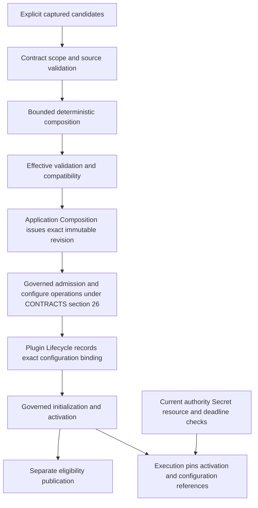

# ADR-003 — Configuration Revision and Activation Binding Mechanism

**ADR ID:** ADR-003  
**Status:** ACCEPTED — ARCHITECTURE DECISION
**Date:** 2026-09-16  
**Decision class:** B — Required before first reference runtime release  
**Priority:** P1  
**Reversibility:** Type 2  
**Decision owner:** Runtime / Plugin maintainer  
**Depends on:** ADR-002  
**Blocks:** Configuration loading and activation binding implementation  
**Supersedes / superseded by:** None  
**Acceptance:** Accepted after architectural review on 2026-09-16. Acceptance records the architecture decision; it does not by itself authorize implementation or establish conformance.

**Authority:** [intent.md](../intent.md) 1.0 → [SPEC.md](../SPEC.md) 0.1.0 → [ARCHITECTURE.md](../architecture/ARCHITECTURE.md) 0.1.0 → [CONTRACTS.md](../contracts/CONTRACTS.md) 0.1.0 → [PLUGIN-SPEC.md](../plugin-spec/PLUGIN-SPEC.md) 0.1.0 → [SECURITY.md](../security/SECURITY.md) 0.1.0 → [EVALUATION.md](../evaluation/EVALUATION.md) 0.1.0 → [CONFORMANCE.md](../conformance/CONFORMANCE.md) 0.1.0 → [ADR-INDEX.md](ADR-INDEX.md) → [ADR-001.md](ADR-001.md) → [ADR-002.md](ADR-002.md) → this ADR.

**Primary requirements:** SPEC S-01–12, E-01–11, A-03–05, §§5.8, 5.12, 7, 11; ARCHITECTURE §§4.1–4.2, 5–6, AR-09/14–18/21; CONTRACTS §§5–7, 10, 15, 26–29, 31; PLG-025–030, 033–034, 047–050; SECURITY §§7–10, 14, 17–19, 22–24; EVALUATION §§7, 18, 20; CONF-009, 025–027, 033, 038–045, 050–053, 067–068, 074–079; ADR-002 §§3, 6–9, 12–13, 20.

**Related questions/risks:** Q-02/Q-05/Q-06/Q-07/Q-08 remain with their governing authorities; R-02/R-04/R-05/R-07/R-08; CR-02–CR-07; Configuration drift; Version coexistence conflicts; State migration incompatibility; Silent guarantee weakening; Policy conflict ambiguity; Secret confused-deputy attack; Cross-tenant metadata leakage; Security-control downgrade; Stale security profile; Environment drift; Evidence staleness; Environment mismatch; Version drift. This decision supplies configuration semantics and proof inputs, not closure of those implementation risks.

## 1. Context and governing constraints

The eleven accepted governing documents were reviewed in authority order. ADR-001 fixes Python on conventional GIL-enabled CPython 3.14. ADR-002 fixes one initial distribution and the regular `legoai` namespace, with shared anchors in Kernel, owner contracts in logical packages and implementations under `legoai.reference`. Neither decision is reopened.

Application Composition owns effective configuration/declaration revisions. Plugin Lifecycle owns Plugin configuration bindings, admission and activation facts. Governance and Resource owners retain their policies, grants, decisions and ledgers. Execution retains its admitted context and attempt state. A configuration facility must not acquire those responsibilities just because values are presented together.

PLG-025–027 already require explicit defaults, attributable pinned non-secret settings, separate configuration/activation identities and current Secret authorization. CONTRACTS §26 already defines `configure_plugin`, `initialize_plugin` and `activate_plugin`. The open decision is how to resolve inputs into a stable configuration revision and hand it to those owners. It is not whether configuration may silently change, confer authority, or invent a Plugin state.

No higher-level contradiction was identified. The accepted ADR headers/index now record ADR-001 and ADR-002 as Accepted. All governing files remain unchanged.

## 2. Decision question

How will the first reference runtime obtain, validate, compose, revision and bind effective configuration so that running and historical work cannot silently acquire different meaning when source files, environment, overrides or remote values change?

The chosen mechanism must support a simple deterministic first slice, replaceable sources, future scoped tenant customization and exact historical interpretation. It must not require a configuration service, universal wire schema, database, mandatory Application entity, AI subsystem or live mutable global settings object.

## 3. Configuration distinctions and ownership

These are reference-level values/records using existing identity/reference/version rules, not new global entities or lifecycles.

| Term | Meaning | Owner or binding responsibility |
|---|---|---|
| Configuration contract/version | Published interpretation of accepted fields, values, units, defaults, references, extension behavior, compatibility and change rules | Defining domain/Plugin contract authority; not a permission grant |
| Submitted candidate | Captured inputs offered for one declared contract and scope, before full validation | Attributed submitter and receiving Application Composition operation |
| Configuration instance | A scoped instance of values under a stated configuration contract; may be a candidate or validated record | Accountable owner under existing contracts; no implicit active status |
| Effective configuration | Completely resolved non-secret meaning plus Secret/reference bindings, pinned interpretation and source/composition provenance | Application Composition assembles and records it; foreign owner facts remain references |
| Configuration revision | Immutable owner-issued reference to one exact effective record | Application Composition's configuration record authority |
| Application revision | Version/revision of the Application declaration, when an Application is represented | Application Composition; not automatically the configuration revision |
| Plugin release version | Exact published Plugin semantics and contributions | Plugin publisher/release authority |
| Activation identity | Plugin Lifecycle record linking release, scope, exact config revision, dependencies and admission/lifecycle history | Plugin Admission/Lifecycle; configuration owner does not issue activation |
| Deployment instance | Where a runtime realization executes | Deployment scope/reference; not config ownership or Plugin identity |
| Owner state revision | Concurrency token/revision of a mutable owner record or selection | Relevant state owner; distinct from immutable configuration content revision |

An effective configuration is not itself Policy, Permission, a selected Provider, Plugin admission, health evidence or resource capacity. Application-supplied values may address only declared public configuration fields or explicit extensions, not arbitrary implementation-private attributes. Merely recording a security-profile or Policy reference does not authorize changing that owner's definitions.

Configuration scope always identifies its accountable record owner and operational tenant where applicable. Application, Plugin release, contribution/Provider and deployment references are present only when material to the instance. The initial direct-capability composition may manage scoped configuration through Application Composition without creating a canonical Application/Team/Goal solely to satisfy this mechanism. Shared definition/default publication retains its own custodian/scope; effective operational records are not cross-tenant shared mutable state.

## 4. Alternatives considered

### A — Explicit immutable snapshots only

The caller supplies a complete effective candidate, the owner validates it and issues a revision. There are no separate tenant or realization overlays. This is the simplest runtime model and has clear attribution. Its weakness is pushing default expansion and repeated tenant/deployment customization into callers, where bespoke merging may become hidden and inconsistent. It remains a valid degenerate use of the selected mechanism: one base candidate and no overlays.

### B — A general owner-managed configuration service

A revisioned management facility owns mutable edit sessions, history, source integrations and change APIs; activations select immutable published revisions. It can provide a strong management experience and remote administration, but introduces a control subsystem, concurrency/recovery workflows and operations beyond the first slice. Owner accountability and revision issuance are necessary regardless; a general management service is not. Reject it as a required initial mechanism, while preserving a future source/service integration behind the same effective-revision boundary.

### C — Controlled overlays materialized once

An explicitly declared capture set is validated, resolved through a small deterministic composition policy and materialized into one immutable revision. Executable consumers never consult the source layers again for that activation. This handles defaults and limited tenant/realization customization centrally, at the cost of provenance and conflict rules.

Select a deliberately limited form of C: contract defaults, one base per declared section, one optional tenant override, and a disjoint realization-input section. There is no arbitrary stack of precedence layers, recursive dictionary merge, expression evaluator or live watcher. This retains A's stable snapshot consumption without requiring B's service machinery.

### Comparative assessment

Ratings are architectural judgments for this repository, not measured performance scores.

| Criterion | A — Explicit snapshot | B — General revision service | C — Bounded overlays to snapshot |
|---|---|---|---|
| Semantic fidelity | Strong if callers supply all material meaning | Strong with correct owner/authority separation | Strong with declared, bounded composition |
| Determinism | Strong after submission; caller preparation may differ | Depends on management/source rules | Strong explicit resolution before binding |
| Historical attribution | Straightforward effective record | Rich history but more machinery | Effective record plus source/contribution provenance |
| Drift prevention | Strong immutable binding | Strong only if live service state is never followed implicitly | Strong; consumers receive materialized snapshot |
| Tenant isolation | Simple independent records; duplicated setup | More administration/access surfaces | Scoped override allowed only in one tenant instance |
| Secret safety | References required | More exposure surfaces to constrain | References only; capture does not dump source contents |
| Plugin compatibility | Explicit validation | Can centralize validation | Explicit contract/release target validation |
| Solo burden | Lowest facility cost; repetitive caller logic | Highest initial build/operational cost | Moderate bounded logic; no remote subsystem required |
| Local usability | Complete inputs required | Management workflow required | One base works; limited overrides optional |
| Testability | Small snapshot/binding surface | Larger state/control surface | Finite rule/conflict/binding cases |
| Reversibility | Easy source changes | Service APIs/storage can create lock-in | Source replacement leaves effective semantics stable |
| Operational complexity | Low | Highest | Low for programmatic first slice |
| Future remote source | Adapter can supply complete candidate | Native concern | Captured revision becomes one source input |

Live bags of settings and repeated ambient reads during governed execution are rejected under all alternatives. They cannot preserve PLG-026 or exact activation/configuration attribution.

## Decision

**Use explicitly captured, replaceable candidate inputs, resolved once through a bounded composition policy into a fully materialized effective snapshot. Application Composition issues an opaque, scoped immutable configuration revision; Plugin Lifecycle binds that exact revision to the activation.**

The concrete rules are:

1. One explicit submission identifies the complete source set, target configuration contract/version, scope, target Plugin release/contributions where relevant, expected owner revisions and composition-policy version. Programmatic input is sufficient for the first slice; no source transport is mandatory.
2. Apply declared contract defaults, then a single base for each declared section, then at most one explicitly authorized tenant override for permitted fields. Realization/deployment input occupies declared **disjoint** fields and has no general override rank. Conflicts or unsupported composition fail rather than resolve by arrival order.
3. Use whole-field/value replacement, including collections and compound values; no generic deep merge, implicit append, set union or truthiness-based fallback.
4. Validate the resolved record and required references/compatibility. Issue a scoped owner revision only for a valid effective candidate, using expected-revision conflict detection for affected mutable owner records. Preserve provenance of defaults, selected sources, explicit overrides and validation.
5. Bind exact revision identity and interpretation to a separately governed activation. Existing bindings are immutable; config availability is not admission, eligibility, health or invocation authority.
6. No live semantic hot reload initially, including no unreviewed “diagnostic” exception. A change produces a new effective revision and a separately admitted activation treatment. Existing work remains pinned unless an explicit upstream-governed operation permits otherwise; this reference mechanism supplies no hot-rebind operation.
7. On restart or historical lookup, obtain the exact recorded revision. If it cannot be retrieved and verified, report unavailability and do not resume or reconstruct the old activation using latest inputs. Creating a new activation is a separate authorized action.
8. Snapshots contain Secret references and declared use requirements, never raw Secret material as ordinary configuration. Current Secret use/rotation is determined by its owner under ADR-010, not frozen by copying bytes into the snapshot.

This selects composition, revision and binding behavior. It does not choose a file format, parser, validation library, store, digest algorithm, CLI, remote configuration product or persistence mechanism.

## 5. Input-source model

Source identity tells where values came from; it is not effective configuration identity or security authority. Each submission explicitly identifies source handles, their intended section/role, capture revision or equivalent evidence, target scope, and whether absence is allowed. Input adapters return captured candidates to the owner boundary; they do not mutate active runtime settings.

| Source kind | Selected architectural role | Rules / limitations |
|---|---|---|
| Programmatic values | Sufficient initial input path through owner contracts | Defensive capture/validation; no retained caller-owned mutable mapping, privileged constructor or implicit import-time settings |
| File | Permitted future replaceable candidate source | Capture declared content/version; path alone is not historical identity; changes after capture do not affect the submission |
| Environment variables | Permitted, explicitly mapped candidate input only | Capture only named fields before resolution; no live reads, whole-environment dump, authority from process environment or default raw credential ingestion |
| CLI | Permitted explicit candidate input | Same validation, scope, revision and binding path as other sources; local operator convenience is not a bypass |
| Local/remote config store | Permitted future source of an exact captured revision | Pin revision and reject unavailable/unverified content; an alias may resolve before capture, never during execution |
| Deployment metadata | Permitted for declared realization fields/assumptions | No automatic priority, trust grant, tenant assignment or permission expansion |

No filesystem search order, automatic file discovery, environment-variable naming convention or default parser is chosen. Multiple sources are permitted, but there must be at most one writer for each section/role in a submission. A file and CLI both writing the same base field is a conflict unless an explicitly defined future policy changes the supported composition; “CLI usually wins” is not a rule here.

Capture is bounded to the declared source set. A source that changes during a required coherent capture must provide a revision/read-consistency check or cause a conflict/unavailability result. Independently captured sources form an explicit version tuple, not a claim that all systems were read at one global instant. If a contract requires cross-source consistency that cannot be demonstrated, reject the candidate. Adapters must not opportunistically reread a failed source and blend new values with old ones inside the same submission.

An optional source may be absent only when that absence is declared before capture and all resulting field requirements still hold. Unreadable or malformed supplied content is not silently treated as absent. The record identifies optional absence; a required missing source blocks resolution. Raw Secret input is rejected/redacted through safe handling, not retained in ordinary rejected-candidate logs or echoed in exceptions. No mechanism for secure erasure of arbitrary Python objects is claimed.

## 6. Configuration contract, validation and effective record

A reference configuration contract identifies its exact version, accountable definition owner, allowed field meanings/types/units, requiredness, explicit defaults, permitted reference kinds, extension handling, allowed tenant-customization fields, realization-only fields, compatibility targets and change/migration effects. These are semantic rules already required by PLG-025; the composition policy can restrict what the first implementation supports without inventing public wire syntax.

Submitted and validated instances are distinct from the resolved effective record. Validation has explicit scope:

| Stage | Required determination | Not established by that stage |
|---|---|---|
| Capture/input decoding | Declared source readable, bounded, valid under its input representation; safe candidate obtained | Source's authority or canonical validity |
| Contract validation | Known version/fields, values/units, requiredness, meaningful null/empty/default/extension behavior | Current Permission, trust or resource capacity |
| Scope validation | Owner, tenant, target and reference scope coherent; attempted customization allowed under declared contract | Entitlement to change foreign owner state |
| Reference validation | Exact applicable definition/release references resolvable as required; Secret reference structurally suitable without reading material | Continuing Secret authorization or immutable live Policy decisions |
| Composition validation | Supported versioned rule set, unique writers, permitted overrides, complete provenance, no ambiguity | Acceptance of security downgrades |
| Effective validation | Entire final value set and cross-field constraints valid; required target compatibility established | Plugin admission/activation/health |
| Activation-time checks by owners | Exact revision remains applicable/available; current admission, scope, trust/dependency/control prerequisites | Perpetual future execution authorization |

A configuration field that conflicts with a known mandatory restriction is not made valid by composition. If required authoritative information is unavailable, the affected change/binding remains blocked rather than assumed permitted. ADR-005 supplies the mechanism for authority checks; ADR-006 supplies Plugin admission. No universal validator substitutes for those owners.

### Effective record contents

The immutable effective record must identify:

- Owner, configuration-instance identity, exact configuration contract/version, operational tenant and applicable Application/Plugin/contribution scope.
- Fully resolved non-secret field meanings, units and declared material defaults; exact Secret/reference bindings and required interpretation modes.
- Source captures/revisions or permitted content evidence, capture scope/time, submitter/Principal attribution and correlation/operation identity.
- Composition-policy version; each effective field's origin; overridden-writer references and reasons; optional source/field absence; preserved optional inert metadata where allowed.
- Validation result and its precise scope/version; target compatibility evidence and limitations, with current predicates distinguished from historical checks.
- Effective revision identity; parent/source revision references for change/migration; required integrity/custody and retention applicability references.

“Fully materialized” means a consuming activation does not chase mutable input sources to discover ordinary setting values. It does not mean embedding every Policy, resource ledger, dependency state or Secret value. Those remain typed references or immutable evidence snapshots where upstream requires them, and current checks stay current.

Sensitive non-secret values may still require protected access. General telemetry can contain safe identifiers/differences without publishing full snapshots. Retain provenance at the level required for interpretation, not indiscriminate copies of every environment value or rejected override. Where disclosure/retention prevents content availability, represent that limitation rather than fabricate a complete history.

## 7. Composition and precedence policy

The initial reference composition policy is **versioned with its implementation-facing definition** and attached to the effective revision. It has four roles, independent of transport:

| Role | Permitted contribution | Relation to other roles |
|---|---|---|
| Contract defaults | Explicit defaults from the exact configuration contract/compatible published definition | Fill absent fields only; each applied default becomes visible effective meaning |
| Base | One explicit base per declared named section for this contract/scope | Replaces defaults for supplied whole fields; duplicate base writers fail |
| Tenant override | At most one input for the same operational tenant; only contract-declared tenant-customizable fields | Replaces the corresponding base/default whole field if authorized and valid |
| Realization input | Host/deployment/application-supplied values for declared realization-only fields | Disjoint from tenant/base-controlled fields, except their declared defaults; overlap with another supplied writer fails |

There is **no automatic global platform-default layer**, Plugin-private override layer, or highest-priority environment layer. Plugin contractual defaults belong to the defaults role. Application intent supplies base values where appropriate. Governance/security restrictions and resource ceilings are **constraints from their authorities**, never lower-priority layers to overwrite. If platform reusable settings are genuinely required later, they must enter as an explicitly scoped/versioned candidate under a supported role or through a revised composition policy.

This choice avoids an arbitrary tenant-versus-deployment hierarchy: deployment fields must be identified by the contract and cannot override tenant semantic choices. An endpoint, region or target setting can affect disclosure and authority even if called “deployment.” Its final value still needs target/scope/policy checks; placement in the realization role does not make it harmless.

### Field and collection replacement

Only declared independently assignable fields are composable. Replacing a compound mapping/list replaces the **whole value**, unless the exact contract exposes named child fields as independent assignment units. Parent and descendant assignments in the same composition are rejected as ambiguous. There is no implicit recursive merge, array concatenation, set union, duplicate elimination, sorting or position-based patching.

Collection order/duplicate significance follows the configuration contract. If a field expects an ordered list, order is retained. If a contract defines set semantics, validate that meaning without claiming an unspecified serialized order. A contract requiring an unsupported merge operator cannot be silently approximated: supply the already complete field value or extend the supported policy in a separately reviewed change. Override order cannot be inferred from Python dictionary insertion, filenames, import timing or input arrival.

### Absence and defaults

| Input situation | Required interpretation |
|---|---|
| Missing required field | Apply an explicit allowed default if defined; otherwise fail |
| Missing optional field | Preserve explicit absence or apply its declared default; no universal fallback |
| Missing override field | Does not replace base/default |
| Explicit null/None | A supplied value only if the contract permits null; never generic “delete” or “inherit” |
| Empty list or mapping | An explicit empty whole value, subject to constraints |
| Zero or false | Literal values, not missingness |
| Explicit unbounded value | Only if the contract defines it and current authority/resource restrictions permit it; omission never means unlimited |

If a caller wants an optional field removed, it submits a new complete base without that field under the contract's absence/default rules; there is no implicit deletion token. Material defaults cannot be hidden in the executing Adapter after snapshot resolution. Internal implementation tuning that can change promised behavior, resources, targets, security or observability must be attributable configuration or a versioned implementation condition, not an invisible default.

### Unknown fields and extensions

Unknown ordinary behavior fields, required extension namespaces/versions or required semantics fail explicitly. Unknown optional metadata is retained only if the configuration contract permits opaque, inert metadata under SPEC extension rules; it is not interpreted as behavior, injected as attributes, or allowed to shadow canonical fields. Requiredness, namespace owner, version, portability and scope remain explicit. A later implementation that assigns execution meaning to formerly inert data requires a new interpretation/revision and compatibility assessment. Global namespace authority remains Q-03 governance, not a configuration precedence decision.

## 8. Revision identity and change concurrency

**Select an owner-issued opaque revision component inside a compound scoped reference**: configuration record owner, instance identity, tenant/scope as applicable, and immutable revision identifier. The reference resolves one immutable record, including its contract/interpretation and provenance. Exact encoding, ID generation and storage are deferred. An ID string alone does not establish ownership; its authoritative resolution and scope validation do.

| Considered revision mechanism | Disposition |
|---|---|
| Content digest alone | Rejected as sole identity: depends on normalization/representation and cannot establish authority, scope or provenance |
| Monotonic local integer alone | Rejected as universal identity: collisions across owners/instances, no cross-owner order; useful as an implementation concurrency token if later justified |
| Owner-issued opaque ID alone | Useful local component, insufficient without owner/instance/scope |
| Compound owner/instance/scope plus opaque revision | Selected: explicit authoritative reference, no universal content-addressing or global ordering requirement |

Optional digests may later support integrity/comparison, but no algorithm, byte canonicalization or hash-based revision rule is chosen. Digest equality does not establish Permission, trust, provenance, tenant ownership or admission. Raw Secret material is never part of general configuration identity or hashing. Identical effective non-secret values in two tenants still have distinct scoped records; no unauthorized cross-tenant deduplication is inferred.

An accepted new change submission creates a new effective revision, including when material contract, scope, source provenance or composition interpretation changes while visible values happen to remain equal. Selecting a previously issued exact compatible revision for rollback is not mutation of that revision. The same equivalent retried owner operation returns its original result under CONTRACTS §5; it must not create another revision or repeat activation merely because the acknowledgment was lost. No deduplication horizon is selected here.

Expected owner/instance revision checks apply to mutation of a selected configuration head or binding request. The immutable configuration revision is distinct from that mutable owner's concurrency token. A request tied to R1 may either bind exactly R1 when permitted or conflict if it required an unchanged selection; it cannot quietly substitute R2. Capturing “current” must produce a pinned exact reference before handoff. ADR-004 decides how these requirements are committed atomically at the owner boundary.

## 9. Activation binding and owner handoff

The configuration owner supplies an immutable validated effective revision/reference. Plugin Lifecycle consumes it using existing `configure_plugin` and admission/initialization/activation contracts; this ADR does not add a new global configuration or Plugin lifecycle.

The binding records the exact Plugin release, operational scope/tenant, contribution constraints as relevant, effective revision, configuration contract/version and the associated admission/dependency/lifecycle evidence. Activation identity remains issued/owned by Plugin Lifecycle. Configuration revision participates as an exact binding component, not as a hash that replaces activation identity. One revision may be reused by more than one separately authorized compatible activation in the same permitted scope; it does not make those activations identical.

Once an activation binds R1, its recorded configuration continues to mean R1. Configuration owner records cannot be edited to alter it. Updating a selection/head for future work does not update already bound activations. Application configuration stays owned by Application Composition; Plugin Lifecycle retains the **binding**, not a duplicated mutable configuration owner. Governance/resource references retain their authorities.

### No global atomicity assumption

Issuing R2, binding/configuring a Plugin, admitting/initializing it, activating it and publishing offers are separate owner facts. A successfully issued R2 with failed admission is a valid unused revision, not an active Plugin. A bound configuration with failed initialization remains attributable under the canonical Plugin state. A committed activation with lost Catalog publication requires repair of publication, not repeat configuration/initialization effects. Outstanding obligations and uncertain status follow CONTRACTS §§28–29.

Required evidence prerequisites must be met at their specified boundary. ADR-009 determines custody; a safe configuration ID does not prove the snapshot or binding evidence is durably available. If owner commits succeed but responses are lost, inspect/reconcile or safely repeat the same equivalent operation; do not submit a fresh activation as if no prior change occurred.

This diagram summarizes handoffs, not a replacement for canonical operation order. `admit_plugin`, `configure_plugin` and initialization preconditions are applied in the order permitted by CONTRACTS §26; configuration validation/evidence may precede admission, while the owner binding operation follows its actual preconditions. No diagram edge changes the Plugin transition relation.

## 10. Changes, new work and running work

**No semantic hot reload is supported initially.** This includes live file/environment watchers and a supposed diagnostics exception that could silently alter evidence or resource behavior. Optional operational observation settings can later receive an explicitly scoped treatment under ADR-013; they are not an exemption created here.

A change goes through a new capture, validation, composition, effective revision and request for separately admitted activation treatment. For the same compatible Plugin release, follow the permitted stop/revalidate/reactivate path with a new validated activation record, or a separately supported concurrent activation as authorized by the lifecycle/compatibility model. This ADR does not assume every Plugin supports simultaneous instances. Changing published Plugin semantics requires a release change, not just a new config revision.

For new work, an authorized Application/selection update may point toward a new **admitted active eligible** activation. Resolution and admission must choose and record the exact applicable binding under their contracts; a newer available revision alone does not win. If the new candidate cannot be used, fail or use an explicitly permitted resolution/fallback policy with truthful evidence—never silently claim R2 while running R1. This ADR defines no resolver preference or cutover transaction.

| Existing work | Configuration behavior | Current-control behavior |
|---|---|---|
| Running | Keeps admitted activation/configuration reference; no live source lookup | Current restrictions, revocation, Approval/resource/deadline conditions still apply at protected boundaries |
| Waiting | Keeps pinned interpretation while waiting | Wakeup/guarded dispatch rechecks required current predicates |
| Suspended | Retains pinned meaning and historical effects; this mechanism offers no automatic config rebind | Resume follows revalidation; prior begun work cannot become rejected |
| Retry/new attempt | Links prior attempt/effect evidence and records its own explicitly selected applicable bindings | New attempt cannot evade inherited bounds or duplicate unknown effects |
| Completed/historical | Original interpretation remains immutable | Access/retention still governed; historical authority is not current authority |

Stable configuration does not freeze permission. A pinned Policy/profile reference records intended baseline/requirements; current mandatory restrictive policy and revocation remain effective under SPEC E-03 and Security. Old configuration cannot restore grants, approvals or Secrets. New grants do not silently expand an admitted Execution. If controls make continuation impossible, follow permitted wait/suspend/cancel/fail behavior and obligations, preserving effects and liability. A begun Execution is never relabeled rejected.

## 11. Restart and historical interpretation

**Restart rule: recover exact pinned meaning or make the old activation unavailable; never use latest input as a substitute.**

If a previous activation or Execution is inspected or resumed, the runtime must obtain its exact effective revision and applicable interpretation/contract, verifying identity/scope and required integrity/evidence. Recovery also requires the existing owners' supported state, authority, lifecycle and failure guarantees. Retrieving a snapshot alone does not reactivate a stopped Plugin. Where stopped → initialized is appropriate, the required new validated activation record can reference the same R1, with fresh admission/current checks; the historical activation is unchanged.

If the exact record cannot be obtained, report explicit unavailability, retain its historical reference/tombstone as allowed, and block dependent resumption. A new capture from changed sources produces R2 and a **separate** governed activation request. The runtime must not infer that a filename, environment variable name, deployment label or reused package version denotes the old content.

This ADR does not choose durable storage or promise restart recovery for every first-slice capability. ADR-004 must demonstrate preservation for any claimed recovery scope; ADR-009 handles mandatory evidence availability. A volatile implementation cannot claim historical recoverability it lacks, and cannot use this decision to waive required evidence. Exact reconstruction, if supported later, must prove the original non-secret record and interpretation rather than merely rerun a resolver against current sources.

Historical existence, reference retrieval, retained content and interpretation availability remain distinct. Retention/access restrictions may make evidence unavailable without changing what originally happened. No indefinite retention or override of deletion/hold authority is introduced. Configuration reproducibility means the old setting meanings can be established; it does not promise identical Model outputs, Tool effects, external state, time or Secret material.

## 12. Tenant and security scope

Each operational effective record and activation binding has exactly one relevant tenant scope. Tenant overrides must name that same tenant and target configuration instance; a process environment or source path cannot infer it. Reusable Plugin contracts/releases may be shared, but effective configuration instances and bindings remain separately scoped. No mutable `GlobalConfig` is exposed to all modules.

Tenant customization may replace only fields declared customizable and independently authorized for that target. It cannot modify another tenant's instance, add Permission, remove a mandatory control, increase authorized budget or bypass admission. Bounds from Governance and Resources are applied as constraints, not merged input settings. An invalid request to increase a budget is rejected or held for a separate entitled decision; recording the requested number does not allocate spend.

Some permitted fields may reference a resource, endpoint, Policy or security profile. Validate target and allowed reference scope; foreign references require the actual cross-scope authority and both applicable policies under SPEC S-11. An unauthorized cross-tenant Secret reference fails. A legitimate cross-tenant use, if supported and authorized, still does not transfer ownership or relabel the source tenant.

Configuration precedence selects among allowed **values**, never among security authorities. Local development, deployment metadata, Plugin publisher identity and filesystem access do not establish who may configure a protected runtime. ADR-005 implements those decisions. If applicable mandatory authority/precedence remains unresolved under Q-05, the affected mutation or activation is blocked, with explicit disposition rather than an invented override rank.

## 13. Secret-reference handling

An effective configuration may bind a logical Secret identity or a specifically constrained Secret revision, according to the declared Secret requirement. It records reference kind, purpose, permitted consumer/target/use scope, requiredness, rotation expectations and unavailable/revoked behavior. The reference is configuration; protected material and authorization are Secret-owner responsibilities.

For a logical reference allowing rotation, replacing authorized material need not alter the configuration revision: R1 still means the same logical reference and use constraints. Required use evidence identifies the actual safe material/revision identifier and current decision where required, without retaining old bytes. If the contract pins a particular material revision or the reference/purpose/consumer changes, the new binding requires a new compatible config revision/treatment. The runtime must not silently reinterpret a pinned reference as logical “latest.” ADR-010 chooses actual resolution/use mechanisms.

No snapshot includes raw Secret bytes for ordinary configuration comparison, hashing, debugging or replay. Public outputs, manifests and telemetry expose only safe references as authorized. A revoked Secret remains unusable after config rollback, checkpoint restoration or restart. Optional absence omits/disables the explicitly dependent feature; it never falls back to ambient host credentials. A required unavailable Secret blocks the corresponding guarded use/admission stage under its contract; structural validation of the reference is not proof that material is currently available.

Adapters must declare and mediate any SDK's ambient credential/config behavior. A provider library silently reading process settings at invocation would violate the captured-configuration boundary if those settings affect governed meaning. The mitigation is an explicit Adapter-controlled input/use boundary, not treating SDK defaults as invisible exceptions. No SDK or Secret backend is selected here.

## 14. Compatibility, coexistence, rollback and migration

Compatibility checks bind the configuration contract version, target Plugin release, contribution/Provider/Capability versions where material, extensions and exact effective revision. A source accepted by release P1 is not automatically valid for P2. Owner-issued revision order is not compatibility order; “newer” does not mean safer or authorized.

Multiple compatible releases/activations may coexist as distinct bindings, such as release P1/activation A/config R7 and release P2/activation B/config R11. No global settings pointer feeds both. Actual simultaneous realization support and dependency isolation remain Plugin/ADR-006/012 concerns; this mechanism supplies the unambiguous binding needed to assess them.

Rollback means explicitly selecting a prior compatible configuration revision for a **new** governed activation treatment, with current authority, dependencies, security requirements and Secret validity. It does not reuse an old activation as if intervening work never occurred, decrement revision history, reopen consumed Approval or discard effects/resource liabilities. If current requirements reject the old configuration, rollback fails.

Configuration contract migration preserves the old record/version and produces a new candidate instance/revision under the new contract, with source revision, migration interpretation, accountable Principal and validation/compatibility evidence. No old snapshot is deserialized and silently interpreted under new field semantics. The migration may be implemented manually or through a later mechanism; no framework is chosen. Partial migration/binding results remain separate owner facts and obligations, not a presumed global rollback.

## 15. Conceptual API and package boundaries

The following are responsibilities mapped to existing definition/configuration/lifecycle contracts, **not new wire operations, Python signatures or lifecycle states**.

| Responsibility | Existing owner / package location | Boundary |
|---|---|---|
| Receive candidate and validate declared definition/instance | Application Composition; `legoai.application` contracts, `legoai.reference.application` realization | Uses ordinary request identity, tenant/Principal and validation/error rules |
| Resolve effective values and issue immutable revision | Same owner | Configuration machinery stays outside Kernel; this ADR supplies composition rules |
| Inspect an exact effective record / binding | Respective configuration and Plugin Lifecycle owners | Authorization/confidentiality and explicit unavailability apply |
| Bind/configure a Plugin using the revision | Plugin Lifecycle; `legoai.plugins` / `legoai.reference.plugins` | Existing `configure_plugin` expected-revision semantics |
| Admit, initialize, activate and publish eligibility | Existing Plugin/Catalog owners | Separate current checks and owner commits; ADR-006 mechanisms |
| Wire configured realizations | `legoai.runtime._composition.direct` | Consumes pinned effective values or invokes their owner contracts; never owns global config |
| Expose configured runtime use | Thin `legoai.runtime.api` | Stable references/validated values, not a mutable settings dictionary |

`legoai.kernel.configuration` contains shared revision/reference/validation/extension anchors only. Application values preserve their owner-local definition and use Kernel references for foreign owners under ADR-002. Port operation records may reference permitted foreign leaf values without importing foreign implementation code. Configuration adapters, if later introduced, remain replaceable realizations behind these boundaries; no new universal configuration package is required.

Governance/Resource policy settings remain with their owners. An Application snapshot may reference them or request parameters, but cannot store a second authoritative Permission or resource ledger. The composition root does not read ambient inputs on behalf of every module and distribute a mutable singleton. Caller-provided Python mappings must be defensively captured into owned immutable effective meaning; exact dataclass/model/validation representation remains undecided.

## 16. Failure semantics

Use the most specific applicable existing canonical error, with safe details, recoverability, known effect status and authorized cause references. The examples below are conditional mappings, not a new configuration error enum or a rule to collapse all source failures into one category.

| Failure | Typical canonical category / treatment | Binding/effect consequence |
|---|---|---|
| Required source absent | ValidationError when required input missing; CapabilityUnavailable/DependencyFailure when a required source realization is unavailable | No effective binding from incomplete candidate |
| Unreadable source | AuthorizationDenied if access denied; DependencyFailure for source failure; DeadlineExceeded if deadline expires | No fallback to ambient/latest; preserve known owner changes |
| Invalid input syntax or value | ValidationError | Reject candidate before revision/binding |
| Unknown required field/extension | ValidationError for unknown required semantics; VersionMismatch for incompatible declared extension version as applicable | No ignore-and-activate behavior |
| Conflicting roles/overlays | Conflict for competing assignments; ValidationError for unsupported composition declaration | No last-writer choice |
| Unresolved required reference | ValidationError for invalid reference; VersionMismatch or DependencyFailure for incompatible/unavailable referenced subject | No dependent binding until resolvable under required guarantees |
| Stale expected owner revision | Conflict | Do not silently replace R1 with current R2 |
| Incompatible Plugin release | VersionMismatch | Existing activation remains unchanged; new candidate cannot bind |
| Tenant/reference scope violation | TenantViolation or AuthorizationDenied as applicable | No foreign data disclosure or ownership relabeling |
| Mandatory control weakened | PolicyViolation or AuthorizationDenied | Higher precedence/newer revision does not override mandatory restriction |
| Budget beyond allowed bounds | BudgetExceeded when authoritative resource limit is exceeded; PolicyViolation/ValidationError for forbidden/invalid request | Requested value does not authorize allocation |
| Historical record unavailable | DependencyFailure for unavailable retained record service, or precise applicable availability error | Old identity retained; no latest substitution/resume claim |
| Lost revision/binding acknowledgment | Existing error/result/effect-uncertainty semantics plus status/reconciliation | Commit may have happened; do not claim none or repeat as a new change |
| Required evidence failure | Applicable DependencyFailure/DeadlineExceeded or owner-specific error | Block required pre-effect boundary; retain post-effect repair obligation |

Input decoding/type exceptions and Python I/O exceptions are not canonical error vocabulary. Invalid override handling must not activate the rest of a partially invalid configuration unless an upstream contract explicitly defines independently selectable scopes. This initial mechanism rejects the affected complete target snapshot; other independent submissions/activations are not globally rolled back.

## 17. Security analysis

| Threat | Configuration boundary response | Remaining owner/mechanism |
|---|---|---|
| Injection in file, CLI or environment | Explicit fields/types and no implicit expression/code execution; treat sources as untrusted candidates | Source Adapter implementation/security review later |
| Tenant override escalation | Same-scope allowed-field check plus current authority/constraints | ADR-005/007; no precedence-created Permission |
| Hostile Plugin configuration | Declared contract fields only; validation must not execute unadmitted candidate code | ADR-006 admission/trust; ADR-012 isolation where required |
| Path/source spoofing | Captured revision/content evidence and entitled source/target checks; pathname not identity | ADR-004/009 custody; source-specific verification later |
| Stale security config | Pinned baseline does not freeze current restrictive controls/revocation | Governance and protected dispatch under ADR-005/007 |
| Secret leakage | References only, no raw environment/candidate dumps or SDK credential fallback | ADR-010 use mediation; evidence disclosure controls |
| Untrusted extension fields | Unknown required semantics fail; optional inert data cannot become behavior | Namespace/version authority remains upstream |
| Rollback/downgrade | Prior revision requires new current validation/admission; old grants are not restored | ADR-006/011 plus current Governance |
| Confused-deputy substitution | Exact owner/tenant/instance/release/config binding and requester entitlement; immutable handoff | ADR-005/006/007 |
| Multi-source time-of-check change | Capture exact input tuple; conflict on unverifiable coherence; binding checks exact revisions | ADR-004 consistency and source adapters |

Validation alone does not solve source authenticity, authority or runtime isolation. A valid security-related value may still be forbidden to the submitter. No override can waive non-waivable upstream requirements. Configuration operations and validation also require bounded resources/deadlines and governed disclosure; hostile large inputs cannot receive unlimited processing simply because no activation exists yet.

## 18. Structural walkthroughs and future proof obligations

These are design walkthroughs; no tests are implemented or executed.

### Deterministic direct Capability

A consumer submits a complete scoped base under a deterministic contribution's exact contract. Application Composition applies explicit defaults, validates and records R1. Plugin Lifecycle separately admits/configures/initializes/activates the compatible contribution with R1. An admitted Execution records that binding; the direct driver consumes pinned values through the Port. No Model, Agent, Team, Workflow, RAG or Memory import is needed. Authority/resources/evidence remain necessary despite non-AI behavior.

### Plugin configuration

Release P1 publishes configuration contract C1. Candidate I1 is validated and composed under C1, yielding R1. `configure_plugin` binds R1 to the relevant lifecycle record under expected revision; admission/initialization/activation follow their canonical preconditions. P1 remains the release identity, R1 remains configuration, and activation A1 has its own identity/history. Successful configuration validation alone cannot create A1 or make its Provider healthy/eligible.

### Two tenants

Tenant A and Tenant B reuse the same published P1/C1 definitions. Each has a distinct captured base/optional same-tenant override and scoped instance/revision RA/RB. Their activation bindings point separately to RA and RB. Updating A's source/selection produces RA2 for a new treatment; B's RB is unchanged. A cache/source adapter that uses only Plugin release as its key would violate this mechanism; owner/instance/tenant/version dimensions and access checks are required.

### Restart after source change

A1 used R1. The source file/environment later changes. After restart, inspecting A1 or its old Execution must request R1 from authoritative retained/reconstructable evidence. If R1 is available, interpret it under the pinned contract and proceed only through valid lifecycle/resume checks. If not, report unavailable and block dependent recovery. Capturing current inputs produces R2, which can only enter a separate authorized activation. R1 never becomes R2.

### Concurrent change and binding

An activation request captured R1 with expected configuration-selection revision H1. A maintainer concurrently publishes R2 and changes the selection to H2. If the request requires H1 still current, fail Conflict. If it explicitly requests historical R1 and policy permits that exact compatible version, bind only R1 after current checks. Neither outcome allows substitution with R2. Concrete compare-and-commit/ordering is ADR-004; cross-owner admission races remain separately governed.

### Invalid overrides

A tenant input tries to raise a declared budget request beyond its authorized ceiling, disable a mandatory guardrail, name another tenant's unauthorized Secret and require an unknown extension. Permitted-field validation does not legitimize these requests. Contract/extension checks fail; current Governance/Resource/Tenant checks deny or block their affected scope with canonical errors. No revision is bound as active configuration on the theory that the overlay has higher rank. Any separate authority-change request is new governed work, not an implicit configuration side effect.

### Binding/publication failure

R2 is committed, configuration is bound, then activation/offer publication fails or its acknowledgment is lost. Each owner reports its actual state/effect uncertainty. R2 remains an attributable record; a caller reconciles the specific outstanding operation. It does not erase R1 history, assume the effect was none, repeat initialization, or automatically switch new work to a half-published activation.

### Future conformance coverage

CONF-025–027, 033, 038–045, 050–053, 067–068 and 074–079 require evidence that source capture is stable, overrides deterministic, identity and tenant preserved, defaults explicit, invalid input blocked, raw Secrets absent from public surfaces, history never follows latest, and lost acknowledgments/restarts preserve facts. Package dependency checks also verify Kernel does not import the configuration machinery or a source vendor. ADR acceptance itself establishes none of that runtime proof.

## 19. Solo-developer burdens, consequences and mitigations

| Burden | Assessment of the selected mechanism |
|---|---|
| Implementation complexity | Moderate: capture, finite precedence, validation, immutable records and handoff; avoids generic overlay engines and management service |
| Operational complexity | Low initially: explicit submissions/new activation; no watcher or remote service required |
| Maintenance burden | Version composition rules and defaults; source adapters remain replaceable; compatibility/migration still real work |
| Testing burden | Finite input/override/null/scope/race/restart cases rather than live-source interleavings throughout execution |
| Local-development burden | A programmatic base is enough; explicit resubmission costs convenience compared with ambient reads |
| Deployment burden | Exact revision retrieval/custody needed for claimed recovery; no deployment platform chosen |
| Learning curve | Clear source-versus-meaning and owner-versus-binding distinction; no new config framework required |

### Positive consequences

- Exact configuration meaning is inspectable and attributable per activation.
- Source changes do not alter executing work or historical references.
- Default and tenant customization behavior is deterministic without a general configuration service.
- Secret rotation/currentness can remain with its owner without putting bytes into configuration history.
- One mechanism supports programmatic local use and later file/store inputs behind the same boundary.
- Owner and package boundaries stay aligned with ADR-002.

### Negative consequences

- Snapshot materialization and provenance records consume memory/storage and validation effort.
- Changes require explicit new revision/activation treatment; live editing is less convenient.
- Disjoint realization fields and whole-value replacement require deliberate contract design and can repeat collection values.
- Exact historical availability depends on mechanisms not chosen until ADR-004/009.
- New contract/default interpretations require compatibility/migration work rather than silent fallback.

### Accepted risks and mitigations

| Accepted tradeoff risk | Mitigation direction |
|---|---|
| More records and snapshot cost | Bound candidate size, retain only governed necessary content/evidence, measure later; no unlimited history promise |
| Operator confusion about R1/R2 or activation selection | Exact reference inspection and safe configuration diffs in later tooling; never hide selection state |
| Less convenient reload | Explicit submit/new-activation workflow with clearly reported status/obligations |
| Repeated compound/collection configuration | Whole-value replacement remains predictable; later contract-defined policy extensions require review |
| Source adapters mishandle capture/provenance | Boundary cases for source change, coherence, missing/unreadable inputs and safe diagnostics |
| Alias/mutable-object leakage | Defensive capture and immutable owned values; no runtime API access to mutable source objects |
| Retention or source loss blocks recovery | Declare exact availability guarantee; preserve safe references/tombstones; fail explicitly instead of latest fallback |
| Compatibility evolves | Pin contract/rule/version and migration provenance; ADR-011 assesses affected evidence |

These are operational/design costs, not waivers for tenant leakage, unauthorized config mutation, unknown-effect loss or weakened security. No measured performance or storage cost is claimed; no prototype or benchmark was run.

## 20. Reversibility and reconsideration

The decision is Type 2 because candidate-source adapters can change without changing effective configuration meaning, revision binding or canonical owners. A programmatic source can be replaced by a file, local store or remote service that emits the same declared captured semantics; a live remote service remains merely a source until an exact revision is captured.

Opaque scoped revision references can survive storage relocation when owner identity, exact content/interpretation, access and evidence are preserved. Changing digest formats or storage keys must not reinterpret old revisions. Adopting a richer composition policy creates a new versioned interpretation and new revisions; old records retain their original policy. No public representation or store is selected, so migration is not tied to one framework.

Reconsider the bounded overlay policy only when concrete applications require additional semantics that cannot be represented by complete fields or explicit sections. Reconsider hot reload only with a separately specified safe activation/change contract and proof agenda; convenience alone does not justify mutable historical meaning. A management service may later add editing/history UX while continuing to issue immutable snapshots and exact bindings.

## 21. Downstream ADR hand-off

| ADR | Requirements inherited from this decision | Remains that ADR's decision |
|---|---|---|
| ADR-004 | Immutable effective records; scoped opaque revisions; expected owner revision/conflict behavior; stable binding references; exact recovery or unavailability; partial facts preserved | Storage, owner commit/concurrency, persistence/reconstruction/recovery mechanism; no database/log selected here |
| ADR-005 | Attributed authorized submitter/use, exact tenant/target scope, config precedence distinct from authority, current restrictions and fail-closed conflict behavior | Identity/Principal/Policy integration and actual entitled decision checks |
| ADR-006 | Exact config contract/revision and compatibility evidence supplied to configure/admit/initialize/activate; no self-validation through unadmitted code; new activation treatment | Trusted roots, loading/discovery/admission procedure and lifecycle mechanism |
| ADR-007 | Resource requests are not authority; current constraints at protected boundaries; changes cannot reset budgets/deadlines or Approval consumption | Joint validity, claim arbitration and settlement mechanics |
| ADR-008 | Equivalent retry retains revision/binding result; lost acknowledgment does not justify new effects; old/new attempt references explicit | Deduplication, retry horizon and reconciliation mechanism |
| ADR-009 | Required snapshot/source/composition/validation/binding evidence; safe disclosure; pre/post-effect failure and historical availability distinctions | Evidence custody/storage/retention and repair mechanism |
| ADR-010 | Secret references, purpose/consumer/target constraints, logical versus pinned interpretation, no raw material in config history | Actual Secret resolution/rotation/use and protected material mechanism |
| ADR-011 | Exact target/config/contract/composition/source evidence and material-change invalidation | Release/conformance evidence workflow, tools and compatibility assessment process |
| ADR-013 | No initial live semantic diagnostic-setting exception; optional observation still separately governed | Any later operational observation configuration treatment |

No new source package or public operation signature is introduced. Mutable configuration assembly stays in `legoai.reference.application`, with `legoai.application` contracts and Kernel anchors under ADR-002. No concrete mechanisms belonging to these later ADRs are selected.

## 22. Acceptance review

“Satisfied” means the decision document covers the required semantics and selected mechanism, not that an implementation has been verified. Acceptance confirms the architecture decision only; implementation verification and conformance proof remain outstanding.

| # | Criterion | Review outcome |
|---|---|---|
| 1 | Every governing document reviewed | Satisfied — eleven sources in authority order |
| 2 | ADR-001/002 unchanged | Satisfied — accepted substrate/package rules preserved |
| 3 | Contract/version distinct from instance/revision | Satisfied — §3 |
| 4 | Effective configuration explicit | Satisfied — Decision and §6 |
| 5 | Revisioned effective configuration immutable | Satisfied — §§8–9 |
| 6 | Exact activation binding | Satisfied — §9 |
| 7 | Existing activation cannot drift | Satisfied — §§9–11 |
| 8 | Running work cannot silently adopt config | Satisfied — §10 |
| 9 | Change creates new revision/treatment | Satisfied — §§8, 10 |
| 10 | Historical reference never follows latest | Satisfied — §11 |
| 11 | Source and semantics separate | Satisfied — §5 |
| 12 | Files not canonical authority | Satisfied — §5 |
| 13 | Environment not live authority | Satisfied — §§5, 13 |
| 14 | Deterministic overlay policy | Satisfied — §7 |
| 15 | Ambiguous precedence fails | Satisfied — §§7, 16 |
| 16 | Tenant override cannot expand authority | Satisfied — §12 |
| 17 | Security constraints not overwritten | Satisfied — §§7, 12, 17 |
| 18 | Secret reference distinct from value | Satisfied — §13 |
| 19 | Raw Secrets not general configuration | Satisfied — §§5, 13 |
| 20 | Validation not admission | Satisfied — §§6, 9 |
| 21 | Validation not authorization | Satisfied — §§6, 12 |
| 22 | Validation not health | Satisfied — §§6, 10 |
| 23 | Defaults attributable | Satisfied — §§6–7 |
| 24 | Missing/empty/null distinct | Satisfied — §7; no Python truthiness fallback |
| 25 | Unknown required semantics fail | Satisfied — §§7, 16 |
| 26 | Optional metadata stays inert | Satisfied — §7 |
| 27 | Version coexistence has exact bindings | Satisfied structurally — §14; realization support still needs proof |
| 28 | Plugin compatibility explicit | Satisfied — §§6, 14 |
| 29 | Rollback preserves history | Satisfied — §14 |
| 30 | Migration produces new revisions | Satisfied — §14 |
| 31 | Restart cannot drift | Satisfied — §§11, 18 |
| 32 | Historical unavailability explicit | Satisfied — §§11, 16 |
| 33 | Direct Capability remains AI-independent | Satisfied structurally — §18 |
| 34 | No global mutable config object | Satisfied — §§12, 15 |
| 35 | Kernel excludes config machinery | Satisfied — §15 |
| 36 | Logical owners preserved | Satisfied — §§3, 9, 15 |
| 37 | Sources replaceable | Satisfied — §§5, 20 |
| 38 | Seven solo burdens assessed | Satisfied — §19 |
| 39 | Alternatives fairly compared | Satisfied — §4 |
| 40 | One mechanism selected | Satisfied — bounded overlays to immutable owner-issued snapshot |
| 41 | ADR-004 persistence undecided | Satisfied — §21 |
| 42 | ADR-005 IAM/Policy integration undecided | Satisfied — §21 |
| 43 | ADR-006 admission/bootstrap undecided | Satisfied — §21 |
| 44 | ADR-010 Secret resolution undecided | Satisfied — §21 |
| 45 | No configuration/storage vendor chosen | Satisfied |
| 46 | No canonical serialization format chosen | Satisfied |
| 47 | No implementation code written | Satisfied — ADR-003 Markdown only |
| 48 | Acceptance not conformance proof | Satisfied — future evidence explicitly outstanding |

**Recommended next action:** review this configuration mechanism, especially bounded override roles, revision identity and restart/unavailability behavior. After acceptance, explicitly authorize ADR-004 for owner-local consistency and recovery. No configuration files, loaders, validators, schemas, migrations, tests, Secret integrations, runtime code or ADR-004 are created by this task.
