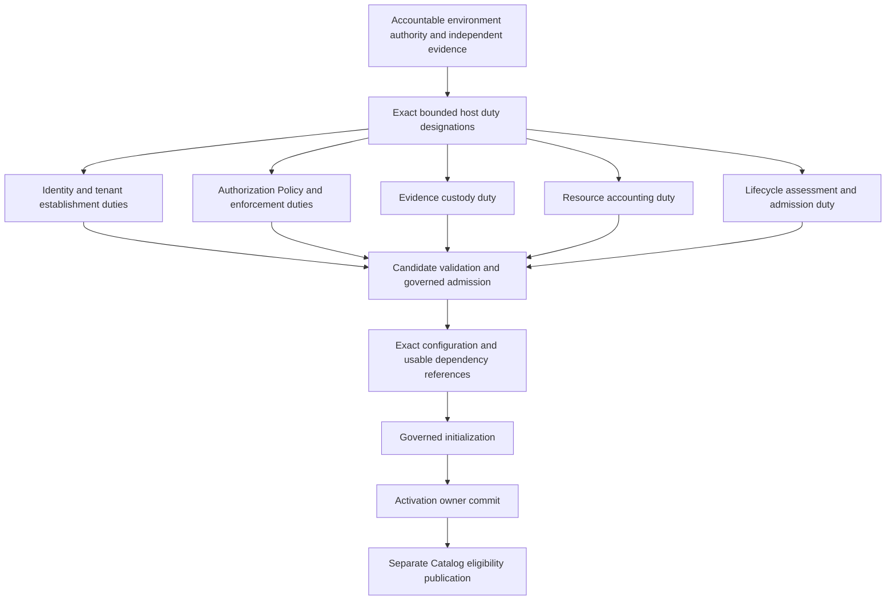

# ADR-006 — Trusted Bootstrap and Contribution Admission Mechanism

**ADR ID:** ADR-006  
**Status:** ACCEPTED — ARCHITECTURE DECISION
**Date:** 2026-09-20  
**Decision class:** B — Required before first reference runtime release  
**Priority:** P1  
**Reversibility:** Type 2  
**Decision owner:** Plugin / Runtime maintainer, with security review  
**Depends on:** ADR-003, ADR-005, ADR-009  
**Relevant accepted substrate:** ADR-004 — owner-local state, retained outcomes and recovery  
**Blocks:** Executable contribution loading, Plugin initialization/activation and trusted bootstrap realization  
**Supersedes / superseded by:** None  
**Acceptance:** Accepted after architectural review on 2026-09-20. Acceptance records the architecture decision; it does not itself admit any Plugin, designate an operational trust root, authorize implementation, or establish conformance or security assurance.

**Authority:** [intent.md](../intent.md) → [SPEC.md](../SPEC.md) → [ARCHITECTURE.md](../architecture/ARCHITECTURE.md) → [CONTRACTS.md](../contracts/CONTRACTS.md) → [PLUGIN-SPEC.md](../plugin-spec/PLUGIN-SPEC.md) → [SECURITY.md](../security/SECURITY.md) → [EVALUATION.md](../evaluation/EVALUATION.md) → [CONFORMANCE.md](../conformance/CONFORMANCE.md) → [ADR-INDEX.md](ADR-INDEX.md) → [ADR-001.md](ADR-001.md) → [ADR-002.md](ADR-002.md) → [ADR-003.md](ADR-003.md) → [ADR-004.md](ADR-004.md) → [ADR-005.md](ADR-005.md) → [ADR-009.md](ADR-009.md) → this ADR.

**Primary drivers:** Architecture §11.3 and AR-12/14–18; CONTRACTS §§26–29, CTR-051 and 054–061; PLG-021–024, 031–050; SEC-054–056; CONF-025–027, 049 and evidence/partial-failure obligations. Q-03 publisher/namespace entitlement is verified locally without creating a universal certification authority. Q-05 authority conflicts and Q-07 guarantee qualification remain with their governing owners. Risks: R-02/R-05/R-08, CR-06/07, trust bootstrap circularity, root compromise, partial activation and publication races.

## 1. Context and closed decisions

The accepted governing documents and ADRs were reviewed in authority order. ADR-009 supplies the mandatory custody mechanism needed before deciding bootstrap. The canonical dependency graph remains unchanged: ADR-006 depends on ADR-003, ADR-005 and ADR-009. ADR-004 supplies already accepted persistence behavior without a new index edge.

The first realization remains Python on conventional GIL-enabled CPython 3.14, one distribution, regular `legoai` namespace, strict logical owners and minimal Kernel. Configuration remains an exact immutable effective revision. Security remains independently rooted, explicitly tenant/Principal scoped, and current at protected boundaries. State and evidence use separate owner-local commits with durable obligations, not a global bootstrap transaction.

An unadmitted candidate cannot establish its own trust, execute arbitrary inspection hooks to prove itself safe, resolve inactive offers as ordinary providers or use successful validation as activation. At the same time, the local reference runtime must start without first requiring a remote IAM/audit system or an infinite chain of Plugins admitting one another.

No substantive upstream contradiction was identified. This ADR introduces no new Plugin states or exceptions to mandatory authority, evidence, resource or isolation requirements. The accepted source decisions remain unchanged; ADR-INDEX's status summary separately records the user's acceptance of ADR-009.

## 2. Decision question and supported scope

How does the runtime establish a minimum usable trusted set of Plugin/Adapter/Provider duties, then admit ordinary contributions through a finite, inspectable and recoverable process?

The initial scope is a local modular monolith, explicit single TenantContext for operational work, deterministic direct Capability and sufficiently trusted executable host/root implementations under ADR-005's threat assumptions. It does not require Agent, Model, Team, Workflow, RAG, persistent Memory, federation, a broker, network discovery, automatic package installation or remote download. Hostile executable Plugins require an appropriately qualified isolation mechanism under ADR-012 before use.

This decision chooses behavioral composition, dependency staging and admission controls. It does not choose a loader library, manifest serialization, package manager, cryptographic format, storage product, sandbox, policy language, credentials or public namespace allocation. Root existence and ordinary Plugin eligibility remain different assertions.

## 3. Alternatives considered

### A — Statically designated bootstrap set

A fixed deployment set makes initialization and dependencies predictable and easy to inspect locally. It avoids dynamic discovery executing arbitrary candidates. However, a hardcoded list alone does not establish who entitled it, the exact code/configuration it covers, its tenant/authority bounds or how its state and evidence recover. Treating membership in a source tree as trust would violate SEC-054–056.

Static selection is useful as a realization detail, not sufficient as the trust mechanism. The selected mechanism keeps an explicit finite set while requiring independently authorized records and exact qualification.

### B — Built-in realizations with owning Plugin identities

Built-ins can expose the same declarations, contributions, versions, limits and evidence as external Plugins while keeping initial deployment simple. This matches ADR-002's local reference modules. The risk is a built-in bypass: assuming the package is safe because it ships with the runtime or publishing its offers merely because it imported successfully.

Built-in attribution is selected, but builtin status alone grants nothing. Initial bounded root duties need independent designation; general-purpose offers still need normal activation/publication. Plugin identity does not become Principal identity.

### C — Externally provisioned bootstrap authority/service

An external administrative service can establish roots independently of candidates and provide enterprise lifecycle controls. It adds availability, network, credential and integration burden and still needs a locally trusted entry boundary to authenticate and interpret its decisions. A compromised external authority is not made harmless by physical separation.

Reject an external running service as a mandatory first-runtime dependency. Independent administrative provisioning remains required and can be local; a later external authority can supply equivalent records through qualified contracts.

### D — Independently provisioned finite local roots plus explicit candidate admission

Select a finite set of exact local reference realizations, each with owning Plugin/contribution identity and a separately authorized host-duty designation. Those already established bounded duties inspect and admit ordinary candidates. Bootstrap assessment handles declarations and stage dependencies without producing executable bindings. No ordinary candidate is executed until its applicable load/initialization conditions are met.

**Select D.** It combines the simple local set of A, attribution of B and independent authority basis of C without requiring an external control service. It adds only the records and controlled handoffs necessary to distinguish established trust from candidate claims.

| Criterion | A — Static only | B — Built-in attribution only | C — External service | D — Selected bounded hybrid |
|---|---|---|---|---|
| Independent authority | Missing unless added | Missing unless added | Possible with verified external basis | Explicit independent provisioning |
| No self-admission | Not guaranteed by a list | Not guaranteed by package identity | Possible; local trust entry still needed | Required at each candidate/root boundary |
| Finite dependency analysis | Simple fixed set | Explicit contributions help | Includes remote authority dependencies | Stage graph plus declared terminal duties |
| Local usability | Best infrastructure simplicity | Simple distribution | Highest initial setup/dependency burden | No required external service |
| Attribution/replacement | Can be hidden constants | Good exact Plugin attribution | Provider mapping/cutover required | Exact Plugin, authority and configuration records |
| Failure/recovery | Easy to overlook | Needs additional state contracts | Network and local partial failures | ADR-004/009 records and obligations |
| Dynamic flexibility | Low | Moderate | High, with governance cost | Explicit additions/requalification; no ambient discovery |
| Threat-scope honesty | Static code is not proof | Built-in is not isolation | Remote is not automatically trusted | Bounded trusted-host scope, stronger cases gated |

No numerical performance or security-assurance scores are claimed. The deciding criteria are finite independent trust, truthful partial failure and manageable local operation, not maximum loading flexibility.

## 4. Decision

Use an **independently designated finite bootstrap duty set, exact built-in Plugin attribution, non-executing descriptor assessment, and explicit owner-governed admission and lifecycle handoffs**.

1. The accountable environment authority independently provisions exact root designations and their supporting evidence before candidate participation.
2. Technical composition loads only those qualified designated host realizations needed for the bounded duties. Their entitlement is external to their self-description, with exact release/configuration/provenance verification and declared loading effects.
3. Plugin Lifecycle records a stage-aware bootstrap assessment over exact declarations, duties and existing usable references. It is not a CapabilityResolution and does not make inactive offers callable.
4. Established duties inspect, validate and admit each candidate; `validate_plugin` returns findings while `admit_plugin` alone commits `validated` under its expected discovered revision.
5. Bind the exact configuration, initialize only with already admitted usable dependencies and current controls, then separately activate and publish eligible offers.
6. Preserve each owner's facts, acknowledgments and unresolved duties. Missing Catalog publication is repaired without repeating initialization; stop/revocation and current eligibility constrain any late publication or use.
7. Recover existing state and roots under their declared guarantees. An unavailable or compromised trust basis cannot be recreated from candidate assertions or current environment defaults.

Root duty authorization is **not** ordinary Plugin eligibility and does not add a root lifecycle state. Only named duty calls are permitted before normal activation. General offers from a root realization require the same ordinary Plugin activation/Catalog path as any other contribution.

## 5. Independently established host record and trusted loading boundary

A host bootstrap record must identify accountable designating authority and independent establishment basis; performing Principal and Actor association; exact owning Plugin/release, contribution, realization/version and applicable contracts; explicit tenant; immutable effective configuration; allowed duties/actions/resources and authority ceiling; dependencies; trust/isolation assumptions; resource/accounting/evidence obligations; validity/revocation; exclusions from ordinary discovery; failure, termination, replacement and recovery behavior; required admission/qualification evidence and its current applicability.

This is the CTR-055/PLG-043 host record, not a new global entity or schema. Shared publisher/contract definitions may have publication scope, but operational use has one verified TenantContext. It is not an implicit host-wide tenant or administrator wildcard. Namespace/publisher entitlement is established by the accountable local authority and verified provenance; a name, import path, installed package or signature without issuer entitlement is insufficient.

The environment's authority is an explicit initial assumption, not appointed by this ADR. Initial trust cannot be derived entirely from the code about to be admitted. Provisioning must designate permitted evidence and assurance/currentness/revocation requirements, then verify the exact selected realization against that basis. Root code can read and retain its designation; reading it does not prove the designation independently authentic or confer new powers.

Technical composition distinguishes **data inspection** from executable import. Descriptor inspection uses already trusted readers and declarative metadata; it does not run candidate activation, initialization, registration or validation callbacks. A format that requires executing candidate Python merely to learn its declaration is unsuitable for initial untrusted inspection. Python imports and entry-point enumeration that executes candidate code cannot be presented as harmless metadata reads.

The initial root implementation set is selected from explicitly designated, qualified local host artifacts and pinned to the corresponding declarations/configuration. Before loading, verify the intended artifact/source association, entitled designation and integrity/compatibility required by that scope. No hash/signature algorithm is selected. The realization must prevent substitution between inspected artifact and loaded code, or detect it and invalidate admission before candidate effects. Unsupported provenance or loading side effects block use.

ADR-002's inert package initializers remain required. Any load-time work that can disclose data, access credentials, mutate external state or allocate governed resources is a declared protected effect; it cannot be hidden in import. Such effects require ordinary current controls and required prior evidence. A bounded local root load must have an independently qualified establishment procedure that actually meets those conditions; this ADR does not assert arbitrary Python code can be verified safe by static metadata.

## 6. Finite duty graph and local establishment order

The initial dependency model has a small independently grounded duty tier and an ordinary contribution tier. It describes authorization/availability dependencies, not a new set of semantic owners or globally atomic startup stages.

The arrows do not imply a universal total order, a global commit, or that all root duties can call one another recursively. The independent authority establishes each root duty and its usable bounded prerequisites; the candidate never supplies an otherwise missing predecessor by asserting its own eligibility.

| Root responsibility | Permitted initial duty | Terminating basis and exclusions |
|---|---|---|
| Identity/Principal and Tenant Governance | Verify designated administration/host identities; bind explicit tenant for named bootstrap operations | Independent accepted identity/tenant establishment basis; no anonymous administrator or arbitrary new Principal |
| Authorization, Policy and Boundary Enforcement | Evaluate exact root/candidate actions against designated scoped rules and current owner state | Independently established issuers/rules/ceilings; no self-grant or candidate-selected policy subset |
| Evidence and Provenance | Commit required root/admission evidence under ADR-009; return exact bounded acknowledgment | Independent custody designation and qualified realization; root attests its record without identical recursive audit approval |
| Resource Admission and Accounting | Account for bounded establishment and supported bootstrap duties | Explicit allocation/accounting basis and finite bookkeeping duties; no unlimited resources or recursive charge-for-the-same-charge chain |
| Plugin Admission and Lifecycle | Inspect declarations, assess graph, record independent admission/lifecycle decisions | Independently designated responsible Principal/realization; cannot approve itself using only its own generated assertion |

Each named responsibility keeps its own owner state and public contract. A single trusted local host may realize several duties, but physical co-location is not independence of assessment, tenant isolation or a shared authority owner. A solo maintainer's review is not described as independent third-party assurance.

To terminate otherwise cyclic governance queries, separate existing facts from new commands. Root duties consume already established exact designations, scoped Policy/identity evidence and bounded accounting authority. Their permitted recording/bookkeeping has an explicitly designated terminal basis; it does not invoke the same admission/Approval/evidence operation recursively. Necessary current checks still apply. If the configured requirements cannot be satisfied without an unresolved cycle, no bootstrap occurs; a root cannot invent an exception or quietly drop a required predecessor.

The local realization first verifies its independent designation set and qualified persistence identity, recovers retained owner state, establishes usable bounded root duties and their required custody, then assesses ordinary candidate closure. Resource and Evidence duties require the actual preservation/authority guarantees selected in ADR-004/005/009; declaring them usable is not proof. Externally effectful initialization cannot proceed until the relevant dispatch/currentness mechanisms are implemented and qualified under ADR-007/008. This implementation gate does not add a backward architectural dependency.

No Secret-bearing bootstrap method is selected. If the chosen verifier, persistence access or root establishment needs Secret material, ADR-010 and its prerequisites must be resolved before that feature is used; treating a bootstrap credential as ordinary configuration is forbidden. Neither missing Secret machinery nor a cyclic audit requirement permits ambient credentials.

## 7. Stage-aware dependency assessment

`assess_bootstrap_dependencies` consumes exact Plugin/contribution/version declarations, stage-specific requirements, existing usable host-duty references, configuration, tenant/trust/isolation constraints and expected graph revision. Its owner is Plugin Lifecycle; it returns recorded order/closure findings, unsupported cycles and unmet conditions. It never returns executable ordinary bindings to inactive offers.

Distinguish declared, inspected, validated, bootstrap-eligible and active eligible contributions under CTR-054. A declared offer is merely an ability claim. A validated contribution is still not an ordinary Provider. Bootstrap-eligible means an independent host admission already permits the exact duty/scope and the realization is already usable for it, not that the graph wishes it were usable.

For each stage, evaluate complete required dependency closure, compatible versions, exact configuration/activation references where applicable, tenant/authority/isolation/resource/evidence constraints and claimed versus verified guarantees. A requirement used only for later runtime invocation need not be an initialization dependency, but it must be met at its own required stage. Do not relabel an actual initialization dependency as optional to break a cycle.

Initial scheduling uses an explicit deterministic order among otherwise independent eligible graph nodes for inspectability. The chosen assessment records that order; no particular sorting syntax or global runtime ordering is selected. Required cycles without already established usable duties fail with safe graph evidence. Optional omission is permitted only where the contract truly allows it, with explicit reason/degradation; omitted dependencies supply no hidden guarantees.

Graph assessment and candidate configuration are revisioned/pinned. Changing release, contribution, configuration, dependency closure, trust, Policy requirement or isolation assumption invalidates affected applicability and requires reassessment. A successful old graph or identical publisher name cannot automatically qualify a new graph. Current dependency validity is checked again at actual initialization/activation, not only when the plan was produced.

## 8. Ordinary candidate admission and lifecycle

| Operation | Required boundary and resulting truth |
|---|---|
| `discover_plugin` | Record authorized visible exact metadata/source; no code execution, trust, installation or eligibility implied |
| `inspect_plugin` | Inspect declarative contributions, contracts, configuration, limitations and evidence without candidate initialization effects |
| `validate_plugin` | Assess full mandatory compatibility, ownership/namespace, closure, config/Secret references, authority/trust/tenant/isolation/resources/extensions/evidence; return findings only |
| `admit_plugin` | Entitled Lifecycle decision using verified evidence and expected discovered revision; commits `validated`, not activation |
| `configure_plugin` | Bind ADR-003 exact non-secret configuration revision and safe Secret references under expected binding revision; no mutable live overlay |
| `initialize_plugin` | Exact validated admission/configuration and already admitted usable dependencies, current controls and required custody; commits permitted initialized/failed outcome with effects and cleanup duties |
| `activate_plugin` | Recheck initialized revision and current full activation closure/health/suitability/authority/evidence; commit active activation reference |
| Catalog publication | Separate Catalog owner operation/acknowledgment over exact activation/contribution; failure leaves explicit obligation |

Validation can prepare candidate configuration/evidence for admission; it does not commit canonical validated state. Bound configuration and permitted operation preconditions follow CONTRACTS §26, not a newly imposed configured/admitted state. Descriptions are data; candidate-generated tests or self-attestations may be inputs only within accepted evidence rules, never a self-issued admission decision. Required independent evidence must come from entitled producers and meet ADR-009 custody where required.

Initialization is real governed work. Declare its action/effect identities, resources, external state, cancellation/cleanup, recovery and uncertainty before invoking it. Preserve exact stage outcomes and prior effects. A timeout is not a reason to rerun an initializer; reconcile or use declared safe equivalent retry under existing contracts. No undeclared network connection, filesystem mutation or credential use is excused as startup plumbing.

Canonical Plugin lifecycle stays exactly:

| From | Permitted next state / condition |
|---|---|
| discovered | validated through admission; retired if unused |
| validated | initialized on successful initialization; failed on initialization failure; stopped by explicit cancellation; retired if unused |
| initialized | active; failed; stopped by explicit cancellation |
| active | degraded; stopping; failed |
| degraded | active with valid recovery evidence; stopping; failed |
| stopping | stopped when disposition completes; failed |
| failed | stopping for cleanup |
| stopped | retired; initialized only through a new validated activation record |

Retired has no reopening transition. Inspect, admit, configure, upgrade, suspend use, health observation and publication are operations, not new states. No installed, configured, bootstrapping, admitted, paused or quarantined Plugin state is introduced. Source effect status remains none/partial/completed/unknown, separately from lifecycle outcome.

## 9. Activation, Catalog publication and stop ordering

Lifecycle owns activation and authoritative lifecycle/health observations; Catalog owns registration, visibility and Provider offer state. Registration may precede activation but does not make an offer executable. Ordinary eligibility requires an active activation, or a degraded activation whose contributions still meet every hard requirement, plus current suitability and required evidence. Provider transitions remain their own canonical relation, not Plugin states.

Activation commits with its required publication obligation under ADR-004. Catalog then checks its expected revision and exact activation/contribution/configuration/health applicability. A lost publication acknowledgment is resolved through retained outcome/status; it does not repeat initialization or create a new activation. Parent result distinguishes active Plugin, published offers, unfulfilled publication and other outstanding postconditions.

If stop/retirement/restriction happens before delayed publication, the old active observation cannot authorize renewed ordinary use. Catalog repair checks authoritative current applicability and publishes only the valid current result; it cannot blindly replay the earlier desired eligible state. A concurrent race still requires current checks at selection/admission/dispatch: publishing a row is not a grant or an irrevocable eligibility guarantee. ADR-007 supplies final stop/revocation-versus-handoff ordering. When that order cannot be established, no new dispatch.

Stop prevents new ordinary work under the affected activation and records explicit per-invocation drain/cancel/permitted-migration/reconciliation treatment. Already released effects and charges remain real; stop acknowledgment cannot claim to undo them. Cleanup/status/evidence duties can remain usable only under separate bounded scope, not by resurrecting ordinary eligibility. Retiring the Plugin cannot delete another owner's resources, Artifacts, Executions or history.

Health reports identify exact activation/contribution, source/time/freshness, observed conditions, limitations and impact; observing health alone does not mutate lifecycle or Catalog. Stale/unverified health cannot satisfy a current hard requirement. Degraded use never silently weakens guarantees, and removing an alarm alone does not restore active eligibility.

## 10. Partial failure, restart and replacement

All lifecycle/admission/graph/configuration changes follow ADR-004 owner-local expected-revision/absence, required immutable facts, retained results and obligations. ADR-009 supplies confirmed pre-effect custody and evidence-only repair. No source commit implies Evidence custody or Catalog publication. An inactive contribution may remain inspectable through safe descriptors; inspection availability is not invocation availability.

After restart, recover exact root designations, owner persistence identity, admission/activation/configuration/dependency history, operation outcomes and unfinished obligations. Verify retained interpretation, integrity and current authority/trust before any protected duty. A record saying active describes committed history, not proof a live object was reinitialized or remains healthy. Do not silently rerun constructors/callbacks to make the record appear true.

The initial runtime promises recovery of authoritative records and obligations, not transparent in-memory Plugin continuation. A lost live instance becomes unavailable for new use while authorized lifecycle/health decisions and reconciliation determine a permitted path. Complete old activation disposition as required; any stopped-to-initialized route uses a new validated activation record and fresh applicability. Unknown initialization/external effects block blind reinitialization. No new recovery state or begun-Execution rejection is invented.

If pinned configuration, code/contract interpretation, evidence or required dependency is missing, dependent use is unavailable. Do not substitute latest, resurrect an expired admission or initialize an empty prior identity. Backup restore follows ADR-004's rollback gate: querying a rolled-back image cannot prove current revocation/consumption. Unaffected dependency closures may remain usable only when their own controls and state are established.

Root replacement is a protected operation authorized by an entitled basis independent of an untrusted replacement. Suspected compromise additionally requires a recovery basis outside the compromised trust root; the compromised verifier or candidate cannot authorize its own successor. If no such basis is available, affected recovery is unsupported and blocked, with safe remaining facts/obligations preserved. This is a limit, not a break-glass exception.

An authorized replacement records exact old/new roots, verified qualification, duty transfer, retained histories/obligations, revocation and descendant reassessment. Prevent two realizations from concurrently assuming incompatible authority over the same owner state. Migrate state under ADR-004 before ordinary target use where necessary; no casual copying of root credentials or live authority. In-flight/unknown effects are reconciled by their existing owners.

Upgrade is new release admission/configuration/init/activation/publication plus separately governed old-version drain/stop/retire. Coexistence requires explicit compatible state ownership, tenant/resource isolation and effect identity semantics; otherwise choose an authorized drain/migration sequence. Rollback is a new currently authorized compatible selection/reactivation, not reversal of external effects, Secret revocation, Approval consumption or state migration. A retired release cannot be reopened by reverting a configuration pointer.

## 11. Failure and race walkthroughs

### Timeline 1 — Ordinary local bootstrap

1. Accountable authority designates exact finite local host duties, explicit Principal/Tenant/configuration and their independent qualification/evidence basis.
2. Qualified technical composition verifies those exact artifacts/records, recovers owner state and establishes only the bounded duties, including required Evidence custody.
3. Lifecycle inspects a deterministic Capability candidate's data and records its stage dependency assessment.
4. Entitled validation/admission, configuration, initialization, activation and Catalog publication occur as separate recorded steps.
5. A verified caller can resolve/use the eligible Capability under current controls; no Agent/Model/Team/Workflow/Memory is required. The candidate never supplies the authority that admits itself.

### Timeline 2 — Dependency cycle

1. A's initializer needs B; B needs A; neither is already admitted usable for that duty.
2. Assessment records the exact required cycle, not an executable resolution to inactive offers.
3. Initialization is blocked. Renaming the edge optional or calling A through an import is not a solution.
4. Only an independently established suitable duty or a legitimate revised declaration/realization can change the assessment; there is no automatic cycle waiver.

### Timeline 3 — Validation is not admission

1. Candidate obtains a positive validation report for release/config/graph R1.
2. Its initializer or caller asks to run before `admit_plugin` commits.
3. Lifecycle refuses: report alone grants neither validated state nor executable use.
4. Concurrent candidate changes invalidate R1 applicability; later admission uses exact current required evidence and expected revision.

### Timeline 4 — Partial initialization and lost response

1. Initialization has declared effect identities, durable intent/cleanup/evidence duties and required current gates.
2. A sub-effect completes, but a later dependency fails or response is lost.
3. Preserve completed/unknown effect and liabilities; record canonical initialization failure when established, with outstanding reconciliation/cleanup.
4. Restart inspects exact retained operations/provider evidence, not automatically repeating initialization. Repair of missing evidence cannot rerun the producing action.

### Timeline 5 — Active, publication failed

1. Lifecycle commits active L8 and publication obligation P1.
2. Catalog is unavailable, or it commits but the response is lost.
3. Caller receives truthful active-plus-incomplete-publication status; no claim all offers are visible.
4. Current authorized repair queries/retransmits the same Catalog operation within coverage; it never repeats initialization or allocates another activation merely to obtain an acknowledgment.

### Timeline 6 — Delayed publication versus stop

1. Publication for active L8 is delayed. Lifecycle commits stop against L8, preventing new ordinary use.
2. Delayed publisher attempts to make the offer eligible using only old evidence.
3. Current applicability checks reject/withhold stale eligibility; concurrent use must still satisfy authoritative stop/order at its protected boundary.
4. Cleanup/withdrawal repair proceeds under its own bounded duty. No stale projection revives stopped work.

### Timeline 7 — Root/evidence cycle or outage

1. Candidate Policy/Evidence implementation requires its own unestablished approval/custody path to admit itself.
2. No independent usable terminating root exists, or required root custody is unavailable.
3. Dependent bootstrap stops with safe failure/obligation evidence where possible; there is no self-declared audit exception.
4. An independently entitled establishment can later resolve the missing basis. Optional telemetry cannot substitute for mandatory evidence.

### Timeline 8 — Compromised root and recovery

1. A root verifier/custodian is suspected compromised; historical accepted records alone cannot establish current trustworthy authority.
2. Affected future duties and dependent ordinary use are gated; known in-flight effects/history remain attributed with limitations.
3. An independent entitled recovery authority may qualify a replacement, preserve/migrate obligations and reassess descendants.
4. Without a trustworthy independent recovery basis, affected service remains unavailable; no dependent Plugin promotes itself to root.

### Timeline 9 — Restart with missing exact configuration

1. Activation references R1, but after restart only current environment R2 is available.
2. Runtime retains the historical R1 reference and reports dependent use unavailable.
3. It does not bind R2 to the old activation or rerun code under old authority.
4. A separately governed new compatible activation may be created using R2 only after current admission, migration and effect-safety obligations are resolved.

### Timeline 10 — Competing lifecycle mutations

1. Stop and degrade both expect active L8.
2. One owner-local permitted transition commits; the other receives Conflict with no requested overwrite.
3. Retry with the same equivalent operation returns its authorized retained outcome if already committed, not a second transition.
4. Further intent uses current lifecycle rules; neither action changes previously observed effects or another owner's records.

## 12. Security, resources and errors

| Threat/failure | Required treatment |
|---|---|
| Self-admission or self-issued root designation | Reject; independent entitled authority and evidence required |
| Publisher/namespace spoofing or artifact substitution | Verify scoped entitlement and exact declaration-to-code association; invalidate affected assessment/load |
| Malicious inspection callback/import side effect | No candidate execution for metadata; any actual executable load/effect requires qualified scope and controls |
| Tenant confusion / root wildcard | Explicit operational TenantContext and duty scope; no implicit host/default tenant |
| Stale admission/config/health/Policy evidence | Reassess exact applicability and current controls before protected use |
| Overbroad root/deputy credentials | Only designated duty/acting-chain ceiling; no ordinary admin or general Provider eligibility inferred |
| Shared-host hostile code | Package boundaries are not containment; qualify isolation or refuse expanded threat scope |
| Catalog lag and late publication | Authoritative current lifecycle and protected-boundary ordering govern use |
| Mandatory evidence outage / unresolved trust cycle | Fail dependent protected work closed; preserve obligations and truthful uncertainty |
| Root compromise / storage rollback | Independent recovery/currentness basis or blocked affected scope; no self-repair authority |
| Resource exhaustion / infinite bootstrap retries | Explicit limits/current accounting, bounded retries and authorized disposition; no startup resource exemption |
| Diagnostic disclosure | Current authorized scoped views; no credential, private tenant or dependency existence leakage |

Use existing canonical errors: ValidationError for invalid mandatory declarations, VersionMismatch for incompatible interpretation, AuthorizationDenied/TenantViolation for authority/scope, PolicyViolation for unsatisfied mandatory controls, CapabilityResolutionError/DependencyFailure for closure/cycles/unavailable prerequisites as applicable, Conflict for stale revisions/equivalence, BudgetExceeded/DeadlineExceeded for bounds. PluginFailure is used when no more specific category explains the Plugin failure. Do not flatten unknown effects into no effect or treat every failure as generic PluginFailure.

Admission evidence distinguishes producer claims, verified findings, required custody and actual deciding authority. Evaluation/Conformance evidence supports assessment but cannot issue Permission or admit a Plugin. No raw Secrets or private reasoning in descriptors, ordinary logs or audit; diagnostic access itself is governed. Root resource bookkeeping and evidence chains must remain finite and attributable. Unsupported required guarantee blocks scope rather than lowering the standard.

## 13. Package and implementation boundaries

`legoai.plugins` retains public Plugin/SPI contracts; `legoai.reference.plugins` implements Lifecycle/assessment/admission. `legoai.reference.application` owns configuration composition, while the private runtime composition root performs technical wiring. Catalog/Resolution, Governance, Evidence and Resources remain in their ADR-002 owner locations with permitted contract dependencies. Kernel holds shared semantic anchors, not a loader, trust registry, admission engine or root database.

Built-in contributions are declared under explicit owning Plugin/release identities even when implemented in the same distribution. No exact public identifier scheme or new package is selected here. Python module import order and distribution membership are not lifecycle/authority. The runtime facade cannot bypass direct Port enforcement; no dynamic scanning/import mechanism is selected. Foreign owner facts are referenced through their contracts, not peer implementation state.

## 14. Seven solo-developer burdens, consequences and migration

| Burden | A — Static only | B — Built-in only | C — External service | D — Selected |
|---|---|---|---|---|
| Implementation complexity | Small list, incomplete trust model | Attribution simple, root gap remains | Adapter/protocol and local entry complexity | Moderate finite records/assessment using existing owners |
| Operational complexity | Minimal infrastructure | One distribution | External dependency setup/outages | One local realization; explicit bounded provisioning |
| Maintenance burden | Hidden assumptions easy to stale | Release/declaration alignment | Provider evolution and trust cutover | Exact release/config/graph evidence requalification |
| Testing burden | Still requires authority/failure cases | Same plus builtin/no-bypass checks | Adds network/root failure cases | Finite root/cycle/lifecycle/race/recovery cases |
| Local-development burden | Lowest convenience, unsafe if implicit | Easy packaging | Highest setup dependency | Explicit tenant/admin/root setup; no remote service required |
| Deployment burden | Static release coordination | Coupled distribution | Service availability/credentials | Qualified local artifacts/state; future adapters optional |
| Learning curve | Easy list, misleading eligibility | Plugin attribution familiar | External protocols plus semantics | Clear duty versus ordinary eligibility distinction |

Positive consequences: finite independently grounded startup, exact attribution for built-ins and replacements, recoverable partial activation, no hidden inactive-provider binding, and a minimal direct Capability path. Negative consequences: explicit provisioning and version/evidence administration, more visible partial obligations, conservative startup availability and less dynamic discovery convenience. Performance/setup-time claims need later measurements.

Accepted limits: trusted shared-process scope is not hostile-code isolation; a compromised root may make recovery unavailable; pinned historical code/config/evidence can become unavailable under declared policy/failure bounds; state/custody sharing has correlated failures; downstream dispatch/Secret mechanisms still gate implementation. Mitigate through exact bounded designations, independent qualification/recovery, current guarded owner operations, declared retention, durable repair and rejection of unsupported guarantees.

Type 2 describes replacing the bounded bootstrap composition/loader behind existing contracts, not cheap rewriting of security history. A future explicit external provisioning or different loader can preserve host-duty records, Plugin identity/release, source/activation/config references, admitted constraints and pending effects/obligations. Qualify its inspection, code-integrity, authority and failure behavior before cutover. State transfer follows ADR-004; custody follows ADR-009. Changed authority basis requires entitled root replacement, not a configuration-only swap.

Prefer quiescent, guarded migration for the first realization where changing roots/state ownership; prevent two incompatible active authorities. Preserve historical root designations and supported interpretation under policy. Reversing after new effects/state changes is another authorized reconciliation/migration, never a return to an old snapshot pretending nothing occurred.

Reconsider on a demonstrated need for external federation/provisioning, independently hosted roots, dynamic third-party discovery, larger dependency graphs, hostile Plugin support, distributed/remote initialization or measured startup/recovery bottlenecks. Stronger demands require new qualification or a superseding decision where semantics change; they do not justify preemptive infrastructure now.

## 15. Future proof, downstream boundaries and acceptance

No bootstrap code, experiments, schemas, tests, credentials, Plugin installations or conformance claims are produced in this task. Future implementation proof must exercise exact artifact/descriptor binding, forged designation, wrong tenant, self-admission, inactive offer use, staged dependency cycles, descriptor inspection without executable callbacks, required evidence outage, initialization partial effects, lost outcomes, activation/publication/stop races, restart, root compromise, finite accounting/audit chains and safe replacement. Prove both facade and direct Port boundaries and state actual failure/threat coverage.

ADR-007 still chooses dispatch/resource/Approval/effect ordering. ADR-008 still chooses broader retry/equivalence/provider reconciliation. ADR-010 still chooses Secret resolution/material and is required before any Secret-bearing root feature. ADR-011 still chooses release evidence/compatibility workflow; ADR-012 hostile isolation and ADR-013 diagnostics remain separate. ADR-006 provides their exact root/contribution/lifecycle inputs without choosing their mechanisms.

| # | Review criterion | Outcome |
|---|---|---|
| 1 | Authority and canonical dependency graph preserved | Satisfied — §§1–2 |
| 2 | Concrete mechanism and alternatives assessed | Satisfied — §§3–4 |
| 3 | Roots independently grounded and bounded | Satisfied — §§5–6 |
| 4 | No candidate or Policy/Evidence self-admission | Satisfied — §§5–8 |
| 5 | Built-ins retain owning Plugin identity | Satisfied — §§4–5, 13 |
| 6 | Explicit Principal/Tenant and no ambient root authority | Satisfied — §§5–6 |
| 7 | Inspection does not execute candidate effects | Satisfied — §5 |
| 8 | Exact code/configuration/provenance binding | Satisfied — §§5, 7–8 |
| 9 | Bootstrap assessment not executable resolution | Satisfied — §7 |
| 10 | Declared/validated/duty/ordinary eligibility distinct | Satisfied — §§4, 7 |
| 11 | Already usable initialization dependencies | Satisfied — §§6–8 |
| 12 | Unsupported dependency/evidence cycles rejected | Satisfied — §6; timelines 2, 7 |
| 13 | Finite evidence/resource duties, no self-exemption | Satisfied — §6 |
| 14 | Validation report separate from admission | Satisfied — §8; timeline 3 |
| 15 | Canonical Plugin states/transitions retained | Satisfied — §8 |
| 16 | Initialization effects/retries governed | Satisfied — §§8, 10 |
| 17 | Activation and Catalog publication separate | Satisfied — §9 |
| 18 | Stale publication cannot revive stopped work | Satisfied — §9; timeline 6 |
| 19 | Current health/degraded suitability explicit | Satisfied — §9 |
| 20 | Stop preserves in-flight effects and obligations | Satisfied — §§9–10 |
| 21 | Owner-local revisions and partial facts preserved | Satisfied — §10; timeline 10 |
| 22 | Lost acknowledgment does not repeat initialization | Satisfied — §10; timelines 4–5 |
| 23 | Exact restart or explicit unavailability | Satisfied — §10; timeline 9 |
| 24 | Compromise recovery independent or unsupported | Satisfied — §10; timeline 8 |
| 25 | Replacement/upgrade/rollback preserve history | Satisfied — §§10, 14 |
| 26 | Direct Capability independent of AI drivers | Satisfied structurally — timeline 1 |
| 27 | Trusted-host/isolation limits honest | Satisfied — §§2, 12 |
| 28 | No vendor/loader/format/Secret mechanism selected | Satisfied — §§2, 5–6 |
| 29 | Seven solo burdens assessed | Satisfied — §14 |
| 30 | Migration and reconsideration addressed | Satisfied — §14 |
| 31 | Downstream mechanisms remain undecided | Satisfied — §15 |
| 32 | Acceptance not implementation/conformance proof | Satisfied — metadata and §15 |

“Satisfied” assesses the decision document and required proof boundary, not an implemented bootstrap system. Acceptance confirms the documented architecture decision only. The bootstrap, admission, loading, lifecycle, recovery, and isolation realizations remain unimplemented and unverified for conformance or security assurance. **Recommended next action:** canonical review of ADR-006, particularly independent root establishment, finite duty termination, candidate loading scope and stale publication handling. After acceptance, proceed to ADR-007. No implementation or further ADR is created here.
