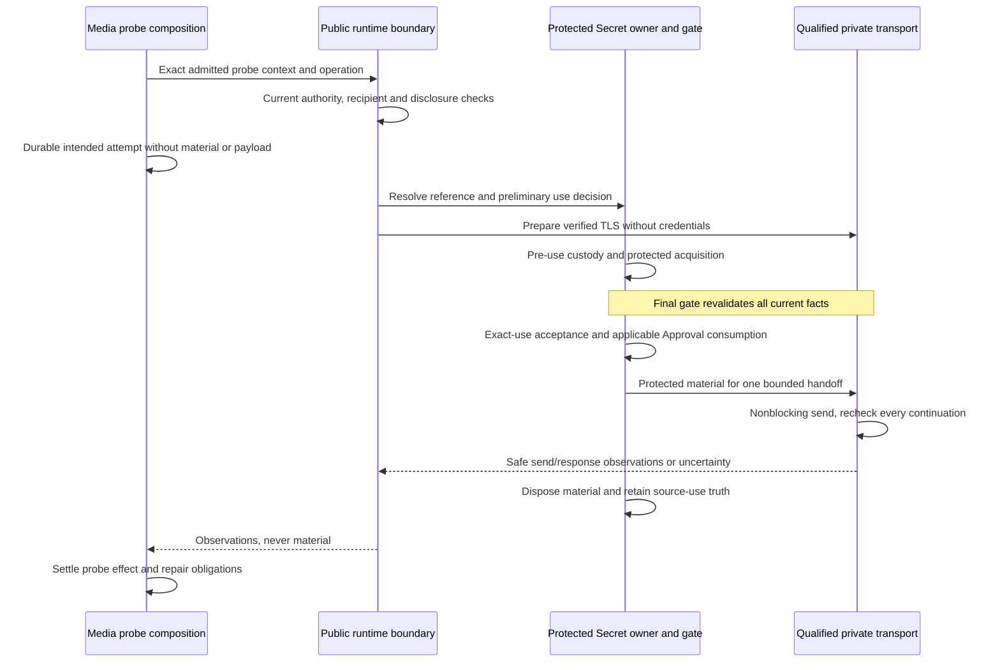

# ADR-027 — Generative Media purpose-bound probe credential profile

Status: Proposed
Readiness: Blocked — ADR_027_BLOCKED, reviewed 2026-10-12; five architecture blockers remain.
Readiness record: [GENERATIVE-MEDIA-ADR-027-READINESS-REVIEW-1](../planning/GENERATIVE-MEDIA-ADR-027-READINESS-REVIEW-1.md).
Current prerequisite snapshot: ADR-026 Accepted; public facade and media migration locally qualified; M-01 and M-04 CLOSED; H-01 OPEN. Historical context below is unchanged.
Readiness validation: Maintainer-run validate_generativemedia_adr_027_readiness_review_1.py succeeded; local document checks only. No acceptance, implementation or live execution authorized.
Date: 2026-10-11
Decision owner(s): Security / Secret Access / Runtime / Generative Media maintainer
Class / priority: C / P2 — before credentialed media provider-control support
Reversibility: Type 2 — bounded profile; effect/use history survives replacement
Governing requirements: SECURITY 0.1.0 SEC-020/037/057-060/066-067/075/077/081; CONTRACTS 0.1.0 CTR-039/040 and effect/evidence contracts; ADR-010 sections 5-15
Related questions/risks: H-01 ambient credentials; M-04 early discovery; Q-07 currentness evidence; timing residual and confused deputy
Depends on: ADR-002, ADR-003, ADR-005, ADR-006, ADR-007, ADR-008, ADR-009, ADR-010, ADR-014, ADR-015, ADR-020, ADR-023, ADR-024; ADR-026 for planned integration; explicit upstream amendment authority
Blocks: Media probe credential provisioning, protected handoff and qualification
Supersedes / superseded by: None currently; proposed separate profile exception to ADR-007/010, not replacement of Model SRCP-1

## Context

[The validated boundary proposal](../planning/GENERATIVE-MEDIA-GOVERNED-HOST-SECRET-BOUNDARY-1.md)
identifies H-01: media `env:` lookup supplies raw tokens without a current
purpose-bound use boundary. M-04 allows discovery before remote VTO refusal.
Its document checks passed per maintainer evidence; this ADR's validation remains
pending. Baseline: `c7cf5f68e029a596077c4a47c9bfea6179c6747c`.

This is separate from [ADR-026](ADR-026.md). A secret-free public execution facade
can ship if this profile is rejected. Security evidence and exception review here
are independent of eliminating private coordinator imports. Planned integration
still requires ADR-026 or another separately accepted public boundary.

## Decision question

How should an attended single-operator media probe use one exact credential
revision with current purpose/recipient authority and truthful handoff evidence,
without exposing material or silently inheriting Model SRCP-1? This is a probe
profile, not a generic HTTP credential service or all-media authorization.

## Decision drivers

Mandatory: current exact authority, source/reference separation, recipient binding,
safe evidence, no ambient authority or blind resend, honest timing/remote-state
limits. Prefer reuse after scope review over inventing a broker or asserting an
unproved stronger guarantee. REUSE > EXTEND > CREATE.

Recommend Option A: distinct media-probe profile MPBP-1, conditionally adopting
the specifically reviewed SRCP-1 timing residual. This is a new named scope;
media is not relabeled as a Model operation.

## Constraints

No production implementation authorized. No live execution authorized.
Remote personal-image VTO remains unsupported.
Model SRCP-1 is unchanged; media cannot inherit it by analogy.

| Dependency | Relationship | Clause and interpretation |
| --- | --- | --- |
| [ADR-002](ADR-002.md) | PRESERVED | Sections 11-12: safe public contracts, private protected realization; public composition follows ADR-026 if accepted |
| [ADR-005](ADR-005.md) | PRESERVED | Sections 10-12: exact principal/tenant/action and requester/deputy intersection; cached allow is not a permit |
| [ADR-007](ADR-007.md) | REQUIRES_ADDENDUM | Sections 6.2, 8, 18 permit nonblocking credential handoff/time exception only for SRCP-1; MPBP-1 needs explicit scope approval |
| [ADR-008](ADR-008.md) | PRESERVED | Exact use/attempt correlation; lost acknowledgement stays unknown; inspect, never resend for repair |
| [ADR-009](ADR-009.md) | PRESERVED | Pre-use custody and post-use source attribution; evidence failure cannot erase effects |
| [ADR-010](ADR-010.md) | REQUIRES_ADDENDUM | Section 8.2 step 5 and section 23's SRCP-1-only exception need a separate MPBP-1 timing exception; retain all other use obligations |
| [ADR-014](ADR-014.md) | PRESERVED | Section 14.18 stays Model-only; public media integration follows ADR-026 separately, not Model settings or host widening |
| [ADR-015](ADR-015.md) | PRESERVED | Bounded supervised work, cancellation and no background credential sessions |
| [ADR-020](ADR-020.md) | PRESERVED | Decision 8 and separate effects remain: no remote source-image upload, garment upload or VTO job submission |
| [ADR-023](ADR-023.md) | REQUIRES_ADDENDUM | Sections 7-8, 11-12: separate qualification required; cross-reference MPBP-1 without broadening SRCP-1 or Model source API |
| [ADR-024](ADR-024.md) | PRESERVED | Section 14: Model disclosure admissions/classes cannot authorize media |

ADR-003 configuration and ADR-006 finite bootstrap also remain. ADR-026 is
Proposed, not presumed accepted. Configuration != authorization. Approval !=
Permission. No runtime success or synthetic test accepts these proposals.

### Blocked amendment scope

Option A's protected handoff is Blocked pending Security/Runtime approval of
the following exact changes. Record status remains Proposed; the affected option
is not Ready for Decision. Under ADR-INDEX sections 1 and 14 a candidate cannot
approve its own upstream amendment.

| Target | Proposed acceptance content / exit condition |
| --- | --- |
| ADR-010 section 8.2 step 5; new addendum alongside section 23 | For MPBP-1 only, replace demonstrated check-to-handoff wall-clock bound with qualified configured margin at final check, domain-ordered expiry and late-handoff detection/recording. Retain local invalidator ordering and every other Secret invariant. Strict real-time scopes unsupported |
| ADR-007 sections 6.2 item 7 and 8; new addendum alongside section 18 | For MPBP-1 only, admit one nonblocking credential-bearing OS send inside the ordered section, no wait/callback; recheck every continuation. Reference only the newly accepted MPBP-1 time exception; all other network I/O stays outside |
| ADR-023 sections 11-12 | Cross-reference ADR-027/MPBP-1 for media probe reuse and its own qualification. SRCP-1 remains Model-only; transfers/jobs stay outside its qualification |

These are draft terms in a new ID, not edits to accepted files. Accepted reasoning
remains immutable. Approval must record the limited extension/replacement and
reciprocal metadata with audit history, not supersede whole ADR-007/010/023.
If upstream owners reject the exception, Option A cannot proceed: require a
separately proved stronger mechanism or defer. No ADR-020 amendment is proposed.

## Considered alternatives

### Option A — Separate exact-use probe profile with reviewed residual

Benefits: smallest protected media operation; reuse without qualification by
analogy. Costs: source admission, transport, custody and exception review. Risks:
silent widening into arbitrary HTTP or concealed timing assumptions. Conformance:
blocked on explicit amendments and profile evidence.

Solo burdens: implementation adapts private source/handoff; operations need
attended provisioning/custody; maintenance tracks a distinct profile; testing needs
race/restart/recipient/canary fixtures; local development uses authorized synthetic
servers; deployment adds no broker but needs protected custody; learning includes
limited time/remote-state guarantees.

#### Operation scope

Initial implementation scope: provider-control/probe only.
One explicitly selected media protocol family and configured provider/binding;
one bounded credentialed exchange. Multi-request auto-family discovery is
unsupported in MPBP-1. No retry, alternate family/provider/origin, credential
fallback or uncredentialed fallback after refusal.

The first probe is read-only, empty-body, HTTPS bearer-authenticated, with a closed
driver-owned method/path and bounded structured metadata response. Before coding,
the selected family must specify exact route, framing/schema and numeric request,
response and time limits. No endpoint is claimed qualified here. A family needing
multiple requests or unsupported wire semantics needs another reviewed scope;
it cannot silently call that one exchange. No caller URLs, paths, arbitrary
headers, images, prompts, repository content or job identifiers.

Media action meanings remain probe, source-upload, reference-upload, submit,
observe, retrieve. Only probe is included. The other five credentialed actions
remain unsupported until their own bounds/effect evidence and scope decisions.
Successful probe does not authorize text-to-image submission. Remote personal-image
VTO remains independently blocked by ADR-020.

#### Ownership and exact-use contract

Runtime composition integrates Secret Access with admitted media composition.
Public surfaces carry safe references/operation facts/observations. Material,
source acceptance, ordering domains and transport stay private. The protected
consumer is the qualified concrete transport, never a callback or exported handle.

Reuse `Principal`, `TenantContext`, `SecretRef`, `SecretRevisionRef`,
`SecurityContext`, `OperationRef`/`OperationId`, `ExecutionContext`/`ExecutionId`,
consumer identity/version, configuration, grant/policy and evidence references.
Purpose fields are currently strings; security meaning is the complete typed
binding. Trusted composition selects a closed media-probe purpose and consumer,
not arbitrary caller prose or `remote-model-bearer`.

An exact use binds requester/actor, tenant, contribution/version, configuration,
probe operation/execution, attempt/use ID, exact Secret revision/mapping, admitted
provider/origin/API root/method/path, current Grant/policy/Approval, deadline and
validity window. One use permits one exchange; continuations recheck currentness.
Every fresh operation needs fresh permission and use identity.

Proposed source is S1-style hidden interactive provisioning by the source itself,
returning only an owner-issued exact reference. Media mapping needs separate
admission/qualification; Model `CredentialSource` is not silently repurposed.
Immutable material lives only in one process incarnation with no persistence,
export or consumer cache. Rotation creates a revision and retires the old in the
ordering domain. Retire/close stops new realization and writes, not already sent
bytes. Any future environment material source requires its own accepted decision.

Raw env lookup is not permission. SecretRef alone is not permission.
`authorize_secret_use` alone is not protected acceptance. No ambient environment
bootstrap, SDK default credential, material fingerprint, reusable bearer object,
public raw Secret/material callback or application material handle is approved.
No generic HTTP transport authority is approved.

Model-specific CHAT/EMBEDDING, `ModelPurpose`, model identifiers, OpenAI-compatible
serialization, `RemoteModelRuntime`, disclosure and attempt schemas stay Model
owned. Media evidence must not invent dummy model identities. Core receives no
image/workflow/job semantics through this probe profile.

Allowed consumers: trusted media provider composition through an accepted runtime
boundary. Implementation candidates: private S1/T2, qualified for this scope.
Substitution requires equal currentness, recipient, use and evidence guarantees;
HTTP similarity is not sufficient. No new universal transport Port is justified.

#### Protected use and effect sequence

Reference resolution, source material acquisition, use authorization, protected
handoff, send and media effect are separate facts. Acquisition is short-lived
near use; slow preparation/evidence I/O stays outside the gate. A point-in-time
allow cannot be replayed at acceptance. Final checks cover current permission,
source revision, all applicable controls and the actual operation/recipient.

Required invalidators share the order: applicable principal/tenant eligibility,
Grant/policy/Approval, binding/catalog suitability, Secret mapping/revision/retirement,
cancellation, expiry and source teardown. If any mandatory participant cannot
join that order, use is unsupported. No arbitrary callbacks in the final gate.
DNS/connect/TLS/readiness/response waits are outside it. Verified TLS precedes
credential realization. No redirect, proxy, alternate target, connection pool,
credential caching in caller/adapter or credential-bearing replay.

Durable intended media attempt precedes handoff and contains safe exact IDs,
recipient/action/configuration/Secret/disclosure-admission references, deadlines,
send/response observations and time violations. No raw bodies, authorization
headers, material, material hashes or personal data in evidence/diagnostics or
exception chains. Source acceptance and transport outcome remain distinct.
A complete rejection after send is still Secret use. An unresolved claimed
attempt after crash is UNKNOWN, not zero send. Recovery inspects and repairs;
it never reconnects, re-realizes or repeats an effect. Later queries need new
authority. No blind retry, fallback or deletion guarantee.

#### Currentness and failure semantics

Recommend timing choice A only with explicit amendment approval: strict local
event order, but no guaranteed wall-clock validity at actual OS handoff. Require
qualified configured margin at final check, domain-ordered expiry and late-use
observation. Late use is detected, not prevented. No hard real-time guarantee.
No equivalent order against independently changing remote provider state.
Recipient must be issuer or explicitly admitted designated service.

Denied/unavailable mandatory controls block new protected send. Proven zero send
differs from partial/all/unknown. Cancellation stops future work/writes, cannot
retract credential disclosure or prove no provider logging. Timeout does not
imply no effect. Complete response is a protocol observation, not provider
qualification or future authorization. No memory-zeroization or hostile in-process
isolation claim; public APIs are not a sandbox against trusted-code compromise.

### Option B — Require the unmodified handoff-time guarantee

Benefits: no timing exception. Costs: demonstrated check-to-handoff time bound
and mechanism proof not available for media. Risks: false stronger promise.
Conformance: block until proved, not until a more recent clock read is added.

Solo burdens: implementation needs timing research; operations preserve assumptions;
maintenance requalifies platform changes; tests cannot prove an absolute scheduler
bound alone; local development cannot waive it; deployment restricted to proved
environments; learning needs timing expertise. Revisit if workload rejects A and
stronger evidence becomes available.

### Option C — External credential broker

Benefits: material can stay elsewhere. Costs: another authenticated protected
boundary. Risks: unprotected loopback proxy becomes an ambient credential service.
Conformance: broker availability/possession is not requester authority.

Solo burdens: implementation adds protocol/authentication; operations another
service; maintenance two releases; testing two trust domains; local development
broker setup; deployment secure bootstrap/networking; learning broker policies
and failures. No current need justifies this additional boundary.

### Do nothing / defer

Benefits: no unproved exception. Costs: H-01 remains; no governed credential support.
Risks: legacy functionality mistaken for qualification. Conformance: valid interim
restriction pending amendment authority. Solo burdens: no implementation; operations
retain limitations; maintenance records debt; testing adds no qualification;
local development retains secret-free flows; deployment excludes the new profile;
learning must distinguish legacy behavior from approved support.

### Design-principle comparison

| Principle | A: scoped probe | B: stronger proof | C: broker | Defer |
| --- | --- | --- | --- | --- |
| SRP | Gate distinct from media | Same owners, new proof | Extra authority boundary | Existing gap |
| OCP | Later profiles separately reviewed | Platform proof may change | Protocol evolves independently | No improvement |
| LSP | Equal guarantees required | Stronger guarantee must be real | Cross-service evidence difficult | No qualified substitute |
| ISP | Probe only | No extra operation required | Broader service unnecessary | No new surface |
| DIP | Public refs, private material | Same public contracts possible | New service dependency | Raw transport retained |
| DRY | Reuse semantics, separate evidence | New enforcement proof | Duplicated authority risk | H-01 persists |
| KISS | Small bounded first use | More complexity without need | More moving parts | Temporary restriction simplest |
| YAGNI | Real probe need, no HTTP framework | Do not invent stronger platform | No current broker need | No speculative code |
| SoC | Source/authority/send/effect distinct | Separation possible | Must preserve across services | Current separation missing |
| Law of Demeter | No private object access | Same facade possible | Another facade needed | Legacy internals retained |

## Evidence

Accepted evidence: ADR-005 sections 11-12; ADR-007 section 18; ADR-010 sections 8/23;
ADR-023 sections 7-12; ADR-024 section 14; ADR-020 decision 8. ADR-023 contemplates
credential-primitive reuse but excludes media transfer/job qualification and
ComfyUI from its actual scope.

Source inspection: [media service](../packages/legoai-generative-media/src/legoai_generative_media/service.py),
[discovery](../packages/legoai-generative-media/src/legoai_generative_media/discovery.py),
[Secret values](../src/legoai/governance/secret.py),
[SecretAccessPort](../src/legoai/governance/ports.py),
[Model exact use](../src/legoai/runtime/_composition/remote_model.py),
[private handoff](../src/legoai/runtime/_composition/secret.py),
[transport integration](../src/legoai/runtime/_composition/credential_https.py).
Model code supplies no media wire-shape, recipient or disclosure qualification.
No tests, validator, external network or provider calls were run in this slice.

## Decision

Pending maintainer decision. Recommendation: Option A.
One proposed profile choice. Its upstream timing/handoff exception scope is
Blocked until approved; no acceptance or support claim is recorded.

## Consequences

### Positive

Bounded route to H-01 correction without material exposure or claiming all media
shares Model semantics. Failed permission cannot fall through to environment keys.

### Negative

Initial scope cannot authenticate multi-request auto-discovery or generation jobs.
Provisioning/custody adds operator work. Later operations need evidence, not just
more vocabulary values.

### Risks accepted

None accepted by this draft. Security/Runtime owners must approve proposed limits:
possible wall-clock expiry at handoff, remote revocation outside local order,
retained transmitted bytes, trusted-process memory limits and provider logging.
Strict timing, hosted/multi-tenant, unattended, streaming and hostile-plugin scopes
remain excluded. A changed requirement reopens review.

## Migration / reversibility

Accept architecture/amendments; separately authorize M-04-only
`GENERATIVE-MEDIA-CONSTRUCTION-ADMISSION-1`; implement ADR-026 facade; migrate
private media imports; then separately implement/qualify MPBP-1. Acceptance is
not implementation authorization.

M-04 contract: unsupported remote VTO refuses before credential resolution,
transport construction, discovery, workflow loading and personal-image handling.
Provider diagnostics remain a separate explicit operation. No M-04 code here.
Credentialed upload/submission/observation/retrieval are later separate scopes.
ADR-020 still blocks remote source-image upload, remote garment upload and remote
VTO job submission independently of credentials.

Preserve Model public behavior, media requests/results, secret-free local media,
local ComfyUI VTO, one-submission/no-retry and reconciliation truth. Later refuse
raw `env:` material on governed paths and stop implicit constructor discovery.
No unsafe compatibility fallback. Replace source/transport only while retaining
exact use/revision history, prior effects and custody duties; no persisted
material or replayable authority migrates.

## Security impact

Independent gates: requester/tenant, current invocation/probe permission, admitted
contribution, provider-control disclosure, exact Secret use, resources and evidence.
A login success or known reference grants none of the others. Admitted recipient
mapping is not defined by driver-supplied URLs. Missing policy/evidence refuses use.

Probe sends no personal image/model input, but needs a media probe admission
binding recipient, operation and allowed data. Model disclosure is not copied as
media authority. No public raw Secret/material callback approved. No universal
generic capability host approved. No media semantics in Core or Model semantics
in media. Secret possession/resolution != authority.

## Resource impact

One exchange; bounded response and total/request time; explicit finite custody
capacity and retention. Unavailable mandatory custody/budget refuses use. No
worker, broker, pool, session renewal or automatic retry. Exact numerical limits
and route are pre-implementation review inputs, not measurements claimed here.

## Conformance impact

Future synthetic evidence: wrong principal/tenant/purpose/recipient denial;
reference-only source; rotation/retirement; expiry/margin; cancellation/revocation
before/after handoff; continuation gates; no ambient proxy/redirect/fallback;
single attempt; bounded framing; safe diagnostics; source close; custody failure;
lost acknowledgement/restart without resend. Negative controls for forbidden
media actions and multi-request discovery. Model regression evidence is not enough.
No named provider, live compatibility, image disclosure, model quality or production
assurance is qualified by the document validator.

## Follow-up decisions and implementation gates

Security/Runtime owners decide the amendment table; Architecture approves public
integration; media owner selects exact single-exchange route/response/disclosure
contract; Secret Access owner approves source mapping/invalidator participation.
Maintainer approves numeric limits and separately authorizes code, synthetic
qualification and any future live work.

Unresolved: acceptance of the distinct wall-clock residual; availability of a
sufficient single-exchange family probe; complete local invalidator ordering;
exact safe operator source/disclosure contract. Until resolved the affected scope
is blocked. No production implementation authorized. No live execution authorized.

## Acceptance record

Pending. Decision-maker: not recorded. Acceptance date: not recorded.
Document validation: pending maintainer execution for this ADR slice.
Upstream amendments: not approved or applied. No qualification recorded.
