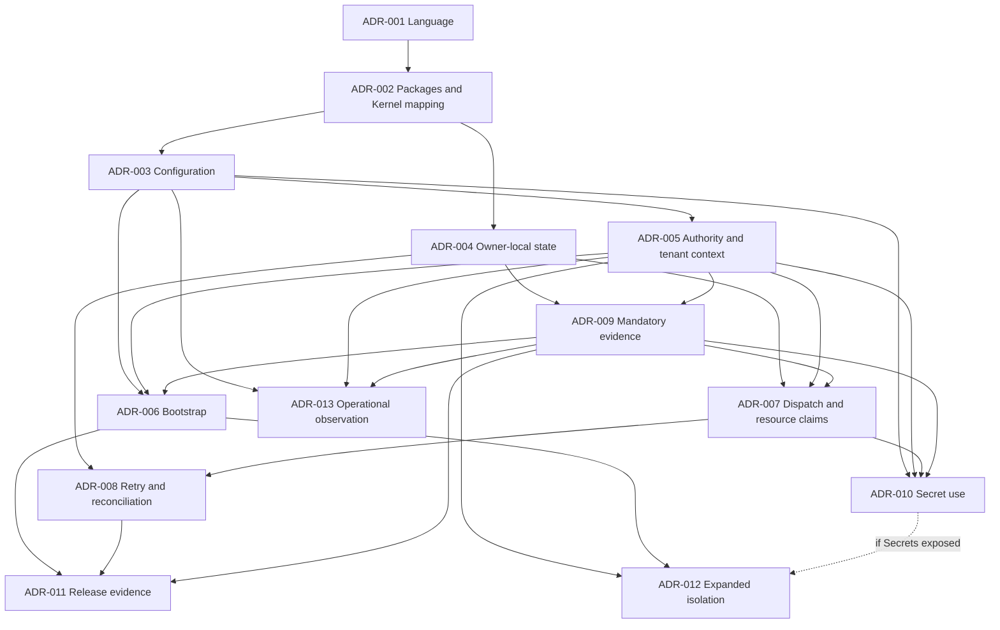

# Lego AI Operating Layer — ADR Planning Index

**Planning index version:** 0.1.0  
**Status:** PROPOSED — FOR CANONICAL REVIEW  
**Authority:** [intent.md](../intent.md) 1.0 → [SPEC.md](../SPEC.md) 0.1.0 → [ARCHITECTURE.md](../architecture/ARCHITECTURE.md) 0.1.0 → [CONTRACTS.md](../contracts/CONTRACTS.md) 0.1.0 → [PLUGIN-SPEC.md](../plugin-spec/PLUGIN-SPEC.md) 0.1.0 → [SECURITY.md](../security/SECURITY.md) 0.1.0 → [EVALUATION.md](../evaluation/EVALUATION.md) 0.1.0 → [CONFORMANCE.md](../conformance/CONFORMANCE.md) 0.1.0 → this planning index.  
**Deliverable boundary:** Decision backlog, prerequisites, evidence, sequencing, and governance only. No individual ADR is decided or created here.

## 1. Authority and purpose

This index identifies unresolved **reference implementation choices**, not new canonical requirements. The eight accepted governing documents were reviewed in authority order. No language, framework, database, broker, vendor, deployment platform, public protocol, or isolation technology is selected. Repository inspection found the governing Markdown documents and no existing implementation or language decision to preserve.

An ADR MUST choose between viable mechanisms that realize the accepted semantics. It MUST NOT restate SPEC as a new decision, reopen logical Architecture, introduce hidden requirements, or become a shopping list or implementation task. Concrete examples and evidence may be implementation-specific; the resulting mechanism MUST remain replaceable without rewriting canonical contracts.

If a proposed option requires changing an upstream rule, the candidate MUST become **Blocked** for that option or affected decision scope, citing the exact conflicting clause, upstream owner, required amendment, and exit condition. Other conforming alternatives may still be evaluated. An ADR cannot approve the amendment itself. No new upstream contradiction is identified here. The accepted Architecture §4.7/§5.2 correction remains binding: Intelligence may reference Evaluation evidence, while an allowed consumer orchestrates Evaluation; an implementation dependency must not reopen that issue.

Acceptance of this index approves a backlog and sequence, not the candidates' decisions or authorization to implement. Next work requires explicit instruction to write individual ADRs. Evidence described below is future work, not a report of prototypes or tests performed during planning.

## 2. Governance principles and decisions already closed

The following are constraints on every alternative, not choices to vote on again:

| Already accepted | Implementation implication |
|---|---|
| Technology-neutral contracts; Ports & Adapters; Plugin-based realizations | Choose reference mechanisms behind the established boundaries. Providers/Adapters retain an owning Plugin version, including built-ins. |
| Capability-first independent use | Deterministic direct work must not require Agent, Model, Workflow, Team, Goal, or Outcome. |
| Role ≠ Actor; Team ≠ Actor | Code organization must preserve identity, responsibility, and authority distinctions. |
| Memory ≠ vector storage; Retrieval ≠ RAG | No mandatory embedding store or generation dependency. |
| Security outside probabilistic Actors | Policy, authorization, Approval, resource, and effect boundaries are externally enforced. |
| Evaluation ≠ Conformance ≠ Certification | Proof tools and release machinery do not issue Permission or appoint certifiers. |
| Operational result ≠ canonical Outcome | SPEC DEC-01 remains unchanged. |
| One tenant per operational entity; one TenantContext per Execution | A single-tenant first runtime still needs explicit tenant binding. |
| Canonical lifecycle/error/version/effect meanings | Choose representations and mechanisms without introducing hidden incompatible states or weakening unknown effects. |
| Minimal Kernel and logical owners | ARCHITECTURE §§1.2, 4, 5 already allocate meanings and state; packages realize that allocation. |
| Initial modular-monolith preference | Preserve intent's preferred starting direction; an alternative needs evidence, not an assumption of future scale. No deployment topology is selected here. |

One meaningful architectural choice SHOULD have one ADR. Combining concerns is appropriate only when the same mechanism and evidence determine them. Implementation checklists, case authoring, threshold tuning under an existing policy, and ordinary bug fixes do not automatically require ADRs. IDs allocated here are stable and never reused; removal leaves the historical ID in the index as reserved, with its existing disposition and reason. “Reserved” is an ID annotation, not an extra ADR status.

## 3. Classification, priorities, and status

| Class | Meaning |
|---|---|
| A | Foundational implementation blocker |
| B | Required before first reference runtime release |
| C | Required before a specific capability/profile is supported |
| D | Operational/production hardening |
| E | Deferred or evidence-dependent architectural decision |

| Priority | Deadline |
|---|---|
| P0 | Before runtime implementation starts |
| P1 | During initial runtime foundation, before the affected path is implemented |
| P2 | Before the first usable vertical slice exposing the affected feature or claim |
| P3 | Before production deployment or an earlier trigger that requires the decision |
| P4 | Safely deferred until a concrete need is established |

Class describes scope; priority describes timing. For example, a Class C isolation choice currently belongs at P3, but admitting hostile Plugins earlier moves its deadline forward. Changing scope MUST update the index and dependencies before affected work proceeds. A feature-dependent P2 decision does not force that feature into the minimal slice.

**Type 1:** expensive/difficult to reverse, requiring stronger comparative evidence and a migration argument. **Type 2:** relatively reversible behind a bounded interface, still requiring semantic and security evidence. Reversibility describes the planned boundary, not a promise that migrations are free.

Allowed candidate/ADR statuses are **Proposed, Ready for Decision, Blocked, Accepted, Rejected, Superseded, Deferred**. This index starts all 13 allocated candidates at Proposed. None is Ready for Decision merely because its question is written; dependencies, viable alternatives, and evidence must be available. No candidate is Accepted. Deferred subjects in §9 are a watchlist, not speculative numbered ADRs; allocate an ID only when their trigger establishes an actual choice. Consequently, there are no Class E/P4 numbered candidates yet.

## 4. Decision criteria and evidence discipline

Every future ADR MUST first pass semantic fidelity, applicable security, and conformance constraints. Popularity or performance cannot compensate for a violated mandatory contract. Among viable alternatives, weight the candidate's stated dominant criteria; do not average all criteria equally.

Every alternative MUST assess these seven solo-developer burdens: implementation complexity, operational complexity, maintenance burden, testing burden, local-development burden, deployment burden, and learning curve. Record concrete obligations, likely failure/debugging effort, and migration cost, rather than unsupported numerical scores. Where two options satisfy the current scope, prefer fewer moving parts, easier local operation, and a clean replacement path unless stronger evidence justifies complexity.

Recurring secondary criteria are replaceability, typing and API ergonomics, concurrency/failure behavior, observability, performance at a stated workload, ecosystem maturity, interoperability, resource cost, and lock-in. Hypothetical scale alone does not justify distribution. Type 1 decisions require a sensitivity analysis: what realistic change would make the rejected option preferable?

Evidence MAY later include a bounded prototype, API spike, failure experiment, benchmark with a relevant workload, threat-model comparison, operational simulation, conformance mapping, or cost/complexity analysis. These are not all mandatory for every ADR. Use the smallest evidence set adequate to resolve the question. A paper argument may suffice for a reversible package arrangement; a claim about races needs an explicit ordering argument and mechanism evidence. Evidence gathering involving executable work is outside this planning phase and must be authorized with the individual ADR work.

All candidates inherit this acceptance gate: real alternatives fairly compared; no upstream change hidden in an option; priority/dependencies satisfied; supported scope and assumptions explicit; the seven burdens assessed; security/resources/conformance consequences stated; reversibility and migration addressed; unresolved mandatory gaps block the affected decision. Candidate-specific gates below add to this common gate.

## 5. ADR candidate backlog

### 5.1 Index matrix

| ADR | Decision | Class | Priority | Type | Blocks implementation? | Upstream drivers | Depends on | Evidence needed | Status |
|---|---|---|---|---|---|---|---|---|---|
| ADR-001 | Reference language/runtime | A | P0 | 1 | All runtime source/package work | ARCHITECTURE §15.2; CONF-011, 076 | None | Comparative API/concurrency/packaging and solo burden analysis | Proposed |
| ADR-002 | Reference packages and minimal Kernel mapping | A | P0 | 2 | All runtime source/package work | AR-01–08; R-01; CONF-011, 021, 056 | ADR-001 | Owner/dependency map; independent-use and replacement walkthrough | Proposed |
| ADR-003 | Configuration revision and activation binding mechanism | B | P1 | 2 | Configuration loading and activation binding | S-06/S-08; PLG-025–027; CONF-074 | ADR-002 | Revision/overlay/change and Secret-reference analysis | Proposed |
| ADR-004 | Owner-local state consistency and recovery boundary | B | P1 | 1 | Stateful owner/persistence/recovery code | AR-14–18; CTR-013–016, 056–058; Q-07 | ADR-002 | Concurrency, crash/acknowledgment and recovery analysis | Proposed |
| ADR-005 | Principal, authorization and tenant-context integration | B | P1 | 1 | Protected request/data paths | SEC-012–030, 035–037, 060–062; Q-05 | ADR-003 | Threat comparison; current context/policy/tenant flow | Proposed |
| ADR-006 | Trusted bootstrap and contribution admission mechanism | B | P1 | 2 | Executable Plugin loading/activation | R-02/R-08; CTR-054–055, 061; SEC-054–056 | ADR-003, ADR-005, ADR-009 | Finite root graph, no-self-admission and lifecycle analysis | Proposed |
| ADR-007 | Dispatch ordering and authoritative resource claims | B | P1 | 1 | Protected handoff and spend/Approval consumption | R-04; CR-01/03; Q-06; CONF-040–044 | ADR-004, ADR-005, ADR-009 | Ordering argument; concurrent/race/failure and accounting evidence | Proposed |
| ADR-008 | Operation identity, deduplication and effect reconciliation | B | P1 | 1 | Retryable or effectful invocation | CR-02; R-07; CTR-013–022, 033–034, 056–058 | ADR-004, ADR-007 | Equivalence/horizon and lost-acknowledgment cases | Proposed |
| ADR-009 | Mandatory evidence custody and failure-handling mechanism | B | P1 | 1 | Required evidence paths, bootstrap and protected effects | R-08; CR-04/05/07; SEC-073–077; CONF-067–068 | ADR-004, ADR-005 | Pre/post-effect failure, finite-root and retention/access analysis | Proposed |
| ADR-010 | Purpose-bound Secret resolution and use mechanism | C | P2 | 2 | Any Secret-bearing capability or bootstrap path | SEC-057–059; CONF-045, 047 | ADR-003, ADR-005, ADR-007, ADR-009 | Rotation/revocation/checkpoint/deputy threat evidence | Proposed |
| ADR-011 | Reference release evidence and compatibility assessment workflow | B | P2 | 2 | First usable release or conformance claim | CTR-063–069; EVAL-077–084; CONF-060–077 | ADR-006, ADR-008, ADR-009 | Complete scope ledger, evidence reuse and release-change walkthrough | Proposed |
| ADR-012 | Isolation mechanism for expanded Plugin threat scope | C | P3 | 1 | Hostile/insufficiently trusted Plugin support | R-06; SEC-051–053; CONF-048, 078–079 | ADR-005, ADR-006; ADR-010 if Secrets exposed | Threat comparison; co-location/collusion/side-channel evidence | Proposed |
| ADR-013 | Operational observation and diagnostic integration | D | P3 | 2 | Production observation/operational-assurance claims | CTR-050; SEC-073–077; EVAL-073–076; CONF-069, 080–081 | ADR-003, ADR-005, ADR-009 | Failure/volume/privacy and diagnostic usability evidence | Proposed |

**Count:** 13 candidates; P0 = 2, P1 = 7, P2 = 2, P3 = 2, P4 = 0. Classes: A = 2, B = 8, C = 2, D = 1, E = 0. There is no need to expand the backlog to match every optional technology family.

### ADR-001 — Reference implementation language and runtime

- **Decision question / need:** Which language/runtime should implement the first reference runtime? Source layout, typing, concurrency and packaging need a concrete substrate; canonical neutrality does not make source implementation language-free.
- **Class / priority / blocking / reversibility / status:** A / P0 / all runtime implementation / Type 1 / Proposed.
- **Upstream authority:** ARCHITECTURE §15.2; intent §§24–25, 38–42; CONFORMANCE CONF-011, 021, 076. **Questions:** no Q identifier directly selects a language. **Risks:** R-01; Hidden implementation coupling; Implementation-specific test overfitting.
- **Dependencies:** none. **Alternatives:** a dynamic typed-at-tooling runtime, a managed statically typed runtime, and a compiled statically typed runtime, with concrete viable language/runtime candidates identified in the future ADR. A small single-language reference versus a mixed-language start must be compared; choosing multiple languages needs demonstrated need. Deferring actual runtime implementation is the valid no-decision alternative.
- **Evidence / dominant criteria:** contract/context API walkthrough, concurrency/cancellation behavior, packaging and local tooling comparison; prioritize fidelity, solo productivity, testing and maintenance over hypothetical peak throughput. Include interoperability and migration costs without choosing a wire format.
- **Decision owner / trigger:** reference-runtime maintainer (currently the solo developer), before first runtime source/package work.
- **If deferred / downstream impact:** documentation can continue; implementation stays blocked. Affects compiler/runtime, build/package choices and later adapters, not canonical SDK languages universally.
- **Acceptance:** viable alternatives demonstrate independent deterministic Capability and governed context/error boundaries; selected runtime can support later ordering mechanisms; seven solo burdens and Type 1 exit costs documented. No dependency on a Model/Agent vendor is foundational.

### ADR-002 — Reference package structure and minimal Kernel mapping

- **Decision question / need:** How should accepted logical owners and Kernel anchors map to independently testable source packages/modules and release boundaries? Logical allocation is closed; its concrete packaging is not.
- **Class / priority / blocking / reversibility / status:** A / P0 / all runtime implementation / Type 2 / Proposed.
- **Upstream authority:** ARCHITECTURE §§1.2, 4–5, AR-01–08; intent §42; CONF-011, 021, 054–056. **Questions:** none reopened. **Risks:** R-01; Hidden implementation coupling; Dependency explosion; Extensions becoming de facto core.
- **Dependencies:** ADR-001 accepted before final package/tooling selection; logical diagrams can be prepared earlier. **Alternatives:** one distributable with enforced internal module boundaries; independently releasable packages in one repository/workspace; multiple repositories only with evidence that their cost is justified. All preserve logical owners and the initial modular-monolith preference; physical service splitting is not the question.
- **Evidence / dominant criteria:** map every initial responsibility to its owner, contract package and implementation boundary; inspect Architecture's exhaustive dependency matrix, including Intelligence/Evaluation. Compare isolated use, replaceability, local development and release burden. Kernel holds semantic/contract anchors, not Catalog, Policy, or accounting operating state by convenience.
- **Decision owner / trigger:** architecture/reference-runtime maintainer, before source directories and package dependencies are established.
- **If deferred / downstream impact:** conceptual API review can proceed; concrete modules cannot. Affects package imports, public surfaces and later releases.
- **Acceptance:** no forbidden dependency, implementation import into canonical abstractions, or mandatory AI/coordination package; one deterministic Capability/Adapter can be substituted without changing consumer semantics. Package migration is feasible without reopening logical ownership.

### ADR-003 — Configuration revision and activation binding mechanism

- **Decision question / need:** How will the reference runtime load, validate, resolve overrides, and bind immutable/revisioned configuration to a specific activation without drift? This chooses configuration handling, not canonical serialization.
- **Class / priority / blocking / reversibility / status:** B / P1 / configuration loading and activation binding / Type 2 / Proposed.
- **Upstream authority:** SPEC S-06/S-08, E-02; PLUGIN-SPEC §§8, 11; SECURITY §17; CONF-025–027, 050, 074. **Questions:** Q-08 only for later vocabulary, not new defaults. **Risks:** Configuration drift; Version coexistence conflicts; Stale security profile; Environment drift; Version drift.
- **Dependencies:** ADR-002. **Alternatives:** explicitly assembled immutable configuration snapshots; revisioned owner-managed configuration with validated activation snapshots; controlled overlays resolved to one pinned snapshot. Compare no implicit overlays against scoped overrides; no alternative may mutate active pinned meaning silently.
- **Evidence / dominant criteria:** changed configuration/release/tenant walkthrough, invalid and conflicting overlays, Secret references without values, restart/version coexistence and invalidation mapping. Prioritize determinism, inspectability and simple local configuration over live-reconfiguration convenience.
- **Decision owner / trigger:** runtime/Plugin maintainer, before config loader or activation binding implementation.
- **If deferred / downstream impact:** contract abstractions may proceed; executable composition/config paths wait. Affects Plugin validation, state/evidence identities and release applicability.
- **Acceptance:** exact effective revision attributable; permitted change creates new admitted activation treatment; tenant overrides cannot expand authority; raw Secrets never become general config; replacement boundary avoids imposing an external universal representation.

### ADR-004 — Owner-local state consistency and recovery boundary

- **Decision question / need:** Which consistency, commit and recovery mechanism will preserve owner-local revisions and partial facts in the first runtime, and what durability scope will that runtime claim? This establishes the storage boundary on which several mechanisms depend.
- **Class / priority / blocking / reversibility / status:** B / P1 / owner mutation, persistence and recovery paths / Type 1 / Proposed.
- **Upstream authority:** SPEC S-06, E-06–11; ARCHITECTURE §§6, 8–9; CONTRACTS §§5, 28–29; CONF-032–037, 068. **Questions:** Q-07; Q-05 retention constraints remain external. **Risks:** R-07; CR-05; State migration incompatibility; Environment mismatch.
- **Dependencies:** ADR-002. **Alternatives:** bounded volatile owners with explicit crash limitations and no unsupported recovery claim; durable owner-local records with atomic revision updates; append-only owner facts plus materialized state. Compare one backing realization with logically separate owners against separate stores; no option assumes a cross-owner global transaction. Durable Workflow support is optional and not selected by this index.
- **Evidence / dominant criteria:** expected-revision concurrency, crash before/after commit/acknowledgment, retained partial facts, unavailable/lost content, restart and migration analysis. Compare simplicity and recovery correctness before throughput; quantify local setup and operational burden. A volatile option is viable only for a scope whose mandatory evidence/effect obligations it actually satisfies.
- **Decision owner / trigger:** runtime state maintainer, before stateful owner implementation.
- **If deferred / downstream impact:** stateless interfaces can proceed; state adapters, recovery and downstream evidence/retry mechanisms wait. Artifact identity/version/content separation informs the boundary without requiring full Artifact or Memory implementations now.
- **Acceptance:** declared failures and acknowledgment meaning match storage behavior; no false durability, lost liability, resurrected authority, or invented global atomicity. Migration path and later checkpoint extension are explicit; exact guarantee parameters needing upstream profile authority are not invented here.

### ADR-005 — Principal, authorization and tenant-context integration

- **Decision question / need:** How will initial identity evidence, Principal binding, Grant/delegation and Policy decisions enter a consistently tenant-scoped enforcement boundary without coupling contracts to one IAM or policy technology?
- **Class / priority / blocking / reversibility / status:** B / P1 / protected request/data paths / Type 1 / Proposed.
- **Upstream authority:** SPEC S-09–12, D-01–05; CONTRACTS §15; SECURITY §§6–9, 11, 18, 23; CONF-028, 038–039, 043, 047, 073. **Questions:** Q-02 preserves current single-tenant ownership; Q-05's authority precedence is not decided here. **Risks:** Identity-provider compromise; Overbroad delegation; Policy conflict ambiguity; Break-glass abuse; Cross-tenant metadata leakage.
- **Dependencies:** ADR-003. **Alternatives:** bounded locally provisioned identities/explicit policies behind Ports; external identity/policy adapters; hybrid verified external identity with local bounded decisions. Policy evaluation is combined here because its trust/context handoff is the same choice; separately deployed policy machinery is not presumed.
- **Evidence / dominant criteria:** issuer entitlement/trust origin, current revocation, requester/deputy intersection, missing tenant, caches/logs/tokens and unauthorized diagnostics. Compare least privilege, clarity of enforcing boundaries, local-development burden and replaceability. A locally established root is an explicit prerequisite, not a Plugin that authenticates itself.
- **Decision owner / trigger:** security/runtime maintainer; upstream Governance authority owns disputed policy precedence. Decide before protected ingress or private-state handling.
- **If deferred / downstream impact:** non-executing abstractions can proceed; protected paths wait. Defines initial single-tenant context propagation; multi-tenant claims require expanded proof rather than retrofitted unscoped storage.
- **Acceptance:** every operation carries verified context; ownership/membership is not Permission; unresolved mandatory policy conflicts fail closed with governed disposition. No new authority hierarchy, legal precedence, co-ownership or exception semantics is silently introduced.

### ADR-006 — Trusted bootstrap and contribution admission mechanism

- **Decision question / need:** How will the runtime establish its minimum trusted Plugin/Adapter/Provider set with finite independently grounded roots and no self-admission?
- **Class / priority / blocking / reversibility / status:** B / P1 / executable Plugin loading, initialization and activation / Type 2 / Proposed.
- **Upstream authority:** ARCHITECTURE §11.3; CONTRACTS §§26–27, 29; PLUGIN-SPEC §§7, 10–13; SECURITY §16; CONF-025–027, 049. **Questions:** Q-03 only for local publisher/namespace entitlement verification. **Risks:** R-02/R-05/R-08; CR-06/07; Trust bootstrap circularity; Trust-root compromise; Partial activation; Contribution publication races.
- **Dependencies:** ADR-003, ADR-005, ADR-009. Identity/evidence mechanism choices precede bootstrap design; their realized bounded duties are instantiated as independently established roots, avoiding a decision dependency cycle. Secret-requiring roots additionally trigger ADR-010 before use.
- **Alternatives:** statically designated bootstrap set; built-in realizations with owning Plugin identities; externally provisioned bootstrap authority; a bounded hybrid. None permits candidate code to confer its own trust or treat inactive offers as executable.
- **Evidence / dominant criteria:** finite duty/dependency/root diagram; root compromise/recovery, cycle rejection, initialization failure, activation/publication/stop race and stale eligibility walkthrough. Prioritize independently justified authority and recoverable local operation over dynamic loading flexibility.
- **Decision owner / trigger:** Plugin/runtime maintainer with security review, before executable contribution loading.
- **If deferred / downstream impact:** descriptor inspection can be designed without executing candidates; activation remains blocked. Affects minimum bootstrap composition and lifecycle coordination.
- **Acceptance:** all roots bounded by identity/scope/duty; no implicit general eligibility; validation report is not admission; exact canonical transitions; stale publication cannot revive stopped work. Recovery outside a compromised root must be justified or explicitly unsupported, never self-authorized.

### ADR-007 — Dispatch ordering and authoritative resource claims

- **Decision question / need:** Which arbitration mechanism provides joint validity of authority, Approval, resource, deadline and trust predicates at protected dispatch, while conserving Budget/Quota/Limit claims? These are combined because the selected ordering boundary governs their coordination; logical owners remain separate.
- **Class / priority / blocking / reversibility / status:** B / P1 / protected handoff, Approval consumption and authoritative spend / Type 1 / Proposed.
- **Upstream authority:** SPEC E-03, B-01–04; AR-17–18; CONTRACTS §§6, 15; SECURITY §§7, 9–10, 19; CONF-040–044. **Questions:** Q-06/Q-07. **Risks:** R-04; CR-01/03; Revocation propagation failure; Approval UI deception; resource double-spend and unknown charge obligations.
- **Dependencies:** ADR-004, ADR-005, ADR-009. **Alternatives:** owner coordination through a bounded serialized handoff arbiter; atomic conditional commit over co-located owner records with explicit logical ownership; separately arbitrated bounded claims with a demonstrable joint-valid interval/equivalent ordering. No option may equate sequential stale checks with joint validity or assume global distributed atomicity.
- **Evidence / dominant criteria:** revocation at each boundary, simultaneous Approval/resource use, partial consumption, owner outage, deadline expiry, unknown liability, duplicate settlement and audit failure. Supply an ordering argument tied to the selected failure model; compare safety, local complexity and recovery effort before availability.
- **Decision owner / trigger:** runtime enforcement/resource maintainer; domain Governance owns permitted units/precision/overrun parameters. Decide before claim consumption or handoff implementation.
- **If deferred / downstream impact:** no protected dispatch or spend can proceed; abstract requests may be modeled. Determines concurrency and settlement integration without merging authoritative owners.
- **Acceptance:** one dispatcher, current mandatory predicates jointly valid, parent bounds conserved, no copied-balance spend, no automatic Approval refund, no expiry refund of unknown liability; fail-closed behavior under unproven ordering. Q-06 parameters require accountable approval; unresolved parameter scope blocks the associated resource claim, not arbitrary invention.

### ADR-008 — Operation identity, deduplication and effect reconciliation

- **Decision question / need:** How will the runtime retain equivalence, return prior authorized outcomes, bound retry horizons and reconcile unknown external effects across linked attempts?
- **Class / priority / blocking / reversibility / status:** B / P1 / retryable or effectful invocation / Type 1 / Proposed.
- **Upstream authority:** SPEC E-06–11; CONTRACTS §§5–6, 14, 28; SECURITY §§9–10, 24; CONF-034–037. **Questions:** Q-07. **Risks:** CR-02; R-07; Silent guarantee weakening; duplicate effects and lost acknowledgments.
- **Dependencies:** ADR-004, ADR-007; ADR-009 evidence guarantees are inherited through ADR-007 and must be referenced. **Alternatives:** owner-local operation ledger with retained results; coordinated operation journal with owner references; external-effect reconciliation adapters backed by bounded deduplication where the external system supports it. Compare full result retention with governed references and explicit unavailability behavior. Deferring effects is valid for an earlier non-effectful scope, not for the selected effectful path.
- **Evidence / dominant criteria:** same identity/equivalence including original expected revision, conflicting identity reuse, committed duplicate, lost acknowledgment, horizon expiry, replacement Provider, unknown effect and nested retries. Prioritize duplicate-effect prevention, honest uncertainty and retention feasibility over broad “exactly once” claims.
- **Decision owner / trigger:** execution/action maintainer, before retry/effect paths and before the usable reference slice.
- **If deferred / downstream impact:** non-effectful structural work continues; retry/effect guarantees cannot be advertised. Determines reconciliation hooks, obligation persistence and retention coupling.
- **Acceptance:** retransmission versus new attempt distinct; no unknown-to-none collapse; current disclosure enforced on prior results; horizons match retained evidence; repair never repeats completed effects; compensation is separate governed work.

### ADR-009 — Mandatory evidence custody and failure handling

- **Decision question / need:** How will required evidence be committed, retained, retrieved and repaired with bounded roots and confidentiality? The upstream contract already determines when required evidence precedes dispatch; this ADR chooses how the declared guarantee is realized, not whether to waive it.
- **Class / priority / blocking / reversibility / status:** B / P1 / mandatory evidence, bootstrap and protected effects / Type 1 / Proposed.
- **Upstream authority:** CONTRACTS §§25, 28–29; SECURITY §§16, 22, 24–25; CONF-066–070. **Questions:** Q-05/Q-07. **Risks:** R-08; CR-04/05/07; Audit denial-of-service; Evidence forgery; Evidence tampering; Security finding disclosure.
- **Dependencies:** ADR-004, ADR-005. **Alternatives:** owner-local evidence committed with owner facts plus governed export; independently durable evidence owner with explicit acknowledgment barrier; hybrid local committed obligation and accepted custody guarantees. Evaluate only options satisfying the specific pre-effect requirement; a later export cannot substitute for required prior custody.
- **Evidence / dominant criteria:** pre-effect write failure, post-effect evidence failure, store loss/outage/expiry, forged or wrong-subject evidence, confidential diagnostics, finite enforcement/evidence root and bounded audit load. Compare sufficiency, integrity and failure honesty before convenient observability integration.
- **Decision owner / trigger:** evidence/security/runtime maintainer; Governance decides disputed retention/exception authority. Before bootstrap or protected paths depend on evidence.
- **If deferred / downstream impact:** source fact contracts may be reviewed; required evidence operations remain blocked. Supplies durable obligation and authorized diagnostic access boundaries, separate from optional telemetry.
- **Acceptance:** preconditions actually gate dispatch; post-effect repair cannot repeat source action; identity ≠ retained content; custody/freshness/retention limits explicit; no infinite evidence recursion or indefinite retention invented. Root-duty instantiation is ADR-006, not a prerequisite to evaluating this mechanism.

### ADR-010 — Purpose-bound Secret resolution and use

- **Decision question / need:** Which narrow reference mechanism resolves Secret references for authorized purposes/consumers/targets without broad exposure of raw material?
- **Class / priority / blocking / reversibility / status:** C / P2 / Secret-bearing paths only / Type 2 / Proposed.
- **Upstream authority:** SPEC §4.9 Secret; CONTRACTS §15; PLUGIN-SPEC §8; SECURITY §17; CONF-045, 047. **Questions:** none newly defined. **Risks:** Secret confused-deputy attack; Overbroad delegation; Privileged Plugin collusion; State migration incompatibility.
- **Dependencies:** ADR-003, ADR-005, ADR-007, ADR-009. **Alternatives:** a narrowly scoped local Secret-use realization; an external managed Secret adapter; mediated use without returning raw material to a general consumer, where supported. Compare custody and enforcement paths, not storage-brand popularity.
- **Evidence / dominant criteria:** target/consumer substitution, rotation during use, revocation before dispatch, checkpoint/retry/migration restoration, diagnostics and retention. Prioritize minimum exposure and current validity, then local developer burden and replacement cost.
- **Decision owner / trigger:** security/Secret maintainer, before the first Secret-dependent capability; move earlier if bootstrap requires a Secret service. No cycle is permitted: unresolved dependencies block that bootstrap composition or require a different explicitly bounded root treatment in the relevant ADRs.
- **If deferred / downstream impact:** a Secret-free deterministic slice remains possible; no Secret support claim. Determines authorized-use adapter and configuration-reference integration.
- **Acceptance:** public records contain references, no raw leakage; purpose/consumer/target checks and rotation/revocation survive recovery; evidence sufficient without retaining obsolete material. Any reusable abstract boundary stays vendor-neutral.

### ADR-011 — Reference release evidence and compatibility assessment workflow

- **Decision question / need:** How will one developer maintain exact release/configuration compatibility and requirement-to-evidence mappings, and assess changes before making a scoped release claim? This selects a practical reference assurance workflow, not official profiles or a certification scheme.
- **Class / priority / blocking / reversibility / status:** B / P2 / usable release and conformance claims / Type 2 / Proposed.
- **Upstream authority:** CONTRACTS §§31–34; PLUGIN-SPEC §§18, 25; EVALUATION §§7–11, 20–22; CONFORMANCE §§5–7, 23–30. **Questions:** Q-03/Q-04 retain separate governance; Q-07 exact local guarantees must be declared. **Risks:** Version drift; False conformance claims; Test-suite incompleteness; Unsupported-feature laundering; Score aggregation masking failures; Self-attestation abuse.
- **Dependencies:** ADR-006, ADR-008, ADR-009; evidence from any optional supported feature is additionally required. **Alternatives:** a reviewed versioned evidence ledger with lightweight repeatable checks; a dedicated conformance harness with the same ledger; a hybrid manual governance review plus targeted automation. A no-formal-claim development snapshot may defer release machinery, but cannot pretend to be a conformant release.
- **Evidence / dominant criteria:** walkthrough of one release, one incompatible change, one reused EvaluationResult, one material environment change and one failing mandatory case; compare coverage, honesty, maintenance and local effort. Include positive/negative results, independence labels and dataset/method limitations.
- **Decision owner / trigger:** release/conformance maintainer, before first usable release/claim. An external independent assessor is not presumed or appointed.
- **If deferred / downstream impact:** internal development under earlier decisions can proceed; conformance/release claim blocked. Affects evidence workflow and later tool selection, not SemVer meanings or canonical case serialization.
- **Acceptance:** clause-level supported-scope closure; exact versions/config/evidence; missing proof never pass; failed obligation cannot be averaged away; delta reuse justified; self-attestation explicit; no official certification/profile fabricated; workflow feasible for one developer.

### ADR-012 — Isolation mechanism for expanded Plugin threat scope

- **Decision question / need:** What isolation mechanisms are necessary for the first deployment that admits Plugins outside the initial bounded trust assumptions? Logical separation is already insufficient for a hostile co-located Plugin claim; the actual enforcement choice remains open.
- **Class / priority / blocking / reversibility / status:** C / P3 / hostile or insufficiently trusted Plugin support / Type 1 / Proposed.
- **Upstream authority:** AR-19; CONTRACTS §26.2; PLUGIN-SPEC §9; SECURITY §15; CONF-048, 078–079. **Questions:** Q-07 if isolation availability/recovery guarantees change. **Risks:** R-06; Shared-host escape; Privileged Plugin collusion; Side-channel leakage; Composition gap.
- **Dependencies:** ADR-005, ADR-006, and ADR-010 when Secrets are exposed. **Alternatives:** same-process execution only for a threat scope it can justify; separate processes; container/VM boundaries; remote realizations; a threat-dependent combination. None is selected and no particular platform is mandatory.
- **Evidence / dominant criteria:** attacker/asset matrix, memory/Secret/tenant/resource/effect escape attempts, collusion, host compromise assumptions, side-channel exclusions and local operational comparison. Prioritize actual prevention and understandable residual risk; compare deployment/maintenance burden before breadth.
- **Decision owner / trigger:** security/runtime maintainer, before untrusted Plugin admission or earlier production scope requiring containment. Move to P1/P2 if first slice includes that threat.
- **If deferred / downstream impact:** only a clearly bounded trusted-contribution scope with independently adequate admission assumptions may proceed; no claim of hostile isolation. Adds physical enforcement adapters without changing logical Ports.
- **Acceptance:** guarantees substantiated under attacker capabilities; exclusions explicit/profile-compatible; hostile Plugin cannot inherit unbounded host privilege; migration and cost of stronger containment addressed. Deferral is not a security waiver.

### ADR-013 — Operational observation and diagnostic integration

- **Decision question / need:** How will production observation collect/correlate traces, metrics and diagnostics while preserving separate audit/provenance owners, tenant confidentiality and bounded overhead?
- **Class / priority / blocking / reversibility / status:** D / P3 / production operational-assurance claims / Type 2 / Proposed.
- **Upstream authority:** ARCHITECTURE §4.13; CONTRACTS §25; SECURITY §22; EVALUATION §19; CONF-069, 080–081. **Questions:** Q-07 operational retention/availability where claimed; Q-05 retention authority remains external. **Risks:** CR-04/05; Audit denial-of-service; Cross-tenant metadata leakage; Security finding disclosure; Evidence staleness.
- **Dependencies:** ADR-003, ADR-005, ADR-009. **Alternatives:** bounded local observation with export adapters; a standardized instrumentation/export realization; an external collection integration. Mandatory evidence and required local observation already apply through ADR-009 and contracts; this candidate chooses production integration, not permission to omit them until P3.
- **Evidence / dominant criteria:** diagnostic task walkthrough, lost optional telemetry versus required audit, sampling gaps, high volume, unsafe details, access, expiry and operational drift signals. Prioritize useful safe diagnosis and bounded cost over maximal collection.
- **Decision owner / trigger:** runtime/operations maintainer, before production monitoring or continuous-conformance operational claims; earlier if a slice specifically requires these guarantees.
- **If deferred / downstream impact:** required basic observation/evidence still implemented under earlier decisions; production integration waits. Affects replaceable exporters and operational procedures, not canonical telemetry authority.
- **Acceptance:** required correlation accessible under authorization, optional failure cannot masquerade as mandatory evidence success, no private chain-of-thought or raw Secrets required, observation gaps explicit and collection bounded.

## 6. P0 — Decisions required before implementation starts

Only **ADR-001 and ADR-002** are global source-implementation blockers. They establish the reference substrate and how the already accepted logical boundaries map to packages. A future language-neutral paper review can precede them; creating runtime packages, code, build setup or dependencies cannot.

Configuration and state mechanisms are important but do not determine whether initial abstract contracts can be structured correctly once those two decisions are accepted. They therefore remain P1 with strict affected-path gates. Bootstrap, authority, dispatch, accounting and evidence MUST be decided before executable work relies on them; assigning P1 is sequencing, not reduced importance.

## 7. P1 — Decisions required during runtime foundation

The seven P1 decisions are ADR-003–ADR-009. Recommended order is configuration and owner-local state; then authority/tenant integration; then mandatory evidence; then bootstrap and dispatch coordination; then retry/reconciliation. ADR-003 and ADR-004 can be researched independently after package boundaries; ADR-006 and ADR-007 share prerequisites and can be compared independently. A solo developer should finish one coherent decision at a time rather than maintain many incomplete ADRs.

Reference trust assumptions, supported operations, failure model, resource units and evidence requirements must be declared as inputs to these decisions. They are scope proposals requiring the appropriate decision owner; this index does not silently fix a first release guarantee profile. Mandatory canonical behavior applies regardless of scope size.

## 8. P2/P3 later decisions and initial scope triggers

**P2:** ADR-011 is required before a usable release/claim. ADR-010 is conditional on Secret use; the smallest deterministic slice may be Secret-free, but credentials introduced for identity/bootstrap immediately bring its prerequisite forward. No unsupported Secret path may be activated while waiting.

**P3:** ADR-012 precedes an expanded Plugin threat scope, and ADR-013 precedes production operational integration/claims. These gates may move earlier with real scope. Baseline security, tenant propagation, mandatory evidence and required observation are already P1 obligations, not optional production hardening.

**P4:** no numbered candidate. Subjects below remain explicitly deferred until evidence establishes a coherent decision. Priority counts exclude this watchlist.

## 9. Deferred — Do not decide yet

This register evaluates the remaining suggested families without creating speculative ADRs. Each trigger requires rechecking upstream constraints, adding or revising a candidate, and obtaining authorization to write it. No deferred item is secretly selected by the deterministic-slice recommendation.

| Deferred decision | Why not now | Trigger to revisit | Upstream requirements affected | Risk of early decision |
|---|---|---|---|---|
| Specific Model provider/first Model Adapter | No Model needed for deterministic slice | A concrete Model capability and quality/resource target | CONTRACTS §16; EVAL §§12, 16; CONF-057 | Vendor behavior becomes core API |
| Agent framework/AgentRuntimePort realization | No Agent required initially | First governed Agent use case with recovery/tool requirements | CONTRACTS §12; SECURITY §12; CONF-054 | Framework dictates Kernel/state model |
| External Workflow engine | Durability/Workflow scope not yet required | Concrete Workflow waits/joins/recovery exceed demonstrated internal capability | SPEC §5.9; CONTRACTS §11; Q-07 | Engine semantics overwrite canonical state/effects |
| Memory/Knowledge store or vector database | No initial persistent Memory requirement | Required memory kinds, queries, retention and retrieval scope established | CONTRACTS §§19–21; CONF-057 | Memory reduced to embeddings |
| Event broker/async distribution | Logical events need not imply external broker | Required delivery/ordering/failure workload cannot be met by simpler realization | CONTRACTS §23; Q-07; CONF-058, 065 | Delivery mistaken for effect confirmation; unnecessary operations |
| Kubernetes, container deployment or cloud | No deployment target authorized | Measured deployment/containment/operations requirement | AR-08/19; SECURITY §15; ADR-012 | Platform complexity and lock-in before need |
| Multi-service deployment | Modular-monolith starting preference; no scale evidence | Demonstrated independent scaling/isolation/availability need | ARCHITECTURE §§5–10, 15.2; Q-07 | Distributed failure modes added without benefit |
| MCP/REST/gRPC/local Tool interoperability adapter choices | First Adapter may be deterministic and local; protocol not required | A concrete external Tool integration | CONTRACTS §14; CONF-022, 034–047 | Transport dictates Tool/effect semantics |
| A2A or other cross-runtime Agent interoperability | No cross-runtime Agent requirement | Actual interoperating actors and authority/delegation contract | CONTRACTS §§12–13; SECURITY §11 | Protocol becomes foundational coupling |
| Public API/serialization and additional SDK languages | In-process representation need does not justify public standardization | Cross-process/language consumer enters accepted initial scope | CONTRACTS §§30–31; CONF-003, 088 | Premature public compatibility burden |
| Global extension namespace registry/allocation scheme | Local explicit ownership verification suffices for planning; no global operator exists | Public namespace/extension publication or third-party discovery | Q-03; SPEC C-06; PLG identity/extensions; CONF-051, 071 | Invented global authority/business model |
| Certification scheme/authority | Conformance does not appoint certifiers | Authorized external recognition requirement | Q-03; CONF-071–073 | Certification theater and false authority |
| Official named conformance profiles | Explicit supported set is allowed | Governance authorizes reusable named profiles with evidence requirements | Q-04/Q-07; CONF-019–020 | Product tiers masquerade as universal requirements |
| Cross-tenant co-ownership | Unsupported canonical feature, not an implementation option | SPEC owner explicitly accepts a semantic amendment | Q-02; SPEC S-10/S-11; CONF-039 | ADR silently changes ontology/ownership |
| Policy/retention legal precedence and broad emergency authority | Requires actual entitled Governance, not mechanism selection | Concrete jurisdiction/organizational conflict or permitted exception | Q-05; SECURITY §§8, 22–23 | Implementation invents legal or override authority |
| Standard blueprint/cardinality/domain vocabularies | No application blueprint in first slice | Concrete domain composition requiring standardized vocabulary | Q-08; SPEC §§3, 11; CONF-072 | Software-team ontology embedded in Kernel |
| Separate Artifact storage ADR | Initial owner-local record mechanism belongs in ADR-004 | Content size, retention, access or lineage workload requires distinct storage choice | CONTRACTS §22; SPEC A; CONF-058, 068 | Premature storage fleet |
| Separate Workflow checkpoint ADR | ADR-004 establishes base state/recovery boundary only | Durable Workflow is explicitly supported | SPEC E-09; CONTRACTS §11; CONF-054 | Universal durability imposed on primitives |
| Separate resource metering backend ADR | ADR-007 owns initial claim/accounting coordination | External metering/pricing uncertainty exceeds initial accepted parameters | Q-06; SPEC B; CONF-040–041 | Billing/provider model becomes canonical |
| Expanded multi-tenant deployment mechanism | ADR-005 already requires tenant-aware foundations | Hosting more than one tenant and declaring isolation guarantees | Q-02; SECURITY §18; CONF-038–039, 079 | Retrofitting unscoped state or prematurely choosing tenant topology |

## 10. Decision dependency graph

Arrows mean an accepted prerequisite before the dependent **decision** is finalized. They are not runtime calls, package imports, or an instruction to deploy separate services. Conditional edges are labeled; candidate cards are authoritative if display abbreviations omit detail.



There is intentionally no ADR-006 → ADR-005 or ADR-009 decision edge. Identity and evidence mechanisms define independently established bounded root duties; bootstrap later assembles those duties without self-admission. Their actual initialization order and authority graph must be proven in ADR-006. Any newly discovered executable dependency cycle blocks that composition rather than being excused by this planning graph.

No optional Agent/Model/Workflow/Memory/broker decision gates the initial Kernel. Secret-based bootstrap is an additional feature trigger: resolve ADR-010 and its prerequisites before using it, and revisit ADR-006's selected composition without inventing a circular dependency. One valid topological writing order is 001 → 002 → 003 → 004 → 005 → 009 → 006 → 007 → 008 → 011, with 010 before any Secret use, and 012/013 at their triggers.

## 11. Risk-to-ADR mapping

Mappings assign follow-up responsibility; they do not claim that choosing a mechanism resolves or proves a risk. Every concrete ADR must carry its related risks into implementation proof and residual limitations. “No new ADR” means the item belongs to accepted semantics, governed parameters, case/data quality work, or upstream authority, with an explicit trigger/owner below. Candidate roles may be held by the same solo developer; that does not create independent assessment or external authority.

### 11.1 SPEC questions

| Identifier | Candidate or explicit disposition | Remaining owner / exit |
|---|---|---|
| Q-02 | ADR-005 tenant foundations; expanded deployment deferred; co-ownership is not an ADR option | SPEC/Governance owner must amend semantics before co-ownership; otherwise prove existing scoped crossing |
| Q-03 | ADR-006 verifies declared publisher/namespace entitlement; ADR-011 labels claims; global registry/certifier deferred | Standards/Governance must appoint actual authorities before public authority claims |
| Q-04 | ADR-011 uses explicit supported scope; official profile definitions deferred | Conformance/Governance approves named versioned requirements/evidence bundles |
| Q-05 | ADR-005 enforces decisions/conflicts; ADR-009 realizes governed retention; precedence remains upstream | Entitled Governance/Security resolves applicable conflicts; protected scope stays blocked while unresolved |
| Q-06 | ADR-007 realizes parameterized accounting; external metering choice deferred | Resource/Governance owner approves units, precision, uncertainty/overrun limits; mechanism demonstrates them |
| Q-07 | ADR-004/007/008/009/011 declare and substantiate exact reference guarantees; broker/Workflow extensions deferred | Capability/Contract/Conformance owners approve any official profiles; no universal durability/order invented |
| Q-08 | ADR-003 preserves explicit configuration vocabulary; domain standardization deferred | SPEC/Contract/Blueprint owners approve new vocabularies when a use case exists |

### 11.2 Architecture and Contract risks

| Identifier | Candidate or explicit disposition | Required follow-through |
|---|---|---|
| R-01 | ADR-001/002 | Package/import evidence preserves minimal Kernel and original semantic anchors |
| R-02 | ADR-006 | Finite bootstrap, no inactive executable dependency or self-admission |
| R-04 | ADR-007 | Joint-validity and race evidence under selected failure model |
| R-05 | ADR-006/011; no new lifecycle decision | Existing activities/states mapping verified; expansion requires SPEC |
| R-06 | ADR-012; ADR-006 limits initial admitted trust scope | Adequate containment evidence before hostile Plugin support |
| R-07 | ADR-004/008/009 | Partial commit, liability and repair evidence without repeated effects |
| R-08 | ADR-006/009 | Finite authority/evidence roots and correct evidence-failure behavior |
| CR-01 | ADR-007 | Fail closed when ordering cannot be established; no fabricated availability |
| CR-02 | ADR-008/009 | Retention and deduplication/retry horizon aligned |
| CR-03 | ADR-007/008 | Consumed Approval retained; Governance owns separate new-entitlement practice |
| CR-04 | ADR-005/009/013 | Safe error detail plus authorized adequate diagnostic evidence |
| CR-05 | ADR-004/009 | Record identity, retrieval, content and interpretation guarantees distinguished |
| CR-06 | ADR-006/011 | Publication and generic definition changes cannot activate Plugin execution |
| CR-07 | ADR-006/009 | Bounded independently admitted root duties; no recursive caller exemption |

### 11.3 Plugin-specific risks

| Risk | Candidate or explicit disposition | Evidence / residual owner |
|---|---|---|
| Dependency explosion | ADR-002/006 | Maintainer demonstrates finite required closure and independent loading |
| Provider shadowing | ADR-006/011 | Exact identity, competing offers and explicit selection proof |
| Namespace impersonation | ADR-006/011; global allocation deferred | Verify actual entitlement; Standards owns global authority question |
| Capability spoofing | ADR-011 | Offer-to-supported-contract evidence; declaration alone insufficient |
| Stale health evidence | ADR-006/011 | Freshness/eligibility and changed-contribution cases |
| Hidden implementation coupling | ADR-001/002/011 | Replacement and independent-use evidence |
| State migration incompatibility | ADR-004/008 | State/effect/liability interpretation and partial migration evidence |
| Configuration drift | ADR-003/011 | Exact activation binding and invalidated applicability |
| Partial activation | ADR-006/009 | Owner-local lifecycle/publication facts survive failure |
| Contribution publication races | ADR-006/011 | Stale publication cannot revive stopped contribution |
| Shared-host escape | ADR-012; ADR-006 initial admission scope | Threat-scoped proof before expanded support |
| Trust bootstrap circularity | ADR-006/009 | Independently grounded finite graph |
| Extensions becoming de facto core | ADR-002/011; extension registry deferred | Optional extensions cannot become hidden baseline dependencies |
| Version coexistence conflicts | ADR-003/004/006/011 | Binding/version/accounting separation during overlap |
| Silent guarantee weakening | ADR-008/011 | Replacement/delta evidence preserves advertised guarantees |

### 11.4 Security-specific risks

| Risk | Candidate or explicit disposition | Evidence / residual owner |
|---|---|---|
| Identity-provider compromise | ADR-005/006 | Independent root/recovery threat assumptions and failure response |
| Overbroad delegation | ADR-005/007 | Attenuation and exact current action boundary |
| Policy conflict ambiguity | ADR-005; no ADR may select legal precedence | Governance supplies applicable authority; unresolved conflicts fail closed |
| Break-glass abuse | ADR-005/007/009 | Entitlement, bounded scope/time and required evidence; no canonical waiver |
| Trust-root compromise | ADR-006/009 | Recovery authority outside compromised root or explicit unsupported recovery |
| Approval UI deception | ADR-007; UI mechanism deferred until HumanApproval interface needed | Exact presented revision/action proof; later UI owner validates faithful presentation |
| Secret confused-deputy attack | ADR-005/010 | Requester/consumer/purpose/target intersection |
| Cross-tenant metadata leakage | ADR-005/009/013 | Cache/token/log/error/lineage access and disclosure evidence |
| Side-channel leakage | ADR-012 | Explicit attacker/exclusion scope and adequate prevention evidence |
| Privileged Plugin collusion | ADR-012; ADR-005/010 boundaries | Composition threat evidence, not independent Plugin reports alone |
| Audit denial-of-service | ADR-007/009/013 | Resource-bounded evidence paths and mandatory failure behavior |
| Evidence forgery | ADR-009/011 | Subject/custody/integrity verification; mechanism chosen later |
| Security-control downgrade | ADR-003/011/012 | Changed config/release/threat scope cannot inherit stale proof |
| Stale security profile | ADR-003/011 | Exact profile/version conditions and freshness trigger |
| Revocation propagation failure | ADR-005/007/013 | Effective ordering proof plus scoped operational observations |

### 11.5 Evaluation-specific risks

| Risk | Candidate or explicit disposition | Evidence / residual owner |
|---|---|---|
| Benchmark overfitting | ADR-011 evidence workflow; no standalone ADR | Evaluation owner supplies representative independent confirmation |
| Dataset leakage | ADR-005/009/011 | Governed access and oracle exposure evidence; dataset owner tracks limits |
| Judge bias | ADR-011 intake rules; judge choice deferred | Evaluator owner substantiates calibration and limitations before reuse |
| Self-evaluation bias | ADR-011 | Self-attestation and independence provenance kept distinct |
| Metric gaming | ADR-011; no metrics-policy ADR absent concrete requirement | Requirement-level judgment cannot be replaced by aggregate score |
| Goodhart's law | ADR-011; Evaluation-method governance remains separate | Intended contractual behavior stays distinct from optimized metric |
| Dataset contamination | ADR-011 | Dataset provenance/contamination disclosure checked; unknown ≠ clean |
| Non-representative cases | ADR-011 | Clause/population coverage and explicit unassessed scope |
| Test flakiness | ADR-011 | Repeatability and contradictory observations retained; no retry-until-pass |
| Environment drift | ADR-003/011/013 | Material changes invalidate applicability and trigger reassessment |
| Evaluation cost explosion | ADR-007/011 | Bounded method/dependency closure and authoritative accounting |
| Hidden evaluator dependency | ADR-002/011 | Full relevant dependencies and finite assurance basis |
| Score aggregation masking failures | ADR-011 | Mandatory failure cannot be averaged away |
| False confidence | ADR-011 | Method/population/uncertainty justified against proof obligation |
| Human reviewer inconsistency | ADR-011; no standalone ADR | Review rubric/disagreements retained; Human reviewer governance owner |
| Adversarial evaluator manipulation | ADR-005/009/011 | Untrusted evidence cannot create authority or trusted result |
| Security finding disclosure | ADR-005/009/013 | Authorized review sufficient without public sensitive-data leakage |

Evaluation risks are not “solved” by the release workflow. Actual cases, datasets, methods and assessor independence remain future Evaluation/Conformance work; no Model judge is required or selected.

### 11.6 Conformance-specific risks

| Risk | Candidate or explicit disposition | Evidence / residual owner |
|---|---|---|
| Test-suite incompleteness | ADR-011 | Clause-level ledger independent of suite pass count |
| False conformance claims | ADR-011 | Exact supported scope and known limitations visible |
| Profile fragmentation | ADR-011 local references; official profiles deferred | Standards/Governance owns namespace/version/compatibility of official bundles |
| Evidence staleness | ADR-003/009/011/013 | Freshness, expiry and material-change applicability checks |
| Certification theater | No certification ADR now; ADR-011 separates assertion and recognition | Scheme/Governance authority must be established before external recognition |
| Implementation-specific test overfitting | ADR-002/011 | Observable contract and alternate-realization evidence |
| Negative-case undercoverage | ADR-007/008/011/012 | Relevant forbidden paths, races and threat assumptions assessed |
| Composition gap | ADR-002/007/011/012 | Shared-resource, retry and co-location interactions assessed |
| Environment mismatch | ADR-003/004/011 | Exact environment or justified applicability mapping |
| Flaky conformance evidence | ADR-011 | Counterevidence and variability addressed rather than discarded |
| Self-attestation abuse | ADR-011 | Claimant versus verifier and independence limitations visible |
| Evidence tampering | ADR-009/011 | Custody/integrity and exact subject verified |
| Unsupported-feature laundering | ADR-011 | Mandatory closure prevents relabeling a failing obligation |
| Version drift | ADR-003/011 | Governing/target/profile/evidence versions pinned and reassessed |
| Waiver abuse | ADR-005/011; upstream Governance owns exceptions | Entitled explicit exception only; unwaived failures remain nonconformant |
| Proof-method mismatch | ADR-011 | Method establishes stated proposition within declared assumptions |

Coverage totals: **7 Q identifiers, 7 R identifiers, 7 CR identifiers, 15 Plugin risks, 15 Security risks, 17 Evaluation risks, and 16 Conformance risks**. None is marked implemented, verified, or closed by this plan.

## 12. Implementation blocker matrix

All rows are conditional work gates; only the first two are global P0 gates. “Can proceed” presumes explicit authorization for the later work and acceptance of any other applicable prerequisite. Nothing in this matrix authorizes implementation during ADR planning.

| Decision | Why implementation cannot safely proceed without it | What can proceed before it | Required evidence |
|---|---|---|---|
| ADR-001 | No reference source/runtime/package substrate established | Governing-document and alternative analysis | Language/runtime burden and semantic feasibility comparison |
| ADR-002 | Imports/package ownership could bake in forbidden dependencies | Logical owner/contract mapping | Kernel allocation, dependency and independent-use review |
| ADR-003 | Config changes could silently alter activation meaning | Approved abstract contracts and package boundaries | Snapshot/override/revision/Secret-reference walkthrough |
| ADR-004 | State writes/recovery could lose revisions, effects or liabilities | Stateless interface work under P0 decisions | Owner commit/concurrency/crash/acknowledgment analysis |
| ADR-005 | Protected work could run with unverified Principal or tenant | Non-executing domain abstractions | Current identity/policy/tenant/deputy threat flow |
| ADR-006 | Candidate code could self-admit or activate through discovery | Non-executing descriptor validation design | Finite roots, lifecycle and publication failure analysis |
| ADR-007 | Stale authority or concurrent claims could authorize unsafe effects/spend | Request models without protected handoff | Ordering/conservation proof under specified failures |
| ADR-008 | Retries could duplicate effects or erase uncertainty | Non-effectful paths within accepted scope | Equivalence/retention/reconciliation evidence |
| ADR-009 | Required evidence could be missing before effects or recursively depend on itself | Evidence requirement/source mapping | Pre/post-effect custody/failure/privacy and root analysis |
| ADR-010 | Secret use could expose values or resurrect revoked material | Secret-free capability work | Purpose/consumer/target, rotation and recovery proof |
| ADR-011 | Release claim could exceed actual supported/evidenced scope | Internal implementation under preceding decisions | Clause coverage, negative proof, exact versions, delta workflow |
| ADR-012 | Hostile Plugin could bypass host boundaries | Explicit trusted-contribution scope with adequate admission proof | Attacker-scoped containment and composition evidence |
| ADR-013 | Production diagnostic/assurance claims could lack safe usable observations | Mandatory local evidence/observation under earlier decisions | Volume, failure, privacy, retention and usability analysis |

## 13. Future individual ADR template

The following is a Markdown authoring template, not a filled decision or canonical wire schema. Record enough evidence to let a future maintainer understand why the selected mechanism was preferable under the actual scope. Retain rejected alternatives fairly.

```markdown
# ADR-NNN — Title

Status: Proposed
Date: [decision record date]
Decision owner(s): [accountable identities/roles]
Class / priority: [A–E / P0–P4]
Reversibility: [Type 1 or Type 2 and reason]
Governing requirements: [exact versions, sections, IDs]
Related questions/risks: [identifiers and named risks]
Depends on: [accepted ADRs and external authority prerequisites]
Blocks: [exact implementation paths or release claims]
Supersedes / superseded by: [references or none]

## Context
[Current supported scope, constraints and why the choice is open.]

## Decision question
[One coherent mechanism choice; what it does not decide.]

## Decision drivers
[Mandatory gates; ranked tradeoffs; relevant workload/threat assumptions.]

## Constraints
[Accepted semantic/owner/lifecycle boundaries; unresolved upstream blockers.]

## Considered alternatives
### Option A — [viable mechanism]
Benefits:
Costs:
Risks:
Conformance implications:
Solo burdens: implementation, operations, maintenance, testing,
local development, deployment, learning curve.
### Option B — [viable mechanism]
[Same dimensions; additional options where meaningful.]
### Do nothing / defer
[Include where valid; affected scope cannot proceed if blocked.]

## Evidence
[Attributable comparisons, authorized experiments, limitations,
counterevidence, and unavailable evidence. No popularity-only argument.]

## Decision
[Unfilled until decision is authorized and evidence is adequate.]

## Consequences
### Positive
### Negative
### Risks accepted
[Residual risk owner, bounds, review trigger; no canonical waiver.]

## Migration / reversibility
[Replacement boundary, retained history, state/effects/liabilities,
change cost, conditions that would justify reconsideration.]

## Security impact
[Trust/tenant/Secret/authority implications and assumptions.]

## Resource impact
[Runtime and operational cost; authoritative accounting obligations.]

## Conformance impact
[Exact supported scope; obligations, required future proof,
evidence invalidation/reuse; no claim that choosing proves implementation.]

## Follow-up decisions and implementation gates
[Prerequisites, downstream work, accountable owner, deadline/trigger.]

## Acceptance record
[Decision-maker, date, reviewed evidence and unresolved limitations.]
```

## 14. ADR status, acceptance, and supersession rules

1. **Proposed:** a coherent unresolved choice with scope, owner and alternatives is recorded. Dependencies may still be pending.
2. **Ready for Decision:** applicable prerequisites accepted, viable alternatives compared, evidence and acceptance criteria reviewed; no unresolved mandatory semantic conflict.
3. **Blocked:** required authority, prerequisite, evidence or upstream amendment is unavailable. Record exact blocker, owner and exit. Do not invent a bypass.
4. **Accepted:** accountable decision-maker selects an option after review, with date, evidence, consequences and residual limits. Index acceptance does not place candidates here.
5. **Rejected:** the proposed decision is not adopted, with reasons and preserved ID/history. Rejection does not erase the underlying problem if it remains open.
6. **Deferred:** the choice is intentionally postponed until a named trigger; affected unsupported scope remains blocked. A trigger may return it to Proposed or Ready for Decision as evidence permits.
7. **Superseded:** a later accepted ADR replaces the decision; link both records and preserve historical applicability.

Accepted ADR decision content is immutable historical reasoning. A changed architectural choice requires a **new ID/ADR that supersedes the old one**, not hindsight rewriting. Status and reciprocal supersession metadata may be updated with an audit trail. Typo corrections may be made only without semantic change and with visible revision history. Index priority, sequencing and current status are living planning metadata; material changes require a rationale and updated dependency/blocker/risk maps.

An ADR is not automatically a universal requirement, Plugin admission, implementation conformance proof, or authorization for production. Standards/Governance decisions that remain outside this index retain their proper authority even if the same person maintains the repository. A solo review is not labeled independent review.

## 15. Recommended first ADR batch

Recommend **four** individual ADRs for the next authorized batch, written in this order:

1. **ADR-001 — Reference implementation language and runtime.** Establish the concrete reference substrate using comparative evidence.
2. **ADR-002 — Reference package structure and minimal Kernel mapping.** Apply the selected substrate to the already accepted logical owners and dependency rules.
3. **ADR-003 — Configuration revision and activation binding mechanism.** Establish exact effective configuration and controlled change without choosing public serialization.
4. **ADR-004 — Owner-local state consistency and recovery boundary.** Establish state/commit/recovery scope with explicit limits; no automatic durable Workflow requirement.

The last two can be researched independently once ADR-002 is accepted; sequential authorship is simpler for one developer. This batch is small enough to review coherently and unlocks source organization and inert foundation work. It does **not** unlock live Plugin activation, protected effects, production or release claims. Next foundation batch should address ADR-005 → ADR-009 → ADR-006/ADR-007 → ADR-008, respecting the graph. Evidence may reject a proposed mechanism; no option is preselected by these titles.

## 16. First reference implementation slice — recommendation only

Recommend a **single-tenant, deterministic direct Capability slice**, with exact tenant awareness and a narrowly declared supported/failure scope. No Model, Agent, Team, Workflow, RAG, persistent Memory or distributed deployment is needed to prove the initial boundaries. The particular Capability and any external effects remain to be selected through the authorized implementation scope; this plan does not claim a reference implementation exists.

| Stage | Recommended work after decisions and explicit authorization | Decision gate / required proof |
|---|---|---|
| 1 | Canonical abstractions mapped to source packages; context, identity/reference, versions, errors and lifecycle primitives | ADR-001/002; inward dependency and minimality review |
| 2 | Configuration snapshots and owner-local revision/state interfaces; Catalog/Resolution interfaces and realizations in their proper modules | ADR-003/004; Kernel does not acquire mutable Catalog/resolver state |
| 3 | Verified Principal/TenantContext, bounded policy/resource interfaces, required evidence and dispatch coordination | ADR-005/009/007; current authority and resource/evidence gates before executable use |
| 4 | Bounded root initialization; one owning Plugin's validation/admission/configuration/initialization/activation and contribution publication | ADR-006; no candidate self-trust or ordinary inactive binding |
| 5 | One deterministic CapabilityProvider and one replaceable Adapter through its Port, with Execution attribution | Applicable P1 decisions; owning Plugin/version and all cross-cutting obligations preserved |
| 6 | Operation identity, equivalent duplicates, declared errors, failure/partial facts and reconciliation where applicable | ADR-008; no hidden exactly-once promise, uncertainty retained |
| 7 | Future positive/negative conformance cases, scope ledger and release evidence for independent use and composition | ADR-011; assess actual implementation, do not infer proof from ADR acceptance |

Stage order prevents the deterministic demonstration from becoming a temporary security bypass. Interface design can occur before execution; any protected action is gated from its first use. Optional Secret use requires ADR-010. Hostile Plugin support requires ADR-012. Production operational integration requires ADR-013. Mandatory observation/evidence already applies in the smaller slice. A local test-only alternate realization may later demonstrate replacement; no external protocol or AI provider is needed.

After the first batch is accepted and implementation is explicitly authorized, initial package/abstraction/config/state foundations may begin. The first **executable governed slice** additionally needs the relevant remaining P1 decisions accepted and mechanisms implemented/proven; a **usable release claim** also needs ADR-011. This separates source-start blockers from executable-safety and release gates without weakening any upstream obligation.

## 17. Final self-review

“Satisfied” below means the planning artifact meets the requested boundary; it does not report executed tests or accepted mechanism decisions.

| # | Check | Disposition |
|---|---|---|
| 1 | All accepted governing documents read | Satisfied — reviewed in authority order; upstream files unchanged |
| 2 | No upstream semantics redefined | Satisfied — §§1–2 and candidate constraints |
| 3 | No closed issue reopened | Satisfied — §2; kernel/lifecycle/semantics remain binding |
| 4 | Every candidate is an unresolved choice | Satisfied — 13 mechanism/workflow questions in §5 |
| 5 | Solo-developer candidate count | Satisfied — 13, with coherent grouping |
| 6 | Small P0 list | Satisfied — two global source-start blockers |
| 7 | Meaningful priorities | Satisfied — §§3, 6–9 separate source, path, feature and production gates |
| 8 | Explicit blockers | Satisfied — §§5, 12, 16 |
| 9 | Explicit deferrals | Satisfied — §9 |
| 10 | No technologies selected | Satisfied — alternatives only; all candidates Proposed |
| 11 | Model/Agent frameworks not foundational | Satisfied — §9 and deterministic slice |
| 12 | Workflow engine not mandatory | Satisfied — ADR-004 boundary and §9 |
| 13 | Event broker not mandatory | Satisfied — §9 |
| 14 | Vector database not mandatory | Satisfied — §9 |
| 15 | Multi-service deployment not mandatory | Satisfied — §§2, 9 |
| 16 | Tenant awareness preserved | Satisfied — ADR-005 and §16 |
| 17 | Bootstrap circularity owner | Satisfied — ADR-006/009 |
| 18 | Dispatch/revocation owner | Satisfied — ADR-005/007 |
| 19 | Retry/effect uncertainty owner | Satisfied — ADR-008 |
| 20 | Resource accounting owner | Satisfied — ADR-007 |
| 21 | Evidence/audit durability owner | Satisfied — ADR-004/009 |
| 22 | Shared-host isolation owner/trigger | Satisfied — ADR-012 and ADR-006 admission limits |
| 23 | Configuration drift owner | Satisfied — ADR-003/011 |
| 24 | All Q/R/CR mapped | Satisfied — 21 identifiers in §11 |
| 25 | All Plugin risks mapped | Satisfied — 15 rows |
| 26 | All Security risks mapped | Satisfied — 15 rows |
| 27 | All Evaluation risks mapped | Satisfied — 17 rows |
| 28 | All Conformance risks mapped | Satisfied — 16 rows |
| 29 | No unresolved risk silently discarded | Satisfied — mappings include upstream owners and deferred/non-ADR disposition |
| 30 | Dependencies explicit | Satisfied — matrix/cards/graph and conditional Secret trigger |
| 31 | Reversibility classified | Satisfied — every candidate Type 1 or Type 2 |
| 32 | Evidence expectations defined | Satisfied — §4 and each candidate |
| 33 | Individual ADR template included | Satisfied — §13; decision left unfilled |
| 34 | Supersession rules included | Satisfied — §14; historical IDs/content preserved |
| 35 | Technology-neutral first slice | Satisfied — §16 |
| 36 | No AI required for first slice | Satisfied — §16 |
| 37 | First batch contains 3–6 decisions | Satisfied — four in §15 |
| 38 | Conformance implications included | Satisfied — common/candidate acceptance gates and ADR-011 |
| 39 | Solo feasibility assessed as criterion | Satisfied — seven burdens mandatory for each alternative |
| 40 | No implementation performed | Satisfied — planning index only; no code, packages, tests, schemas, CI or installs |

## 18. Next step and stop boundary

Review this index, then explicitly authorize the first individual ADR batch or ADR-001 alone. The recommended next artifact is **`adrs/ADR-001.md`**, evaluating the reference implementation language/runtime with real alternatives and evidence. It has not been created. No individual ADR, runtime code, package, Plugin, Adapter, test, schema, CI, deployment manifest, dependency installation or database is part of this deliverable.
