# Lego AI Operating Layer — Conformance Specification

**Conformance specification version:** 0.1.0  
**Status:** ACCEPTED — CANONICAL CONFORMANCE SPECIFICATION
**Authority:** [intent.md](../intent.md) 1.0 → [SPEC.md](../SPEC.md) 0.1.0 → [ARCHITECTURE.md](../architecture/ARCHITECTURE.md) 0.1.0 → [CONTRACTS.md](../contracts/CONTRACTS.md) 0.1.0 → [PLUGIN-SPEC.md](../plugin-spec/PLUGIN-SPEC.md) 0.1.0 → [SECURITY.md](../security/SECURITY.md) 0.1.0 → [EVALUATION.md](../evaluation/EVALUATION.md) 0.1.0 → this document.  
**Scope:** Technology-neutral supported scopes, requirement closure, claims, findings, proof obligations, evidence sufficiency, and reassessment. No implementation proof is asserted by this specification.

## 1. Authority and scope

**CONF-001.** This document MUST be interpreted under the authorities above, in order. It MUST NOT redefine canonical entities, owners, states, Capability or Port meaning, Plugin admission, security authority, Evaluation semantics, tenant or resource accounting, effects, errors, versioning, Goal/Outcome ownership, or deployment topology. MUST, MUST NOT, SHOULD, SHOULD NOT, and MAY have their upstream normative meanings. A conformance requirement here constrains claims and proof; it does not add a runtime subsystem to every realization.

**CONF-002.** A discovered upstream contradiction MUST be recorded with the conflicting sections, affected proof obligation, and upstream decision owner. Only the affected conformance conclusion MUST remain unfinalized; unrelated assessment MAY continue. Assessors MUST NOT invent replacement semantics or treat ambiguity as satisfaction. No new higher-level contradiction was identified in preparing this document. The accepted Intelligence/Evaluation dependency correction remains authoritative: Intelligence references Evaluation evidence; an allowed consumer coordinates evaluation without an Intelligence-to-Evaluation dependency.

**CONF-003.** This phase defines neither tests nor a test framework, wire schema, SDK, certification program, CI pipeline, deployment technology, or runtime implementation. Later mechanism-specific proof MUST map to these semantic requirements without making its implementation technology canonical. The next phase follows intent §47: ADR planning, then the authorized downstream implementation hierarchy. No schema phase is inserted.

## 2. Principles and invariants

**CONF-004.** Conformance is demonstrated satisfaction of **every applicable mandatory requirement of a declared supported scope**, under identified governing versions, target versions, environment, configuration, assumptions, profiles, and guarantees. A claim such as “Lego AI conformant” without that scope MUST NOT be represented as a valid conformance conclusion.

**CONF-005.** The following invariants govern every assessment and consumption of its findings:

| Invariant | Required interpretation |
|---|---|
| Conformance is always scoped | Neither a product name nor one passing case identifies scope. |
| Claim is not proof | Claimant identity and declaration alone do not establish behavior. |
| Evidence is attributable | Its source, subject, method, time, and limitations are identifiable as required by the obligation. |
| Evaluation score is not conformance | Measurement may support proof; favorable aggregates cannot offset mandatory violations. |
| Conformance is not certification | Certification requires a separately authorized scheme and authority. |
| Certification is not authorization | Permission and current boundary decisions remain separate. |
| Unsupported is not automatically nonconformant | Unsupported scope must be explicit and cannot remove universal or activated obligations. |
| Claimed support activates mandatory closure | Dependencies and cross-cutting requirements travel with supported features. |
| Missing evidence is not pass | Incomplete assessment cannot become full conformance. |
| Historical findings remain historical | Changed conditions invalidate applicability without rewriting evidence. |
| Component findings do not prove composition | Interactions have their own proof obligations. |
| Negative requirements need a proof strategy | Finite observations alone do not establish universal absence. |
| Private chain-of-thought is unnecessary | Public decisions, actions, transitions, effects, and evidence are sufficient proof surfaces. |
| Testing cannot canonize technology | Observable contract preservation is the criterion. |

## 3. Canonical conformance model

**CONF-006.** The terms below are conformance-layer records, references, or versioned definitions. They MUST NOT be interpreted as new global domain entities, a second Execution model, or replacement owners. Existing identity, definition, Artifact, Evaluation, and provenance facilities MAY represent them under SPEC S-01–S-12. Embedded records need an accountable enclosing owner and stable local identity; publication does not confer authority.

| Term | Semantic definition and minimum meaning |
|---|---|
| ConformanceTarget | Reference to the exact subject being assessed, its kind, identity, version/revision, and supported boundary. |
| ConformanceRequirement | Identified normative obligation with authoritative source, version, applicability predicate, required/forbidden behavior, and proof sufficiency rule. |
| Proof obligation | Requirement-specific proposition to establish for a target/environment, including assumptions, observation boundary, negative behavior, and admissible proof forms. |
| ConformanceProfile | Versioned named bundle of features, requirements, guarantees, assumptions, failure model, and evidence rules. |
| ConformanceClaim | Attributed assertion binding target, supported scope, requirements, evidence, and applicability conditions. It is not self-proving. |
| ConformanceEvidence | Attributable material offered to establish an obligation; its adequacy is requirement-relative. |
| ConformanceCase | Versioned analytical, static, behavioral, adversarial, or observational procedure addressing specified proof obligations. |
| ConformanceSuite | Versioned collection of cases with dependency, coverage, evidence, and completion rules. |
| ConformanceFinding / ConformanceResult | Attributed immutable conclusion for an assessment scope, with per-requirement judgments, evidence, limitations, and applicability. These names denote the same result concept here. |

**CONF-007.** A target MAY be a Port realization, Adapter, CapabilityProvider, CapabilityVersion realization, Tool, Model, Workflow, Agent Runtime, Memory kind, Retriever, Evaluator, Event or Artifact realization, Policy realization, Plugin contribution or release, runtime or Application composition, security realization, or realization of a tenant profile. A profile document itself can be inspected as a definition; proof of that document MUST NOT be presented as proof that an implementation satisfies it. Targets MUST retain existing owning Plugin associations for Providers and Adapters, including built-in realizations.

**CONF-008.** Conformance assessment is governed work. Where implemented through Evaluation, it MUST use the existing Evaluation attempt and Execution contracts; this document adds no assessment lifecycle to Execution or Evaluation. Assessors, evidence readers, case stimuli, and adversarial actors require their own current authority, TenantContext, bounded resources, and effect controls. A test purpose or favorable finding MUST NOT authorize access or effects.

## 4. Supported scope and minimality

**CONF-009.** Every claim MUST state exact governing document versions; target version/revision; supported Port operations and versions; exact CapabilityVersions; Plugin release/contribution boundaries where relevant; lifecycle stages; tenant modes; security, resource, durability, ordering, and effect guarantees; failure model; extensions; configuration; environment; assumptions; and explicit unsupported features. Inapplicable dimensions MUST be identified with a reason rather than filled with invented functionality. Ranges MUST identify their actual supported set and evidence coverage, not merely a marketing range.

**CONF-010.** Scope MUST be defined before deriving the assessment conclusion. Narrower claims MAY be issued for genuinely independent supported subsets, but MUST name exclusions and retain the original broader finding and limitations. A failing applicable obligation MUST NOT be removed by retrospectively calling it optional or unsupported. False support claims are nonconformant declarations even when the implementation honestly could have supported a narrower scope.

**CONF-011.** No official “base” profile is established here. Every scope inherits the universal obligations applicable to that kind of realization: valid identities and versions, accountable ownership, truthful declarations, mandatory validation, authority/tenant preservation where operating, canonical error/effect behavior where exposed, and required evidence. The common assessment envelope MUST NOT require unrelated subsystems. Model without Agent, Retrieval without RAG, Tool without Team, Workflow without Agent, Evaluation without Model, a deterministic non-AI Capability, and a single-capability Plugin MUST all remain assessable. Optional AI, Memory, Knowledge, coordination, or durability support MUST NOT become a prerequisite through a suite dependency.

## 5. Claims, findings, and status

**CONF-012.** A claim MUST bind: claim identity and revision; claimant identity and accountable owner; target identity/kind/version/revision; supported and unsupported scope; governing versions; profile versions or explicit absence; closed requirement set; exact evidence set and Evaluation references; configuration and environment identity or reproducible description; assumptions, limitations, and exceptions; assessment/issuance times; freshness criteria; and current applicability/withdrawal information. Claims MUST distinguish assertion, assessment, and external recognition. Publisher, implementation owner, runtime owner, Application owner, independent assessor, or an authority under an external scheme MAY assert a claim; none is inherently a trusted verifier.

**CONF-013.** Findings MUST identify assessor, assessment method/version, assessment boundary and dates, target/configuration/environment, source requirements, per-obligation evidence, missing coverage, known counterevidence, judgment, uncertainty where applicable, and limitations. Published findings MUST be immutable historical records; correction or reassessment produces a linked new record. Claim revision and applicability annotations MUST NOT change the original finding. Confidential evidence MAY be referenced through governed access or accepted attestation; inaccessible proof MUST NOT silently be treated as inspected proof.

**CONF-014.** The following judgments have distinct meanings. They are not Execution states, Plugin states, or canonical error categories.

| Judgment | Meaning and aggregation consequence |
|---|---|
| conformant | Adequate evidence establishes every applicable mandatory obligation of the stated scope, with assumptions and limitations consistent with the claim. |
| nonconformant | An applicable mandatory obligation is violated or adequately disproven. One such failure prevents conformance for any scope containing it. |
| not assessed | No assessment conclusion was attempted for the identified requirement/scope. It cannot contribute a pass. |
| insufficient evidence | Assessment cannot establish satisfaction or adequately establish violation; missing, stale, conflicting, irrelevant, or inconclusive proof remains explicit. |
| not applicable | A cited applicability predicate demonstrably does not activate the obligation. This requires a reason and evidence where disputed. |
| unsupported scope | Feature is explicitly outside supported scope and not imposed by closure or a claimed profile. This is not satisfaction of the feature. |

An aggregate finding MUST preserve all underlying judgments. Known mandatory violation yields nonconformant even if other requirements lack evidence. Without a known violation, missing mandatory proof blocks conformant; distinguish wholly unassessed scope from an attempted but insufficient assessment. An empty applicable set MUST NOT be used to claim implementation behavior was proven. Conflicting credible evidence requires resolution or insufficient evidence; a valid counterexample within the claimed guarantee cannot be averaged away.

**CONF-015.** “Partially conformant” alone MUST NOT be used. Report “conformant for X; unsupported for Y; nonconformant for Z; not assessed for W,” identifying the closure of each scope and any insufficient proof. An assessment procedure completing successfully says nothing by itself about subject conformance. A suite that stops after finding a violation MAY issue that failure and remaining gaps; it MUST NOT claim all obligations were assessed.

## 6. Requirement applicability and closure

**CONF-016.** Each requirement MUST retain its normative strength and source. Mandatory obligations apply whenever their scope predicate holds. Optional support does not impose implementation of that feature; claiming the feature activates its mandatory obligations. Conditionally mandatory requirements MUST express their trigger. “Not applicable” is an assessed predicate outcome; “unsupported” describes a feature boundary, not a waiver. SHOULD-level recommendations MUST retain their upstream treatment and recorded rationale; assessors MUST NOT silently promote them to universal MUSTs or demote MUSTs.

**CONF-017.** Scope closure MUST be computed conceptually as a fixed point: identify supported features and claimed guarantees; include direct upstream obligations; follow required dependencies, cross-cutting obligations, and profile/extension requirements; repeat until no mandatory obligation is missing. Record each inclusion edge, condition, and justified exclusion. Unresolved mandatory dependency or incompatible requirements prevent a conformant finding for the affected scope. A selected optional dependency is subject to its mandatory contract. This proof closure is not a new Capability resolution algorithm and MUST preserve SPEC §7.

**CONF-018.** Port or Capability support MUST include applicable Security, Tenancy, Resource Governance, Observation, audit/provenance, versioning, errors, effects, and Plugin lifecycle obligations. For example, an effectful Tool claim includes request context, authorization, exact action/Approval binding where required, resource claims, dispatch ordering, effect uncertainty, retry equivalence, tenant isolation, and required evidence. Passing its happy-path output case alone is inadequate. A composition may satisfy some obligations through other declared owners, but the target boundary, enforcing owner, dependencies, and integration proof MUST be explicit.

## 7. Profiles and composition of profiles

**CONF-019.** A profile MUST have namespace, accountable definition owner, identity/version, purpose and target kinds, supported-feature bundle, required governing versions, closed mandatory requirement references, guarantees, environment/threat assumptions, failure model, evidence sufficiency rules, coverage/completion rules, and extension/compatibility rules. Evidence thresholds MAY be quantitative when justified for a particular obligation; no universal numerical threshold is established. Profile ownership does not appoint a certifier, Policy authority, or runtime administrator.

**CONF-020.** Composed profiles MUST preserve all mandatory obligations and check consistency of feature scope, versions, assumptions, threat models, failure guarantees, evidence access, units, and exception policies. Conjunction is required; choosing the weaker of incompatible guarantees is not composition. An incompatible bundle MUST be reported as unsuitable for a conformant claim until an authorized definition change or a different explicitly scoped bundle resolves it. More evidence cannot reconcile logically contradictory requirements. No official profile names, product tiers, global namespace authority, or certification scheme are finalized here; §30 dimensions are illustrative inputs for future governed definitions.

## 8. Port, Adapter, Capability, and Provider conformance

**CONF-021.** Port-level proof MUST cover every declared operation's inputs, outputs, validation, acknowledgments, error mapping, state/effect semantics, current authority, TenantContext, resource obligations, version/extension handling, evidence, and declared failure guarantees, using CONTRACTS §30's Port dimensions. Supported subsets MUST be explicit and permissible under that Port; a mandatory operation cannot be omitted while claiming the complete Port. Internal class structure, language, transport, and algorithm similarity are irrelevant.

**CONF-022.** Adapter proof MUST show the mapping in both directions preserves canonical semantics, including provider errors, timeouts, unknown/partial effects, revisions, continuation context, tenant scope, and resource reporting. Negative cases MUST address provider failure mapped to success, unknown mapped to none, ignored version, dropped tenant, replay with changed effect, and bypassed authorization. Provider enhancements MUST be declared extensions; a convenient provider response format is not sufficient mapping proof.

**CONF-023.** A Capability realization MUST demonstrate the declared exact CapabilityVersion contract: inputs/outputs, constraints, errors, advertised guarantees, resource behavior, security/tenant semantics, and required extensions. Offers MUST NOT advertise stronger guarantees than adequate evidence supports. Capability-level findings MUST identify realizing Providers and assumptions without binding canonical meaning to one implementation. Supported version ranges require boundary and behavioral compatibility justification; one sampled version does not prove every version in a range.

**CONF-024.** Provider proof MUST cover owning Plugin/version, registration, offers, compatibility and selection metadata, health scope/freshness, eligibility, binding identity, availability, withdrawal, and replacement. Catalog presence, health, resolution selection, and current authorization MUST remain separate. Resolution proof MUST exercise requirement snapshots, complete candidate/dependency constraints, versions, tenant/Policy filters, extensions, ranking, ties/ambiguity, declared nondeterminism, and recorded outcomes: resolved, unsatisfied, conflict, ambiguous, or invalid. Resolution MUST NOT issue invocation authority or spend claims. Stale or changed conditions require current reuse checks or a new resolution record, not rewriting an old one.

## 9. Plugin conformance

**CONF-025.** Plugin release and contribution claims MUST distinguish their coverage. A contribution finding does not prove the entire release; a release finding MUST cover all contributions in its declared supported set and applicable release-wide obligations. Proof MUST address identity/version/owner, semantic manifest completeness, contribution ownership, dependencies and closure, compatibility, configuration, Secret references, permission/trust declarations, lifecycle, bootstrap, health/eligibility, tenant/resources, upgrades/migration/retirement, extensions, partial completion, and required evidence under PLUGIN-SPEC §§3–20. Manifest self-declaration is inspection input, not behavioral proof.

**CONF-026.** Lifecycle proof MUST use SPEC §5.12 and PLUGIN-SPEC §10 exactly. Validation report, admission, configuration, initialization, activation, offer publication, health observation, and upgrade activities MUST remain distinct. Internal implementation states MAY refine canonical states only through an explicit mapping that preserves all observable transitions, guards, and obligations. Installed, admitted, configured, upgrading, revoked, or certified MUST NOT become replacement canonical Plugin states. Proof MUST show no executable eligibility before activation and no automatic admission from a successful conformance assessment.

**CONF-027.** Health proof MUST bind source, observation time, freshness rule, exact release/configuration/contribution, affected guarantees, and effect on eligibility. A stale or release-wide optimistic health summary cannot satisfy a current mandatory predicate for an affected contribution. Degraded selection is allowed only while its requirements still hold. Stopping prevents new work; existing work follows declared continuation, drain, cancellation, re-resolution, or failure semantics. Lost offer-publication acknowledgments MUST be reconciled without reinitialization or reactivation, and stale publication MUST NOT restore eligibility after stop.

## 10. Security conformance

**CONF-028.** Security proof MUST derive its obligation set from SECURITY §§3–28, with assets, attacker capabilities, trust boundaries, assumptions, current authority, and residual risk. It MUST cover applicable identity establishment, Principal binding, Grants, authorization, revocation, Approval, delegation, tenant/cross-tenant handling, isolation, Secrets, Tool mediation, prompt injection, confused deputies, resource abuse, evidence integrity, finite bootstrap, fail-closed behavior, and authorized exceptions. A conformance profile MUST NOT create new policy precedence, weaken mandatory boundaries, or treat trusted publisher identity as proof of safe behavior.

**CONF-029.** Each security claim MUST identify prevented behavior and enforcing owner; evidence MUST challenge both direct and indirect paths. Tests that observe a compliant Agent choosing not to attack do not prove the boundary rejects an attacker. Static analysis, governed adversarial exercise, isolation evidence, race analysis, and operational evidence MAY combine according to the threat model. An exploit inside declared assumptions disproves the affected guarantee; absence of observed exploit is bounded evidence, not universal safety. Unsupported attacker capabilities MUST be prominent limitations and compatible with the claimed profile.

## 11. Evaluation evidence in conformance

**CONF-030.** Before reusing an EvaluationResult, an assessor MUST verify exact subject/version/configuration/environment and dependency match; criteria/case/dataset relevance and versions; required-case coverage and missingness; uncertainty and method assumptions; evaluator independence and provenance; contamination/bias limitations; freshness; integrity/accessibility; and applicability to the conformance obligation. Evidence reuse MUST retain the original result and attach the mapping, not relabel its quality judgment as conformance. EVALUATION §§7–11, 20, and 22 govern these checks.

**CONF-031.** Mandatory deterministic authority or safety semantics MUST NOT be weakened because a Model is probabilistic. Quality expectations, statistical guarantees explicitly required by a contract, and deterministic contract behavior MUST be assessed separately. For a statistical guarantee, proof MUST identify population, observation unit, sample/dependence assumptions, uncertainty, threshold and its authority, stopping/comparison rules, and limitations. For authority enforcement, low observed violation frequency is insufficient to assert an unconditional boundary. An unsafe Agent proposal and an unauthorized external effect are different observations: the former may be permitted; the latter violates the applicable prevention guarantee. Favorable aggregates cannot offset mandatory failure, missing required evidence, or unsupported scope.

## 12. Execution and independent lifecycles

**CONF-032.** Every applicable lifecycle MUST be assessed independently against its authoritative transition relation, preconditions, owner, revision guards, terminal meaning, observable effects, and retention obligations. Required cases MUST include legal transitions, forbidden transitions, duplicates, concurrent transitions, stale revisions, and failure between owner commit and acknowledgment. The table is a proof index, not a replacement lifecycle definition.

| Lifecycle | Authority | Essential proof obligations |
|---|---|---|
| Execution | SPEC §5.8; CONTRACTS §10 | created/admitted/running/waiting/suspended/cancelling and terminals preserve their exact guards; resume revalidates; rejection means no begun governed work or admitted protected effect. |
| Plugin | SPEC §5.12; PLUGIN-SPEC §10 | All allowed paths including explicit cancellation, failure/cleanup, unused retirement, and stopped reinitialization through a new validated activation record; no hidden activation. |
| Provider | SPEC §4.4; CONTRACTS §8 | registered → eligible ↔ unavailable → withdrawn; registered may withdraw directly; eligible withdrawal goes through unavailable. |
| Permission | SPEC §4.9 Permission | issued → active → expired or revoked; issued may withdraw before activation; issuer entitlement and scope amendments preserve invalidation meaning. |
| Approval | SPEC §5.11; SECURITY §10 | requested/pending and exact decision paths; approved may expire/revoke/be consumed; terminal decisions never reopen; multi-approver rules and no silence-as-consent. |
| Evaluation | SPEC §4.11; EVALUATION §3 | requested → running → completed/failed/cancelled; requested may cancel; judgment is separate; no invented inconclusive/rejected attempt state. |

**CONF-033.** Execution proof MUST exercise admission, active work, waiting/suspension, resume under changed authority, cancellation uncertainty, deadline failure, success, and pre-work rejection. A previously begun Execution MUST NOT become rejected, including after resume admission failure. It MUST follow a permitted existing state path, with intervention obligation where required, while preserving prior effects, Artifacts, consumption, and provenance. Retry creates a new linked Execution attempt; retransmitting an equivalent operation is not necessarily a new attempt. Neither cancellation nor failure proves absence of external effects.

## 13. Retries, effects, and partial completion

**CONF-034.** A retry proof MUST bind operation identity, equivalence domain, tenant/requester/action/versions, original expected revision, deduplication scope and horizon, failure coverage, retained result access, and current disclosure authority. A duplicate of a committed equivalent operation MUST return its permitted prior result rather than reapply the mutation or incorrectly reject it solely because the original expected revision has advanced. Conflicting reuse of an identity MUST fail under canonical semantics. Beyond retained equivalence evidence, absence of a record is not proof of no effect: reconcile or use an explicitly authorized safe action.

**CONF-035.** “Exactly once” MUST NOT stand alone. Claims MUST name the boundary and proposition, such as exactly-once owner commit, at-most-once external handoff, deduplicated equivalent operation within a horizon, or one confirmed external effect, together with failure model and evidence. None implies the others. Delivery and acknowledgment counts do not prove business-effect counts. Implementations without stronger guarantees MUST expose truthful at-least-once, uncertainty, and reconciliation behavior where those semantics apply.

**CONF-036.** Effect proof MUST preserve the canonical statuses none, partial, completed, and unknown. Provider timeout, lost acknowledgment, unavailable status owner, or missing evidence MUST NOT become none without adequate evidence. Reconciliation MAY complete as an operation while effect status remains unknown. Compensation is a separately governed action and does not erase the original effect. Changed Providers and nested retries MUST preserve intended-effect identity when equivalence is established; otherwise redispatch needs reconciliation or an explicitly authorized safe strategy, never a guessed duplicate-free outcome.

**CONF-037.** Partial-completion cases MUST preserve each owner's committed facts and CONTRACTS §28 obligations: identity, owner, requester/tenant, parent/action/target, due condition, guarantee, status, last evidence, next safe action, and authority. At minimum address effect succeeded/audit failed; Plugin initialized/publication failed; Approval consumed/dispatch failed; migration succeeded/old release stop failed. Repair MUST operate on the outstanding obligation without repeating completed protected effects. Evidence must show pending or intervention work remains visible, resource uncertainty is conserved, and no global transaction is fabricated across independent owners.

## 14. Tenancy and cross-tenant conformance

**CONF-038.** Operational proof MUST show exactly one valid TenantContext, including single-tenant operation; no missing or wildcard execution tenant; separation of private state, cache keys, continuation tokens, logs, traces, diagnostics, Secret use, health metadata, Artifact relationships, and provenance traversal. Shared definitions or shared code MUST NOT imply shared private state. Protected reads and denied requests require confidentiality proof as well as content writes. Tenant correctness MUST be evaluated across operation retries and downstream calls, not only at ingress.

**CONF-039.** Cross-tenant proof MUST establish explicit transfer/use authority, both applicable policy sets, preserved source identity/lineage, and a distinct destination use/copy/Execution as required; relabeling source ownership is forbidden. Cases MUST attempt guessed references, colliding cache keys, reused continuation tokens, diagnostic disclosure, relationship/provenance traversal, and health metadata discovery across tenants. Co-ownership remains unsupported under Q-02 pending SPEC amendment; testing MUST NOT legitimize it. Redaction and accepted attestations MUST preserve enough scope to establish the claimed guarantee without leaking protected information.

## 15. Resources and deadlines

**CONF-040.** Resource proof MUST distinguish Budget, Quota, Limit, reservation, commitment/consumption, release, measurement, settlement, and unknown liability. It MUST demonstrate authoritative concurrent accounting across children, retries, replacement, Evaluation, and composition; copied snapshots MUST NOT authorize spend, child allocation MUST NOT be double-counted, and expiry/timeout MUST NOT refund unknown consumption. Units, currency/conversion if any, metering precision, uncertainty bounds, and accounting scope MUST be explicit; no universal precision is chosen here.

**CONF-041.** Required cases MUST include simultaneous claims exceeding remaining capacity, owner outage, stale balances, partially consumed claims, lost settlement acknowledgment, unknown external charge, duplicate release, and nested retry. Proof MUST show parent deadlines and resource ceilings propagate without reset, including wait/resume and loops. Admission of evaluation or adversarial work does not waive its own resource limits. Fail-closed resource admission under unavailable mandatory proof MUST be distinguished from a universal availability guarantee.

## 16. Approval, authorization, and revocation

**CONF-042.** Approval proof MUST bind exact action/target/revision, presented evidence revision, approver eligibility, conditions, permitted-use count, expiry, and revocation. Concurrent consumption and replay cases MUST establish no excess use. A consumed Approval MUST NOT be automatically refunded when dispatch fails; new entitlement requires the separate authorized process described in SECURITY §10, linked to prior consumption and unresolved effects. Human evaluation, a conformance finding, or a silent approver MUST NOT count as HumanApproval.

**CONF-043.** Dispatch proof MUST establish joint validity of current Principal, TenantContext, action/resource, applicable Policy, delegation, admitted ceiling, required Approval, resource claims, deadline, and trust/isolation predicates at the protected handoff, using the owner ordering or equivalent guarantee required by CONTRACTS §6. Sequential observations of individually valid claims at unrelated times are insufficient. Case evidence MUST identify the single effect dispatcher, claim owners, decision/consumption ordering, and whether handoff occurred. Queue acceptance is not necessarily protected handoff or external effect confirmation.

**CONF-044.** Revocation proof MUST distinguish effective, observed, enforced, dispatched, and effect-completed moments. Cases MUST position revocation before authorization, after authorization, after Approval reservation, after resource reservation, immediately before handoff, during the external effect, and after the effect. If revocation wins the governing order before dispatch, no handoff may occur. If dispatch wins, the in-flight effect is not retroactively undone; later protected subactions recheck current authority. Partition or delayed observation MUST NOT excuse use of stale mandatory authority. Resume, retry, and checkpoint restoration MUST preserve these rules.

## 17. Secrets, prompt injection, and confused deputies

**CONF-045.** Secret proof MUST establish reference rather than value in public envelopes/evidence, authorized purpose/consumer/target-bound use, current rotation and revocation semantics, and no resurrection from checkpoints, cached bindings, retries, migrations, or historical records. Cases MUST attempt public/log/diagnostic disclosure, substitute target or consumer, and restore a checkpoint holding a now-revoked reference. Reproducibility MUST NOT require retention or restoration of obsolete secret material.

**CONF-046.** Prompt-injection proof MUST target the authority boundary: malicious Messages, retrieved content, Memory, Skill instructions, Model outputs, and Tool responses cannot create Permission, Policy, TenantContext, Secret grants, Approval, or direct Tool authority merely by being consumed. Cases MUST observe enforcing boundaries even when a Model follows the malicious instruction. Perfect Model obedience is not the canonical security requirement; externally prevented unauthorized effects are. Public proposals, mediated calls, decisions, and effect evidence MUST suffice without private chain-of-thought.

**CONF-047.** Confused-deputy proof MUST verify requester authority ∩ delegated scope ∩ deputy ceiling ∩ applicable Policy, with current tenant, resource, Approval, and deadline obligations. A privileged deputy MUST NOT substitute its maximum privileges for a denied requester. An independently authorized service action remains distinct governed work and MUST NOT be disguised as successful fulfillment of the denied request. Cases MUST cover forged delegation, scope expansion, indirect Secret access, and cross-tenant deputization.

## 18. Isolation, shared hosts, and bootstrap

**CONF-048.** “Isolated” claims MUST name attacker capabilities, protected assets, prevented accesses/effects, enforcement boundary, and exclusions. Evidence MAY address memory, filesystem, Secret, tenant, network, resource, and effect confinement as applicable. Shared-host proof MUST establish the same declared guarantees despite co-location; logical module separation alone is insufficient when malicious Plugin behavior is in scope. An unproven host assumption MUST limit the claim explicitly rather than disappear into a passing component result.

**CONF-049.** Bootstrap proof MUST establish a finite independently grounded trust/dependency graph, bounded root duties/identity/scope, and authoritative admission distinct from candidate code. Negative cases MUST attempt self-admission, mutually self-justifying Plugins, inactive contributions satisfying executable dependencies, unsupported cycles, and a bootstrap contribution becoming generally eligible without ordinary admission/activation. Root evidence and required audit MUST not recurse without a finite justified basis. Compromised-root recovery requires independent authority per SECURITY §16; inability to establish it blocks that recovery claim. A conformance assessor MUST NOT execute an unadmitted candidate's code by calling it inspection.

## 19. Versions, extensions, replacement, and migration

**CONF-050.** Version proof MUST distinguish identity, semantic version, mutable revision, release, configuration, and activation record. Compatibility ranges MUST follow CONTRACTS §31's shared comparison rules, including explicit 0.x compatibility and prerelease handling, without inventing silent compatibility. Historical semantic versions MUST NOT change meaning in place. Cases MUST cover unsupported versions, range boundaries, incompatible changes, deprecation, stale configuration, and old evidence presented for a new release.

**CONF-051.** Extension proof MUST bind namespace, owner, version, required/optional status, semantics, compatibility, and portability impact. Unknown required extensions MUST fail explicitly; unsupported optional extensions follow declared omission/handling rules without pretending their guarantees were delivered. Extension requirements MAY add obligations in their namespace but MUST NOT weaken canonical requirements or turn private behavior into undeclared core semantics. Namespace ownership, not name similarity, identifies meaning.

**CONF-052.** Replacement proof MUST demonstrate consumer-visible preservation of applicable Capability meaning, Port behavior, errors, effects, authority/tenant behavior, resources, observability, and version guarantees. It MUST include adverse and uncertain outcomes, not only equivalent successful output. Evidence from one Provider MAY be reused only through justified applicability mapping and change analysis. Provider-specific enhancements remain explicit extensions; replacement cannot silently weaken an advertised guarantee.

**CONF-053.** Migration proof MUST bind source/target versions, state interpretation, authorized owner/actions, tenant, resources, outstanding effects, partial completion, lineage, and rollback limits. It MUST show revoked authority/Secrets are not restored, immutable history is not rewritten, and liabilities are not lost. Upgrade proof MUST assess the actual sequence of new release validation/admission/initialization/activation, offer publication, binding changes, old-work disposition, and stop/retirement where applicable. Upgrade is not a new Plugin state; rollback is not an undo of external effects. Coexistence and partial failures require explicit evidence.

## 20. Workflow, Agent Runtime, Team, and direct invocation

**CONF-054.** Workflow proof MUST cover declared transition rules, branching, joins, unfinished branches, bounded loops, waits, resume, retry, cancellation, deadlines, effects, and recovery. Durable checkpoint guarantees apply only when supported; then proof MUST establish a coherent declared state/effect/accounting cut and safe recovery under its failure model. No Workflow engine is required. Agent Runtime proof MUST cover public proposal mediation, Tool boundaries, bounded authority/delegation/resources, state and recovery; a persuasive plan is not evidence of authorized execution.

**CONF-055.** Coordination proof MUST preserve Role ≠ Actor and Team ≠ Actor; Human, Service, Agent, and child-Team participation retains canonical distinctions. Delegation attenuates authority and propagates resource/deadline bounds. Task acceptance, Goal ownership by Organization, and Outcome ownership by Team remain with their canonical owners. Handoff and completion evidence MUST NOT be mistaken for acceptance or achieved Outcome. Teams need not consist of Agents.

**CONF-056.** Direct invocation proof MUST demonstrate a primitive Capability can produce an operational result without Goal, Team, Agent, Workflow, or Outcome unless its own contract requires them. It still requires Execution attribution, current authority, tenant and resource/effect governance. DEC-01 MUST be preserved: an operational result is not a canonical Team-owned Outcome. Suite composition MUST NOT force unrelated coordination or AI dependencies into this scope.

## 21. Independent functional surfaces

**CONF-057.** Model proof MUST cover its declared capabilities independently: supported input/output contracts, structured-output and streaming semantics where promised, errors, resource reporting, tenant/security handling, and versioned realization. Model quality remains Evaluation unless an applicable mandatory contract establishes a measurable guarantee. Retrieval proof MUST independently cover pre-consumer tenant filtering, source references, continuations, errors, and freshness metadata; relevance normally remains Evaluation. Memory proof MUST target each supported memory kind, including state, access, retention, and tenant obligations, without assuming vector storage. Knowledge assertions and provenance MUST remain distinct from proven truth.

**CONF-058.** Event proof MUST identify source fact ownership, identity, delivery/ordering scope, duplicates, loss/delay behavior, consumer handling, tenant/security, and acknowledgment meaning. Delivery acknowledgment MUST NOT become external business-effect confirmation or authority for a consumer command. Artifact proof MUST preserve identity, immutable versions, relationships, producer and lineage, governed publication, access, retention, and truthful tombstones/content availability. Storage mechanism is irrelevant; a retained identifier alone does not prove content or interpretation remains available.

## 22. Evaluation implementation conformance

**CONF-059.** An Evaluation implementation MUST itself satisfy EVALUATION's applicable obligations. Proof MUST distinguish procedure success, Evaluation attempt state, subject judgment, and recorded-result success; pin subject/method/cases/datasets/environment versions; preserve missing cases, partial coverage, uncertainty, oracle limitations, independence, and self-evaluation labeling; and prevent favorable aggregation from hiding required failures. Human evaluation MUST NOT become HumanApproval. LLM judge rationale is not independent truth or mandatory private reasoning. Genuine reruns require new linked attempts; publication repair does not require repeating effects. No Model, Agent, or Team is inherently required to realize Evaluation.

## 23. Cases, suites, and proof obligations

**CONF-060.** Every proof obligation MUST have a stable local identity under its requirement/version, target/scope, applicability, proposition, assumptions/failure model, expected and forbidden observations, evidence forms and sufficiency rule, and trace to authoritative clauses. It MUST separate normative behavior from the chosen proof method. CONF identifiers identify this document's requirements, not a renumbering of upstream S-, E-, C-, D-, B-, A-, ERR-, V-, I-, AR-, CTR-, PLG-, SEC-, or EVAL- identifiers.

**CONF-061.** A ConformanceCase MUST bind case identity/version, requirement and proof-obligation references, target scope, preconditions, stimulus or analytical question, failure schedule where applicable, required/forbidden behavior, observation boundary, evidence collection, environment assumptions, permitted authority/effects/resources, and judgment rule. Cases MAY be analytical or static; not all are executable tests. Adaptive procedures MUST predeclare adaptation and stopping rules so unfavorable observations cannot be silently discarded. Cases MUST distinguish subject violation from assessor/tool/environment failure.

**CONF-062.** A ConformanceSuite MUST bind suite identity/version, governing/profile versions, requirements covered, mandatory/optional cases, dependencies, environment/failure assumptions, evidence rules, and completion criteria. A full conformant finding requires coverage and adequate proof of all applicable mandatory obligations, whether through cases or explicitly accepted analytical evidence. Skipped, failed-to-run, unsupported, or inconclusive mandatory cases MUST remain visible. A method substitution requires equivalence of proof coverage and sufficiency, not just a similar case title. A suite is not the standard itself: known normative obligations remain binding even if the suite omitted them.

**CONF-063.** Coverage MUST map Requirement → one or more proof obligations → evidence → finding. A coverage ledger MUST record applicable, excluded-with-reason, assessed, violated, unassessed, and insufficiently evidenced obligations, including transitive requirements. Code line coverage MAY supplement implementation evidence but MUST NOT stand in for semantic coverage. Before a concrete full-scope claim, every applicable normative clause in the cited versions MUST have a ledger disposition; the family matrices below are a planning index, not a claim that every future case has already been authored.

## 24. Negative cases and failure models

**CONF-064.** Negative proof MUST be first-class and requirement-specific. It MUST identify forbidden behavior, threat/failure assumptions, attempted violating path, observation capability, and the inference justified by the method. Finite testing MUST NOT claim universal absence unless combined with a legitimately sufficient proof argument. The following mandatory case families activate with their corresponding feature; they are proof obligations, not implemented tests.

| Negative case family | Required observation and boundary |
|---|---|
| Missing/wrong tenant | Protected work does not proceed; errors/diagnostics do not disclose another tenant. |
| Revoked grant / expired Approval | Current boundary denies guarded handoff; no stale binding or delayed observation exception. |
| Duplicate Approval consumption | Use count never exceeded under concurrency; consumed entitlement not reopened. |
| Stale health / invalidated configuration | No selection/invocation relying on unmet mandatory predicates. |
| Unknown required extension | Explicit failure, not ignored requirements or silently weakened output. |
| Plugin self-admission / bootstrap cycle | No candidate-supplied trust grant or inactive executable dependency. |
| Unknown effect / lost result | Uncertainty retained and reconciled; no assumption of none or blind redispatch. |
| Duplicate equivalent request | Stable prior outcome within scope/horizon, no additional intended business effect. |
| Guessed cross-tenant reference | No unauthorized content, metadata, relationship, token, or provenance disclosure. |
| Malicious prompt or Tool response | No authority, Policy, Approval, tenant, or Secret-grant creation by content. |
| Revoked Secret in checkpoint | Resume cannot restore invalid authority or expose old material. |
| Competing resource claims | No spend authorization from duplicated or stale budget snapshots. |

**CONF-065.** Every distributed guarantee MUST declare which process crashes, network partitions, message loss, duplicates, delay, reordering, provider timeouts, partial dependency outages, evidence-store failures, resource-owner outages, stale health, and revocation races are in scope. Proof MUST assess relevant combinations and boundary orderings, not merely each fault in isolation. Excluded faults and environmental assumptions MUST be explicit and compatible with claimed profiles. Local-process success is insufficient evidence for a distributed guarantee; no universal availability, durability, or exactly-once promise is introduced.

## 25. Evidence sufficiency and availability

**CONF-066.** Evidence classes include declaration, static inspection/analysis, behavioral execution, adversarial exercise, EvaluationResult, operational observation, Human/governance review, formal proof, and external attestation. There is no universal trust ranking among them. Adequacy MUST be justified per obligation using subject/version match, method validity, coverage including negative paths, independence, freshness, environment/failure-model match, integrity/custody, repeatability, limitations, and known counterevidence. A declaration may establish declared intent; alone it cannot establish enforcement. Attestation scope and assessor entitlement MUST be verified rather than inferred from a badge.

**CONF-067.** Evidence MUST retain attributable source, subject, versions, tenant, time, collection method, integrity/custody, scope, freshness, and limitations where required. Its availability, interpretation, and confidentiality MUST be evaluated separately from mere identity. Proof MAY use authorized redacted evidence or attestations when the governing evidence rule accepts them; an assessor MUST state what was actually inspected. Raw Secrets and private chain-of-thought MUST NOT be required. Evidence collection and disclosure are governed operations with their own resource and tenant limits.

**CONF-068.** Evidence-availability proof MUST distinguish successful writes, failure before protected effect, failure after effect, store outage, lost records, and expiry. Mandatory pre-effect evidence/acknowledgment failure prevents dispatch where required by CONTRACTS §29; post-effect evidence failure creates visible repair/intervention obligations without repeating the effect. Historical identity, record retrievability, content retention, and interpretability are four distinct assertions. Expired/lost evidence may make a current claim insufficiently supported without disproving the historical behavior. No retention rule here overrides upstream authority or creates indefinite retention.

**CONF-069.** Observation and error proof MUST expose required operation/correlation identity, transitions, effects, resource accounting, policy/Approval decisions, Plugin/Provider selection, Evaluation references, and provenance without excessive sensitive detail. The most specific applicable canonical error MUST be preserved with recoverability, effect status, safe public detail, and authorized underlying cause. The canonical categories remain ValidationError, CapabilityUnavailable, CapabilityResolutionError, AuthorizationDenied, PolicyViolation, BudgetExceeded, DeadlineExceeded, DependencyFailure, ExecutionFailure, ToolFailure, ModelFailure, HumanRejected, Conflict, VersionMismatch, TenantViolation, and PluginFailure. Mapping every failure to ExecutionFailure or a conformance judgment violates this boundary.

**CONF-070.** Mechanism-specific evidence MAY support canonical proof through an explicit requirement mapping. A transaction, delivery mechanism, isolation mechanism, or integrity mechanism proves only its stated property under its assumptions, not the whole surrounding contract. Formal evidence MUST identify model, assumptions, properties, state abstraction, relation to implementation, tool/version if used, and coverage limits. Proof of an inaccurate abstraction is insufficient. Flaky observations MUST be investigated and represented; repeated runs until a pass do not remove counterevidence.

## 26. Conformance ≠ Certification

**CONF-071.** Evaluation measures quality and produces evidence; Conformance assesses mandatory obligations for supported scope; Certification recognizes conformance under an authorized external scheme. This document appoints no certifier, official scheme, global namespace authority, or official profile set. Q-03 and Q-04 remain open for those governance decisions. Self-attested and independently assessed findings MUST be distinguishable; independence claims MUST describe organizational, method, data, and conflict-of-interest limits rather than rely on a different signature or process name.

**CONF-072.** Policy MAY require a particular profile/evidence finding before use, Plugin admission, or release, but those decisions remain separate with current Governance/Security authority. A conformant or certified subject has no resulting Permission. Admission remains with its existing owner; release gates MAY combine findings, Evaluation/security evidence, and Human review without becoming a CI design here. Blueprints MAY later require declared scopes through the same profile mechanism; no software-team domain assumptions become core requirements.

**CONF-073.** Exceptions MUST originate in permitted upstream Governance/Security authority, identify issuer entitlement, exact rule and scope, version, duration where applicable, conditions, compensating controls, review, and revocation, and remain visible in the claim. They MUST NOT redefine a canonical MUST or hide a failure. Where an upstream rule expressly permits a conditional exception, assess its conditions; otherwise report the violation or unmet evidence despite any risk acceptance. SECURITY §23 prohibits bypassing inherited non-waivable constraints and non-overridable tenant/legal constraints, fabricating Approval, or silently waiving evidence; urgency does not replace required authority/evidence. This document invents no universal list; identity, lifecycle, Secret, and authority obligations remain mandatory unless their actual governing rule expressly allows the proposed exception. Conformance itself grants no waiver.

## 27. Freshness, withdrawal, incremental and delta conformance

**CONF-074.** Claim applicability MUST be tied to exact target, configuration, dependency set, environment, profile, governing versions, evidence set, and date. Freshness rules MUST identify expiry and material-change triggers: Plugin/Model/dependency change, configuration or Policy/profile change, altered threat assumptions, security finding, environmental drift, and evidence expiry/unavailability. A fresh assessment timestamp does not refresh old observations. Current, stale, expired, superseded, and withdrawn describe claim applicability information, not new domain lifecycle states. Known invalid applicability MUST NOT be represented as a current conformant finding.

**CONF-075.** Claim withdrawal MUST identify the withdrawing accountable claimant or an authorized scheme authority, affected claim/version/scope, reason, effective time, and notification/publication obligations under that scheme. Assessment owners MAY publish correction or invalidation findings without impersonating the claimant. Consumers MUST be able to distinguish historical evidence from currently asserted claims. Withdrawal MUST NOT erase evidence, rewrite past findings, or create a new Plugin state; any operational response is separately governed. An inability to determine required current status makes the claim insufficient for a decision that requires current proof.

**CONF-076.** Incremental evidence reuse MUST include impact analysis showing unchanged subject portions, dependencies, configuration/environment guarantees, requirement/profile meanings, failure/threat assumptions, and evidence sufficiency. Each retained item MUST have an applicability justification; invalidated evidence MUST remain historical and excluded from current proof. Changed conditions need not require repeating unrelated proof, but convenience or unchanged source files alone is inadequate. Portability across language, cloud, process topology, deployment platform, and Provider depends on preserved semantics and justified environment mapping, not identical code.

**CONF-077.** Delta assessment MUST identify changed components and versions, affected requirements and transitive dependents, invalidated evidence, retained evidence with reasons, new proof obligations, interactions requiring reassessment, and residual gaps. It MUST issue a new finding bound to the new target/configuration/environment and combined justified evidence set. “Only test changed code” is not a conformance strategy. Remediation is separate governed work; after remediation a new assessment/finding is required before representing the affected guarantee as restored.

## 28. Composition and environment conformance

**CONF-078.** Component conformance MUST NOT imply composition conformance. Composition proof MUST establish interaction semantics, version/dependency compatibility, shared resource conservation, tenant and authority propagation, isolation, failure propagation, effect composition, and evidence continuity. It MUST identify which owner enforces each cross-cutting obligation and how component assumptions are discharged by the environment or other components. Circular reliance on each other's unproven claims is insufficient.

**CONF-079.** Applicable emergent cases MUST include two conformant Plugins sharing a host, competing Providers, Workflow plus Agent retries, Tool plus Approval races, Memory plus tenant cache interactions, and Event duplicates triggering Tool effects. Proof MUST inspect resulting cross-component behavior and canonical owners, not merely concatenate component reports. Common dependencies and correlated assessor blind spots MUST be explicit. Environment assumptions MUST include relevant clock/order guarantees, storage durability, network model, isolation, identity trust roots, and evidence retention/availability; unmet assumptions invalidate applicability rather than weaken the claimed requirement.

## 29. Operational and continuous conformance

**CONF-080.** Operational evidence MAY complement pre-release proof for revocation propagation, latency/resource guarantees, tenant monitoring, health freshness, retention, and environment drift. It MUST state observation interval, sampling/coverage, detector limitations, and uncertainty. Absence of alerts is not proof of absence of violations. Runtime operational conformance remains conditional on its observation and failure model; monitor health and evidence gaps MUST themselves be visible where relied upon.

**CONF-081.** Reassessment MAY be periodic or triggered by release, dependency/configuration drift, incident, security finding, profile change, environment change, or evidence expiry. A trigger initiates governed assessment or marks applicability pending/insufficient according to declared rules; it MUST NOT silently mutate a runtime, admit/revoke a Plugin, or issue Permission. Nonconformance findings MAY identify remediation and evidence obligations with accountable owners. Enforcement, release, quarantine, or risk acceptance remains a separate authorized decision.

## 30. Conformance matrices

**CONF-082.** These matrices define proof planning and scope dimensions. They MUST be expanded into the clause-level coverage ledger required by CONF-063 for a concrete claim. Potential dimensions below are **not official profile names or tiers**; a dimension activates its full applicable upstream closure.

### 30.1 Potential profile dimensions

| Conceptual dimension | Activated requirement families | Proof emphasis | Conditional assumptions |
|---|---|---|---|
| Primitive Capability | SPEC S/C/E; Port contract; current authority/tenant/resources | Direct invocation, inputs/errors, exact version, no unrelated subsystem | Declared operation/effect boundary |
| Stateful Capability | Revision ownership, lifecycle, state/effect evidence | Concurrent updates, stale revision, recovery consistency | Owner durability and concurrency model |
| Effectful Capability | CONTRACTS §§5–6, 14, 28–29; SECURITY §§7–13 | Dispatch, Approval/resource claims, duplicates, unknown effects | External effect visibility and deduplication horizon |
| Durable Workflow | SPEC E-09; CONTRACTS §11 | Coherent checkpoint, recovery, joins, accounting | Declared durability/failure/retention scope |
| Governed Agent Runtime | CONTRACTS §12; SECURITY §§11–13 | Proposal/action separation, deputy and injection boundary | Agent attacker/content model; external enforcement |
| Multi-Tenant | SPEC S-10/S-11; SECURITY §18 | State and metadata separation across all surfaces | Tenant identity and shared-host assumptions |
| Isolated Plugin | PLG trust/isolation; SECURITY §15 | Attacker-scoped confinement, host interactions | Actual threat boundary, not module separation |
| Security-Sensitive | Applicable SECURITY requirements | Current authority, Secrets, evidence, fail-closed behavior | No universal sensitivity taxonomy implied |
| Cross-Tenant | SPEC S-11; SECURITY §18 | Both policies/grants, distinct destination, lineage | Explicit supported transfer/use semantics |
| Bootstrap | CONTRACTS §27; SECURITY §16 | Finite independent roots, no self-admission | Entitled root authorities and bounded duties |

### 30.2 Conformance surface matrix

| Surface | Primary contracts | Cross-cutting requirements | Failure cases | Security obligations | Evidence classes | Typical nonconformance |
|---|---|---|---|---|---|---|
| Model | CONTRACTS §16 | Versions, errors, resources, observation | Timeout, partial stream, unavailable dependency | Tenant, current Secret/Principal scope | Declaration, behavioral, Evaluation | Claims valid structure while emitting invalid contracted output |
| Tool | CONTRACTS §14 | Effects, retries, claims, evidence | Lost acknowledgment, duplicate, partial effect | Current mediated dispatch, Approval/deputy | Behavioral, failure, adversarial | Unknown mapped to none |
| Workflow | CONTRACTS §11 | Execution, resource/deadline, effects | Join failure, checkpoint loss, resume | Revalidation, scoped state | Static, behavioral, failure | Resume restores revoked authority |
| Agent Runtime | CONTRACTS §12 | Delegation, resources, observation | Unsafe proposal, retry overlap | External Tool enforcement, injection boundary | Adversarial, behavioral, Evaluation | Model text becomes direct Tool authority |
| Memory | CONTRACTS §19 | Revision, retention, supported kind | Stale write, cache collision | Tenant, classification/access | Behavioral, adversarial, operational | Private memory returned across tenants |
| Retrieval | CONTRACTS §21 | Source refs, continuations, errors | Expired token, stale source | Filtering before disclosure | Behavioral, adversarial, Evaluation | Unauthorized source metadata leaks |
| Plugin | CONTRACTS §§26–27; PLUGIN-SPEC | Full supported contribution closure | Partial activation, stale health, stop race | Admission, isolation, finite bootstrap | Static, behavioral, adversarial | Discovery treated as activation |
| Evaluation | CONTRACTS §24; EVALUATION | Attempt/result separation, version/evidence | Missing cases, judge failure | Governed data, no approval substitution | Static, behavioral, Human review | 80 completed cases represented as all 100 |
| Event | CONTRACTS §23 | Identity, delivery, ordering, effects | Duplicate, loss, reorder | Fact is not command authority | Behavioral, failure, operational | Delivery receipt called effect confirmation |
| Artifact | CONTRACTS §22 | Version, relationships, lineage/retention | Content lost, reference stale | Access on traversal, no content authority | Static, behavioral, operational | Identifier asserted to prove retained content |
| Policy | CONTRACTS §15; SECURITY §8 | Version, authority, evidence | Conflict, stale decision | Entitled issuers; no invented precedence | Governance, behavioral, adversarial | Missing mandatory decision treated as allow |
| Direct Capability | CONTRACTS §§9–10 | Applicable universal and feature closure | Resolution ambiguity, failed admission | Principal/tenant/resources without Team | Behavioral, static | Team or Agent forced on primitive use |
| Composition | ARCHITECTURE §§4–8; applicable contracts | Interactions and assumption discharge | Shared-host attack, nested retry, double spend | End-to-end boundaries | Integration behavior, failure, adversarial | Component reports substituted for integration proof |

### 30.3 Proof matrix

| Requirement type | Suitable proof forms | Unsuitable evidence alone | Required assumptions | Typical negative case |
|---|---|---|---|---|
| Lifecycle | Transition analysis, state properties, behavioral/failure cases | Happy-path screenshot | Owner/revision and observable state mapping | Begun Execution relabeled rejected |
| Authorization | Boundary analysis, adversarial/race cases, ordering proof | Authenticated identity or passing quality score | Current predicates and dispatch boundary | Revocation wins before handoff |
| Tenant isolation | Dataflow/access analysis, adversarial traversal/cache cases | Separate UI labels | Attacker visibility, tenant binding, shared state | Token reused by another tenant |
| Retry/effect | Equivalence inspection, failure schedules, effect observations | Duplicate message count | Dedup scope/horizon, external visibility | Lost acknowledgment followed by retry |
| Security isolation | Threat-scoped static/dynamic/formal evidence | Module/process name or publisher reputation | Actual attacker capabilities and host trust | Malicious co-located Plugin reads Secret |
| Quality/metric | Evaluation evidence with method, uncertainty, coverage | Aggregate score without denominator | Contractual threshold, population, oracle | Missing difficult cases dropped |
| Resource conservation | Accounting invariant, concurrency/failure evidence | Balance snapshot | Authoritative owner, precision, liability bounds | Two children spend the same remainder |
| Versioning | Definition comparison, compatibility/range cases | Version string alone | Shared version scheme, immutable meaning | Old evidence applied to changed contract |
| Extension handling | Declaration inspection and supported/unsupported cases | Ignoring unknown fields | Required/optional semantics, namespace authority | Required extension silently omitted |

### 30.4 Claim matrix

| Claim type or applicability qualifier | Who may assert | Evidence expectation | Authority meaning | Freshness | Can it authorize? |
|---|---|---|---|---|---|
| Self-attested | Accountable claimant | Same requirement coverage; self-source and independence limitations explicit | Assertion by claimant | Exact target/conditions and expiry rules | No |
| Independently assessed | Attributed assessor with demonstrated independence scope | Adequate proof plus independence/conflict evidence | Assessment, not grant | Subject and method applicability checked | No |
| Certified under external scheme | Authority entitled under that identified scheme | Scheme-required findings and recognition evidence | Recognition only within scheme | Scheme validity plus current applicability | No |
| Historical | Claimant, assessor, or evidence custodian accurately reporting past record | Original immutable scope, dates, evidence availability | Past assertion/finding, not current endorsement | Historical conditions explicit | No |
| Withdrawn | Claimant or entitled scheme authority; others may report verified withdrawal | Linked withdrawal source/scope/effective time | No longer currently asserted | Withdrawal must remain visible | No |

Historical/withdrawn qualifiers can apply to any of the first three claim types; they are not competing certification levels.

### 30.5 Upstream requirement-to-proof traceability matrix

| Conformance surface | Applicable upstream requirement families | Required proof type | Negative cases | Evidence inputs | Residual assumptions |
|---|---|---|---|---|---|
| Foundation and minimality | intent §§46–51, 54; SPEC S/I and DEC-01; AR-01–08 | Declaration/static and direct behavior | Unrelated Team/AI prerequisite | Scope, dependency graph, direct result | Actual realization availability |
| Identity, ownership, context | SPEC S-01–12; CTR-004–006, 023; SEC-012–015 | Static/behavioral/governance | Forged Principal, missing tenant, owner-as-grant | Owner records, verified context | Trusted identity root |
| Ports, versions, errors | SPEC ERR/V; CTR-007–012, 062–067 | Static/mapping/behavioral | Generic error, ignored version/extension | Port declaration, mapped outcomes | Provider-observable cause scope |
| Capability/Provider selection | SPEC C and §7; CTR-025–026; PLG-011–024, 035–041 | Static/behavioral/failure | Tie hidden, stale health, inactive offer | Offers, snapshots, resolution/health facts | Current metadata validity |
| Execution and state owners | SPEC E and §5; AR-14–16; CTR-027–029 | Transition/concurrency/failure | Rejected after work, incoherent resume | Owner transitions, effects, checkpoints | Declared durability boundary |
| Effects and retries | SPEC E-06–11; CTR-013–022, 033–034, 056–061 | Behavior/failure/ordering | Duplicate effect, unknown-to-none | Operation identities, claims, external observations | Dedup horizon and external truth |
| Coordination and delegation | SPEC D and ownership; CTR-030–032 | Static/behavioral/governance | Team treated as Actor, authority expansion | Delegations, handoffs, acceptance evidence | Entitled organizational decisions |
| Resources and deadlines | SPEC B; AR-18; CTR-037–038; SEC-063–065 | Invariant/concurrency/failure | Double spend, liability refund | Authoritative claims and settlements | Precision and uncertainty contract |
| Plugin lifecycle and release | SPEC §5.12; CTR-051–055; PLG-001–070 | Static/transition/failure/adversarial | Self-admission, hidden activation, stale publication | Release/config/dependency/activation records | Trust and lifecycle owner availability |
| Security and dispatch | CTR-017–022, 035–040; SEC-001–093 | Governance/adversarial/ordering/isolation | Replay, stale authority, deputy expansion | Claims, policy decisions, threat model | Independently justified roots and isolation |
| Information and tenancy | SPEC A/S-10–12; CTR-039–048; SEC-057–077 | Dataflow/behavioral/adversarial | Metadata leak, checkpoint Secret resurrection | Access, source, lineage and retention evidence | Governed disclosure and source reliability |
| Evaluation | CTR-049; EVAL-001–090 | Static/behavioral/Evaluation/Human | Missing-as-pass, biased self-judge, invalid reuse | Exact results, methods, coverage, uncertainty | Oracle, sample, environment limitations |
| Evidence and partial completion | AR-16–23; CTR-050, 056–061, 068–069; SEC-073–083 | Failure/operational/governance | Required audit lost; effect repeated to repair | Owner-local facts, obligations, custody | Required retention and retrieval guarantees |
| Composition and change | AR-09–23; CTR-063–069; PLG-047–050; EVAL-069–080 | Integration/failure/impact analysis | Nested retries, changed environment, revived grant | Component mappings, delta ledger, operational data | Environment discharges component assumptions |

## 31. Technology-neutral diagrams

**CONF-083.** Diagrams show semantic relationships and proof boundaries, not runtime topology, canonical serialization, or additional lifecycle states.

### 31.1 Requirement to finding

### 31.2 Evaluation, Conformance, Certification

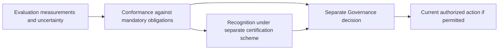

### 31.3 Supported scope closure

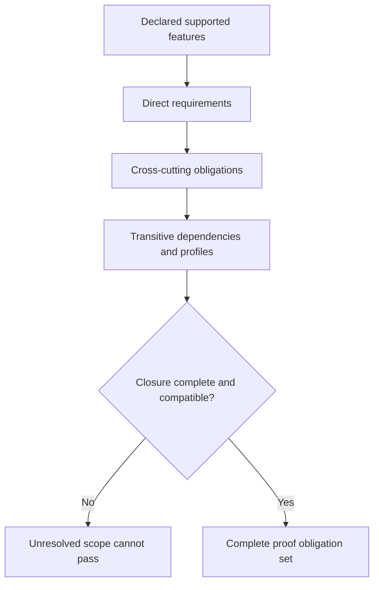

### 31.4 Port and Adapter

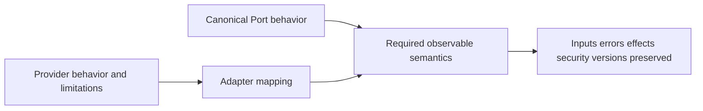

### 31.5 Plugin proof

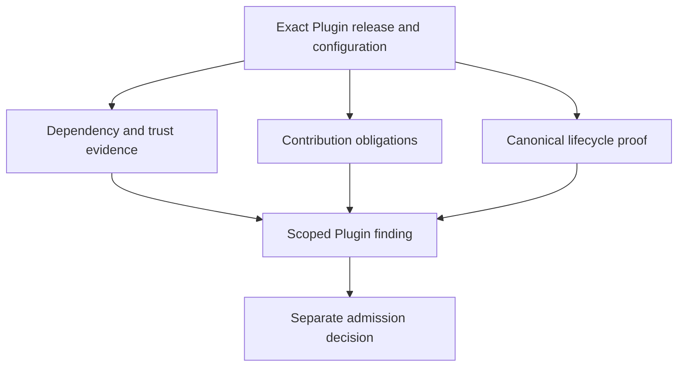

### 31.6 Security proof

### 31.7 Retry and effects

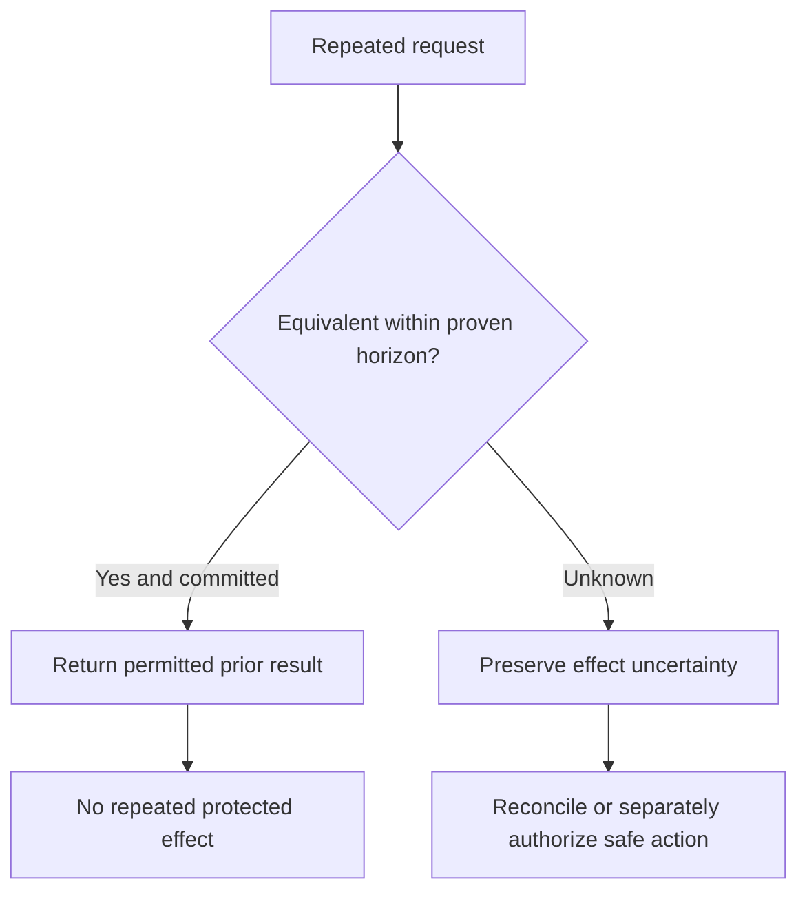

### 31.8 Revocation race

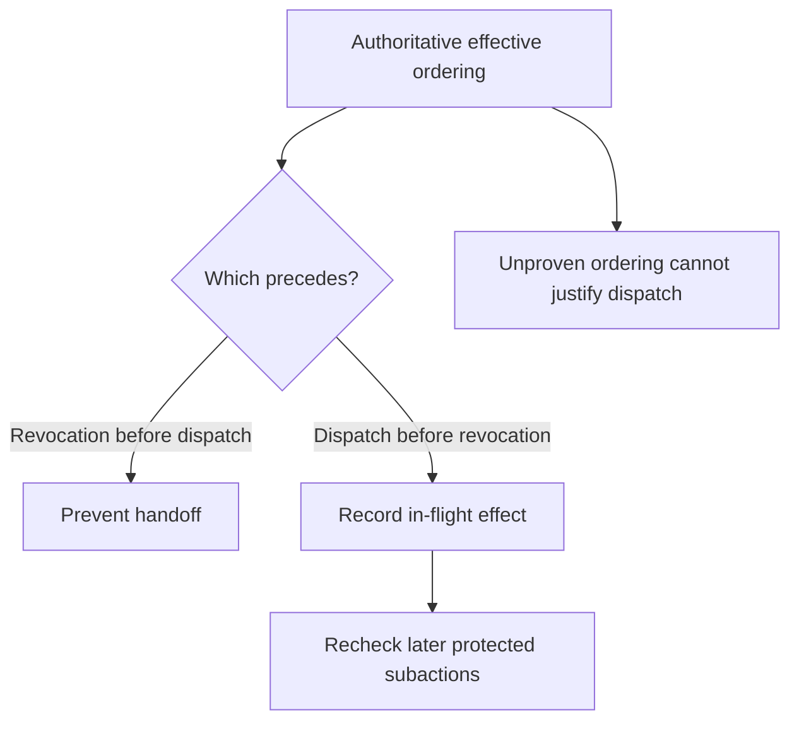

### 31.9 Tenant isolation

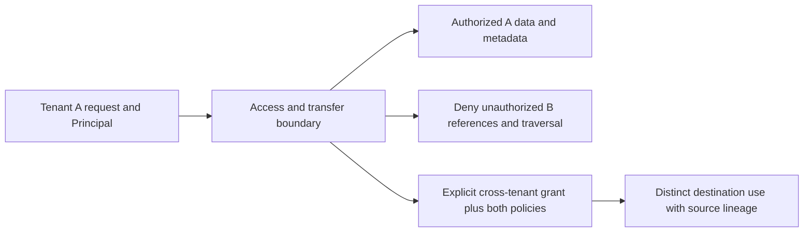

### 31.10 Composition

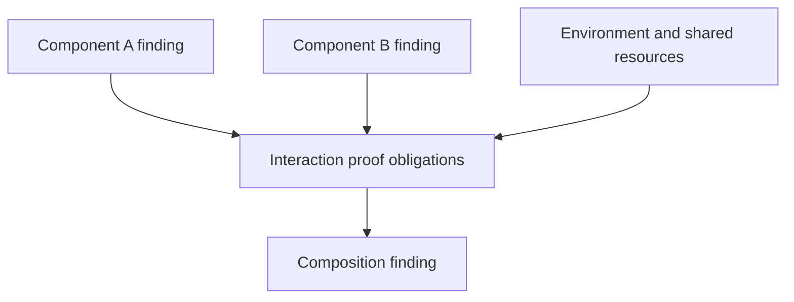

### 31.11 Delta assessment

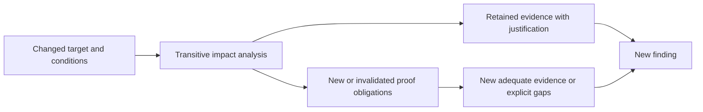

### 31.12 Continuous assessment

### 31.13 Evidence reuse and invalidation

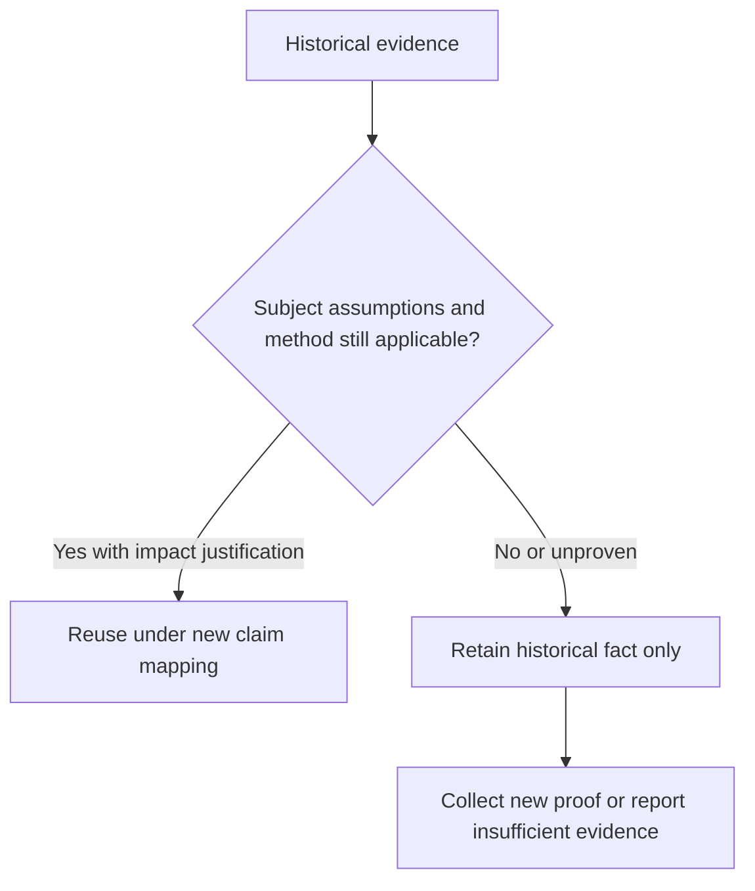

### 31.14 Finding to separate decision

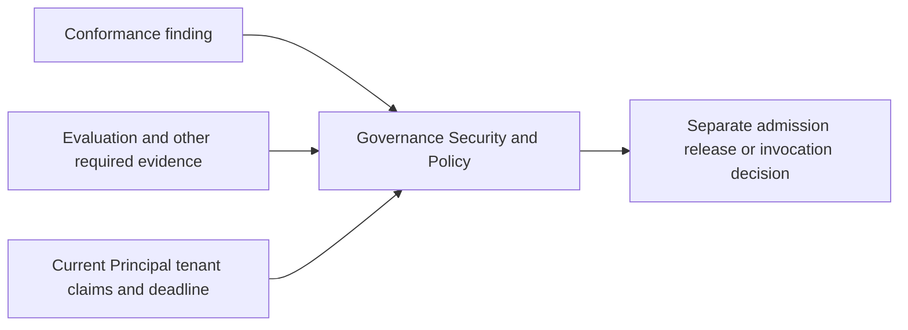

## 32. Inherited questions and risks

**CONF-084.** Dispositions below advance semantic proof obligations only. No implementation, certification program, or deployment has been verified. “Partially resolved” means the proof model is now specified while stated decisions or actual evidence remain outstanding. Each item is carried forward to its identified owner and exit criterion; none is silently closed by publication of this document.

### 32.1 SPEC, Architecture, and Contracts

| Identifier | Disposition here | Conformance contribution | Next owner | Exit criterion |
|---|---|---|---|---|
| Q-02 | Unchanged; carried forward | Cross-tenant proof preserves distinct scope and excludes unsupported co-ownership | SPEC authority | Accepted co-ownership semantics before any such support claim |
| Q-03 | Partially resolved; carried forward | Claims, attestations, certification, and namespace ownership are separate | Standards/Governance authority | Explicit namespace/certification authority and scheme governance adopted |
| Q-04 | Partially resolved; carried forward | Versioned profile mechanism, composition and sufficiency defined; no official tiers | Standards/Governance authority | Named profiles approved with closed requirements and evidence rules |
| Q-05 | Unchanged authority question; carried forward | Proof must expose retention/policy conflicts and permitted exceptions | Governance/Security authority | Applicable precedence/exception decision with enforceable proof scope |
| Q-06 | Partially resolved; carried forward | Resource proof binds units, precision and uncertainty | Resource authority and ADR owners | Accepted metering bounds plus conservation evidence |
| Q-07 | Partially resolved; carried forward | Guarantee/failure-model/horizon evidence requirements established | Contract/profile and ADR owners | Concrete profiles and mechanisms demonstrate durability/order/recovery/retention |
| Q-08 | Unchanged; carried forward | Blueprint scopes may activate requirements without core domain coupling | SPEC/Blueprint owners | Accepted cardinality vocabulary with independently usable compositions |
| R-01 | Partially resolved; carried forward | Clause-ledger and anti-coupling proof constrain kernel expansion | Architecture/ADR owners | Minimal kernel and independent realizations demonstrated |
| R-02 | Partially resolved; carried forward | Finite-root and no-self-admission negative obligations | Security/Plugin/ADR owners | Independent roots and bootstrap failure evidence |
| R-04 | Partially resolved; carried forward | Joint-validity and revocation ordering proof required | Contract/ADR/runtime owners | Competing claims/races proved under actual failure model |
| R-05 | Partially resolved; carried forward | Activities, owner state, acknowledgment and finding remain distinct | Contract/Plugin/runtime owners | Illegal transition and partial publication cases satisfy mapping |
| R-06 | Partially resolved; carried forward | Threat-scoped shared-host/composition evidence mandatory | Security/ADR owners | Host meets declared attacker model or claim narrowed honestly |
| R-07 | Partially resolved; carried forward | Partial commit and outstanding-obligation repair surfaces defined | Contract/runtime owners | Fault evidence preserves all committed facts without repeated effects |
| R-08 | Partially resolved; carried forward | Finite evidence roots and assessment dependency closure | Security/Evidence/ADR owners | No recursive proof or admission dependency without grounded basis |
| CR-01 | Partially resolved; carried forward | Ordering proof and fail-closed availability tradeoff explicit | Contract/ADR owners | Joint validity demonstrated during partitions and owner outage |
| CR-02 | Partially resolved; carried forward | Deduplication scope/horizon and lost-record proof mandatory | Contract/retention/runtime owners | Retry horizon matches retained equivalence/effect evidence |
| CR-03 | Semantics preserved; proof carried forward | No Approval refund; separate new entitlement assessed | Governance/Approval runtime owners | Consumed-dispatch-failure and new-entitlement cases pass |
| CR-04 | Partially resolved; carried forward | Safe errors and authorized evidence access assessed separately | Security/Observation owners | Confidentiality and sufficient diagnostic review both evidenced |
| CR-05 | Partially resolved; carried forward | Identity, retrieval, retained content, and interpretation distinguished | Evidence/retention owners | Loss/expiry/outage behavior satisfies declared guarantee |
| CR-06 | Partially resolved; carried forward | Publication cannot substitute for admission/activation | Plugin/Catalog/runtime owners | Delayed/stale publication never reactivates stopped contributions |
| CR-07 | Partially resolved; carried forward | Required pre-evidence, post-effect repair, finite roots proof | Security/Evidence/ADR owners | Root sufficiency and evidence-failure behavior demonstrated |

### 32.2 Plugin-specific risks

| Risk | Disposition and proof contribution | Next owner | Exit criterion |
|---|---|---|---|
| Dependency explosion | Partially resolved; transitive proof closure and bounded assessment dependencies | Plugin/Architecture owners | Complete finite dependency graph and bounded assessment cost |
| Provider shadowing | Partially resolved; candidate identity, selection and competing-Provider cases | Catalog/Resolution owners | No implicit substitution of unqualified offers |
| Namespace impersonation | Partially resolved; authoritative namespace/version evidence | Standards/Security owners | Issuer/namespace entitlement established and spoofing rejected |
| Capability spoofing | Partially resolved; exact advertised guarantee-to-proof mapping | Capability/Plugin owners | Every advertised supported guarantee adequately evidenced |
| Stale health evidence | Partially resolved; freshness and invalidation cases | Plugin/Catalog owners | Stale observations cannot satisfy current predicates |
| Hidden implementation coupling | Partially resolved; Port mapping and replacement/minimality proof | Architecture/Adapter owners | Alternate realization preserves declared behavior |
| State migration incompatibility | Partially resolved; source/target interpretation and partial migration proof | Migration/domain owners | State, effects, liabilities and history preserved |
| Configuration drift | Partially resolved; exact config binding and reassessment triggers | Runtime/Plugin owners | Material drift invalidates current applicability visibly |
| Partial activation | Partially resolved; owner-local lifecycle/publication failure schedules | Plugin/Catalog owners | No fabricated global activation success |
| Contribution publication races | Partially resolved; stale publication and stop ordering | Catalog/Plugin owners | Eligibility cannot be revived by delayed publication |
| Shared-host escape | Partially resolved; attacker-scoped isolation/composition proof | Security/ADR owners | Declared host boundary demonstrated under hostile contribution |
| Trust bootstrap circularity | Partially resolved; finite independent root proof | Security/Plugin owners | No self-admission or circular evidence entitlement |
| Extensions becoming de facto core | Partially resolved; namespace and portability proof | Standards/Extension owners | Core support remains possible without unrelated extension |
| Version coexistence conflicts | Partially resolved; exact binding and coexistence interaction proof | Plugin/runtime owners | Old/new work retain valid distinct semantics and accounting |
| Silent guarantee weakening | Partially resolved; replacement/delta guarantee mapping | Contract/Plugin owners | No reduced advertised guarantee without explicit version/scope change |

All Plugin risks remain carried forward until their exit evidence exists; no Plugin has been assessed here.

### 32.3 Security-specific risks

| Risk | Disposition and proof contribution | Next owner | Exit criterion |
|---|---|---|---|
| Identity-provider compromise | Partially resolved; root assumption and compromised-issuer cases | Identity/Security/ADR owners | Threat-scoped detection/recovery or explicit justified limitation |
| Overbroad delegation | Partially resolved; attenuation and deputy negative proof | Governance/runtime owners | Requested action cannot exceed effective intersection |
| Policy conflict ambiguity | Partially resolved proof; authority precedence remains open | Governance/Security owners | Applicable conflict handled without invented allow precedence |
| Break-glass abuse | Partially resolved; exception entitlement/scope/expiry visibility | Governance/Security owners | Emergency action cannot bypass non-waivable boundaries |
| Trust-root compromise | Partially resolved; independently grounded recovery proof | Security/ADR owners | Recovery authority exists outside compromised root or claim blocked |
| Approval UI deception | Partially resolved; exact presented evidence/action binding | Approval/Human interaction owners | Decision binds the actual protected action and revision |
| Secret confused-deputy attack | Partially resolved; consumer/purpose/target and requester intersection cases | Secret/Tool owners | Privileged consumer cannot misuse requester's scope |
| Cross-tenant metadata leakage | Partially resolved; metadata/traversal/token/cache obligations | Tenant/Information owners | No unauthorized metadata path within declared threat model |
| Side-channel leakage | Partially resolved; threat-scoped exclusions and evidence | Security/ADR owners | Claimed prevention proved; exclusions explicit and profile-compatible |
| Privileged Plugin collusion | Partially resolved; composition and indirect-path proof | Security/Plugin owners | Combined privileges cannot bypass declared isolation/mediation |
| Audit denial-of-service | Partially resolved; resource bounds and evidence-failure schedules | Evidence/Resource owners | Required audit failure blocks/repairs correctly without duplicate effects |
| Evidence forgery | Partially resolved; provenance/integrity/custody and counterevidence checks | Evidence/Security owners | Forged/stale subject evidence rejected under accepted method |
| Security-control downgrade | Partially resolved; replacement/profile/delta proof | Security/Release owners | No silent weakening across updates or fallback |
| Stale security profile | Partially resolved; profile version/freshness applicability | Standards/Security owners | Material threat/profile changes invalidate affected claims |
| Revocation propagation failure | Partially resolved; effective ordering and operational proof | Governance/runtime owners | No handoff when revocation wins; later subactions revalidate |

All Security risks remain carried forward; semantic proof obligations are not deployed control evidence.

### 32.4 Evaluation-specific risks

| Risk | Disposition and proof contribution | Next owner | Exit criterion |
|---|---|---|---|
| Benchmark overfitting | Partially resolved; relevance/coverage and independent confirmation | Evaluation/assessor owners | Evidence generalization matches claimed population/scope |
| Dataset leakage | Partially resolved; access/provenance and hidden-oracle boundaries | Evaluation/Information owners | No unauthorized reference leakage; exposure limitations stated |
| Judge bias | Partially resolved; independence/calibration and contradictory evidence handling | Evaluation owners | Bias limitations compatible with obligation sufficiency |
| Self-evaluation bias | Partially resolved; self-attestation distinct from independent proof | Assessor/Governance owners | Claimed independence substantiated; self-source never disguised |
| Metric gaming | Partially resolved; requirement closure prevents score substitution | Evaluation/Conformance owners | Metric success cannot bypass mandatory behavior |
| Goodhart's law | Partially resolved; obligation-level findings and non-aggregate failures | Evaluation/Conformance owners | Target metric does not replace intended contract evidence |
| Dataset contamination | Partially resolved; provenance and contamination disclosure | Evaluation owners | Relevant contamination assessed; unknown not presented as clean |
| Non-representative cases | Partially resolved; requirement/population coverage ledger | Evaluation/assessor owners | Supported scope justified by relevant cases and assumptions |
| Test flakiness | Partially resolved; repeatability and counterevidence preservation | Assessor/implementation owners | Cause understood and sufficiency justified without pass cherry-picking |
| Environment drift | Partially resolved; exact environment binding and delta analysis | Runtime/assessor owners | Changed assumptions invalidate or requalify affected evidence |
| Evaluation cost explosion | Partially resolved; governed bounded proof dependencies | Evaluation/Resource owners | Assessment resources bounded and accounted, no hidden recursion |
| Hidden evaluator dependency | Partially resolved; exact method/dependency and finite root evidence | Evaluation/Architecture owners | Full relevant evaluator dependency closure identified |
| Score aggregation masking failures | Partially resolved; per-obligation judgments and mandatory failure dominance | Evaluation/Conformance owners | Critical counterexample cannot be averaged away |
| False confidence | Partially resolved; requirement-relative uncertainty and negative proof strategy | Evaluation/assessor owners | Confidence interpretation and limits substantiate stated claim |
| Human reviewer inconsistency | Partially resolved; attributed rubric and disagreement evidence | Evaluation/Human review owners | Decision consistency/limitations assessed for intended use |
| Adversarial evaluator manipulation | Partially resolved; evaluator boundary and malicious-evidence cases | Security/Evaluation owners | Manipulated inputs cannot manufacture trusted proof or authority |
| Security finding disclosure | Partially resolved; governed evidence access and safe diagnostic proof | Security/Evidence owners | Review remains adequate without unauthorized disclosure |

All Evaluation risks remain carried forward; no dataset, evaluator, case, or implementation has been executed or certified here.

## 33. Conformance-specific risks

**CONF-085.** The following new risks remain open. Exit criteria require actual downstream work; writing this specification does not satisfy them.

| Risk | Failure mode and required mitigation | Next owner | Exit criterion |
|---|---|---|---|
| Test-suite incompleteness | Suite omits a normative obligation; require clause-level coverage independent of suite pass count | Conformance suite/Standards owners | Every applicable clause has reviewed proof disposition |
| False conformance claims | Claim exceeds evidenced scope; bind exact target and closed obligations | Claimant/assessor/Governance | Published claims match findings and known limitations |
| Profile fragmentation | Incompatible local bundles masquerade as the same scope; namespace/version/composition rules | Standards/Governance | Governed profile identities and conflict handling adopted |
| Evidence staleness | Old observations represented as current proof; explicit freshness/impact checks | Claimant/assessor/runtime owners | Change/expiry triggers invalidate affected applicability |
| Certification theater | Recognition badge substitutes for adequate proof or Permission | Scheme/Governance owners | Scheme entitlement, evidence and authorization boundaries demonstrable |
| Implementation-specific test overfitting | Cases reward one mechanism instead of canonical behavior | Suite/Adapter/Architecture owners | Distinct realizations assessed through semantic mappings |
| Negative-case undercoverage | Only successful paths checked; explicit forbidden-path coverage | Security/Conformance owners | Relevant attacker/failure paths covered or honestly bounded |
| Composition gap | Component passes hide unsafe interactions | Composition/runtime owners | Interaction obligations and shared assumptions independently assessed |
| Environment mismatch | Evidence taken under materially different conditions | Assessor/ADR/runtime owners | Environment mapping or new evidence discharges assumptions |
| Flaky conformance evidence | Repeated retries select a favorable outcome | Assessor/implementation owners | Variability explained; counterevidence retained and resolved |
| Self-attestation abuse | Publisher statement represented as independent verification | Claimant/Governance owners | Attestation type and independence evidence visible |
| Evidence tampering | Altered records or substituted subjects support a finding | Evidence/Security owners | Integrity, custody and exact-subject verification meet threat model |
| Unsupported-feature laundering | Failed mandatory obligation relabeled unsupported | Assessor/Standards owners | Closure/exclusion review prevents selective compliance |
| Version drift | Claim target/profile/source semantics change without reassessment | Claimant/Standards owners | Immutable version binding and compatible evidence reuse proven |
| Waiver abuse | Risk acceptance hides canonical failure | Governance/assessor owners | Exceptions entitled and limited; unwaived violations remain visible |
| Proof-method mismatch | Statistical sample or static declaration asserted to prove absolute boundary | Assessor/Standards owners | Method legitimately establishes the stated proposition and limits |

## 34. CONF-to-authority traceability

**CONF-086.** Every CONF requirement is traced below. References include upstream semantic sections as well as numbered families; §30.5 maps those families to future proof obligations. Exact clauses MUST be expanded for concrete claims under CONF-063. Review and hand-off requirements derive from the same phase boundaries; they do not assert additional runtime behavior.

| CONF requirements | Upstream authority and purpose |
|---|---|
| CONF-001–003 | intent §47; SPEC §1; ARCHITECTURE §§1, 4.7, 5; EVALUATION §§1, 27 — hierarchy and phase boundary |
| CONF-004–005 | intent §§46–51; SPEC §§1.2, 12; CONTRACTS §§32, 34; EVALUATION §§1–2, 22 — scoped mandatory satisfaction |
| CONF-006–008 | SPEC S-01–12, §§4.11, 5; ARCHITECTURE owner boundaries; CONTRACTS §24; EVALUATION §3 — records without new global ontology |
| CONF-009–011 | SPEC §§1.2, 7, 11–12.2; AR-01–08; CONTRACTS §§30–32; EVALUATION §§1, 22 — supported scope and independent use |
| CONF-012–015 | CONTRACTS §§3, 32, 34; PLUGIN-SPEC §18; SECURITY §§22, 26; EVALUATION §§3, 8–11, 20, 22 — attributed findings and gaps |
| CONF-016–020 | SPEC §§2, 7, 11, Q-03/Q-04/Q-07; CONTRACTS §§30–32; PLUGIN-SPEC §§5–6; SECURITY §26; EVALUATION §22 — applicability and profile closure |
| CONF-021–024 | SPEC §§4.4, 4.12, 7; CONTRACTS §§8–9, 26, 30; PLUGIN-SPEC §§4–6, 12 — Port/provider semantics |
| CONF-025–027 | SPEC §5.12; CONTRACTS §§26–27; PLUGIN-SPEC §§3–20; SECURITY §14 — release, contribution, lifecycle proof |
| CONF-028–029 | SECURITY §§3–28; CONTRACTS §§6, 15, 26–29; EVALUATION §14 — threat-scoped security proof |
| CONF-030–031 | SPEC §§4.11, 9; SECURITY §12; EVALUATION §§5–11, 14, 20, 22 — relevant evidence and probabilistic limits |
| CONF-032–033 | SPEC §§4.4, 4.9, 4.11, 5; CONTRACTS §§7–10, 24, 26; PLUGIN-SPEC §10; EVALUATION §3 — independent canonical lifecycles |
| CONF-034–037 | SPEC E-06–11; AR-14–18; CONTRACTS §§3, 5–6, 14, 28–29; SECURITY §§9–10, 22 — retry, effects and owner-local facts |
| CONF-038–039 | SPEC S-10–12, Q-02; CONTRACTS §15; PLUGIN-SPEC §17; SECURITY §§18, 20–22 — tenant/cross-tenant behavior |
| CONF-040–041 | SPEC B-01–04; AR-18; CONTRACTS §15; SECURITY §19; EVALUATION §16 — conservation and inherited limits |
| CONF-042–044 | SPEC §§5.11, 6, 8; CONTRACTS §§6, 15; SECURITY §§7–11 — exact claims and revocation ordering |
| CONF-045–047 | SPEC A-04; CONTRACTS §§12, 14–15; SECURITY §§11–13, 17; EVALUATION §14 — Secrets, content and deputy boundaries |
| CONF-048–049 | AR-19, AR-21; CONTRACTS §§26–27, 29; PLUGIN-SPEC §§9, 13; SECURITY §§15–16 — isolation and finite bootstrap |
| CONF-050–053 | SPEC §§7.3, 11; CONTRACTS §31; PLUGIN-SPEC §§6, 8, 15; SECURITY §§14, 17; EVALUATION §§7, 18 — compatibility and change |
| CONF-054–056 | SPEC §§3, 5.8–5.9, 8, 12.2; CONTRACTS §§10–13; SECURITY §§11–12 — optional composition and DEC-01 |
| CONF-057–058 | SPEC §§4.5–4.8, 9; CONTRACTS §§16–23; SECURITY §§20–21; EVALUATION §§12–13 — independent information/action surfaces |
| CONF-059 | CONTRACTS §24; EVALUATION §§3–22 — Evaluation implementation obligations |
| CONF-060–065 | SPEC §12; CONTRACTS §34; PLUGIN-SPEC §25; SECURITY §28; EVALUATION §§6–11, 14–15, 22 — proof cases, suites and coverage |
| CONF-066–070 | CONTRACTS §§4, 25, 28–29, 34; SECURITY §§22, 24–25; EVALUATION §§7–9, 19–22 — sufficiency, availability and safe errors |
| CONF-071–073 | intent §§46–49; SPEC Q-03/Q-04, A-05; PLUGIN-SPEC §18; SECURITY §§23, 26; EVALUATION §§17, 22 — certification and decisions |
| CONF-074–077 | SPEC §§2, 11; CONTRACTS §§31–32; PLUGIN-SPEC §15; SECURITY §§14, 26; EVALUATION §§7, 18–20 — freshness, impact, delta |
| CONF-078–081 | ARCHITECTURE §§4–8; CONTRACTS §§6, 28, 34; SECURITY §§15, 18–19, 22, 24; EVALUATION §§18–20 — composition/environment/operational evidence |
| CONF-082–083 | All families indexed in §30.5; EVALUATION §22 — matrix and diagram proof index |
| CONF-084–085 | SPEC §13; ARCHITECTURE risks; CONTRACTS §35; PLUGIN-SPEC §§22–23; SECURITY §§29–30; EVALUATION §§23–24 — inherited and new risks |
| CONF-086–090 | intent §§47–51; SPEC §12; CONTRACTS §§34–36; PLUGIN-SPEC §§24–27; SECURITY §§31–33; EVALUATION §§22, 25–27 — traceability, review, hand-off and next phase |

## 35. Downstream hand-off

**CONF-087.** Conformance supplies downstream requirement IDs, proof obligations, supported-scope and profile mechanisms, claim/finding semantics, evidence sufficiency, case/suite semantics, negative-case families, coverage/traceability, change-impact rules, and risk-driven proof surfaces. Future ADR planning SHOULD identify which unresolved guarantee, environment, authority, retention, accounting, and isolation decisions need mechanism choices and what evidence would justify them. This hand-off does not decide those mechanisms.

**CONF-088.** This document defines no wire schemas, JSON/YAML formats, SDK interfaces, test-runner APIs, CI configuration, runtime technology, specific Adapter, deployment topology, or certification authority. If representations are needed later, they require authorization in the accepted downstream process; this document does not insert a canonical representation phase. No tests were written or executed, no implementation assessed, and no conformance or certification award made during this phase.

## 36. Final self-review

**CONF-089.** The following review checks document completeness and semantic boundaries. “Satisfied” means specified here, not proven in an implementation.

| # | Review check | Disposition and location |
|---|---|---|
| 1 | No test technology selected | Satisfied — §§1, 25, 35 |
| 2 | No schema created | Satisfied — §§1, 35 |
| 3 | Conformance distinct from Evaluation | Satisfied — §§2, 11, 26 |
| 4 | Conformance distinct from Certification | Satisfied — §26 |
| 5 | Conformance distinct from authorization | Satisfied — §§3, 26 |
| 6 | Claims always scoped | Satisfied — §§2, 4–5 |
| 7 | Claimant does not equal verifier | Satisfied — §§5, 26, 30.4 |
| 8 | Self-attestation labeled | Satisfied — §§26, 30.4 |
| 9 | Supported scope explicit | Satisfied — §4 |
| 10 | Unsupported features explicit | Satisfied — §§4–6 |
| 11 | Conditional obligations close transitively | Satisfied — §6 |
| 12 | Cross-cutting requirements cannot be omitted | Satisfied — §§6, 30.5 |
| 13 | Port conformance preserves semantics | Satisfied — §8 |
| 14 | Adapter preserves errors/effects/security | Satisfied — §8 |
| 15 | Plugin preserves lifecycle/bootstrap | Satisfied — §§9, 12, 18 |
| 16 | Security preserves trust boundaries | Satisfied — §§10, 16–18 |
| 17 | Tenant proof includes metadata | Satisfied — §14 |
| 18 | Retry covers equivalence/effects | Satisfied — §13 |
| 19 | Unknown effect never becomes none | Satisfied — §§8, 13 |
| 20 | Partial completion remains visible | Satisfied — §13 |
| 21 | Approval replay prevented | Satisfied — §16 |
| 22 | Revocation ordering has proof cases | Satisfied — §16; no cases executed |
| 23 | Revoked Secret restoration prohibited | Satisfied — §17 |
| 24 | Injection proof targets authority boundary | Satisfied — §17 |
| 25 | Confused deputy has proof cases | Satisfied — §17; no cases executed |
| 26 | Shared-host claims require threat-scoped evidence | Satisfied — §§18, 28 |
| 27 | Resource double-spend addressed | Satisfied — §15 |
| 28 | Canonical error categories preserved | Satisfied — §25 |
| 29 | Version/extension semantics preserved | Satisfied — §19 |
| 30 | Replacement cannot weaken guarantees | Satisfied — §19 |
| 31 | Migration cannot restore authority | Satisfied — §19 |
| 32 | Evaluation implementations have obligations | Satisfied — §22 |
| 33 | Missing evidence is not pass | Satisfied — §§5, 23, 25 |
| 34 | Mandatory failure cannot be averaged away | Satisfied — §§5, 11 |
| 35 | Components do not imply composition conformance | Satisfied — §28 |
| 36 | Environment assumptions explicit | Satisfied — §§4, 24–25, 28 |
| 37 | Evidence reuse needs impact analysis | Satisfied — §§11, 27 |
| 38 | Historical findings immutable | Satisfied — §§5, 27 |
| 39 | All inherited risks tracked | Satisfied — §32: 21 identifiers and 47 named risks |
| 40 | Next phase follows accepted hierarchy | Satisfied — §§1, 35, 37 |

## 37. Next document

**CONF-090.** Recommend an **ADR planning/index document under `adrs/`** next, following intent §47's accepted sequence toward ADRs, runtime, adapters, blueprints, and applications. Its purpose would be to identify needed decisions and their evidence obligations, not to bypass unresolved authorities or preselect technologies. It is not created by this phase. Work stops at this Conformance specification; schemas, ADR decisions, implementation, adapters, blueprints, and applications require subsequent explicit instruction.
