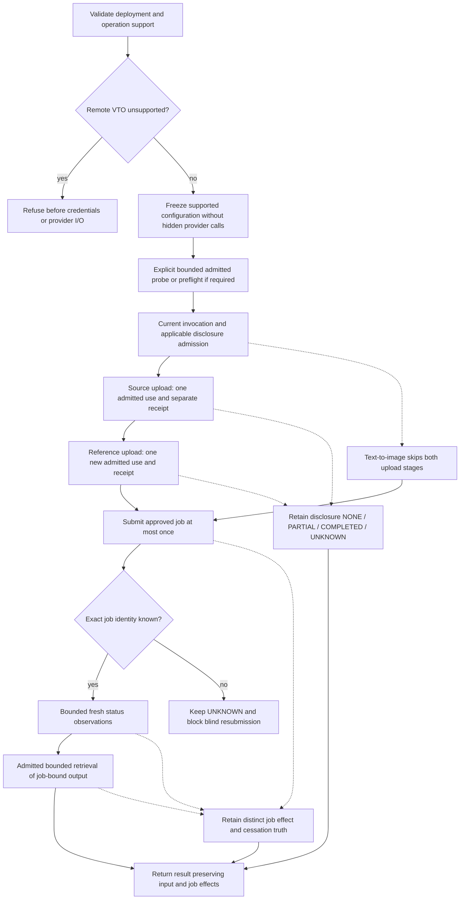

# GENERATIVE-MEDIA-GOVERNED-HOST-SECRET-BOUNDARY-1

Architecture proposal, 2026-10-11. LOCAL VALIDATION PENDING.
Source baseline: `5840eef3baadfada97740af51cef0630be1a7612`.

This document proposes a boundary; it does not accept an ADR, authorize a
migration, or qualify credentialed media. No production source, public API,
dependency manifest or existing ADR changes. No live execution authorized.
The only companion artifact is the local document/scope validator.

The preceding architecture audit has maintainer-reported local evidence:
423 Core/consumer architecture, 133 Engineering architecture/authorization,
and 16 public-host/VTO tests passed (572 total); typing, lint, formatting and
whitespace passed. That evidence does not close H-01, M-01 or M-04. No checks
were executed for this slice by the author.

## 1. Current problem statement

The media pack owns the correct application-facing operations, but combines
them with a private Core host reconstruction and an ungoverned credential
transport. Moving either implementation behind a renamed class would preserve
the authority gap. The smallest useful change is a media facade using a narrow
Core execution composition contract and, separately, an admitted protected
credential-use boundary. A universal operation/result protocol is unnecessary.

This proposal closes the design question, not the runtime defects. Remote
personal-image support remains blocked by ADR-020. Credentialed media remains
unqualified; a local host or a successful provider response does not change that.

## 2. H-01 evidence

At the frozen source revision:

| Source | Observed behavior | Consequence |
| --- | --- | --- |
| [config.py](../packages/legoai-generative-media/src/legoai_generative_media/config.py), `resolve_secret` | Interprets `env:NAME`, reads a supplied mapping, returns a raw string | Deployment lookup supplies material, not a Secret-use decision |
| [service.py](../packages/legoai-generative-media/src/legoai_generative_media/service.py), `_driver`, `probe_provider`, `default_transports` | Passes that string into a transport before a governed generation invocation | Invocation admission cannot retroactively authorize earlier credential use |
| [http.py](../packages/legoai-generative-media/src/legoai_generative_media/http.py), `RemoteHTTPS` and `LocalHTTP` | Retains an authorization value for subsequent requests | No exact Secret revision/use identity, current purpose decision or protected-use attribution |
| [local_host.py](../packages/legoai-generative-media/src/legoai_generative_media/local_host.py), `prepare_local` | Establishes an operator capability-invocation grant | That grant is not a Secret-use grant |

H-01 is absence of an enforcing use boundary, not merely absence of a reference
type. TLS verification, endpoint allowlisting and hidden repr reduce different
risks; they do not establish purpose, tenant, current grant or revocation order.
Wrapping the token in `SecretRef`, passing a boolean approval, or calling
`authorize_secret_use` once at open would not fix the gap. The token path also
exists for local transports; local deployment is not an exemption.

## 3. M-01 evidence

[composition.py](../packages/legoai-generative-media/src/legoai_generative_media/composition.py)
imports `legoai.reference.execution.ExecutionCoordinator` and
`legoai.reference.resolution.resolve`. Its public-looking `invoke` and
`invoke_try_on` signatures expose the concrete coordinator. `Contribution`
already contains public immutable catalog/configuration/lifecycle values; those
values are not the private dependency problem.

`local_host.py` imports private reference catalog, evidence, execution,
governance and lifecycle implementations. `prepare_local` constructs registries,
admits/initializes/activates a plugin, publishes and resolves an offer, registers
a security context, and coordinates execution. The audit inventory counts
16 private imported names in these two media modules. It does not establish
that the pack currently imports `runtime._composition`; private `reference`
imports are sufficient evidence of M-01.

[ADR-002](../adrs/ADR-002.md) reserves reference implementations and runtime
composition internals to their owners. A method without an underscore on a
private class is not thereby a documented public Core API. Media should not
copy reference currentness/lifecycle rules or own Core registry wiring.

## 4. Relationship to M-04

`open_virtual_try_on` calls `_driver` before constructing the adapter with its
`local` flag. `_driver` resolves credentials and `discover("auto", ...)` may
probe both protocol families. The later adapter refusal therefore does not
prove construction was free of credentialed I/O. The explicit-family test
`test_remote_config_builds_but_never_transfers` uses `legacy`, which bypasses
auto-discovery. Separate preflight tests do not prove the constructor contract.

| Construction choice | Assessment |
| --- | --- |
| A: fail before any remote I/O | Preferred. Reject unsupported remote VTO before credential resolution, transport construction, discovery, workflow loading or image handling; safe configuration/deployment validation only |
| B: return an inert refusal-capable adapter | Can preserve delayed refusal, but adds an unsupported service state and duplicate refusal paths; no demonstrated need |
| C: permit bounded discovery, prohibit uploads/jobs | Discovery is still a protected credential/network operation; it is unnecessary to decide an already unsupported deployment |
| D: explicitly separate provider diagnostics from construction | Compatible with A: an independently admitted `probe_provider` operation may be supported under its own scope; it never grants VTO authority |

Intended contract: unsupported `open_virtual_try_on(remote_config)` fails
without external I/O for both explicit and auto families. Supported construction
should freeze configuration without hidden discovery; explicit preflight is
observable, bounded and separately admitted. Apply the same review to
`open_image_transfer`, which currently also constructs its driver first.
No behavior is changed here. This is an earlier refusal point, not permission
to enable remote VTO or change ADR-020's disclosure conditions.

## 5. Accepted security/architecture requirements

Authority comes from the actual accepted records, not historical index totals
or this proposal:

| Authority | Requirement for the proposed boundary |
| --- | --- |
| [Architecture](../architecture/ARCHITECTURE.md), [Contracts](../contracts/CONTRACTS.md), [ADR-002](../adrs/ADR-002.md) | Modular-monolith first; Ports & Adapters; public owner contracts; composition owns realizations, domain values do not contain provider SDKs |
| [ADR-005](../adrs/ADR-005.md), [ADR-007](../adrs/ADR-007.md) | Current authority and participating invalidators ordered at actual protected acceptance; admission alone is not a perpetual permit |
| [ADR-008](../adrs/ADR-008.md), [ADR-009](../adrs/ADR-009.md) | Unknown effects stay unknown; authoritative source truth differs from custody acknowledgements and caller assertions |
| [ADR-010](../adrs/ADR-010.md), sections 2, 5-15, 23 | Reference/material separation, exact purpose/consumer/recipient, current bounded use, disposal, safe attribution; no ambient fallback |
| [ADR-014](../adrs/ADR-014.md), [ADR-015](../adrs/ADR-015.md) | Public local composition is deliberately narrow; structured execution/claiming does not define every capability's result or business effect |
| [ADR-020](../adrs/ADR-020.md), decisions 3-9 | Minimize PNG inputs; separate disclosure from job effect; no retries; truthful retention; remote personal images unsupported |
| [ADR-023](../adrs/ADR-023.md), sections 7-12 | SRCP-1 is scoped to attended single-operator remote Model bearer use; future credential-primitive reuse is contemplated, not media qualification |
| [ADR-024](../adrs/ADR-024.md) | Model disclosure admission is distinct from credential authority; its processor/model policy is not a media admission |
| [Security](../security/SECURITY.md), SEC-011, 020, 037, 057-060, 066-067, 075, 077, 081 | Exact principal/tenant/action; current Secret use; constrained deputy; classified disclosure; preserve partial/unknown; fail closed before new protected handoff |

REUSE > EXTEND > CREATE. Configuration != authorization. Plugin admission !=
authorization. Capability selection != authorization. Approval != Permission.
Secret possession != permission to use. Model/Agent output has no authority.
Unknown effect != no effect. Provider topology must not redefine domain meaning.
These distinctions apply even when a single operator establishes several roles.

## 6. Current Model Secret-use flow

Read together: [runtime/api.py](../src/legoai/runtime/api.py),
[runtime/local.py](../src/legoai/runtime/local.py),
[model_governed.py](../src/legoai/runtime/_composition/model_governed.py),
[remote_model.py](../src/legoai/runtime/_composition/remote_model.py),
[secret.py](../src/legoai/runtime/_composition/secret.py),
[credential_https.py](../src/legoai/runtime/_composition/credential_https.py).

1. The source itself obtains hidden interactive material, issues an immutable
   exact `SecretRef` and retains protected material within one process
   incarnation. The public `CredentialSource` is explicitly Model-purpose
   scoped; it is not a ready-made media source. Ordinary environment bootstrap
   is explicitly not authorized by ADR-023 section 8.
2. `open_local_host` binds trusted operator configuration, source, principal,
   grant/policy, contribution, HTTPS origin/API root and local custody. Its
   `CredentialAssociation` checks `remote-model-bearer`. Configuration selects
   a mapping; it is not current permission for every future request.
3. Model orchestration claims one invocation, evaluates disclosure, and
   validates binding/provider/recipient association before custody or transport.
4. The invoking owner commits an INTENDED remote attempt. `exact_use_request`
   binds a fresh `SecretUseId` to that attempt and builds `SecretUsePlan` plus
   `SecurityContext`. Preliminary current authorization runs before connection.
5. The private transport establishes verified DNS/TCP/TLS without credential
   bytes. Protected acquisition follows pre-use evidence preparation. In one
   ordering-domain occupancy `_handoff` rechecks current authority, revision,
   catalog, cancellation and validity margin; consumes applicable Approval;
   durably accepts exact Secret use; begins encryption; makes one nonblocking
   credential-bearing send. Arbitrary adapter callbacks do not run in that gate.
6. Each continuation write re-enters the gate; waits occur outside it. Losing
   cancellation/revocation ordering stops further writes, not bytes already sent.
   Material is discarded on exit. There is no retry, alternate recipient,
   credential fallback or reusable raw credential cache in the caller.
7. Transport observations settle the attempt; Secret Access records source
   use truth; Model composition maps the response to its own result/disclosure.
   A complete rejection after sending is not evidence that the Secret was unused.
   Lost acknowledgement/recovery inspects records and never resends.

Qualification limits matter. SRCP-1 orders local invalidations, but does not
prove wall-clock validity at handoff, provider-side currentness, zeroization,
hostile in-process isolation, remote retention or recall of transmitted bytes.
Margin checks and detected late sends are not a hard real-time guarantee.
The helper name `_SyntheticSecretAccess` does not widen its admitted profile.

## 7. Current Media credential flow

The current order is configuration -> `resolve_secret` -> token-bearing
transport -> optional discovery -> media adapter -> local host preparation ->
capability claim -> provider operations. Current reconciliation methods delegate
directly to the adapter; they must not inherit a previous invocation's authority
in a future credentialed profile.

Media owns two bounded uploads, a separately bounded submission, status
observations and output retrieval. See [transfer.py](../packages/legoai-generative-media/src/legoai_generative_media/transfer.py),
[virtual_try_on.py](../packages/legoai-generative-media/src/legoai_generative_media/virtual_try_on.py),
[comfyui.py](../packages/legoai-generative-media/src/legoai_generative_media/comfyui.py),
and [drivers/base.py](../packages/legoai-generative-media/src/legoai_generative_media/drivers/base.py).
`Budget` imposes request/overall deadlines; read-only wrappers constrain methods.
Neither mechanism establishes current Secret or disclosure authority.

`GenerationResult` separates `input_disclosure` from job `effect`; the compositor
preserves unknown disclosure once invocation starts, and typed cancellation can
retain a job receipt. Preserve those useful semantics. Current counters and
provider metadata are observations, not admission or authoritative non-use proof.

## 8. Generic vs Model-specific Secret semantics

Existing [Secret values](../src/legoai/governance/secret.py) and
[SecretAccessPort](../src/legoai/governance/ports.py) are the vocabulary to reuse.
`SecretUsePlan` explicitly documents its original local profile; reusing its
shape cannot silently broaden qualification. `authorize_secret_use` returns a
point-in-time decision, not a replayable permit. Protected acceptance is private
to qualified composition; the public Port alone cannot safely hand a token to
an arbitrary media adapter.

| Reusable semantic requirement | Existing representation / minimum proposed binding |
| --- | --- |
| Verified requester and actor | `Principal`, `SecurityContext`; first media profile remains non-delegated, single operator, not an invented delegation chain |
| One tenant | `TenantContext`, exact reference scope and configuration agree; caller text cannot select a different tenant |
| Exact Secret and source mapping | `SecretRef`, `SecretRevisionRef` including mapping revision; no material hash, environment name, alias or latest-selector substitute |
| One operation and execution | `OperationRef`/`OperationId`, `ExecutionContext`/`ExecutionId`; owner-issued attempt correlates one `SecretUseId` |
| Purpose and admitted consumer | Existing plan purpose, consumer and `Version`; closed media operation vocabulary mapped by trusted composition, never user-supplied security prose |
| Capability and contribution | `CapabilityOffer`, `CatalogEntry`, plugin identity/version and `ConfigurationRevisionRef`; bind the selected contribution, not just a display name |
| Recipient and credential function | Validated exact provider/binding/origin/API root plus allowed operation/method/target; an output URL or alternate download origin grants no credential authority |
| Current permission and policy | Exact `Grant`, `PolicyRef`, applicable Approval, requester/deputy intersection, cancellation and current catalog/source facts rechecked at protected use |
| Use count and lifetime | One exact exchange per use; locally bounded expiry limited by grant/deadline; continuation writes belong to that same exchange and recheck currentness |
| Truth and evidence | Pre-use custody witness, accepted source use, send observations, media attempt/job correlation, safe settlement; evidence never mints a grant |

Purpose is currently a string field in canonical values, not a canonical enum.
Do not invent an incompatible universal replacement. Its security meaning is
the complete typed binding above, with a closed, versioned media action set:
probe, source-upload, reference-upload, submit, observe, retrieve. Observation
can have multiple explicitly budgeted attempts; two uploads are two uses, not a
shared lifetime token. A missing required input, provider identity, time bound
or enforcement participant blocks use. Bound payload meaning is checked inside
the trusted operation adapter; image bytes/digests are not added to Core evidence.

Model-specific: CHAT/EMBEDDING, model identifiers, OpenAI-compatible serialization,
`ModelPurpose`, `CredentialAssociation`, `RemoteModelRuntime`, Model disclosure
and processor admissions, and the Model attempt schema. SRCP-1's scope and
timing residual are an explicit profile decision, not a generic default.

Environment variables may identify deployment settings. They are not policy
and are not an approved media credential source here. Reuse of S1 would need a
separately admitted media purpose/consumer mapping. Any future environment
material source requires its own accepted source/currentness decision; retaining
`environ` as a backdoor after migration would leave H-01 open.

## 9. Media effect-boundary matrix

This is the proposed enforcement contract, not a claim of current support.
For every row, credentials are required only if the admitted provider operation
requires authentication. If a credential is used, a fresh exact Secret-use
decision and protected handoff are mandatory. An unauthenticated operation
still needs applicable invocation/disclosure/resource/evidence admission.

| Operation | Credential / Secret use | External effect | Retry and reconciliation | Authoritative evidence | Cancellation |
| --- | --- | --- | --- | --- | --- |
| A: provider probe/discovery | Separate probe purpose; each authenticated probe has its own use | Network/credential disclosure and provider logging possible; no intended upload/job | No automatic retry; bounded family probes are distinct admitted actions, not fallback authority. A later fresh observation cannot prove the first was never sent | Protected transport send/response observations; validated metadata proves only what was observed, never provider entitlement | Stop new probes/writes; retain possible prior credential use; no job does not mean no external effect |
| B: person/source upload | Source-upload use, exact recipient and minimized input admission | First personal-image disclosure and provider storage | At most one attempt; no blind resend. Reconcile only with a qualified exact object acknowledgement/lookup; otherwise unknown | Exact expected random object identity plus validated acknowledgement; lost acknowledgement is UNKNOWN, not absent upload | Stop further sends and garment/job steps; bytes already sent persist; deletion unproved |
| C: garment/reference upload | Separate reference-upload use, revalidate despite prior success | Second disclosure/storage; one confirmed upload gives PARTIAL aggregate unless another outcome is unknown | At most one attempt; same uncertainty rule as B; never restart both uploads | Separate object receipt; preserve first upload's truth; complete both gives COMPLETED input disclosure | Stops future work, cannot undo either upload; keep partial/unknown |
| D: submit generation job | Submit use bound to approved workflow and exact input references | Job creation/compute; distinct from prior image disclosure | At most one submission, no automatic retry. Qualified job identity permits reconciliation; lost identity/ack remains UNKNOWN | Validated provider job identity and attempt record; a local intended ID or idempotency header alone proves no provider deduplication guarantee | Before proven send NONE for job only; after possible send UNKNOWN unless a stronger receipt exists; stopping local wait is not remote cessation |
| E: reconcile status | New observe permission/use, exact existing job/tenant/recipient, bounded polls | Credential and job-reference disclosure; no new upload/submission | Read-only in job semantics, but each poll is fresh admitted work. No resend of failed poll automatically; bounded scheduled observations do not recreate a job | Identity-bound provider status plus preserved submission history; missing/404 status does not prove job absence or non-execution | Stop polling; preserve previous job effect and cessation truth |
| F: retrieve output | Retrieve permission/use only for the exact admitted recipient/object; no token forwarding to arbitrary output URLs | Transfer of output and possible provider access logs; local artifact custody is separate | No automatic retry; any later retrieval is new bounded authority. Read semantics do not authorize unlimited downloads | Job-bound output reference, validated bounded response/media format, separate local persistence receipt where applicable | Stop transfer; partial output is not valid success, and prior job COMPLETED stays completed |

Keep four facts distinguishable: Secret use, transport send, input disclosure,
and generation effect. A transport response does not automatically settle all
four. A complete provider rejection may settle a particular job request as
rejected while leaving credential use and already completed uploads intact.
Mandatory evidence failure before handoff blocks it; after handoff preserve
uncertainty and outstanding recording obligations. Never repeat an effect to
repair evidence. Retention/deletion is a separate provider guarantee; record
deletion, temp naming or local cancellation never proves physical deletion.

## 10. Alternative architecture comparison

| Option | Benefit | Cost / authority problem | Disposition |
| --- | --- | --- | --- |
| A: extend `GovernedHost` with capability execution | Familiar entry point | Existing host configuration/purposes/results are Model scoped; media jobs and disclosures would force unrelated changes. Merely delegating to callbacks cannot enforce Secret handoff | Reject whole-operation extension; reuse its internal composition knowledge |
| B: public execution/admission primitives | Removes concrete coordinator/registry coupling; Core retains enforcement authority | Too many raw registries or gate callbacks would recreate composition externally; existing Ports alone do not cover protected handoff | Select only a bound execution facade and separately qualified credential boundary |
| C: media public composition facade using approved Core contracts | Keeps workflow, images, jobs and typed results with their owner | Cannot close H-01 by wrapping current raw transports; requires B's missing enforcement seams | Preferred application boundary; extend existing service facade, do not add another application host |
| D: owner-local host using public lower-level contracts | Preserves ownership, can inject existing Ports | If it reconstructs grants/lifecycle/currentness or needs private acceptance it retains duplicated controls | Use media-local orchestration, not duplicate Core host internals |
| E: generic capability-host abstraction | Uniform appearance | No evidence of common whole-operation effect, lifecycle, result and substitution semantics across Model/media | Reject; violates ISP/KISS/YAGNI and risks flattening truth |
| F: retain current/debt | Zero migration risk today | H-01/M-01/M-04 remain; no production credential qualification follows | Temporary state until ADR/implementation review; explicitly not closure |

## 11. SOLID / DRY / KISS / YAGNI / SoC / LoD comparison

| Principle | Preferred C + bounded B | Rejected shortcut / review gate |
| --- | --- | --- |
| SRP | Core controls current authority/use; media controls generation semantics | Universal host mixes model response, uploads and job lifecycle |
| OCP | Another media driver implements existing media Ports and admitted provider profile | Provider selection/configuration alone cannot enable a new unqualified credential profile |
| LSP | Drivers must preserve bounds, no-retry, disclosure, unknown and cancellation contracts | A provider lacking reconciliation/retention evidence must expose/refuse that limit, not pretend equivalence |
| ISP | Apps retain media Ports; Core execution facade has no chat/image operation union | Adding `generate_any` or forcing media consumers to use Model settings |
| DIP | Media composition uses documented Core contracts; concrete controls stay Core-owned | Publishing `ExecutionCoordinator` or merely aliasing it |
| DRY | One authority implementation for reusable authorization, ordering and Secret-use invariants | Recreating registries/gates in media or sharing owner-specific acceptance criteria |
| KISS | Existing media service plus small bound control facade; separate credential qualification | General plugin host, session engine or workflow framework to remove two private import sites |
| YAGNI | Share already identical coordinate/claim/settle meaning; no universal operation/result abstraction | Counting future apps or HTTP similarity as consumer evidence |
| SoC | Configuration, source provisioning, authorization, transport, disclosure and job semantics remain distinct | `env:NAME` becomes permission, or one success flag hides uploaded data |
| LoD | Media calls a bound facade; immutable canonical value traversal is permitted | Reaching through a host into `_source`, coordinator registries or private transport objects |

## 12. Cross-consumer evidence

| Current consumer | Real matching semantics | Non-matching / evidence limit |
| --- | --- | --- |
| Model invoking plane | Uses the concrete coordinator's coordinate, one-shot claim and settlement; requester/tenant/current-use and source evidence requirements | One request produces a Model result; no media uploads or job lifecycle |
| Generative Media invoking plane | Already uses the same coordinator semantics with a different owner result. Independently requires exact credential admission under SEC-057/058 | Current media Secret enforcement is missing; this is a real second requirement, not a second qualified implementation |
| [ForgeAI composition](../examples/forgeai/src/forgeai/composition.py) | Uses `open_local_host`, Model execution and disclosure; application still owns engineering approval/effects | An application of the Model host is not another independently matching media/credential primitive consumer |
| [DocuMind composition](../examples/documind/src/documind_app/composition.py) | Public host provides governed chat/embedding; document acceptance stays application-owned | No independent remote media Secret use; also not a third whole-operation host requirement |

Strong two-consumer evidence exists for Core execution coordination primitives.
For credential semantics there is a second actual need, and ADR-023 section 11
supports future primitive reuse, but qualification is missing. Share only after
that profile is decided and proved. There are not two consumers demonstrating
an identical generic whole-operation host. "They both call HTTP" is insufficient.

## 13. Preferred architecture

Choose C backed by a narrow B, with media-owned orchestration from D. Keep F as
the accurately recorded current state until implementation is accepted.

Applications continue to use `TextToImagePort`, `VirtualTryOnPort` and
`JobReconciliationPort` through the existing media service facade. The pack
owns approved workflow selection, image minimization, upload sequencing, job
identity/status, output validation and retention disclosure. Core must not
import media, interpret a garment, or decide that a job completed.

Core composition should supply a bound execution facade using existing public
execution/security/catalog values. It handles trusted bootstrap, exact selected
contribution, context establishment, coordination, one-shot claim and truthful
settlement. It does not execute arbitrary user callbacks or expose registries.
This addresses M-01 without making Model's `GovernedHost` universal.

H-01 additionally requires an operation-bound protected credential exchange
whose safe public contract sits at runtime composition and whose material,
source acceptance, ordering and transport stay private. It accepts only an
admitted operation from trusted provider composition, never a caller-supplied
URL plus token or a cached allow decision. The media driver serializes and
validates its protocol; the protected boundary checks the actual request's
binding and shape against the admitted operation before handoff.

Do not expose an arbitrary `with_secret(callback)` hook. A returned material
handle or publicly transferable bearer permit would recreate ambient authority.
The qualified concrete transport remains the protected consumer, with every
credential-bearing continuation gated. Media operation adapters can supply
bounded protocol data outside the final gate, not arbitrary code inside it.

The first implementation cannot truthfully claim all media credential support:
ADR-023's current transport/attempt schema is Model specific in its integration
and excludes media transfer/job qualification. Start with independently bounded
provider-control use only after the new ADR. Uploads/downloads and asynchronous
job support need separate limits and effect evidence. Keep unsupported operations
closed; never route them back to raw `RemoteHTTPS` as a compatibility fallback.

## 14. Exact public/private ownership proposal

Names below are proposed contract roles, not implemented symbols or approved
signatures. The ADR must freeze the smallest signatures before coding. Do not
create a new Protocol merely because a public facade is required.

| Public surface / disposition | Semantic owner | Actual consumers / implementation | Authority and concrete substitution requirement | Failure semantics |
| --- | --- | --- | --- | --- |
| Existing media `open_*`, generate/try_on/reconcile and provider diagnostics | Generative Media | Media applications; current legacy/v2 drivers behind existing media Ports | Config selects an approved workflow/provider; operator admission is separate. Driver substitution must preserve the same media effect contract | Typed refusal before unsupported I/O; partial/unknown input/job outcomes; no automatic retry |
| Proposed `open_governed_execution` bound facade in the existing public `legoai.runtime.local` composition module; public contract values in `runtime.api` | Runtime composition, with Execution/Governance/Lifecycle owning their semantics | Model and media composition; first implementation wraps private reference controls | Trusted operator setup binds one configuration/contribution/authority scope, no model or media payloads. Replace reference internals without consumer imports; no second host-backend Protocol justified yet | Invalid/unadmitted config fails before provider I/O; current denial, duplicate claim and unavailable mandatory controls fail closed; claimed effects remain inspectable |
| Facade operations: create context for an allowed operation; coordinate exact entry; claim once; settle canonical execution outcome | Execution semantics via runtime facade | Both invoking planes; private coordinator today | Existing `ExecutionContext`, `CoordinationRequest`/`CoordinationResult`, `ExecutionResult`, `EffectExtent` and error values. No caller-minted context gains authority. No generic result/callback/driver dispatcher | Reuse transition/claim/deadline semantics; settlement records owner evidence, never manufactures success or equates timeout with no effect |
| Existing `SecretAccessPort`, `SecretRef`, `SecretUsePlan`, `SecretAccessRequest` remain reference/decision/evidence contracts | Governance / Secret Access | Model now; media only under accepted profile; qualified protected source internally | Preserve exact identity, minimum use, currentness and no material return. Public authorization result remains a snapshot, not the final gate | Denial/unavailable revision blocks use; uncertain source acceptance requires exact inspection, never reacceptance as recovery |
| Proposed operation-bound credential exchange facade, supplied only by qualified runtime composition | Runtime integrates Secret Access, Governance, invoking owner and protected transport | Model composition and media provider composition have matching exact-use needs; only Model currently realized. Private S1/T2 are candidates, not automatically reusable implementations | Closed admitted operation descriptor binds exact context/use/recipient/request/deadline and owner attempt receipt. No raw token, arbitrary URL, material callback or generic HTTP client API. Substitution only for a realization proving the same gate/recipient/failure contract; no new universal transport Port | Zero proven send differs from partial/unknown; complete rejection does not erase use; evidence loss keeps repair obligations; no retry/fallback |
| Media operation descriptor, bounded attempt records and disclosure/retention admission | Generative Media, referencing Core values | Media drivers and reconciliation service; Model keeps its own descriptor/attempt schema | Media closes action set, exact image/job targets and provider evidence. A descriptor is data; trusted composition validates it, Core does not accept it as authority merely by construction | Reject target/action/config drift, expired admission and unsupported privacy promises; preserve previous effects |

The execution facade's factory internalizes lifecycle admission/publication and
resolution for one explicitly admitted contribution; it must not infer a grant
from `CapabilityOffer` or arbitrary plugin construction. A supplied configuration
is validated against an independently established operator authority basis.
The returned facade supplies no registry mutation API, raw catalog publication
authority, generic plugin loader or tenant-switching convenience method.

Private remain private: `ExecutionCoordinator`, `DeterministicDispatchArbiter`,
`StaticSecurityContextRegistry`, in-memory registries, lifecycle functions,
`reference.resolution.resolve`, `_OrderingDomain`, `_SyntheticSecretAccess`,
`_CredentialFlight`, remote stores and every `runtime._composition` module.
No re-export or subclassing contract is proposed. Core can reorganize these
internally under the new public guarantees after acceptance.

Outstanding ADR-level choices are finite: exact safe factory inputs/error
mapping, context/session disposal bounds, ordered invalidator participation for
the new facade, media Secret provisioning profile, and supported wire/response
bounds per media operation. They are not delegated to implementation by analogy.

## 15. Secret-use sequence diagram

Proposed credentialed media operation; every arrow after admission requires a
qualified profile. Current media does not implement this sequence.

```mermaid
sequenceDiagram
    participant App as Application
    participant Media as Media composition
    participant Core as Public runtime boundary
    participant Secret as Private Secret Access and ordering domain
    participant Wire as Qualified protected transport
    participant Provider as Admitted recipient
    App->>Media: Request data, no authority
    Media->>Core: Exact context, contribution, operation and disclosure facts
    Core->>Core: Validate current invocation authority and claim once
    Media->>Media: Record intended media attempt with safe identities
    Media->>Core: One bound credential operation and attempt receipt
    Core->>Secret: Resolve exact reference and preliminary current use
    Note over Core,Secret: Public resolution returns a reference, never material
    Core->>Wire: Prepare bounded request and verified TLS without credential
    Wire->>Provider: Establish connection without credential
    Secret->>Secret: Required pre-use custody and protected acquisition
    Note over Secret,Wire: Final current gate, exact-use acceptance and send share qualified ordering
    Secret->>Wire: Protected one-use material, no application access
    Wire->>Provider: Bounded credential-bearing handoff
    Note over Secret,Wire: Each continuation rechecks; waits outside gate; invalidation stops future writes
    Provider-->>Wire: Response or uncertain acknowledgement
    Wire-->>Core: Safe send and response observations
    Secret->>Secret: Dispose material and record source use truth
    Core-->>Media: Observation and exact use correlation
    Media->>Media: Settle disclosure and job effects separately
    Media-->>App: Typed result and safe evidence references
```

Resolution/acquisition and consumption are distinct. A final denial after
acquisition disposes material and sends nothing new; it cannot erase an earlier
accepted use. Pre-use custody is required before handoff. No evidence-store I/O
or arbitrary callback is introduced into the final gate. Recovery uses retained
source truth; authorization is re-established for any later observation.

## 16. Media operation/effect sequence diagram



Each failure/cancellation stops dependent new operations. Already observed
effects survive. Standalone reconciliation enters at observation only after
fresh context/admission; it never enters upload or submit. The diagram does
not authorize remote images: the first refusal still applies. Request and
operation deadlines, response-size limits and finite observation counts are
mandatory profile inputs, not an indefinite job session.

## 17. Migration outline

1. Obtain maintainer document validation and architecture review. Prepare and
   accept the ADR described in section 19. Neither validation nor ADR acceptance
   automatically authorizes production changes or live use.
2. Make M-04 an explicitly scoped early-refusal correction with constructor
   tests covering auto and explicit families, unread credential mappings and
   transports that fail if touched. Keep the separate probe route explicit.
3. Implement the narrowly approved Core execution facade; migrate the two real
   invoking consumers to public controls without changing owner result semantics.
   Retain independent fixtures, prove duplicate claims and forged contexts fail,
   and enforce no private imports from media with allowed/forbidden controls.
4. Implement a separately admitted media provider-control Secret profile, if
   accepted: reference-only provisioning, exact one-operation handoff, durable
   attempts and refusal of credentialed operations outside that profile. Prove
   wrong purpose/tenant/recipient, currentness races, rotation, replay, source
   closure, cancellation and crash/unknown-use behavior with synthetic fixtures.
5. Only under subsequent explicit scope, qualify bounded submission/status/output
   operations. Multipart image uploads, large responses, polling lifetime and
   output origins require operation-specific limits and tests. No generic
   Model schema stretching or fallthrough to raw credential transport.
6. Remote personal-image enablement requires ADR-020's provider retention/deletion
   evidence and superseding/amended decision, in addition to Secret enforcement.
   Keep it excluded from this migration until those independent gates pass.

This outline is sequencing, not approval. H-01 is not closed by step 3, and a
probe-only implementation cannot claim credentialed generation qualification.

## 18. Compatibility impact

This slice changes no behavior. A later migration should preserve application
media requests/results and Model public operations. Core internals and media's
private coupling are not stable consumer APIs; any documented public media
entry point that currently exposes a private coordinator needs an explicit
deprecation/replacement note, not silent aliasing.

Expected intentional changes need release notes: unsupported remote VTO fails
at open instead of later invocation; supported constructors cease implicit
discovery; legacy raw `env:` credential use is refused on governed paths until
replaced by a qualified source. There is no automatic conversion, silent dual
credential path or compatibility escape hatch. Secret-free local use must
remain possible without starting a Secret subsystem. Current local VTO retention
limitations and bounded no-retry behavior remain visible.

Model's accepted SRCP-1 profile remains unchanged unless an explicit amendment
is accepted. No multi-tenant, unattended, hostile-plugin, streaming or real-time
guarantee is added. Safe source/use evidence and unresolved media effects must
survive migration; no persisted material or replayable session authority moves.

## 19. Required ADR status

Required ADR status: NEW_ADR_REQUIRED.

A new decision must approve the narrow public execution composition boundary
and the separately scoped media credential profile. It must state the exact
relationship to ADR-002/014 public composition rules and ADR-010/023 currentness
and source rules. If the selected media profile adopts SRCP-1's timing residual,
explicit scope addenda to ADR-010/007/014/023 are required on acceptance; the
Model-only exception cannot be inherited silently. Alternatively the ADR must
prove the stronger unmodified guarantee or keep that operation unsupported.

ADR-023 section 11 permits investigation of reuse, but section 12 explicitly
excludes ComfyUI, and transfers/jobs need further qualification. ADR-020 remains
unchanged: remote VTO is excluded. Public boundary review and media credential
profile review can be separated into ADRs if their evidence is ready at different
times; neither gate may be treated as satisfied by the other.

The repository requires an accepted architecture decision before significant
boundary changes; it does not require allocating an ADR number within this
two-file research slice. This document is the decision input, not an accepted
ADR or an unnumbered substitute. No ADR status is changed here.

## 20. Exact next implementation slice if approved

First gate: maintainer accepts the public-boundary ADR and explicitly scopes
implementation. Until then the next work is ADR preparation, not migration.

Conditional first code slice: `GENERATIVE-MEDIA-CONSTRUCTION-ADMISSION-1`.
Limit it to deterministic remote-VTO/input-transfer refusal before driver,
credential or transport activity, with typed safe failures and constructor
regressions for auto/legacy/v2 families. Keep provider diagnostics separately
invoked and remote personal images disabled. Do not change Model, Secret APIs,
production credential support or introduce the execution facade in that slice.
This independently reviewable correction implements the M-04 contract and
leaves H-01/M-01 explicitly open. The subsequent separately authorized slice
would implement the ADR-approved execution facade and migrate private imports;
credentialed media remains behind its own profile/qualification gate.

Maintainer validation for the present document slice only:

```powershell
uv run --locked --offline --no-sync python .\validate_generativemedia_governed_host_secret_boundary_1.py
if ($LASTEXITCODE -ne 0) { throw 'Generative Media boundary review validation failed' }
```

Return the complete phase log and exit outcome. Expected final line:
`GENERATIVE-MEDIA-GOVERNED-HOST-SECRET-BOUNDARY-1 LOCAL DOCUMENT CHECKS PASSED; ADR REQUIRED BEFORE IMPLEMENTATION; NO LIVE EXECUTION AUTHORIZED`.
The validator checks structure/scope and local whitespace, not architecture
soundness, runtime enforcement or provider conformance. No internal tests or
validator executions were performed. Stop for maintainer results and review.

DECISION:
    ADR_REQUIRED_BEFORE_IMPLEMENTATION
