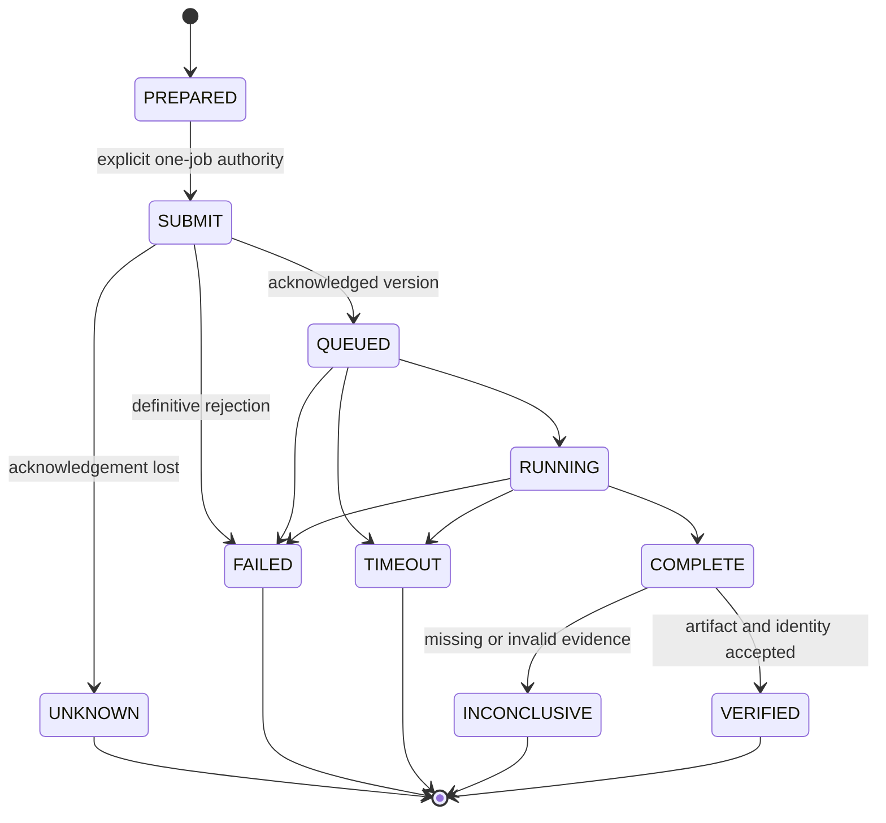

# KAGGLE-FORGEAI-INTEGRATION-OPTIONS-1

## 1. Decision and scope

Status: IMPLEMENTED — MAINTAINER VALIDATION REQUIRED. This is a research and
design handoff, not connectivity implementation or runtime qualification.
Documentation retrieval date: **2026-10-11, Europe/Berlin**.

The official service has the broad primitives for a private job and artifact
exchange. A safe, supported, bounded end-to-end path is **not yet established**.
The primary recommendation is **NEED_MORE_EVIDENCE**. Resolve the released
client's identity, download, retry and service-use gaps before implementing a
bridge. This is a bounded evidence gap, not a claim that job integration is
impossible. Interactive ForgeAI suitability remains unproven.

This slice changes only this document and its local validation script. No tests,
validators, Kaggle commands/API calls, Docker, notebooks, model calls or
repository uploads were executed. No commit was made. Public documentation was
read. No live probe is authorized by this document or a passing local validator.

## 2. Current evidence and repository boundary

The maintainer reports FREE-GPU-MODEL-RUNTIME-KAGGLE-1G live-qualified for bounded
synthetic feasibility: `Qwen/Qwen2.5-Coder-14B-Instruct-AWQ`, revision
`eb3172f06a6d6b3a15f08947b0668d782e4d2d2c`, AWQ 4-bit, Python 3.12.3,
torch 2.7.0+cu128, transformers 4.51.3, vLLM 0.9.2, two Tesla T4 GPUs and
tensor parallel size 2. READY, JSON and ADD passed; final KAGGLE_RUNTIME_PASS.
This does not establish CLI submission, artifact identity or Windows retrieval.

[Provider closeout](../FORGEAI-FREE-GPU-MODEL-PROVIDER-1-CLOSEOUT.md) records
FORGEAI-FREE-GPU-MODEL-PROVIDER-1 locally qualified after the full validator
exited zero, including Core, real Docker, package/install, historical ForgeAI
and static checks. These are existing evidence, not rerun in this slice.
Its prompted JSON contract differs from the Kaggle JSON-mode experiment;
matching a model or prompt alone does not qualify a deployment path.

Baseline: `c7e6070f0675fdaed95f246fc778275863779080`.
The existing [ModelPort](../src/legoai/intelligence/model/ports.py) already has
async methods. An awaited model call is not a durable job protocol. Its
preflight/uncertain/rejected distinctions must survive future composition.
Kaggle is compute infrastructure, not a LegoAI domain provider.
No KagglePort, KaggleAdapter, KaggleModelPort, KaggleRuntimePort or
KaggleComputePort is proposed. Core, public contracts, dependency manifests,
runtime implementations and disclosure authority remain unchanged.
This options record is not an adopted architecture change requiring a new ADR;
any later public-contract change would need its own decision and authority.

## 3. Official source ledger

All sources below are official; retrieval is public read-only research.
`main` is development documentation, not a release guarantee. No installed CLI
version or account entitlement was inspected. Facts and design inferences are
separated below. Where extraction failed, the gap remains explicit.

| ID | Source | Evidence and limitation |
| --- | --- | --- |
| S1 | [Notebooks](https://www.kaggle.com/docs/notebooks) | Saved-run versus interactive lifecycle; output persistence; scheduling; external Jupyter connection. |
| S2 | [CLI kernel commands](https://github.com/Kaggle/kaggle-cli/blob/main/docs/kernels.md) | Push, status, logs, files, output, accelerator and timeout options. Development documentation. |
| S3 | [Kernel metadata](https://github.com/Kaggle/kaggle-cli/blob/main/docs/kernels_metadata.md) | Explicit code file, private scope, GPU, internet and datasource fields. |
| S4 | [CLI releases](https://github.com/Kaggle/kaggle-cli/releases) | Latest release visible during review: v2.2.4. |
| S5 | [Changelog](https://github.com/Kaggle/kaggle-cli/blob/main/CHANGELOG.md) | Version/download/path fixes and no-run support appear under Next, not v2.2.4. |
| S6 | [Released v2.2.4 client source](https://github.com/Kaggle/kaggle-cli/blob/v2.2.4/src/kaggle/api/kaggle_api_extended.py) | Read kernels_output and kernels_status to reconcile documentation with behavior. |
| S7 | [Development client source](https://github.com/Kaggle/kaggle-cli/blob/main/src/kaggle/api/kaggle_api_extended.py) | Push result exposes versionNumber and URL; missing version has a separate output path. Not an immutable release contract. |
| S8 | [CLI dataset commands](https://github.com/Kaggle/kaggle-cli/blob/main/docs/datasets.md) | Private creation, versioning, readiness, download and deletion. |
| S9 | [CLI setup/authentication](https://github.com/Kaggle/kaggle-cli/blob/main/docs/README.md) | OAuth, access-token and legacy authentication. |
| S10 | [Official authentication reference](https://github.com/Kaggle/kaggle-cli/blob/main/skills/references/auth.md) | Authentication precedence, login/revocation and broad default OAuth scope. |
| S11 | [Efficient GPU usage](https://www.kaggle.com/docs/efficient-gpu-usage) | Free GPU quota is capacity-dependent, not an availability promise. |
| S12 | [Scheduling announcement](https://www.kaggle.com/product-announcements/582781) | Staff describes daily/weekly/monthly scheduling. |
| S13 | [Original scheduling discussion](https://www.kaggle.com/product-feedback/273569) | Historical staff description was CPU-only; not proof of today's GPU scheduling. |
| S14 | [Dataset documentation](https://www.kaggle.com/docs/datasets) | Private visibility includes collaborators and Kaggle under its privacy policy. |
| S15 | [Terms](https://www.kaggle.com/terms) | Active page identifies June 22, 2025 terms; service-use and submission rights matter. |
| S16 | [Privacy policy](https://www.kaggle.com/privacy) | Opened, but readable policy body was not available through this research interface. No retention or processor assurance inferred. |
| S17 | [Official benchmark reference](https://github.com/Kaggle/kaggle-cli/blob/main/skills/references/benchmarks.md) | Benchmark run/status/download capabilities exist; not evidence of a free arbitrary-model job service. |

### 3.1 Verified capabilities and release caveats

Development CLI documentation describes `kernels push` as create/update plus
execution, `status` for state, `logs` for diagnostics, `files` for inventory and
`output` for downloads. Accelerator selection includes `NvidiaTeslaT4` for T4x2;
selection is not allocation. Push has a run timeout. Output supports filename
filtering and pagination. No documented kernel cancel command was established;
deletion is not acknowledged cancellation. These are capabilities, not commands
to run in this slice. [S2](https://github.com/Kaggle/kaggle-cli/blob/main/docs/kernels.md)

Metadata names one `code_file`; it is not a general upload-directory contract.
Private, GPU and internet flags exist; set private explicitly, despite its
documented true default. Dataset/kernel datasource examples use owner/slug;
model references include versions. Exact dataset/kernel input version pinning
through these fields is not established by that documentation.
[S3](https://github.com/Kaggle/kaggle-cli/blob/main/docs/kernels_metadata.md)

The reviewed release is v2.2.4. The development changelog puts honoring kernel
version references, output traversal protection, streaming/read-timeout/size
handling, and push-without-run under **Next**. It also describes download resume
and transient retries. Do not install an unspecified latest client or assume
development fixes satisfy the no-retry contract.
[S4](https://github.com/Kaggle/kaggle-cli/releases),
[S5](https://github.com/Kaggle/kaggle-cli/blob/main/CHANGELOG.md)

In v2.2.4, `kernels_status` and `kernels_output` parse a version but omit it from
the service request. Output writes whole response content and can save a log
separately from the filename-filtered artifacts. A response-file regex therefore
does not prove bounded, log-free retrieval. This release is not qualified for
the proposed bridge. [S6](https://github.com/Kaggle/kaggle-cli/blob/v2.2.4/src/kaggle/api/kaggle_api_extended.py)

Development push code exposes a version number when returned. A missing version
is possible in its presentation logic; a URL or process exit code alone is not
sufficient submission evidence. SDK dependency behavior, session identifiers
and exact released wire contracts still require source review.
[S7](https://github.com/Kaggle/kaggle-cli/blob/main/src/kaggle/api/kaggle_api_extended.py)

### 3.2 Lifecycle and free capacity facts

Notebook documentation describes Save & Run All as a fresh full execution,
whereas Quick Save does not execute. It documents 12-hour CPU/GPU sessions,
20 GB saved working output, and a 20-minute interactive idle timeout. These
ceilings are not proposed request budgets. Scheduling and experimental external
Jupyter editor connections are documented; the latter is not evidence that an
arbitrary notebook-local HTTP port can be privately reached from Windows.
[S1](https://www.kaggle.com/docs/notebooks)

Free GPU documentation describes a weekly quota around 30 hours, potentially
varying with demand/resources. Treat the operator's actual entitlement as
unknown until separately observed; do not promise allocation or latency.
Queueing, allocation failure and session/quota termination must be handled as
deployment conditions. No account creation or quota workarounds are proposed.
[S11](https://www.kaggle.com/docs/efficient-gpu-usage)

Staff documents daily/weekly/monthly scheduling. An older CPU-only description
does not establish current GPU support; scheduled GPU suitability is UNKNOWN.
No corresponding general scheduling CLI contract was verified.
[S12](https://www.kaggle.com/product-announcements/582781),
[S13](https://www.kaggle.com/product-feedback/273569)

## 4. Candidate comparison

Ratings: **SUPPORTED** = official primitive documented; **PARTIAL** = primitive
exists but does not meet the whole criterion; **UNSUPPORTED** = no acceptable
path for this design; **UNKNOWN** = evidence insufficient. Ratings are design
assessments from section 3, not live qualification. For latency and complexity,
PARTIAL denotes a tradeoff rather than a service guarantee.

Candidates: A kernel push with embedded bounded data; B private request dataset
plus kernel output; C notebook-output datasource chaining; D scheduled job;
E official programmatic kernel API (with external Jupyter/benchmark alternatives
considered separately); F direct notebook-local HTTP consumed by Windows.

| Criterion | A | B | C | D | E | F |
| --- | --- | --- | --- | --- | --- | --- |
| Zero monetary cost | PARTIAL: free quota | PARTIAL: storage/quota | PARTIAL: more jobs | PARTIAL: entitlement | PARTIAL: same service | UNSUPPORTED: no path |
| Official support | SUPPORTED: job primitives | SUPPORTED: datasets/jobs | SUPPORTED: datasource field | SUPPORTED: UI schedule | SUPPORTED: CLI-backed API | UNKNOWN: arbitrary port |
| Private execution | SUPPORTED: explicit flag | PARTIAL: two resources | PARTIAL: entire chain | PARTIAL: inherited scope | PARTIAL: verify metadata | UNKNOWN |
| Authentication | SUPPORTED: official client | SUPPORTED: same account | SUPPORTED: same account | PARTIAL: UI ownership | PARTIAL: SDK contract | UNKNOWN |
| Input confidentiality | PARTIAL: host/history | PARTIAL: dataset/history | PARTIAL: inherited access | PARTIAL: recurrent copies | PARTIAL: host access | UNKNOWN |
| Output confidentiality | PARTIAL: verify sharing | PARTIAL: verify sharing | PARTIAL: downstream access | PARTIAL: repeated outputs | PARTIAL: verify sharing | UNKNOWN |
| Request-size limits | UNKNOWN: platform ceiling | UNKNOWN: applicable quota | UNKNOWN: chain limits | UNKNOWN: effective limits | UNKNOWN: wire ceiling | UNKNOWN |
| Output-size limits | PARTIAL: saved-output cap | PARTIAL: same | PARTIAL: same plus sources | PARTIAL: same | PARTIAL: same, transport TBD | UNKNOWN |
| GPU selection | SUPPORTED: T4 request | SUPPORTED: same | PARTIAL: each job | UNKNOWN: GPU schedule | PARTIAL: wire qualification | PARTIAL: server-local only |
| Run identity | PARTIAL: version vs session | PARTIAL: dataset and job | PARTIAL: multiple versions | PARTIAL: recurring sessions | PARTIAL: response schema TBD | UNSUPPORTED: no job binding |
| Poll status | PARTIAL: version caveat | PARTIAL: two statuses | PARTIAL: multiple statuses | PARTIAL: run association | PARTIAL: exact session TBD | UNSUPPORTED: no reachable API |
| Deterministic retrieval | PARTIAL: release blockers | PARTIAL: input pin too | PARTIAL: dependency pin too | PARTIAL: recurrence | PARTIAL: bounded client TBD | UNSUPPORTED |
| Stale-output protection | PARTIAL: digest/receipt | PARTIAL: dual digest | PARTIAL: graph identity | PARTIAL: scheduled overlap | PARTIAL: version contract | UNSUPPORTED |
| Concurrent-run clarity | PARTIAL: serialize | PARTIAL: two updates | PARTIAL: producer races | PARTIAL: overlaps | PARTIAL: session evidence | UNKNOWN |
| Session/job timeout | PARTIAL: local + remote | PARTIAL: same | PARTIAL: each stage | PARTIAL: schedule/run split | PARTIAL: local + remote | PARTIAL: ephemeral session |
| Queue delay | UNKNOWN: no measured bound | UNKNOWN | UNKNOWN | UNKNOWN | UNKNOWN | UNKNOWN |
| GPU availability | UNKNOWN: quota/capacity | UNKNOWN | UNKNOWN | UNKNOWN | UNKNOWN | UNKNOWN |
| Failure observability | PARTIAL: safe enums needed | PARTIAL: upload + job | PARTIAL: producer failures | PARTIAL: recurrence | PARTIAL: typed parsing TBD | UNSUPPORTED |
| Cancellation support | UNKNOWN: no verified cancel | UNKNOWN | UNKNOWN | PARTIAL: disable future schedule | UNKNOWN | UNKNOWN |
| Cleanup | PARTIAL: delete != erasure | PARTIAL: two histories | PARTIAL: referenced histories | PARTIAL: schedules + jobs | PARTIAL: exact delete scope | PARTIAL: session expiry |
| Reproducibility | PARTIAL: pins + observed GPU | PARTIAL: input pin gap | PARTIAL: chain drift | PARTIAL: temporal drift | PARTIAL: client/runtime pins | PARTIAL: interactive drift |
| ForgeAI coding-agent latency | PARTIAL: batch hypothesis | PARTIAL: extra upload | PARTIAL: extra stages | UNSUPPORTED: interactive | PARTIAL: same cold start | UNSUPPORTED: connectivity |
| ComfyUI/VTO later | PARTIAL: artifact pattern | PARTIAL: larger input | PARTIAL: batch DAG | PARTIAL: periodic batches | PARTIAL: same job model | UNSUPPORTED: no public UI |
| Implementation complexity | PARTIAL: smallest candidate | PARTIAL: two lifecycles | PARTIAL: graph lifecycle | PARTIAL: scheduler state | PARTIAL: transport/security | UNSUPPORTED: prohibited workarounds |
| Security boundary | PARTIAL: account/host/download | PARTIAL: plus dataset ACL | PARTIAL: transitive sharing | PARTIAL: recurring authority | PARTIAL: credential/client | UNSUPPORTED: no accepted path |
| Kaggle-specific coupling | PARTIAL: operator script | PARTIAL: dataset + script | PARTIAL: chain metadata | PARTIAL: scheduler | PARTIAL: SDK at edge | UNSUPPORTED: no design |

### 4.1 A: Kernel push and response artifact

Most promising *technical candidate*, but not selected for implementation yet.
A reviewed fixed worker could contain one serialized request as a data literal,
materialize `request.json`, and call notebook-local vLLM. Do not concatenate
prompt text into executable source. Push a staging directory containing only
the fixed code and explicit metadata; never use the repository root. A separate
request file is not assumed uploaded by push. The source envelope itself needs
a bound and digest, and only the fixed reviewed worker may be uploaded.

Each push creates/updates a version and may execute. Prefer a unique private
kernel slug per eventual synthetic request, one version, one writer, no update,
no schedule and no rerun. This reduces latest-output ambiguity but does not
replace remote version evidence. Reusing a kernel per request accumulates
history and creates races. Per-call startup/version creation is a poor basis
for promising interactive model latency. No live timing has been measured.

### 4.2 B: Dataset request input

Dataset commands support private creation, versioning, processing status and
deletion. Updating can remove old versions; deletion is a resource operation,
not a proven content-erasure guarantee. [S8](https://github.com/Kaggle/kaggle-cli/blob/main/docs/datasets.md)

This offers a natural JSON input file and later image payloads, but adds an
upload transaction, readiness wait, second ACL and second history. Input
attachment version pinning is unresolved. A unique immutable dataset per
request plus digest checking is a possible compensation, not proof of service
version semantics. Shared dataset rotation is rejected for the first request.
Deletion must target the owned dataset, never guess version-delete semantics.
This is more complex than A for a single fixed READY prompt.

### 4.3 C through F

C can compose notebook outputs as inputs but adds producer/consumer version
bindings and stale dependency risks without benefit for one request. Do not
build a DAG scheduler.

D is useful for periodic evaluation, not operator-triggered interactive turns.
Scheduling introduces recurring execution authority; reject it for a one-job
probe even if GPU support is later established.

E uses the official API underlying the CLI and could avoid unsafe convenience
downloads by inspecting one bounded artifact. It is an alternative edge
implementation of A, not another domain capability. No guessed private
endpoint, browser-cookie automation or undocumented method is allowed.
The public docs also describe external Jupyter editor sessions; their existence
does not prove a stable unattended single-job protocol or private vLLM routing.
The official benchmark APIs have a different task/model contract; arbitrary
pinned AWQ runtime support and zero-charge operation were not established.
[S17](https://github.com/Kaggle/kaggle-cli/blob/main/skills/references/benchmarks.md)

F is rejected for this design: localhost in a Kaggle notebook is not Windows
localhost. There is no verified official private forwarding contract for the
vLLM port. No ngrok, Cloudflare Tunnel, localtunnel, SSH reverse tunnel, public
reverse proxy, relay or public vLLM/ComfyUI endpoint is allowed. No Colab use.

## 5. Zero-cost and service-use assessment

Only ordinary free Kaggle capacity is eligible. No paid API, tier, trial with
billing exposure, Colab Pro, HF credits, external GPU, paid object storage,
queue, tunnel or cloud VM may be required. Any such candidate is classified
**ZERO_COST_REQUIREMENT_VIOLATED** and eliminated, even as an outage fallback.
Free capacity is a conditional resource, not guaranteed free always-on compute.
Queue/capacity failure terminates the attempt; no alternate account, accelerator,
provider or model. Monetary cost excludes the operator's existing computer and
internet connection; this design introduces no paid service.

The reviewed terms restrict service use to internal personal non-commercial
use, not third-party benefit, and grant Kaggle operational rights over submitted
content including private submissions. This does not establish permission for
commercial ForgeAI/VTO hosting. The operator's intended use and applicable
terms must be resolved before any job; a synthetic label alone is insufficient.
This is a deployment gate, not a legal determination about the operator.
[S15](https://www.kaggle.com/terms)

## 6. Authentication and privacy

The CLI documents OAuth login, an API token through `KAGGLE_API_TOKEN` or
`~/.kaggle/access_token`, and legacy `~/.kaggle/kaggle.json` credentials.
No credentials are needed for this research. A later bridge should use a
separately provisioned operator account context outside the checkout, not
token command-line arguments or committed files.
[S9](https://github.com/Kaggle/kaggle-cli/blob/main/docs/README.md)

The official auth reference describes broad default OAuth scope
`resources.admin:*` and multiple credential sources with precedence. A future
qualification must identify the actual source, constrain Windows file ACLs,
avoid accidental account selection and document revocation. Do not print tokens,
capture the environment, store auth URLs, or claim existing Secret/S1 governance
automatically covers an external CLI credential store.
[S10](https://github.com/Kaggle/kaggle-cli/blob/main/skills/references/auth.md)

Private datasets are not opaque to Kaggle, and collaborators affect visibility.
[S14](https://www.kaggle.com/docs/datasets) The privacy policy URL was inspected
but its readable body could not be retrieved; retention, regional processing,
subprocessors, deletion timing and contractual role remain UNKNOWN.
[S16](https://www.kaggle.com/privacy) Terms identify the service entity, not a
completed processor/disclosure admission. Private scope is necessary, not a
repository-data authorization.

**SYNTHETIC only. No REPOSITORY_CONTENT, TASK_TEXT, DERIVED_DIAGNOSTIC or customer
code disclosure is authorized.** Public source research is not an inference
upload. No repository-wide upload; future staging is an exact file allowlist.
No model-supplied notebook, shell command or package installation instruction.
No automatic repository mutation. Output is untrusted data, never executable
instructions. Later disclosures require separate existing governance review.

## 7. Conceptual request contract

These are proposed first-probe bounds, not frozen public contracts or Kaggle
limits. The future worker must reject unknown fields and duplicate JSON keys.
No general prompt/model/path/command inputs are needed for READY.

| Field | Proposed rule and reason |
| --- | --- |
| protocol_version | Exact `kaggle-synthetic-job/1`; prevent silent schema drift. |
| request_id | Fresh random 128-bit identifier, lower-case hex; one local custody record. |
| model_id / model_revision | Exact model/revision from section 2; no mutable branch or suffix fallback. |
| runtime_profile_digest | SHA-256 of reviewed dependency/hardware/runtime manifest; bind the qualified profile. |
| worker_digest | SHA-256 of the fixed worker template before inserting request data; prevent code drift. |
| prompt_class / prompt | Exact SYNTHETIC / `Return exactly the word READY.`; no arbitrary task. |
| max_output_tokens / temperature | Exact 16 / 0; bounded deterministic configuration, not a determinism guarantee. |
| created_at / expires_at | UTC timestamps; proposed lifetime 45 minutes; refuse expired execution and acceptance. |

Proposed `request.json` maximum: **4096 bytes**, UTF-8 without BOM, object depth
at most 3, no NaN/infinity. Serialize once with a specified canonical JSON
profile (sorted ASCII keys, compact separators, fixed numeric representations);
hash those exact bytes. The digest is carried in the local receipt and response,
not recursively inside the bytes being hashed. Worker recomputes from the
materialized exact bytes. Request identity binds content, not trustworthiness.
An input timestamp is not authorization; local monotonic deadline also applies.

The remote version cannot be known before a push. Do not invent a predicted
version in the request or push a second version to add it. Keep the submission
receipt outside the request digest and bind it during result validation.

## 8. Conceptual response contract

Proposed `response.json`: **8192 bytes maximum**, one UTF-8 object, strict keys,
no duplicate keys, no nonfinite numbers, depth at most 4. Exactly one artifact;
write a temporary file then atomically rename only after complete validation.

| Field | Proposed rule and reason |
| --- | --- |
| protocol_version, request_id, request_sha256 | Exact equality with locally frozen request. |
| model_id, model_revision, runtime_profile_digest, worker_digest | Exact identity; observations must match expected runtime/hardware before inference. |
| kernel_ref, kernel_version | Authenticated remote identity, matched to submission receipt; worker observation if an official mechanism exists. |
| run_id | Service identifier when available; otherwise null with explicit absence, never a fabricated server identifier. |
| status | Closed success/failure enum; notebook completion alone is not inference success. |
| output | On success exactly `READY`, without whitespace repair; at most 64 UTF-8 bytes overall. Null on failure. |
| prompt_tokens, completion_tokens | Nonnegative bounded integers when observed; completion count at most 16; null if unavailable, never invented. |
| elapsed_ms | Bounded integer duration for diagnostics; not wall-clock authority. |
| safe_failure | Null on success or one fixed enum; never raw exception text. |

How the worker obtains authenticated version/session identity is **unresolved**.
If unavailable in the notebook, a separately typed local retrieval envelope may
bind authenticated service metadata to the validated payload digest. It must
label local assertions versus remote observations and cannot just echo the
requested version. This alternative needs explicit qualification. Missing
version evidence stops acceptance with RESULT_INCONCLUSIVE.

The local receipt additionally binds owner/slug, returned version, optional
session identifier, submission time, code/metadata digests, private scope,
CLI/SDK versions and artifact digest. Do not persist signed download URLs,
credentials, environment, arbitrary logs, raw stack dumps or notebook state.
The API response and artifact must both be bounded before materialization;
checking file size after an unbounded download is insufficient.

## 9. Lifecycle, races and failures

```mermaid
flowchart LR
    O[Windows operator: fixed synthetic request] --> S[Reviewed private staging]
    S --> K[Official Kaggle submission]
    K --> J[Private versioned job]
    J --> V[Notebook-local vLLM]
    V --> R[Bounded response artifact]
    R --> B[Bounded authenticated retrieval]
    B --> I[Identity and result validation]
    I --> E[Local synthetic evidence]
```



There is no connectivity implementation in this slice and no path from this
diagram to ForgeAI workspace mutation. Credentials stay at the operator edge;
the worker needs no Kaggle account credential for its fixed model request.



These are bridge concepts, not promises about Kaggle's exact status strings.
An eventual adapter must map a pinned official status schema, reject unknown
states, and never interpret CLI exit zero as job success.

One request, one writer, one fresh slug, one submission. Exclusive local custody
prevents a second process using the same record. No automatic retry, resubmit,
fallback or rerun; inspect SDK/HTTP retry layers, not just the wrapper loop.
Bounded status polling is an explicit read protocol, not a failed submission
retry: proposed 30-second interval, at most 90 successful observations inside a
45-minute monotonic deadline. Any poll transport failure terminates locally;
no silent retry. Proposed job execution budget 30 minutes and per-control-call
timeout 30 seconds. These are stop budgets for a future experiment, not latency
estimates. If cold setup cannot fit, stop and revise through a separate review.

Never accept "latest output" merely because it exists. Require the immutable
submission version, fresh request ID, request digest and runtime identity.
Use a new empty local destination, no overwrite/resume of old artifacts. Reject
additional files, unexpected names, symlinks, path traversal, archives and
duplicate pages. An exact filename regex alone does not enforce these rules.
Reject output from another version/request even when it says READY. A malicious
artifact can echo identifiers: digests prove binding, not remote attestation;
the authenticated service and reviewed worker are explicit trust assumptions.

If only latest retrieval is available, a unique one-version slug and digest
check reduce accidental staleness but do not prove version-specific service
behavior. Remote mutation or an uncertain second run remains a stop condition.
Version-specific retrieval must be qualified against a stale/mismatching fixture
before any multi-version or concurrent workflow. No multi-request support now.

### 9.1 Safe failure and effect semantics

| Conceptual category | Meaning / required handling |
| --- | --- |
| JOB_SUBMISSION_FAILED | Definitive pre-send failure or acknowledged rejection; distinguish the two in custody. |
| SUBMISSION_UNCERTAIN | Request may have created a job; retain receipt, never resubmit automatically. |
| JOB_QUEUED | Nonterminal observation only while budgets remain. |
| GPU_UNAVAILABLE | Use only explicit service evidence; no inference from an arbitrary failure. |
| JOB_FAILED | Terminal service failure; safe code, no raw body/log. |
| JOB_TIMEOUT | Local deadline expired; remote may still run and consume quota. |
| OUTPUT_MISSING | Completed job lacks the required artifact. |
| OUTPUT_IDENTITY_MISMATCH | Any request/version/runtime binding mismatch; quarantine and refuse. |
| OUTPUT_INVALID | Size/schema/result violation; no trimming, parsing repair or execution. |
| RESULT_INCONCLUSIVE | Evidence insufficient, unknown service state or missing run/version binding. |

Local process cancellation does not cancel a server job. Killing a CLI process
does not establish no remote effect. A cancellation API was not qualified;
operator UI reconciliation may be necessary, with confirmed identity and
separate authority. Keep a terminal local record and do not accept late output
after expiry. Cleanup is not a retry and does not erase uncertainty.
Existing ModelPort effects cannot be assigned mechanically from these job
states: a created job is an infrastructure effect even without usable text.
Any later composition must separately account for submission and model-result
effects, preserving uncertain outcomes rather than labeling them NONE.

## 10. ModelPort and integration placement

| Placement | Decision |
| --- | --- |
| A. Await a Kaggle job inside an existing model call | Reject for the first proof. Async methods already exist, but long queueing, custody, cancellation and restart semantics are not provided by that fact. No blocking subprocess on the event loop. |
| B. Generic asynchronous compute-job capability | Defer. ForgeAI and ComfyUI are possible consumers, not two proven consumers needing a new public abstraction. |
| C. Operator-side deployment/experiment bridge outside LegoAI | Smallest potential later implementation. Configuration plus a bounded wrapper first; Kaggle-specific details stay outside Core. |
| D. Batch evaluation only | Most plausible initial workload, but still subject to the same retrieval and service-use gates. Not automatically a production integration. |

REUSE > EXTEND > CREATE. First prove a standalone synthetic result with existing
runtime machinery and operator scripts. Do not fabricate ChatResult from a
cached artifact or inject an unsolicited job result into a live Agent session.
A later separately reviewed provider-neutral composition may consume a result
only with its original invocation/tenant/disclosure identity and deadlines.
No ModelPort signature change, Core job scheduler or new Kaggle abstraction.

Interactive coding agents involve repeated dependent turns; cold job launch and
model load make their responsiveness unproven. Batch coding, test generation,
evaluation and repository review are conceptually better matches, but only
synthetic evaluation is within the proposed first proof. Actual task text and
repository material remain disallowed. No numerical latency claim is made.

## 11. Future ComfyUI and VTO applicability

The artifact pattern could carry a reviewed workflow identifier, bounded image
inputs and bounded output images, without exposing a ComfyUI server. Dataset
input might then justify its additional lifecycle. It is not a second proven
consumer now. Do not generalize the text contract for it.

Future work must independently qualify image byte/pixel limits, decompression
bombs, formats, output count, storage capacity, workflow/custom-node integrity,
model licensing, GPU memory, runtime and artifact version binding. VTO images
can be personal data: processor policy, consent and retention need separate
review. Commercial or third-party VTO use cannot be inferred permitted from a
successful personal synthetic experiment. No workflow or image is uploaded here.

## 12. Evidence gates and implementation sequence

First next slice, only after this handoff is reviewed:
**KAGGLE-JOB-BRIDGE-CONTRACT-REVIEW-1**, documentation and official-source review.
It must resolve the following without live execution:

1. Select an immutable official CLI/SDK release or supported API contract;
   document exact dependencies. Main documentation and a semver range are not
   sufficient. Demonstrate source-level version propagation for status, files,
   output and logs, including missing identity behavior.
2. Establish bounded artifact retrieval that does not persist arbitrary logs,
   permits only one safe filename, enforces bytes/time during transfer and
   rejects oversized control responses. Stock v2.2.4 output is not acceptable.
   Do not patch third-party internals or use undocumented endpoints to bypass
   this gate. If an official supported path is unavailable, remain blocked.
3. Identify and disable automatic retries/resume on submission and reads for
   the one-attempt policy. Establish push acknowledgement and unique remote
   session/version binding; record cancellation limitations honestly.
4. Resolve private metadata verification, exact download authentication/redirect
   boundaries, owned-resource cleanup and credential handling. Signed URLs must
   be treated as credentials and never retained in diagnostics.
5. Review applicable terms, account eligibility and free quota for the intended
   use. Obtain readable current privacy evidence before expanding data classes.

Only if those gates close, a *new decision* could select
**KAGGLE-JOB-BRIDGE-SYNTHETIC-1**: one request, SYNTHETIC only, one private job,
one fixed pinned model, one bounded output, no retry, no fallback, no repository
disclosure and no repository mutation. Infrastructure creation/output writes
are explicit effects of that future job, not a claim of zero remote mutation.
This future slice is neither implemented nor authorized here.

Then prepare offline fixtures and operator steps; wait for maintainer results.
Only separately authorized live qualification may establish actual free GPU
allocation, run identity, status, output privacy, cancellation and timing.
Do not advance automatically from a local pass to Kaggle execution.

## 13. Qualification plan and stop conditions

Current local qualification is documentary: two-file scope, required sections,
one final recommendation, safety declarations, official-source presence, static
checks on the validator and whitespace. It is not source-fact verification,
security certification, implementation testing or live qualification.

Future offline contracts must cover stale READY output, mismatched request hash,
wrong model/revision/version, absent session identity, duplicate JSON keys,
truncated/oversized/control bodies, unknown status, traversal/symlink names,
unexpected logs, page duplication, lost acknowledgement, queue expiry, GPU
unavailability, expired late results, private-flag mismatch, retry attempts,
concurrent local custody and SDK dependency drift. Derive fixtures from contracts,
not a mirror of an implementation. Never execute generated model code.

Future live evidence, if separately authorized, should retain only safe IDs,
versions/digests, private-scope observation, phase durations, bounded status and
literal READY result. No credentials, auth URLs, raw environment or logs.
Record queue, setup, model load, inference and retrieval separately; one run
cannot establish availability or latency distributions.

Stop on payment requirement, incompatible terms, public scope, missing identity,
unknown credential source, unbounded output/log path, undisabled retries,
quota/capacity failure, timeout, unsupported accelerator, runtime drift or data
outside SYNTHETIC. Never replace missing evidence with a success claim.

Rollback this slice by reverting its two files. For a future job, stop local
acceptance, preserve only the safe custody record, reconcile remote status and
remove only explicitly owned resources after terminal confirmation and operator
approval. Do not treat deletion as guaranteed erasure or cancellation. Failure
to clean up is visible unresolved state; no recurring cleanup daemon or retries.

## 14. Maintainer validation handoff

Validator: `validate_kaggle_forgeai_integration_options_1.py`.
It has not been executed. It uses a fixed baseline and allows only this document
and itself to differ, checking both staged and working changes plus untracked
files. It never invokes production modules, tests, Docker or network clients.
It runs local mypy/Ruff checks on itself and Git whitespace checks only when
the maintainer invokes it. It does not install anything.

Scope failure caused by other work is a real isolation failure: review or move
unrelated changes separately; do not delete user work or broaden the allowlist
just to get a pass. Ignored files are outside the Git change inventory; this is
not a machine-wide audit. Text assertions cannot prove document semantics;
maintainer review must confirm the design contains no live instructions,
public-endpoint setup or disclosure authorization.

Run from the repository root in the existing locked development environment:

```powershell
uv run --locked --offline --no-sync python .\validate_kaggle_forgeai_integration_options_1.py
if ($LASTEXITCODE -ne 0) { throw 'Kaggle integration options validation failed' }
```

Paste the complete phase output, final status and any safe diagnostic. Do not
paste credentials, environment dumps or Kaggle account material. Expected final
line on success: `KAGGLE-FORGEAI-INTEGRATION-OPTIONS-1 LOCAL DOCUMENT CHECKS PASSED; NO CONNECTIVITY QUALIFIED; NO LIVE EXECUTION AUTHORIZED`.
Missing local dependencies are environment blockers, not permission to install
or use the network automatically. After this handoff, wait for the maintainer.

RECOMMENDATION:
    NEED_MORE_EVIDENCE
