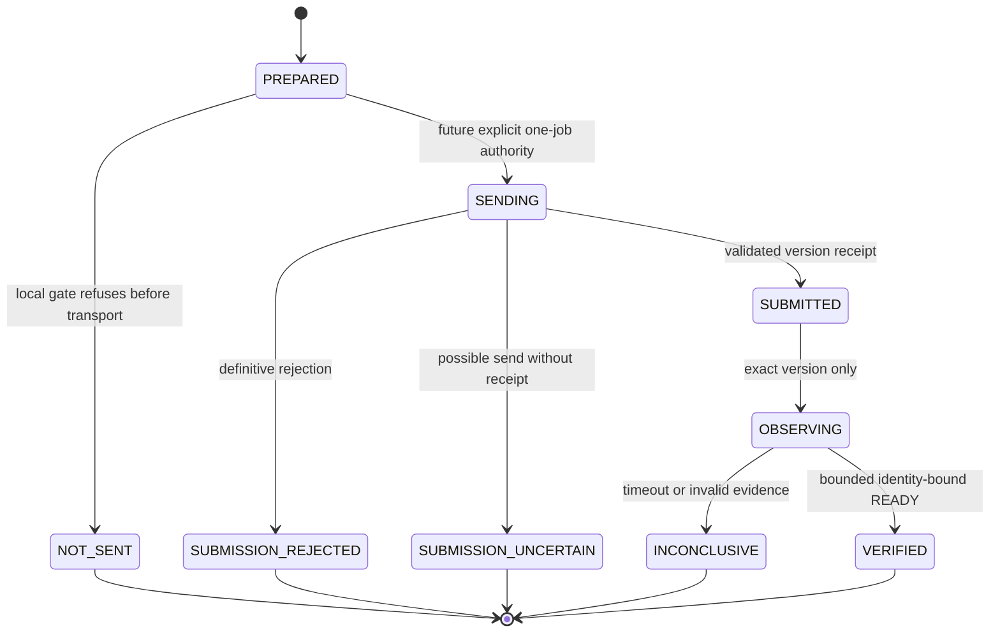
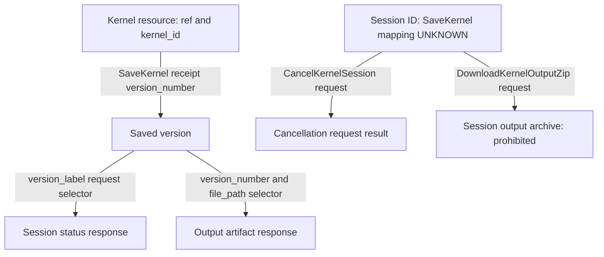

# KAGGLE-JOB-BRIDGE-CONTRACT-REVIEW-1

## 1. Executive decision

**CONTRACT_BLOCKED_SECURITY_GAP.** Released Kaggle APIs expose useful identity
and single-file primitives, but the reviewed public client transport cannot
enforce bounded control responses, an 8192-byte JSON download, network deadlines
and redirect restrictions before consuming responses. A newer CLI version that
only fixes version propagation will not close this security gap.

Research date: **2026-10-11 (Europe/Berlin)**. This document distinguishes tagged
source evidence, provider documentation, design requirements and unknowns.
Source inspection is not live qualification. No tests, validators, static
checkers, Kaggle CLI/API, Docker, notebooks or models were executed. Official
source was read as text, including temporary copies outside the repository;
no dependency was installed. No commit was created.

No live command is authorized. No repository disclosure is authorized.
No production code or dependency manifest changes. No synthetic prototype
implementation. No public endpoint or tunnel instructions. No new Core or job
abstraction. Do not vendor main, install Git main, patch site-packages, replace
private SDK transport internals or call guessed service URLs.

## 2. Evidence and selected stable release

The maintainer's existing evidence remains scoped as follows:

- Kaggle 1G: bounded SYNTHETIC runtime feasibility, READY/JSON/ADD PASS and
  KAGGLE_RUNTIME_PASS. Model `Qwen/Qwen2.5-Coder-14B-Instruct-AWQ`, revision
  `eb3172f06a6d6b3a15f08947b0668d782e4d2d2c`, vLLM 0.9.2, two Tesla T4 GPUs.
- FORGEAI-FREE-GPU-MODEL-PROVIDER-1: locally qualified after full validation.
- [Integration options](KAGGLE-FORGEAI-INTEGRATION-OPTIONS-1.md): maintainer
  local document checks passed; recommendation NEED_MORE_EVIDENCE.
- No Windows-to-Kaggle job connectivity is qualified by any of those results.

Repository baseline for this two-file slice:
`a71461fe1a3cbc94b9da3fc7d6556684e36090e6`.

| Component | Immutable review selection | Release evidence |
| --- | --- | --- |
| CLI / Python package | `kaggle==2.2.4`, tag `v2.2.4`, commit `f0afa32699d28c97f82691728ada3ed8c16c5abf` | Latest stable visible in official releases and PyPI; July 23, 2026. [R1], [R2] |
| Minimum allowed SDK | `kagglesdk==0.1.35`, tag `v0.1.35`, commit `a208c160e632a211dcb8937a14552c3d28773648` | Released July 22, 2026; source reviewed for the CLI release baseline. [R3] |
| Latest released SDK alternative | `kagglesdk==0.1.37`, tag `v0.1.37`, commit `ae99c895ac3d5cfb80436be8e426c0bc658c5892` | Released August 6, 2026; fits CLI dependency range; relevant source reviewed separately. [R4] |

CLI metadata requires Python >=3.11 and `kagglesdk >=0.1.35,<1.0`; it does not
freeze a complete dependency graph. Requests is unpinned; urllib3 has a lower
bound. SDK 0.1.37 also leaves Requests/protobuf unpinned. These selections are
review anchors, not an installation instruction or a qualified lock. Exact
transitive versions and wheel-to-source correspondence remain future evidence.
[CLI metadata][R5], [SDK metadata][R6]

CLI wheel SHA-256 published by PyPI:
`47d3b258363f4693ade67d875b1c108bfaa87a469f4b6fe85903e7c9757aa09c`.
SDK 0.1.37 wheel SHA-256:
`766e7d1e59379941b373957e7d80f612942e63ab4a638d99ae4ee3e9e92f050e`.
These are published identifiers, not locally downloaded/verified wheel claims.
[R2], [R4]

## 3. Stable versus development capability matrix

RELEASED means present in reviewed released source, not operationally qualified.
UNRELEASED means only development evidence. ABSENT means absent from the
reviewed interface/path, not a claim about every Kaggle service. UNKNOWN marks
an unestablished guarantee. Public generated SDK fields are distinguished from
private implementation details.

| Required capability | CLI 2.2.4 | SDK 0.1.35 / 0.1.37 | Development / remaining gap |
| --- | --- | --- | --- |
| Save acknowledgement with version | RELEASED | RELEASED | Require positive version and matching resource; missing values fail closed. |
| Exact-version status selector | ABSENT in CLI request wiring | RELEASED `version_label` | UNRELEASED CLI propagation fix. |
| Exact-version output selector | ABSENT in CLI request wiring | RELEASED labels; direct download version number | UNRELEASED CLI fix; remote session identity not established. |
| File inventory before bytes | RELEASED, drops version | RELEASED version field | Metadata byte ceiling ABSENT. |
| Single-file selection without log envelope | ABSENT in stock output | RELEASED direct download method | JSON-safe bounded transport ABSENT. |
| Stream artifact before parsing | ABSENT in stock output | RELEASED special response streaming, but JSON preparse | Full requirement ABSENT. |
| 8192-byte receive ceiling | ABSENT | ABSENT | No reviewed fix establishes this. |
| Connect/read deadline configuration | ABSENT for these calls | ABSENT public controls | UNRELEASED CLI downloader improvement is not a control-response fix. |
| Disable transport retry / redirect replay | No kernel retry loop; redirect controls ABSENT | No retry loop; redirect controls ABSENT | Dependency pin and no-replay guarantee UNKNOWN. |
| Traversal-safe stock output | ABSENT | Direct response does not choose local path | UNRELEASED CLI path fix. |
| Observe private flag | No push/status confirmation | RELEASED GetKernel metadata | Pre-execution observation for fresh one-push job UNKNOWN. |
| Save without execution | ABSENT CLI flag | RELEASED execution-type field/enum | UNRELEASED CLI flag; does not solve one-push privacy timing. |
| Cancel exact session | ABSENT CLI command | RELEASED cancel by session ID | SaveKernel-to-session-ID binding UNKNOWN. |
| Run/session ID in SaveKernel result | ABSENT | ABSENT | Do not infer from kernel ID or version. |
| Ordinary free GPU path | RELEASED documented service offering | Same service | Account entitlement/capacity UNKNOWN. |

Evidence: tagged dispatch [C1], CLI implementation [C2], released SDK kernel
service/types [S1], [S2], transport [S3], enums [S7], development ledger [D1].

## 4. Tagged call-chain analysis

All CLI commands below are names under review, not executable instructions.
Dispatch is registered in `src/kaggle/cli.py`. [C1]

| Command | CLI Python chain | Generated service method | Request -> response |
| --- | --- | --- | --- |
| kernels push | kernels_push_cli -> kernels_push | save_kernel / SaveKernel | ApiSaveKernelRequest -> ApiSaveKernelResponse |
| kernels status | kernels_status_cli -> kernels_status | get_kernel_session_status / GetKernelSessionStatus | ApiGetKernelSessionStatusRequest -> ApiGetKernelSessionStatusResponse |
| kernels files | kernels_list_files_cli -> kernels_list_files | list_kernel_files / ListKernelFiles | ApiListKernelFilesRequest -> ApiListKernelFilesResponse |
| kernels output | kernels_output_cli -> kernels_output | list_kernel_session_output / ListKernelSessionOutput | ApiListKernelSessionOutputRequest -> ApiListKernelSessionOutputResponse |
| kernels logs | kernels_logs_cli -> kernels_logs | list_kernel_session_output / ListKernelSessionOutput | Same output envelope, log member consumed |
| logs follow | kernels_logs_cli -> kernels_logs_stream | CLI direct Requests stream; not generated-method dispatch | SSE or persisted log blob |

Generated methods delegate to `KaggleHttpClient.call` through
`KaggleClient.kernels.kernels_api_client`. The shared path prepares a POST,
merges environment settings, sends through Requests, then prepares a response.
No separate idempotency key is added. [S1], [S3], [S4]

| Path | Identity sent | Identity/result returned | Transport / output |
| --- | --- | --- | --- |
| push | id or owner/slug, code, private/GPU/runtime settings | Save response in section 5 | Shared SDK; run timeout is not HTTP timeout. |
| status | owner/slug; parsed version discarded | status, failure_message | Shared SDK JSON; raw failure text may print. |
| files | owner/slug, paging; parsed version discarded | names, sizes, dates, next token | Shared SDK JSON; no file body downloaded. |
| output | owner/slug, paging; parsed version discarded | file URLs/names, log, next token | Shared SDK then Requests GET, whole-content write; separate log file. |
| logs default | owner/slug; parsed version discarded | log | Shared SDK then stdout. |
| logs follow | owner/slug through CLI stream path | stream events/blob | Requests streaming, reconnect loop, stdout/stderr. |

The version drops are assignments missing after parsing, not an inference from
help text. See tagged function anchors in [C2] and the subsequently merged fix
in [D2]. SDK selectors already exist; therefore these CLI deficiencies alone
do not prove there is no released lower-level path.

## 5. Submission acknowledgement

The Save response schema supplies the following fields. [S2]

| Identity/fact | Classification | Acceptance consequence |
| --- | --- | --- |
| ref | service-returned | Must match the exact expected owner/slug; no acceptance by URL alone. |
| kernel_id | service-returned | Resource identifier, not session identifier. Reject default/missing/nonpositive value. |
| version_number | service-returned optional field; getter defaults to zero | Positive value required. Cannot assume version 1 from a fresh slug. |
| url | service-returned; printed as presentation | Not sufficient identity or execution acknowledgement. |
| error and invalid_* collections | service-returned | Reject error/invalid configuration; never classify a partially invalid submission as qualified. |
| requested owner/slug | locally asserted until matching response | A generated slug is not a receipt. |
| status / operation ID / session ID / run ID | absent from this response | Do not invent or derive them from another ID. |
| CLI success text / process exit code | presentation-only | Not a durable acknowledgement. |

**Can custody bind an immutable version without guessing?** Yes, conditionally:
the public schema can return resource ref, kernel ID and positive version.
That is a version receipt, not proof of one unique execution or a complete
bounded-response contract. Lost, missing, contradictory or malformed receipt
means SUBMISSION_UNCERTAIN once sending may have occurred. Never submit again
to discover whether the first submission succeeded.

## 6. Status identity and output identity

Released SDK request types contain `version_label` for GetKernel,
GetKernelSessionStatus, ListKernelFiles and ListKernelSessionOutput. Their
generated serialization maps this field onto the service request. Status
responses contain an enum and failure text, not a version/session echo.
The direct DownloadKernelOutput request separately has owner_slug, kernel_slug,
file_path and version_number. [S2]

The merged CLI correction sets a label with a `v` prefix. The official
repository's issue documents bare-number failure and version-specific examples;
those are upstream observations, not tests run here. Treat the label convention
as corroborated by the merged change, not evidence that arbitrary SDK/client
combinations have been qualified. [D2], [D3]

Thus a released SDK selector can address a version, while stock CLI 2.2.4
cannot be relied on to do so. A future verifier would bind authenticated
request context to the receipt and artifact hash. It must not describe the
status response as independently echoing a version or proving one run.
Timestamp and unique-slug comparisons are not replacements.

## 7. File inventory before download

ListKernelFiles has paging and a version selector. Its response contains file
name, size, creation date and next-page token; no content type, digest or
session/version echo. ListKernelSessionOutput instead contains name/URL items
and a log member; those items do not provide size. [S2]

Required future inventory policy: exactly `response.json`, size 1..8192 bytes,
no continuation token, duplicate names or extra files. Reject archives,
notebooks, logs, caches and checkpoints. The metadata size is a precheck, not
an in-flight byte ceiling. Page size limits item count requests, not field
lengths or serialized response bytes. Since control JSON is consumed before
application bounds, inventory is not yet safe even for one requested item.
Unknown/missing size cannot be silently treated as a safe zero-byte file.

## 8. Bounded download analysis

The supported lower-level candidate is `download_kernel_output` with the
version number and exact file_path. Its generated return type is HttpRedirect;
HttpRedirect/FileDownload wrappers return the Requests response rather than
enforcing a content limit. This avoids the listing-with-log route. [S1], [S5], [S6]

Transport source sets streaming for those special response types, but
`_prepare_response` calls `.json()` for JSON content before the public
response_processor callback. Ordinary control responses are nonstreamed.
Verbose mode also reads and prints response text. No public call argument
sets connect/read deadlines, redirect policy or a maximum body size. [S3]

This is decisive for a JSON response artifact: obtaining a streaming response
object eventually is insufficient if JSON was already consumed. A header
callback after parsing is not a pre-read security boundary. A parent process
timeout can terminate local work, but cannot prove bounded bytes or no remote
execution. It is not a substitute for transport limits.

| Requirement | Stock CLI | Released SDK candidate | Review disposition |
| --- | --- | --- | --- |
| Stream before any JSON consumption | No | No for JSON media type | Blocking |
| Validate Content-Length before body | No required maximum | No early public bound | Blocking |
| Receive ceiling of 8192 bytes | No | No | Blocking |
| Bound control/error/redirect bodies | No | No | Blocking |
| Connect timeout | No per-call value | No public argument | Blocking |
| Read timeout | No per-call value | No public argument | Blocking |
| Redirect count/host and replay control | Requests defaults | Requests defaults | Blocking; control requests must not redirect |
| Exact filename selection | Client regex after listing | Public file_path | Useful, insufficient alone |
| Destination confinement | Stock path join | Caller would own path | Must be designed later, no implementation here |
| Resume disabling | No resume in this stock output path | No resume loop here | Do not confuse with general CLI download helper |

Requests documents zero default adapter retries, redirects enabled by default,
and a default redirect cap of 30. Its redirect handling can preserve a POST
body on 307/308. Such retransmission is not an allowed second submission just
because it is called a redirect. These upstream defaults explain the risk;
the Kaggle dependency graph is not locked. [T1], [T2]

No supported public transport-injection or pre-read budget configuration was
found in the reviewed KaggleClient/KaggleHttpClient interfaces. Modifying
`_session`, overriding private parsing, or copying endpoint strings into a new
transport would exceed this review's supported-path requirement. A future
official interface or documented supported transport extension is needed.

## 9. Log-free retrieval analysis

Stock output filtering concerns files only. The output API envelope can already
contain log text, and the CLI can separately write `<kernel-slug>.log`.
Suppressing presentation or selecting a later page is not a no-log network
contract. The actual kernel flag is `--file-pattern`, not a server-side
log-exclusion option. [C1], [C2]

Default logs prints the log. Follow mode prints events to stdout and reconnect
notices to stderr. Status may print arbitrary failure text. Verbose SDK output
can expose request headers/body and response content. No such output is suitable
for evidence custody.

**Released alternative exists:** ListKernelFiles followed by the direct
versioned single-file method has no log field in its declared path. This closes
the claim that logs are unavoidable in every released API, but not the byte,
deadline, redirect or unexpected-content requirements. Do not call the
log-containing envelope and merely discard its log after receipt. No log
operation belongs in a future synthetic probe's allowed call inventory.

## 10. Retries, resume and observation budgets

The following distinguishes actual call paths from helpers present elsewhere
in the client. Zero here means no explicit retry loop in that layer; it is not
a locked whole-stack guarantee. [C2], [S3], [T1], [T2]

| Operation/path | Retry count and conditions | Delay/backoff | Configurable off / effect |
| --- | --- | --- | --- |
| SaveKernel submission | CLI and generated SDK add 0 retries; ordinary Requests adapter default 0 | None at these layers | Redirect replay not publicly disabled by SDK; reject one-send guarantee. |
| Status observation | 0 retries in call path | None | Bounded repeated observations would be separately budgeted, never failure retry. |
| File inventory | 0 retries in call path | None | Every page is another observation; future single-artifact policy rejects continuation. |
| Output listing/default logs | 0 retries in call path | None | Log-bearing response disqualifies this route regardless. |
| Stock artifact GET | 0 explicit retries; whole-content consumption | None | No resume here; still unbounded. |
| Direct SDK artifact | 0 explicit retries/resume | None | Redirect handling can issue further requests; no supported policy controls. |
| GetKernel/private metadata | 0 explicit retries | None | Extra authenticated observation, not submission acknowledgement. |
| CancelKernelSession | 0 explicit retries | None | A state-changing request; lost response remains uncertain. Not part of this slice. |
| CLI logs follow | Reconnect on connection/chunk/protocol failures; stops after 5 consecutive failures without progress | 1 second | Progress resets failure counter; no finite total reconnect budget. Avoid entirely. |
| CLI generic with_retry helper | Default 10 attempts total, on classified transient failures | 500 ms base times 1.7^attempt, or Retry-After for 429; nominal jitter truncates to zero | max_retries=1 means one attempt; NOT wrapped around these kernel calls. |
| CLI generic download_file helper | Default up to 5 retries, network/read/HTTP/protocol/OS errors; can resume | min(2^retry_count + random, 60), or Retry-After | max_retries=0 and resume=False exposed on helper, not proof of safe kernel path. |
| Auth introspection/refresh | Separate SDK calls; no explicit retry loop observed | None | Additional I/O must be budgeted; expiry is not authority to rerun a job. |

No retry/resume blanket claim is inferred from the changelog. The generic
downloader is not used by stock kernel output. Its final length comparison
occurs after writing and does not establish an application maximum. Likewise,
urllib3's ordinary adapter policy does not constrain redirects or callbacks.

Future proposal only: one submission, at most 90 successful status observations
30 seconds apart within a 45-minute monotonic deadline, and one inventory plus
one bounded artifact fetch. Stop on transport failure; do not retry/resume.
Authentication/private-scope reads would require their own finite inventory.
No such budget is implemented or exercised here.

## 11. Push effects and local custody

Typed Requests exceptions distinguish HTTP, connection, timeout and decoding
failures, but do not by themselves supply a trustworthy sent-byte marker or
remote commit receipt. SDK JSON error handling can raise HTTPError before
returning a typed response. A status failure message is not a safe enum. [S3], [T1]

| Custody state | Evidence required |
| --- | --- |
| NOT_SENT | Proven local refusal before entering submission transport; validation/configuration failure alone is insufficient if earlier transport occurred. |
| SUBMITTED | Complete, bounded, accepted service receipt with exact ref and positive version. Not merely HTTP 200 or CLI exit zero. |
| SUBMISSION_REJECTED | Complete authoritative rejection that establishes no accepted job; retain only safe classification. HTTP 5xx alone does not prove no effect. |
| SUBMISSION_UNCERTAIN | Timeout after possible send, generic connection error without phase proof, response decode failure, lost acknowledgement, missing identity or ambiguous rejection. |

ConnectTimeout may identify a connection-stage failure, but the wrapper must
also establish no prior redirect or earlier send. Default conservatism is
uncertain. Never infer NOT_SENT from arbitrary exception strings.



This is a proposed local custody model, not new Core effect semantics. No retry
edge. A created job can consume compute without returning usable model text.
Cancelling a Windows process does not undo that effect. Late results after the
deadline are refused; uncertainty is preserved for operator reconciliation.

## 12. Resource, version, session and cancellation

Only evidenced relationships are connected below. An unconnected session node
deliberately shows the unresolved association rather than inventing an edge.



The SDK exposes a distinct interactive CreateKernelSession returning Operation;
that is not the SaveKernel Save & Run acknowledgement. Do not use its operation
name as the identity of a different job. The status enum includes queued,
running, complete, error, cancel-requested, cancel-acknowledged and new-script
states. Source presence is not proof of all remote transitions. [S1], [S7]

Cancellation exists in the released SDK and takes a numeric session ID. The
reviewed save/status/output receipts do not provide that binding. Cancellation
acceptance is not proof of stopped compute; a subsequent authoritative terminal
observation would be needed. Resource deletion and kernel IDs cannot substitute
for session cancellation. This corrects the earlier documentation-only
uncertainty about whether any official cancellation method exists.

## 13. Private-scope verification and unique resources

SaveKernel requests `is_private`; GetKernel returns metadata including
`is_private`, resource identity and `current_version_number`. This is a
service observation when obtained through authenticated transport, not merely
the uploaded metadata. GetKernel also returns source; it is not a bounded
privacy-only endpoint. A current-version field is not an independent session
receipt, and private boolean scope does not prove absence of collaborators.
[S2]

A fresh normal push may start execution before a follow-up metadata read.
Therefore it does not establish service-confirmed privacy **before** execution.
The released SDK has QUICK_SAVE and SAVE_AND_RUN_ALL values, unlike the older
CLI flag surface. A precreate/observe/run sequence would add state-changing
operations and needs explicit policy design and race analysis; it is not
silently counted as the requested one-submission experiment. [S7]

Recommend a fresh unique private slug **if a future contract is qualified**.
It reduces collision with previous outputs, shared-writer races and histories
under one resource. It does not authenticate a version, prevent another actor
updating it, identify an execution, stop duplicate sends or establish private
scope. Enforce single local custody and no updates/concurrent requests later.
Unique resources also accumulate remote history/storage; explicit owned-resource
cleanup and quota accounting are necessary. Delete only a confirmed owned
resource after reconciliation, never assume deletion erases logs/backups.

## 14. Authentication contract and recommendation

Future recommendation: **operator-provisioned access-token file outside the
repository**, under the intended Windows user's profile with restrictive ACLs.
No credential provisioning is implemented or requested now. This avoids shell
arguments and routine child-process token environment inheritance; it does not
make a plaintext file an OS secret vault.

| Mechanism | Assessment |
| --- | --- |
| OAuth | Supported CLI login; broad default scope `resources.admin:*`; credentials.json can hold refresh/access tokens. Refresh introduces extra calls. SDK chmod errors may be ignored on Windows; explicit ACL review required. |
| KAGGLE_API_TOKEN | Supported; overrides token file. Can leak to child processes/environment captures; reject for the proposed file-only custody policy. |
| ~/.kaggle/access_token | Supported; Windows .txt fallback also searched. Choose one explicit file, check ownership/ACL/source and refuse alternate sources. Exact token privileges/expiry require independent observation. |
| ~/.kaggle/kaggle.json | Supported legacy username/key; can conflict with newer methods. Avoid as a silent fallback. |

CLI precedence is access token, legacy key, OAuth, then command-dependent
anonymous behavior. An invalid access token may fall through, rather than
failing the whole authentication selection. The SDK token lookup prefers the
environment, then access_token, then access_token.txt. Raw KaggleClient does
not automatically perform the CLI's OAuth selection. [A1], [A2], [C2]

Future code must refuse ambiguity rather than modifying unrelated credentials:
verify selected source and observed account match the exact owner; disable
verbose logging; do not capture environment or auth headers. CLI access-token
authentication introspects the token, an extra network operation to budget.
OAuth revocation has a supported credential path; an API token's exact scope,
expiry and revocation must be confirmed in the operator's official account
settings before qualification. Removing a file alone is not remote revocation.
No claim that LegoAI S1 automatically governs external Kaggle credentials.

## 15. Zero-cost and service-use assessment

Official notebook/GPU documentation describes free GPU execution and API push
as a normal workflow. A newer staff announcement confirms T4x2 remains offered
after the P100 retirement. No mandatory monetary payment for normal private
CLI submission/output access was identified. Separate per-call price guarantees
were not published in the inspected contract; this is not a perpetual promise.
Account eligibility, quota, queue time and allocation remain UNKNOWN. [P1], [P2]

No credit-card workaround, additional accounts, paid API, paid tier, credits,
paid storage/queue, external compute or paid fallback. Stop if the ordinary
free path requires payment: ZERO_COST_REQUIREMENT_VIOLATED. Do not use elevated
priority or restricted accelerator entitlement merely because the schema has
fields for it. Free service does not make repeated failed probes costless in
quota or operational impact.

| Terms question | Assessment for the stated personal portfolio goal |
| --- | --- |
| Personal non-commercial development/evaluation | SUPPORTED_BY_TEXT: aligns with the stated service-use category. |
| Ordinary official API submission of one bounded synthetic notebook | SUPPORTED_BY_TEXT when read with official API workflow guidance; not permission to overload or evade limits. |
| Paid hosting, client production service, resale/third-party benefit | NOT_SUPPORTED_BY_TEXT for this plan. |
| Operator-specific eligibility and future changed purpose | UNKNOWN; not investigated through account access. |
| Complete acceptable-use interpretation beyond retrieved text | AMBIGUOUS: current AUP body was not fully extractable; no blanket legal approval. |

The active terms identify Kaggle Inc. and describe personal/non-commercial use,
account responsibilities and submission rights. The operator's clarified goal
removes the earlier assumed commercial-use concern for this bounded personal
experiment. This is a textual compatibility assessment, not legal advice or
live authorization. No account sharing, quota evasion or public serving is
proposed. Terms do not establish model-input retention or training policy.
[P3], [P4]

## 16. Privacy evidence and existing governance minimum

The official privacy URL and an English-language query variant were opened;
the readable policy body remained unavailable in this research interface.
Targeted public search did not establish current notebook-specific commitments.
Do not use an old forum discussion, translated historical snippet, competition
policy or Terms as a substitute. [P5]

| Fact | Evidence classification |
| --- | --- |
| Service/entity identity | PROVIDER_DECLARED: Kaggle Inc., official Terms, retrieval date above. Not an assertion of a GDPR processor role. |
| Input/output/log retention | UNKNOWN |
| Processing location/residency | UNKNOWN; headquarters is not processing location. |
| Subprocessors | UNKNOWN |
| Human access | UNKNOWN |
| Model-input training/use | UNKNOWN; hosting open weights does not prove service-side no-training. |

[ADR-024](../adrs/ADR-024.md) section 5.2 and the existing
[disclosure evaluator](../src/legoai/governance/disclosure.py) require known
processor identity for SYNTHETIC; they do not require the other policy facts
to be known for that class. The remaining admission, transport, exact identity,
currentness and independent credential requirements still apply. Unknown facts
must remain UNKNOWN, not become no-retention/no-training attestations.

The future operator bridge is not automatically the governed Model invocation
plane. It must not pretend a filename or a document creates a disclosure
admission. SYNTHETIC denotes provenance, not content screening: only the fixed
operator-authored READY prompt is contemplated. No REPOSITORY_CONTENT,
TASK_TEXT, DERIVED_DIAGNOSTIC or customer data is authorized. No upload or
admission is performed in this review. Fixed worker deployment assets would
need their own explicit reviewed file inventory, never repository-wide upload.

## 17. Request and response identity acceptance

The earlier 4096-byte request and 8192-byte response bounds remain proposed,
not a newly frozen public contract. Require one strict JSON object, no duplicate
keys or nonfinite values, no extra fields, and literal READY on success. Reject
log bodies, archives and repair/trim/fallback behavior.

| Binding | Trust classification | Required comparison |
| --- | --- | --- |
| protocol_version | locally asserted; worker asserted echo | Exact protocol equality. |
| request_id | locally asserted nonce; worker asserted echo | Match the one outstanding custody record. |
| request_sha256 | locally computed; worker asserted recomputation | Hash canonical frozen request bytes; compare exactly. |
| model_id / model_revision | locally pinned; worker asserted observation | Exact Qwen model/revision from section 2; no backend substitution. |
| runtime_profile_digest | locally expected; worker asserted observation | Qualified runtime/GPU profile equality; not service attestation. |
| worker_digest | locally computed; worker asserted echo | Bind reviewed deployment bytes; not proof against a malicious worker. |
| kernel owner/slug and kernel_id | locally expected; service authenticated receipt when valid | Exact resource match; resource ID is not run ID. |
| exact kernel version | service authenticated positive save receipt plus request-bound selector | Reject absent/zero version and latest-only retrieval. |
| run/session ID | unavailable from reviewed SaveKernel path | Do not manufacture it; resolve mapping if required for exact execution/cancellation. |
| output digest | locally computed from bounded received bytes | Bind accepted payload to retrieval receipt; no service digest provided by inventory. |
| private scope | service authenticated metadata observation | Check positive private flag and intended resource; timing/ACL limitations remain. |

Authenticated means a future successfully authenticated service interaction,
not evidence collected in this slice. Worker echoes are not service attestation.
Version-bound retrieval is stronger than a timestamp or unique slug but cannot
prove a single execution if reruns of that version are possible and unobserved.
No model text is accepted solely because it says READY. No acceptance yet:
transport and pre-execution privacy gates remain unresolved.

## 18. Release blockers and exact next decision

| Deficiency | Official development evidence | What must happen before reconsideration |
| --- | --- | --- |
| CLI drops version | [PR #1201][D2], merged September 23, 2026 | A stable release must contain the fix; review serialization and stale-version behavior. SDK selectors already exist. |
| Stock output allows escaping destination | [PR #1189 / commit 68dcbdc][D4] identified in official history | Released containment protection and Windows traversal/symlink qualification. |
| Whole-file stock output | Next changelog streaming/read-timeout/size/resume entry [D1] | A release containing it; still require early byte limits and no resume. Exact associated commit not independently established in this review. |
| CLI lacks no-run flag | [PR #1185 / commit 4f2dd128919535c7f926740bb9be66db91b39b59][D5] | Released CLI workflow if selected; SDK QUICK_SAVE already exists. |
| SDK consumes JSON/control bodies before bounds | No sufficient reviewed released or Next contract | Official early byte/deadline/redirect controls or a documented supported transport extension. |
| No SaveKernel-to-session receipt | No sufficient binding found | Official identity evidence; do not derive IDs or use interactive operation IDs. |
| Private-before-run verification | Request flag and later metadata exist, timing unresolved | An explicitly reviewed preparation/observation/execution contract with no unapproved extra submission. |

No future version number or release date is promised. Waiting only for the
four CLI fixes is insufficient. The released SDK narrows the release gap but
leaves mandatory security controls absent; that is why the primary decision
is security-blocked rather than merely release-blocked.

**Next decision: wait for authoritative supported transport/identity evidence;
do not implement the prototype.** If a new official release or supported
contract is supplied, propose a separate source-only re-review,
`KAGGLE-JOB-BRIDGE-CONTRACT-REVIEW-2`. No slice starts automatically. Only after
all mandatory gates close may a new decision propose a one-job synthetic
prototype. No request to upstream maintainers is sent by this review.

Re-review checklist: immutable dependency graph; public pre-read control and
artifact ceilings; timeout/redirect/no-replay controls; no implicit logs;
version and execution association; receipt failure behavior; private scope
before run; exact operator credential source; current free-account and service
conditions. Future verification remains maintainer-run and separately authorized.
No change to ModelPort, ChatRequest, ChatResult, Agent contracts, execution
effects or disclosure semantics. REUSE > EXTEND > CREATE; no ComputeJobPort,
AsyncJobPort, KaggleJobPort, JobScheduler or QueuePort.

## 19. Sources and retrieval ledger

All links are official public documentation, published package metadata or
official tagged source. Tagged source was inspected as text, not executed.
Development links are cited only for changes not yet released. Generic Requests
documentation explains defaults; it is not a resolved Kaggle dependency lock.
Where code line numbers differ in rendered web extraction, function/class names
are the stable lookup anchors.

[R1]: https://github.com/Kaggle/kaggle-cli/releases/tag/v2.2.4
[R2]: https://pypi.org/project/kaggle/2.2.4/
[R3]: https://github.com/Kaggle/kaggle-sdk-python/tree/v0.1.35
[R4]: https://pypi.org/project/kagglesdk/0.1.37/
[R5]: https://github.com/Kaggle/kaggle-cli/blob/v2.2.4/pyproject.toml
[R6]: https://github.com/Kaggle/kaggle-sdk-python/blob/v0.1.37/pyproject.toml
[C1]: https://github.com/Kaggle/kaggle-cli/blob/v2.2.4/src/kaggle/cli.py
[C2]: https://github.com/Kaggle/kaggle-cli/blob/v2.2.4/src/kaggle/api/kaggle_api_extended.py
[S1]: https://github.com/Kaggle/kaggle-sdk-python/blob/v0.1.37/kagglesdk/kernels/services/kernels_api_service.py
[S2]: https://github.com/Kaggle/kaggle-sdk-python/blob/v0.1.37/kagglesdk/kernels/types/kernels_api_service.py
[S3]: https://github.com/Kaggle/kaggle-sdk-python/blob/v0.1.37/kagglesdk/kaggle_http_client.py
[S4]: https://github.com/Kaggle/kaggle-sdk-python/blob/v0.1.37/kagglesdk/kaggle_client.py
[S5]: https://github.com/Kaggle/kaggle-sdk-python/blob/v0.1.37/kagglesdk/common/types/http_redirect.py
[S6]: https://github.com/Kaggle/kaggle-sdk-python/blob/v0.1.37/kagglesdk/common/types/file_download.py
[S7]: https://github.com/Kaggle/kaggle-sdk-python/blob/v0.1.37/kagglesdk/kernels/types/kernels_enums.py
[A1]: https://github.com/Kaggle/kaggle-sdk-python/blob/v0.1.37/kagglesdk/kaggle_env.py
[A2]: https://github.com/Kaggle/kaggle-sdk-python/blob/v0.1.37/kagglesdk/kaggle_creds.py
[T1]: https://requests.readthedocs.io/en/latest/_modules/requests/adapters/
[T2]: https://requests.readthedocs.io/en/latest/_modules/requests/sessions/
[D1]: https://github.com/Kaggle/kaggle-cli/blob/main/CHANGELOG.md
[D2]: https://github.com/Kaggle/kaggle-cli/pull/1201
[D3]: https://github.com/Kaggle/kaggle-cli/issues/1200
[D4]: https://github.com/Kaggle/kaggle-cli/commits/main/
[D5]: https://github.com/Kaggle/kaggle-cli/commit/4f2dd128919535c7f926740bb9be66db91b39b59
[P1]: https://www.kaggle.com/docs/efficient-gpu-usage
[P2]: https://www.kaggle.com/product-announcements/735239
[P3]: https://www.kaggle.com/terms
[P4]: https://www.kaggle.com/aup
[P5]: https://www.kaggle.com/privacy

## 20. Maintainer validation handoff

Create-only validator: `validate_kaggle_job_bridge_contract_review_1.py`.
It has not been executed. It checks the two-file scope against the fixed
baseline, required review structure, one final decision, local command fences,
official URL allowlist and whitespace. It does not import product code or
invoke tests, static checkers, Kaggle, Docker, package installation or network.
This validator is standard-library plus read-only Git commands.

Scope includes staged, working and untracked non-ignored paths. Ignored files
are not a machine-wide audit. Extra user work causes a scope failure; isolate
or review it rather than deleting work or widening the allowlist casually.
Text checks cannot prove research truth, privacy or absence of instructions
expressed in prose. Maintainer semantic review remains required. Local success
does not authorize live execution or close any external contract gate.

Run in the existing locked environment from the repository root:

```powershell
uv run --locked --offline --no-sync python .\validate_kaggle_job_bridge_contract_review_1.py
if ($LASTEXITCODE -ne 0) { throw 'Kaggle job bridge contract review validation failed' }
```

Paste complete phase output and final status, excluding credentials, environment
dumps or account material. Expected success:
`KAGGLE-JOB-BRIDGE-CONTRACT-REVIEW-1 LOCAL DOCUMENT CHECKS PASSED; CONTRACT BLOCKED SECURITY GAP; NO LIVE EXECUTION AUTHORIZED`.
Then stop and wait; no next implementation slice follows a local pass.

DECISION:
    CONTRACT_BLOCKED_SECURITY_GAP
