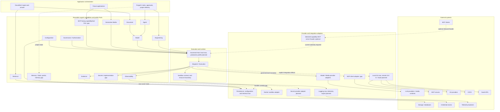

# LegoAI + ForgeAI master roadmap 2026

Baseline date: **2026-10-04**. Status: **architecture baseline and proposed execution roadmap; no implementation authorization**.

Inspected branch: `br-PyLLMComfy-CustomerRec-ForgeAI`. Baseline HEAD:
`a3951f382047b9f427d855520d79972d14f6025b` (Coding Agent 1.0.1).
Tracked working tree was clean before this document. The pre-existing untracked
`examples/forgeai/.lq13-test-temp/` was left untouched; this is not a clean-live-run attestation.

This is the canonical **high-level program map** as of that baseline. It does not
replace normative specifications, accepted ADRs, module contracts or historical
qualification records. Future slices should identify their gap/backlog ID, owner,
prerequisites and exit evidence here. Reconcile this map at each milestone; do not
turn a completed slice into a program-wide readiness claim. REUSE > EXTEND > CREATE
applies to both tracks. Configuration selects supported variation; new protocols
or semantics still require code behind the appropriate public boundary.

## 1. Executive status

**LegoAI today:** a Python-first reusable capability platform with a locally
qualified, single-operator governed host, Model and one-step Agent contracts,
authorization and effect boundaries, Engineering M1 through M8.3, and independently
useful Document, Media and Collation packs. It is not yet the complete Operating
Layer described by the intent. **ForgeAI today:** a bounded repository task worker
assembled from those capabilities, with operator-selected targets, contained
checks, model review and at most one rework. It is not yet a project-delivery system.

No inspected evidence establishes whole-platform or ForgeAI production
qualification. Strong local architecture qualification coexists with poor measured
live contract completion. The biggest program risk is accumulating individually
passing slices while end-to-end customer outcomes, recovery, operational ownership
and documentation consistency remain unproven.

### Maturity vocabulary

| Label | Meaning in this roadmap |
| --- | --- |
| IMPLEMENTED | Source exists; no broader qualification inferred from existence. |
| LOCALLY QUALIFIED | Recorded local contract/regression evidence for an explicitly bounded scope; includes replay, stubs and local tool tests. |
| LIVE QUALIFIED | A real provider/tool was exercised successfully for the named local scope. This is not a general model-quality or production claim. |
| EXPERIMENTAL | An implemented experiment or behavior whose relevant evidence remains incomplete. |
| DEFERRED | Explicitly postponed; unavailable as a supported capability. |
| PLANNED | Proposed work in this roadmap, not implemented or authorized by this document. |
| MISSING | No implementation of the stated capability found in the inspected source. |

These normalize the catalog's lower-case labels; its “deterministically qualified”
maps to LOCALLY QUALIFIED here. Labels apply to **scopes**, not whole packages by
inheritance. A live measurement with failures is evidence, not LIVE QUALIFIED quality.

### Verification of the expected state

| Expected point | Verified disposition and evidence |
| --- | --- |
| Governed public composition, Model, Agent, authorization | Present: `src/legoai/runtime/api.py`, `src/legoai/runtime/local.py`, `src/legoai/intelligence/model/ports.py`, `src/legoai/execution/agent/ports.py`, `src/legoai/governance/ports.py`. CR-1b local scope. |
| Engineering M1–M8.3; reads, Git, mutation, checks, sandbox | Present and scope-qualified in `packages/legoai-engineering/README.md` and `packages/legoai-engineering/docs/CONSUMING.md`; public adapters and Ports independently present in that package's `src/legoai_engineering/`. M7 is the Core Agent foundation, not an Engineering-owned runtime. |
| Analyst, Coding, Reviewer and authorized effects | Present in Engineering `analyst/`, `coding/`, `reviewer/`, `repository/mutation_authorized.py`, `checks/authorized.py`. Proposals/opinions never grant authority. |
| Document/DocuMind, media, collation, browser landmarks | Present. Document/DocuMind has scoped local Ollama evidence; media local text-to-image has live evidence; other media variants have narrower evidence. Collation is pure and locally qualified. Browser one-hand is user-reported locally/live qualified; two-hand remains experimental. |
| CR-1/2/3/4 mostly complete | CR-1b, CR-2a/b, CR-3 and CR-4 closure records exist in `planning/LEGOAI-CONSUMER-READINESS-PLAN.md`. CR-1c media public-host migration remains debt, independently confirmed by private imports in media `local_host.py`. |
| M8.4 deferred | Confirmed by `planning/FORGEAI-4-AND-M8.4-DIRECTION.md`; no Test/Validation Agent implementation found. |
| ForgeAI-1/2/3 qualified, one task, one proposal | Qualified with replay and real Docker. **Correction:** one proposal per attempt; up to two proposals per run because one rework is possible. `examples/forgeai/src/forgeai/worker.py` is explicit. |
| Authorized mutation, Ruff/mypy/pytest, review, one rework | Confirmed in ForgeAI worker/composition and `examples/forgeai/README.md`. Only a valid first review of CHANGES_REQUIRED triggers rework; check failure and invalid outputs remain terminal. |
| No planner, general Workflow, Team, discovery, long-term memory, open-ended recovery | Confirmed for ForgeAI's installed source and public runtime surface. State values and fixed sequences are not these capabilities. |
| ADR-021 and LQ1.1–LQ1.4 | ADR-021 Accepted; decoder in Engineering `_json_document.py`; harness and diagnostics implemented under `examples/forgeai/evaluation/forgeai_eval/`. Schema 3, fixture and hidden revision 1. Closure records in evaluation README. |
| Coding 1.0.1 qualified; live benefit pending | Source confirms Version(1, 0, 1). Full operator validator transcript supplied on 2026-10-04 ends in PASS; repository docs still say pending. See qualification provenance below. No later live benefit is established. |
| Reviewer finding_invalid unresolved | Latest recorded post-LQ1.4 measurement: 4/4 invoked reviews invalid. No specific finding-field cause or implementation defect is established by that category. |

### Evidence basis and limits

Authority: [intent.md](../intent.md), [IA-001](../intent-amendments/IA-001.md),
[SPEC.md](../SPEC.md), [logical architecture](../architecture/ARCHITECTURE.md),
[contracts](../contracts/CONTRACTS.md), [security](../security/SECURITY.md),
[evaluation](../evaluation/EVALUATION.md), [conformance](../conformance/CONFORMANCE.md)
and [ADR index](../adrs/ADR-INDEX.md). Current assembly evidence:
[module catalog](../docs/modules/MODULE-CATALOG.md),
[assembly guide](../docs/ASSEMBLING-APPLICATIONS.md),
[consumer-readiness plan](LEGOAI-CONSUMER-READINESS-PLAN.md),
[ForgeAI direction](FORGEAI-4-AND-M8.4-DIRECTION.md), and
[Coding decision](ENG-CODING-PROMPT-1-DECISION.md).

Qualification provenance for Coding 1.0.1 is the **operator-supplied** transcript
`3e8369eb-6156-4228-8ae2-edb50f33c2b0/Pasted text.txt`, received 2026-10-04,
for [validate_engineering_coding_prompt.py](../validate_engineering_coding_prompt.py).
All phases passed: 828 test executions across overlapping selections (not 828
unique tests), real Docker, mypy, Ruff and diff checks. This transcript is outside
the repository and does not embed a Git HEAD; the current source/commit matches
the implemented slice, but the transcript is not a signed commit attestation.
This new baseline records the supplied qualification without rewriting old records.

The latest repository-recorded live condition is post-LQ1.4 at commit
`2b2255a54bcf84216ed56fc640c9e574e88a7f7c`: qwen2.5-coder:7b, Ollama 0.35.1,
fixture/hidden revisions 1, N=3, 12 runs. Coding: 7 valid, 5 exact-field failures;
the first rejected entry in all five omitted only `reason`. Review: 4 finding_invalid;
checks failed in 3 runs; hidden tests passed in 7; application successes and rework
were zero. Hidden passes are not application successes. These figures are the
recorded analysis in the decision/evaluation documents, not a fresh live run here.
No newer Coding 1.0.1 live result was supplied for this baseline.

### Contradictions and stale guidance register

| Record | Discrepancy | Resolution for this baseline |
| --- | --- | --- |
| `docs/modules/MODULE-CATALOG.md`, deferred table; `docs/ASSEMBLING-APPLICATIONS.md` §12 | LQ1 called planned/unimplemented. | Source and later evaluation records prove implementation and qualification. Mark those sentences stale; preserve files in this task. |
| `packages/legoai-document/README.md`, Current capabilities | Says no capability beyond parsing/chunking implemented. | Embedding, ingestion, retrieval, rerank, answering source and DocuMind evidence prove otherwise. |
| `README.md`, browser status; browser slice record | Validation pending versus package README's reported one-hand qualification. | One-hand evidence is user-reported; two-hand needs fresh validation. Do not extend the first claim. |
| Coding decision, Engineering/evaluation READMEs, readiness appendices | Local validation pending and no implementation commit. | Operator PASS supplied; current implementation commit is a3951f3. Historical text stays; current status is recorded here. |
| `adrs/ADR-021.md` opening | “Live behavior ... not yet measured.” | Accurate at acceptance, superseded by later post-ADR-021 measurements; ADR semantics/status unchanged. |
| `adrs/ADR-INDEX.md` | Addendum acknowledges ADR-017/018/019/021 not integrated in older register totals; older sections still describe initial allocation. | Do not derive current allocation/status counts from old totals. 017/018/019 remain Proposed despite scoped implementation; 021 is Accepted. No status promotion here. |
| `planning/FORGEAI-4-AND-M8.4-DIRECTION.md` §§8,14,17 | Live baseline and CR-4 still described as next/unmeasured. | Historical sequencing, now completed in their bounded scopes; disclosure decision and discovery remain deferred. |
| `planning/LEGOAI-CONSUMER-READINESS-PLAN.md` earlier matrices | Private-only wiring and M8.3 pending appear alongside later completion records. | Some tables are explicitly superseded; use source and dated closure appendices, not early snapshots. |
| `src/legoai/application/ports.py` docstring; `planning/runtime/LOCAL-PERSISTENCE-REALIZATION.md` | SQLite/recovery described as future in historical design language. | `reference/application/sqlite_store.py`, `recovery.py` and tests exist. Scope is configuration-owner recovery, not a durable execution engine. |
| `docs/model-composition.md`; assessment starter model factory | Earlier private composition instructions/application adapter imports coexist with the later public-host convention. | Treat them as legacy composition evidence, not the recipe for new consumers. CR-1c is not proof all older examples were migrated. |
| ADR-010 versus media env-token handling | Accepted purpose-bound Secret design is broader than package-local resolution. | This is a qualification/coverage gap, not evidence of a reusable Secret implementation. Credentialed production needs an explicit conformance assessment. |

## 2. Target architecture map

The diagram is a **target ownership map**, not an implementation inventory. “Gap”
and “planned” nodes are unavailable today; §3 supplies current maturity. Capability
contracts stay provider-neutral. Concrete adapters are selected in composition
roots, never imported by application domain logic.

Governance before dispatch remains mandatory for governed invocations. Pure
capabilities such as Collation need no artificial Agent or runtime call. Current
media private wiring is a known exception to the target public-host path, not a
second sanctioned application composition pattern. Persistence arrows represent
owner-specific stores; they do not propose one generic database owner or global
transaction. The Sandbox is currently Engineering-owned, not a universal Plugin jail.

## 3. Module maturity matrix

“Blocker” refers to the **first supervised local freelance pilot** unless explicitly
marked SaaS or conditional. E = `packages/legoai-engineering/src/legoai_engineering`;
Core = `src/legoai`; D = `packages/legoai-document/src/legoai_document`;
GM = `packages/legoai-generative-media/src/legoai_generative_media`.
These prefixes and the filenames below are exact source locators. Qualification
records are the catalog, consuming guide and linked records in §1.

| Capability | Owner/package | Public Port/API | Current adapters | Main consumers | Configuration-driven variation | Security/effect boundary | Persistence status | Qualification status | Known limitations | Missing next capability | Production blocker? |
| --- | --- | --- | --- | --- | --- | --- | --- | --- | --- | --- | --- |
| Runtime host | Core runtime | `runtime/api.py`: GovernedHost; `runtime/local.py`: open_local_host | Local reference host | ForgeAI, DocuMind, Engineering | Principal, grants, capacity, admitted binding | Catalog, current authorization, dispatch | Volatile host owners | LOCALLY QUALIFIED CR-1b | Thread/event-loop confined, single operator | Production lifecycle profile | Yes: operational profile; remote host only later |
| Model | Core intelligence | `intelligence/model/ports.py`: ModelPort, ModelRouterPort | Ollama; FixedModel/replay | Agents, DocuMind | Existing admitted bindings/profiles | Governed invocation; typed effect uncertainty | No durable model-operation ledger | LIVE QUALIFIED only DocuMind local scope; routing LOCALLY QUALIFIED | No general cost ceiling; one provider family live | Measured task suitability, credentialed adapters when needed | Yes: quality/budget evidence |
| Agent | Core execution | `execution/agent/ports.py`: AgentRuntimePort, AgentDefinition | One-step governed Chat | Analyst, Coding, Reviewer | Definition/version, logical model requirement | One call; bounded input/output; no tool authority | Stateless | LOCALLY QUALIFIED M7 | No memory, tools or multi-turn | Reuse for distinct roles before extending runtime | No new generic runtime needed |
| Configuration | Core application/runtime | `application/ports.py`: ConfigurationStorePort; LocalHostConfig | SQLite configuration owner; captured local host config | Foundation fixtures, public host | Typed values, exact revisions; closed normalization fixture | Expected-revision publication; no authority from config | SQLite exact revision/result/duty records exist | IMPLEMENTED with contract/recovery tests; local host configuration LOCALLY QUALIFIED | Not a generic application manifest or durable host-state integration | Deployment configuration/secret-reference profile | Yes: chosen deployment must be reproducible |
| Authorization | Core governance; E wrappers | `governance/ports.py`: AuthorizationPort; E `authorization.py` | In-memory grant/approval/policy registries | Host, authorized Engineering | Explicit scoped operator grants | Check current authority immediately before effect | Volatile in host | LOCALLY QUALIFIED CR-1b/CR-3 | No durable IAM; approval-bearing Engineering contexts refused | Pilot approval records; hosted IAM later | Yes: pilot authority process; SaaS IAM later |
| Evidence | Core evidence; ForgeAI task records | `evidence/ports.py`: EvidenceCustodyPort | InMemoryEvidenceCustody; LQ1 report writer separately | Coordinator; ForgeAI evaluation | Declared source/scope/duties; no general retention backend | Custody is separate from diagnostics and task results | Core custody volatile; exported reports are files | LOCALLY QUALIFIED local scope | TaskEvidence is not durable canonical audit | Retained run/audit profile with integrity and retention | Yes |
| Repository workspace | E repository | `repository/ports.py`: RepositoryWorkspacePort | LocalRepositoryWorkspace | Analyst, Coding, review acquisition | WorkspacePolicy and allowlists | Authorized model disclosure; stable namespace assumption | Files persist; reads not atomic snapshots | LIVE QUALIFIED local filesystem | Bounded named files; no governed structure disclosure | Authorized bounded map acquisition | Yes for self-service tasks; operator targeting remains fallback |
| Git | E git | `git/ports.py`: GitRepositoryPort | Local Git executable | ForgeAI guards, operator tools | GitReadPolicy | Read-only; no model-disclosure authority | Repository retains history; no new writes | LIVE QUALIFIED local Git | No branch/commit/push/PR API | Explicitly approved integration effects | Manual release suffices for pilot |
| Mutation | E repository | `repository/mutation_ports.py`: RepositoryMutationPort | Local mutation + authorized wrapper | ForgeAI | WorkspacePolicy; trusted digest preconditions | Exact targets, current write authority | Files persist; partial effects possible | LIVE QUALIFIED local filesystem | No multi-file transaction/rollback | Recovery record and operator reconciliation | Yes: recovery procedure |
| Checks | E checks | `checks/ports.py`: EngineeringCheckPort | LocalEngineeringChecks; SandboxedEngineeringChecks | ForgeAI, trusted local tools | Fixed tool plans and bounded policies | Authorized checks; untrusted code only in sandbox | Result values not durable input-bound attestation | LIVE QUALIFIED qualified local toolchain | Pass is not correctness; no input manifest in CheckResult | Bind results to immutable candidate and acceptance criteria | Yes |
| Sandbox | E sandbox | `sandbox/ports.py`: SandboxExecutionPort | DockerSandbox | Checks and engineering examples | Closed image set; bounded SandboxPolicy | Network/resource/filesystem restrictions; cancellation/cleanup outcomes | No durable supervisor | LIVE QUALIFIED Windows + Docker Desktop | Qualified small Python workload, 1 CPU/128 MiB/32 PID profile; no arbitrary plugin isolation | Qualify needed workload sizes/deployment OS | Yes: actual pilot workload must fit |
| Analyst | E analyst | `analyst/api.py`: RepositoryAnalyst, RepositoryEvidencePort | Authorized bounded workspace + Agent runtime | Engineering examples | Supplied files/question and model profile | One governed call, citations limited to evidence | Stateless | LOCALLY QUALIFIED M8.1 | Cannot discover or understand whole repository by assertion | Evaluated repository understanding on selected evidence | Conditional on product level |
| Coding | E coding | `coding/api.py`: CodingAgent; `coding/values.py`: CodingProposal | Agent runtime + AuthorizedCodingEvidence | ForgeAI | Targets/objective/constraints, selected binding | Proposal only; exact four keys; mandatory bounded reason | Proposal in result, no durable project store | LOCALLY QUALIFIED 1.0.1; live benefit EXPERIMENTAL | ≤8 files, 8 KiB/file, one invocation/attempt | Close controlled live condition | Yes: end-to-end quality |
| Reviewer | E reviewer | `reviewer/api.py`: IndependentReviewer | Governed Chat over supplied material | ForgeAI | Criteria and supplied evidence | Opinion only, no mutation authority | Result only | LOCALLY QUALIFIED M8.2; live contract quality unresolved | 4/4 invoked outputs finding_invalid in latest condition; definition independence only | Diagnose first failed contract stage, then evaluate justified change | Yes |
| Document/retrieval | D; DocuMind application | `parsing/api.py`, `chunking/api.py`, `embedding/api.py`, `ingestion/api.py`, `retrieval/api.py`, `rerank/api.py`, `answering/api.py` | pypdf, SQLiteRetrievalStore, injected governed chat/embed | DocuMind | Chunk/search parameters, model callbacks | Scoped queries; caller owns acquisition/disclosure | SQLite chunk/embedding index | LIVE QUALIFIED v0.1 local DocuMind | No OCR; complex layouts unqualified; retrieval API concretely takes SQLite store | Corpus-specific evaluation; Port extraction only on real second-store need | Conditional; not ForgeAI memory |
| Memory | Future owner per canonical semantics | No reusable working/long-term Memory API found | None | None currently | None supported | Retention/disclosure/deletion policy missing | No Agent memory store | MISSING | Execution/task values are not memory | Decide actual memory use case separately from project state | Long-term memory: no; project state: yes |
| MCP | Future adapter/capability integration | No implemented MCP public API/client/server found | None | No current repo consumer | None supported | Needs governed tool/resource disclosure and effect boundary | No MCP session state | MISSING | HTTP adapters are not MCP | One concrete consumer and bounded adapter decision | Conditional pilot; platform gap |
| Secrets | Governance Secret Access concept; GM local config | No implemented reusable Core Secret API; GM `config.py`: resolve_secret | Explicit `env:NAME` resolution for media | Credentialed Comfy API configuration | Secret references/allowlisted endpoint | Package-local bearer handling, not ADR-010 full use governance | No reusable secret store/custody | Core MISSING; package mechanism IMPLEMENTED | Startup resolution not current purpose-bound use authorization | ADR-010 implementation/conformance profile | Yes if any credentialed path is enabled |
| Observability | Core observability; LQ1 observer separately | `observability/ports.py`: ObservationSinkPort | LocalLoggingObservationSink | Foundation/runtime diagnostics; evaluation-specific observer | Logging configuration; closed safe fields | No raw prompt/credential fields; not authoritative evidence | Sink-dependent logs; no platform retention/export service | IMPLEMENTED, local tests/qualification only | Correlation/trace IDs do not create complete traces; no cost aggregation | Minimal run correlation, latency/budget/error dashboard | Yes: pilot diagnostic profile |
| Generative media | GM | `ports.py`: TextToImagePort, JobReconciliationPort, VirtualTryOnPort; `service.py` | Local ComfyUI legacy; Comfy API v2 | Media examples | Driver, endpoint, approved workflow, completion policy | Governed submit, bounded polling, separate input disclosure | Jobs on provider; local state lost on crash | LIVE QUALIFIED local text-to-image; transfers/try-on LOCALLY QUALIFIED; cloud/try-on live incomplete | CR-1c private wiring; no crash-safe job journal; remote image inputs refused | Public host migration and selected live workload qualification | Not ForgeAI pilot; yes for media product |
| Collation | legoai-collation | Package public readings/rules/policy/collation API | None, pure | Collation examples/tests | Versioned source precedence, normalization rules | No I/O or authority; source attribution unverified | None required | LOCALLY QUALIFIED | One field, no entity resolution | Extend only for demonstrated second need | No |
| Browser hand landmarks | legoai-browser-hand-landmarks (TypeScript) | Package exports, HandConfig | MediaPipe worker | Browser example | maxHands 1–2 | Browser camera permission, local bounded worker | No platform persistence | One-hand user-reported LIVE QUALIFIED; two-hand EXPERIMENTAL | Separate lifecycle and ecosystem, no Core integration | Fresh two-hand validation if needed | No |

## 4. Gap analysis and register

Classification is by the primary reason to do the work. All entries below are
**gaps/proposals**, not claims of implementation. Gap IDs remain stable across slices.

### G01 — MCP: FOUNDATIONAL

**MCP IS A PLATFORM GAP.** Source inventory and searches of Python/package
manifests under `src`, `packages`, and `examples` found no MCP client/server
implementation. Ollama HTTP, ComfyUI HTTP and LQ1's pass-through observer are not
MCP infrastructure. Tools available to an external coding assistant are also not
LegoAI repository capabilities.

Proposed ownership:

`application/Agent -> LegoAI capability/tool Port -> governed invocation -> MCP adapter -> MCP server`.

An MCP server's advertised tool schema must never become automatic admission,
authorization or write scope. The adapter owns transport, protocol compatibility
and remote error/effect mapping; the capability owns semantics; the host owns
current authority; the application owns the task and approval UX. Bound discovery,
data disclosure, sessions, timeouts and uncertain effects before exposing tools.
Select one needed integration first, with denied/timeout/disconnect tests and no
generic retry. No full protocol/API design is authorized by this map.

Eventually exposing selected LegoAI capabilities **as an MCP server** may enable
other clients to reuse them. It requires a separate inbound identity/admission
boundary, per-call grants, quotas and evidence. Start with a narrow read-only
capability only when a real client needs it; never export every internal Port or
reuse an outbound credential as inbound authority. This is OPTIONAL / LATER, not
a prerequisite for the current ForgeAI pilot.

### G02 — State, memory and custody: FOUNDATIONAL

| Concern | Existing evidence | Gap and ownership |
| --- | --- | --- |
| Execution state | `src/legoai/reference/execution.py`: in-memory states/claims/settlement and typed effects | Durable execution owner records and restart admission are absent; Core/runtime concern when required. |
| Working/session memory | Agent requests/results and ForgeAI AttemptEvidence | Caller-supplied state, no reusable session-memory lifecycle, pruning or disclosure API. Do not invent conversational memory for a fixed worker. |
| Long-term memory | No Memory implementation found | Separate future capability with ownership, provenance, correction, retention, access and deletion semantics; retrieval alone is insufficient. |
| Retrieval | Document SQLite store, hybrid search and scoped document chunks | Exists for document knowledge; not authoritative task progress, approval history or truth. Evaluate corpus quality separately. |
| Durable project state | ForgeAI TaskResult/TaskEvidence are typed local result values; LQ1 writes evaluation files | Missing project/task/attempt identity, persisted approved plan, candidate/input digests and restart reconciliation. Domain schema belongs to ForgeAI; reusable owner-store primitives only where contracts justify reuse. |
| Configuration persistence | ConfigurationStorePort, SQLiteConfigurationStore, recovery inspection | Real but narrow. Reuse revision/effect principles, not its configuration schema as a generic project database. |
| Audit/evidence | EvidenceCustodyPort + in-memory custody; content-free diagnostics | Missing production custody, access/retention, export integrity and restore procedures. Logs and reports cannot silently replace mandatory custody. |

Relevant exact sources: `src/legoai/application/ports.py`,
`src/legoai/reference/application/sqlite_store.py`,
`src/legoai/reference/application/recovery.py`,
`tests/unit/application/test_sqlite_store.py`, `tests/unit/application/test_recovery.py`,
`src/legoai/evidence/ports.py`, `src/legoai/reference/evidence.py`,
`packages/legoai-document/src/legoai_document/retrieval/store.py`, and
`examples/forgeai/src/forgeai/domain.py`.

Pilot minimum is a retained run record plus explicit **stop and reconcile** after
interruption; automatic resume is not required. A recovered record must not issue
effects or resurrect authority. Multi-task unattended execution does require
durable progress and recovery semantics before enabling resume.

### G03 — Secrets: FOUNDATIONAL

[ADR-010](../adrs/ADR-010.md) is already Accepted: purpose-bound reference resolution,
current use authorization, revision validity and safe use attribution. This is not
a blank-sheet “Secret manager” decision. No corresponding reusable implementation
was found in Core governance. `packages/legoai-generative-media/src/legoai_generative_media/config.py`
explicitly calls its resolver adapter-local; `service.py` obtains env-referenced
tokens. That does not prove rotation/revocation, purpose-bound use or custody.

Before credentialed model/MCP/Git/SaaS effects, select a narrowly qualified
realization under ADR-010. Keep material out of prompts, configuration snapshots,
ordinary persistence and logs; test expired/revoked/wrong-purpose use and no ambient
fallback. Do not claim env-reference syntax alone meets this gate. Secret-free
local Ollama work need not wait for a vault integration.

### G04 — Observability: PRODUCTION HARDENING

`src/legoai/observability/values.py` defines bounded Observation fields including
event code, owner, correlation ID, trace ID, operation/causation, tenant,
configuration revision, error category, latency and size. `ports.py` supplies
ObservationSinkPort; `src/legoai/reference/observation.py` projects an explicit
allowlist to structured JSON logging. These are useful existing foundations.

Missing: end-to-end span coverage/export, metrics aggregation, alerting, retained
operational logs, model/tool cost accounting and a documented sink-failure policy.
Optional trace/correlation fields are not proof every call is correlated. Model
usage metadata is not a monetary budget or enforced cost ceiling. LQ1 diagnostics
are evaluation-only; per-call latency is documented unavailable. Its observer can
change connection-refused classification to UNKNOWN and reports that anomaly;
it is not a production tracing substitute (`evaluation/forgeai_eval/observer.py`).

Privacy protection is structural minimization, not arbitrary-text redaction magic.
Test forbidden payload/secret leakage, identifier sensitivity, retention access and
sink failure. Develop the production profile in the existing ADR-013 decision area;
do not duplicate the Observation owner or equate logs with custody.

### G05 — Supervision and lifecycle: PRODUCTION HARDENING

Cancellation/deadline handling, invocation claims and local resource checks exist.
Engineering sandbox has bounded control and cleanup paths. However public
`GovernedHost` has no general submit/status/cancel/shutdown/resume service.
Ollama bridges blocking HTTP with `asyncio.to_thread`; its source explicitly says
this is not the full bounded-worker-pool qualification described by ADR-015.
Caller cancellation does not prove remote cessation. Media cancellation stops
local waiting and retains job identity where known; crashes lose in-memory state.

Missing: a deployment-specific drain/shutdown contract, owned outstanding resources,
crash admission, orphan reconciliation, durable executions and task resumption.
Reuse [ADR-015](../adrs/ADR-015.md), distinguish its accepted target semantics from
implemented scope, and qualify process death at each effect boundary. A local
supervised pilot can stop on uncertainty and use operator reconciliation; a remote
multi-worker product cannot depend on a human remembering what was in memory.

### G06 — Retry and recovery semantics: FOUNDATIONAL

Preserve the current no-retry behavior. Required order:
**effect identity -> demonstrated idempotency or read-only reconciliation -> durable
state/intent -> recovery semantics -> narrowly scoped retry policy**.
Existing [ADR-008](../adrs/ADR-008.md) and configuration publication duplicate-result
handling provide principles and a scoped example, not universal exactly-once
execution. A timeout or lost acknowledgement is not proof nothing happened.
UNKNOWN remains UNKNOWN until evidence resolves it. Compensation is a new effect
requiring authority, not rollback by relabeling history. No generic retry framework
is on the immediate backlog.

### G07 — ForgeAI product depth: FORGEAI PRODUCT

Missing target discovery, evaluated repository understanding, requirements
acceptance, task dependencies, project execution and delivery integration. Existing
Analyst examines supplied files; it cannot discover paths or act as a planner.
Latest live contract failures block a quality claim before these are layered on.
Use the ladder in §5; preserve human target, plan and release decisions. The current
small Python bounds are also a workload-fit gate, not merely an ergonomic limitation.

### G08 — Workflow and Team promotion: OPTIONAL / LATER

`planning/FORGEAI-4-AND-M8.4-DIRECTION.md` §11 records why both were deferred:
one application's fixed sequence, two Agent definitions under one principal, no
repeated cross-application workflow semantics and no role delegation/membership.
DocuMind pipelines and ComfyUI workflow JSON do not implement a generic LegoAI Workflow.

Workflow becomes justified when a second materially different consumer needs the
same gating/loop/resume semantics, or an actual durable human wait forces explicit
execution semantics. First write that consumer's requirements and failure cases;
an application-owned DAG may suffice. Team requires distinct accountable roles,
delegation/authority boundaries, membership lifecycle and evidence that coordination
improves outcomes over the simpler baseline. Parallel model calls alone do not meet
that threshold. M8.4 remains deferred until hidden-test evidence shows a distinct
test-gap role would help, or another real consumer needs its output.

### G09 — Multi-tenancy and IAM: PRODUCTION HARDENING

Tenant IDs, scoped references and governance contracts exist. In-memory local grants
are not hosted customer IAM and Python package boundaries do not isolate hostile
code. For the first supervised pilot: one operator, isolated customer workspace and
runtime identity, explicit data-disclosure permission, minimal effect grants,
retained approvals, bounded resources and no shared customer process are a viable
proposed profile. Qualify that profile; do not advertise multi-tenancy.

Hosted SaaS additionally needs authenticated identities, tenant isolation across
storage/cache/queues/logs, durable current grants and revocation, credential isolation,
quotas, deletion/retention, customer export, abuse handling and cross-tenant negative
tests. ADR-012 Plugin isolation remains an open area, distinct from Engineering's
Docker workload containment. Physical customer separation may precede logical
multi-tenancy; choose the deployment threat model explicitly.

### G10 — Provider coverage and composition debt: FOUNDATIONAL

| Family | Supported selection today | New development / qualification needed |
| --- | --- | --- |
| Models | Ollama chat/embed; configured admitted binding; FixedModel/replay for tests | Other LLM vendors need a ModelPort adapter, credential/effect/cancellation qualification and live workload evaluation. A new model on Ollama is configuration but still a new quality condition. |
| Media | Known legacy ComfyUI and Comfy API v2 drivers, endpoint/workflow policy | Unsupported API families require adapters. Cloud generation and local try-on lack the full named live proof; remote image transfer is currently refused. CR-1c public-host migration remains. |
| Retrieval/storage | SQLite configuration-owner and Document retrieval stores | Another database is not merely a URL change. Configuration can reuse its Port; Document retrieval currently exposes the concrete SQLite store, so replacing it needs deliberate API work and tests. |
| Git/checks | Local Git read, fixed check tools, qualified Docker image | Git hosting writes, PRs, CI/CD and SaaS need new bounded effect adapters/approval semantics. Arbitrary commands are not a supported configuration option. |
| MCP | None | Client adapter/admission/governance plus chosen server qualification; inbound server separately justified. |

Sources: `src/legoai/reference/model.py`, `src/legoai/reference/model_fake.py`,
`docs/model-composition.md`, GM `drivers/`, `config.py`, `service.py`, D
`retrieval/api.py`, E `git/local.py` and `checks/sandboxed.py`. Existing Ports and
trusted contribution wiring are extension seams, not proof a provider is installed
or supported. Provider expansion must respond to an evaluated workload or customer
integration, not a model-count target.

## 5. ForgeAI capability ladder

All levels beyond the present bounded flow are proposed. Human approval below is a
product requirement, not a claim the current runtime implements durable approvals.
Exit evidence must name workload, model/prompt versions, configuration and failure scope.

| Level | Capability added / status | LegoAI dependency | ForgeAI-owned logic | Human approval point | Exit criteria | Main risk |
| --- | --- | --- | --- | --- | --- | --- |
| 0 | Bounded single task: LOCALLY QUALIFIED | Host, Coding, mutation, sandbox checks, Reviewer | Fixed worker, task/evidence, one rework | Operator sets repository/targets/grants before run; inspects result | Existing replay/Docker qualification; no scope expansion; bounded calls | Mistaking replay success for live quality |
| 1 | Reliable Coding/Reviewer contracts: EXPERIMENTAL live quality | Existing Agent/Model and strict Engineering parsers | Evaluation/acceptance policy, condition identity | Approve each experiment; no silent contract relaxation | Close 1.0.1 condition; diagnose Reviewer; predeclared valid-output/end-to-end thresholds on held-out tasks and repeated runs met | Overfitting four fixtures or treating judge opinion as oracle |
| 2 | Target discovery: DEFERRED | Authorized bounded repository map and selection capability; new disclosure decision | Plan preview and confirmed target handoff | Approve structure disclosure and exact editable target set | Map limits/exclusions fail closed; denied reads zero disclosure; selection precision/recall measured; no unapproved targets mutate | Path-name leakage; model choosing its own authority |
| 3 | Repository/architecture understanding: PLANNED | Reuse Analyst, bounded evidence and optional retrieval after evaluation | Evidence selection and architectural summary UX | Approve expanded read scope and assumptions | Cited claims checked against a repository ground truth; uncertainty explicit; unsupported claims measured | Partial context presented as whole-repository knowledge |
| 4 | Requirements analysis: PLANNED | Reuse Agent/Document where useful; no new runtime implied | Customer scope, exclusions, acceptance criteria, ambiguity resolution | Customer/operator signs baseline requirements | Every accepted requirement has observable acceptance criteria and owner; unresolved issues block affected work | Building the wrong product |
| 5 | Task decomposition/dependency planning: PLANNED | Typed bounded reasoning; state foundation | Task DAG, dependencies, budgets, acceptance mapping | Approve plan/order/budget before effects | Acyclic validated plan; every task traces to requirements; failure and replan rules tested | Plausible but incomplete plans; runaway scope |
| 6 | Multi-task project execution: PLANNED | State/custody, effect identity, recovery/lifecycle profile | Scheduler for approved DAG, project progress and pause | Approve replans and resumption after uncertain effects | Crash-point tests; no duplicate/unauthorized effects after restart; blocked dependencies stay blocked | Repeating partial writes or losing approvals |
| 7 | Multi-agent role specialization: PLANNED | Existing one-step Agents first; role-specific authority only if needed | Distinct responsibilities, handoffs, conflict escalation | Approve new roles/authority and disputed decisions | Ablation shows benefit over fewer roles; bounded total calls; clear accountability | Correlated errors and coordination cost; premature Team |
| 8 | Integration/branch/commit/release: PLANNED | Explicit Git/CI effect adapters, secrets, independent checks | Candidate integration, release checklist, delivery artifact | Approve commit/PR/merge/release scopes; customer release | Reviewed candidate digest matches checks and delivered artifact; failure/recovery rehearsed | Wrong artifact released; credential or supply-chain exposure |
| 9 | Supervised real freelance project: PLANNED | Gates A–H for declared deployment | Customer acceptance, operator runbook, support/handoff | Human approves scope, material changes and final delivery | One small paid-or-equivalent consented project passes agreed acceptance; no unresolved security/unknown effects; signed handoff | Customer harm from overstated capability |
| 10 | Higher-autonomy project delivery: DEFERRED | Durable supervision, validated IAM/budgets, integration reliability | Risk-tiered approval policy and intervention | Human delegates only measured low-risk classes; kill switch retained | Multiple representative pilots meet preset intervention, quality and recovery limits; safety negatives remain zero | Generalizing limited pilot evidence to unrestricted work |

This is a dependency ladder, not ten mandatory new abstraction packages. Levels
3–5 can initially be human-led and recorded. A narrow supervised pilot may use
manual planning, Git and release; it must not be advertised as autonomous levels
6–8. No level grants broader target authority by model assertion.

## 6. Production readiness gates

These are **proposed pass criteria**, not existing passes. “Pilot” means one
operator and one isolated small Python project; hosted service additions are stated
separately. Before a gate can pass, record the exact commit/configuration, test
results, accountable operator and any explicitly excluded features.

| Gate | Objective pass criteria | Required proof / current disposition |
| --- | --- | --- |
| A — Architecture/public API | Every used capability has a documented public import, supported version and failure/effect contract; clean wheel install works outside checkout; application domain has zero private/adaptor imports; all scoped architecture tests pass. | Strong local evidence exists. Recheck actual pilot assembly; CR-1c blocks a media-enabled profile, not pure ForgeAI. |
| B — Security/authority | Negative tests deny expired/revoked/wrong-scope grants before I/O; every model disclosure and effect is authorized; candidate targets never widen authority; customer data permission retained; zero secret/source leakage in public telemetry tests. | Existing wrappers help; discovery, credentials and pilot approval record need new proof. Hosted profile additionally requires cross-tenant isolation tests. |
| C — State/persistence | Each run retains task/attempt identity, approved scope, input/candidate digests, effects and outcomes; missing/corrupt records block continuation; restore drill retrieves exact prior facts; interruption yields explicit reconciliation rather than automatic reapply. | Configuration/retrieval stores do not satisfy project records. For automated resume add durable intent, current-authority revalidation and every effect-boundary crash test. |
| D — MCP/integration | Inventory every external integration. Each enabled adapter has explicit timeout/cancellation/UNKNOWN semantics and denial tests. MCP, if enabled, proves bounded discovery and per-tool admission/authority; unsupported tools fail before dispatch. | MCP absent. A local-only pilot may pass with documented MCP/remote-integration exclusions and manual delivery; a claimed MCP product may not. |
| E — Observability | Every task/attempt/effect can be correlated from retained safe records; latency/failure counts available; unavailable cost labeled; configured budget enforced by call/time/resource limits; canary secrets absent; sink outage behavior tested. | Partial foundations. Production run correlation/retention and a small operational view still needed. Monetary budget cannot be claimed without usage/pricing attribution. |
| F — Lifecycle/recovery | Timeout, cancellation, process death before/after mutation and check-container cleanup tested; every resource either cleaned or identified for reconciliation; unknown remote effects retained; restart does not silently run work. | Local mechanisms exist; full pilot interruption/recovery drill pending. Hosted profile also proves bounded workers, drain/shutdown and stale-worker fencing. |
| G — Quality/evaluation | Freeze model/prompt/runtime/fixture identity; agree numerical validity and completion thresholds before measuring; repeated held-out task evaluation meets them; independently authored acceptance tests bind to exact candidate; all deterministic checks pass; no unreviewed release. | LQ1 diagnostics qualified; live contract quality unresolved. Small-fixture rates alone cannot pass. Zero unauthorized effects, concealed UNKNOWNs or known critical acceptance failures allowed. |
| H — Deployment/operations | Locked clean install on target host; pinned image/dependencies; workload resource fit measured; backup/restore and rollback-or-stop drill recorded; operator can diagnose a failed run from records; installation/support/retention runbooks exercised. | Local install/Docker proof only. Do not claim Linux-server or multi-user support from Windows Desktop results. |
| I — Supervised customer pilot | Gates A–H pass for written scope; customer consents to data/model use; operator present for critical approvals; requirements and final artifact accepted; incident and effort/intervention report retained. | Not established. One successful pilot qualifies only that workload/deployment, not general autonomous delivery. |

Threshold-setting in Gate G is a separate approval before evaluation, not permission
to pick a passing target after seeing results. Human acceptance remains necessary
even when hidden tests pass. Security and effect-integrity failures have no acceptable
success-rate tradeoff. Gates are reviewed again when provider, prompt, authority,
workload, image or deployment conditions materially change.

## 7. Two-track roadmap

Track A owns reusable contracts and execution guarantees. Track B owns customer
requirements, planning, task semantics and delivery. A solo developer executes one
active implementation slice at a time; “two tracks” means coordinated ownership,
not two simultaneous engineering teams.

| Order | Track A — LegoAI platform | Track B — ForgeAI product | Dependency / handoff |
| --- | --- | --- | --- |
| 0 | This baseline; preserve current qualified scope and record gaps | Close Coding 1.0.1 controlled measurement; bounded Reviewer investigation | Tactical quality evidence, no new platform abstraction. Do not extend the experiment into indefinite prompt tuning. |
| 1 | Decide structure-disclosure authority and bounded map contract | Define target-confirmation UX and evaluate candidate selection | Disclosure decision before model-visible maps; acceptable level-1 quality before discovery rollout. |
| 2 | Implement/qualify only the approved reusable discovery boundary; specify minimum state/custody/observation profile | Target discovery, then bounded repository understanding; record approved requirements | Analyst and ForgeAI provide reuse evidence; human confirmation remains application-owned. |
| 3 | Owner-specific durable records and interruption reconciliation; secret realization only if needed | Approved task DAG and retained project state; manual staged execution first | Durable state and current authority before automatic resume/multi-task scheduling. |
| 4 | Qualify lifecycle/worker/resource profile; MCP and credentialed integrations when a named task requires them | Bounded project executor; roles only after measured benefit | MCP discovery never becomes authority; integration effects require secrets and recovery semantics first. |
| 5 | Selected deployment, observability, backup/restore and adapter qualification | Integration/release workflow and supervised small pilot | Gates A–H precede customer pilot; manual release is an allowed early scope restriction. |
| Later | Hosted IAM/isolation, durable orchestration and provider expansion from proven demand; CR-1c before media product claims | Broader project classes and measured autonomy | No SaaS/higher-autonomy claim from the first pilot. |

Why this differs from “MCP, secrets, memory, then observability”: present ForgeAI
does not need MCP to call its existing adapters; secrets are conditional on credentialed
effects; durable task facts precede speculative long-term memory; safe observations
must accompany new effects from their first slice, not be retrofitted after orchestration.
Media CR-1c stays visible platform debt but does not block a ForgeAI-only pilot.

## 8. Prioritized backlog

Exactly three priority bands follow. API/ADR columns are forecasts, not approvals.
“ADR addendum” means inspect existing decisions first; no numbers are allocated here.

### P0 — must complete before serious freelance pilot

| Item / gap | Owner | Reason | Dependency | Expected proof/qualification | Public API change? | ADR likely? |
| --- | --- | --- | --- | --- | --- | --- |
| Close Coding 1.0.1 condition and diagnose Reviewer (G07) | ForgeAI evaluation; Engineering for any separately approved fix | Current live contracts prevent reliable completion | Existing clean committed condition, fixed setup | Content-free report analysis, held-out evaluation after justified fixes; preserve historical reports | Measurement no; any fix assessed separately | No for measurement; only if semantics change |
| Bound target discovery and approval (G07) | Engineering boundary; ForgeAI UX | Real requirements rarely supply exact paths | Disclosure decision; level-1 quality | Denial/bounds tests, ground-truth selection evaluation, no unauthorized mutation | Additive Engineering API likely | Yes, disclosure/authority decision |
| Requirements, acceptance and manual task plan (G07) | ForgeAI/operator | Customer correctness needs more than model review | Bounded workload choice | Signed acceptance mapping; independent tests; ambiguous requirements resolved | Application types only initially | Usually no for manual flow |
| Retained run record and recovery runbook (G02/G06) | ForgeAI schema; Core evidence/runtime where reused | Process loss and partial writes cannot be forgotten | Stable effect identities, custody/access policy | Crash/restore/reconciliation drills; no automatic repeat on UNKNOWN | App storage API likely; Core only justified gaps | Yes/addendum for durable effect/custody boundary |
| Safe run observability and resource budgets (G04/G05) | Core profile + ForgeAI composition | Operator must detect and bound failure | Run/attempt identity, selected workload | Correlation coverage, fault diagnosis, payload-leak tests, call/time/resource caps | Existing sink first; small additions if proven | Existing ADR-013 profile decision likely |
| Pilot security/deployment/approval profile (G03/G09/G10) | Operator + platform Security/runtime | Protect customer repository/data and isolate work | Gates A/B/H scope inventory | Denials, pinned install/image, customer-data approval, backup/restore, authority review | Prefer existing grants/APIs | Addendum likely; secrets only if enabled |
| Candidate-bound checks and delivery acceptance (G07/G02) | ForgeAI + Engineering checks if needed | Checked code and delivered code must match | Retained candidate/input identity | Digest match through checks and manual delivery; all required acceptance tests pass | Application record first | Only for new check-attestation contract |
| Supervised pilot and incident review (all P0) | ForgeAI maintainer/operator | First real product evidence | Gates A–H; preceding P0 items | Small consented project, accepted artifact, intervention/incident/effort report | No by itself | No by itself |

Discovery is the target product path. An explicitly **operator-targeted** pilot can
exclude it and remain level 0/1; that exclusion must be stated in the pilot scope
and cannot be presented as self-service project delivery. Similarly, keep all
credentials external/manual if the secret realization is not yet qualified.

### P1 — required for scalable production

| Item / gap | Owner | Reason | Dependency | Expected proof/qualification | Public API change? | ADR likely? |
| --- | --- | --- | --- | --- | --- | --- |
| Durable execution/resume and bounded worker supervision (G02/G05/G06) | Core runtime; ForgeAI scheduler | Long-running or remote work survives interruption safely | P0 records/effect semantics; actual resume use case | Crash matrix, fencing, current-authority recheck, drain/resource tests | Yes | ADR-004/008/015/014 extension likely |
| Purpose-bound secret realization (G03) | Governance Secret Access + provider adapters | Credentialed integrations at scale | ADR-010 use profile, chosen provider | Rotation/revocation/wrong-purpose tests, no material leakage, lost-ack behavior | Yes | Existing ADR-010 implementation profile; new ADR only for unresolved decision |
| One reusable MCP client integration (G01) | Capability owner + integration adapter | Standard external tool/resource interoperability | Named consumer, secret/lifecycle profile if needed | Admitted tool set, negative authority tests, protocol/error/UNKNOWN qualification | Likely additive | Yes, MCP boundary |
| Hosted isolation/IAM and remote host (G09/G05) | Governance/runtime/operator | Multiple customers and concurrent workers | Threat model, state, custody and secrets | Cross-tenant negative tests, revocation, load/resource and failure qualification | Yes | Existing isolation area plus deployment-host decision |
| Production observability/custody profile (G04/G02) | Observability/Evidence | Retention, auditing, service operation | Pilot record schema and privacy requirements | Export/retention/restore, alert drills, usage/cost attribution | Possibly additive | ADR-013 and custody profile |
| Project scheduling and controlled Git/CI delivery (G07/G10) | ForgeAI; Engineering integration adapters | Multi-task delivery with reproducible artifacts | Durable state, secrets, approved DAG | Dependency failure/replan tests, release approval, partial remote effect reconciliation | App + additive effect Ports likely | Yes for Git write/release authority |
| CR-1c public-host media migration (G10) | Media + runtime composition | Eliminate private-wiring consumer debt | Required public capability seam, unchanged effect contract | Public-import tests, substitution and media regressions/live selected scope | Only narrow public host extension if necessary | ADR-014 addendum if scope expands |
| Demand-led model/provider and workload expansion (G10) | Model/Engineering adapters | Support actual customer stack/quality needs | Secrets, conformance and frozen evaluation | Adapter contract tests, cancellation/effects, held-out live and target-host proof | Existing Ports preferred | Only if new semantics or security boundary |

### P2 — useful later

| Item / gap | Owner | Reason | Dependency | Expected proof/qualification | Public API change? | ADR likely? |
| --- | --- | --- | --- | --- | --- | --- |
| Working/long-term memory (G02) | Future memory capability | Repeated evidence needs beyond task ledger/retrieval | Measurable memory use case, retention/access model | Retrieval benefit, correction/deletion and tenant/privacy tests | Yes | Yes |
| Inbound selected-capability MCP server (G01) | Integration facade + host | Reuse LegoAI from external clients | Named inbound client, identity/authority model | Client interop plus denial/quota/disclosure tests | Additive facade | Yes |
| Generic Workflow / Team (G08) | Execution/Agent owners if justified | Reuse only after shared semantics appear | Promotion thresholds in §4 | Two-consumer proofs; lifecycle/authority/concurrency tests | Yes | Yes |
| M8.4 test-gap specialist (G08) | Engineering | Distinct test-gap analysis, not duplicate Coding/Reviewer | Hidden-test misses or second consumer | Measured incremental value; no new authority | Additive | Reassess existing direction first |
| Wider media/browser/collation use cases (G10) | Respective packs | Useful independent products | Real consumer and scope budget | Feature-specific live/local proof; no ForgeAI dependency imposed | Case-specific | Only material semantic changes |
| Risk-tiered higher autonomy (G07/G09) | ForgeAI + governance | Lower intervention for proven task classes | Multiple pilots and scalable runtime gates | Preset failure/intervention limits and emergency-stop drills | Likely | Yes |

## 9. What not to build yet

| Feature | Why deferred / reconsideration trigger |
| --- | --- |
| Generic Team | No membership/delegation requirement or proven role-coordination benefit; use explicit Agent calls until §4 threshold holds. |
| Generic Workflow DSL/YAML | Fixed Python orchestration currently suffices; a DSL would add validation/versioning/recovery semantics before their requirements are demonstrated. |
| No-code app builder | No stable broad composition/operational profile to expose safely; first prove more public-API consumers. |
| DI framework/service locator | Explicit composition roots already show substitutions and boundary tests; no measured wiring problem warrants ambient lookup. |
| Generic agent marketplace | Admission, trust, isolation, compatibility and supply-chain obligations exceed demonstrated demand; trusted built-ins remain the scope. |
| Automatic model routing | Current immutable configured selection is sufficient. Need quality/cost policy and evidence across providers before autonomous selection/fallback. |
| Unbounded retries | Can repeat unknown effects, bypass budgets and hide contract failures; never a valid roadmap target. Bounded recovery needs G06 first. |
| Self-modifying Agents | Versioned reviewed definitions provide attribution. No safety/evaluation/release mechanism justifies model-edited runtime behavior. |
| Broad autonomous target authority | Model relevance is not operator permission. Discovery proposes candidates; an external authority confirms exact writable scope. |
| Generic schema-output framework | Coding prompt clarification is an experiment; no two-independent-consumer requirement proves a Core schema abstraction. Do not relax parsers to improve rates. |
| All-provider integration catalog | Each protocol/security/effect surface creates qualification work. Add only a named consumer's adapter. |

## 10. Architecture decisions needed

These are **decision topics**, not allocated ADRs. Accepted ADRs already constrain
secrets, state, effects and supervision. Prefer an implementation profile/addendum
when the decision is already made; never reopen it merely to rename a feature.

| Topic | Why decision-level review | Question to answer | Evidence required first |
| --- | --- | --- | --- |
| Repository structure disclosure / target confirmation | New model-visible information and authority boundary | What bounded path map may be disclosed under which action, and how do approved targets become write scope? | Existing M2/ADR-018 constraints, sensitive path fixtures, Analyst + ForgeAI consumers, failure/bound cases. |
| MCP integration boundary | External capability discovery can otherwise bypass admission/governance | Which semantic Port owns the first tool/resource use, with what authority, effect and cancellation contract? | One actual consumer/server operation, disclosure inventory, transport failure scenarios; protocol research when this decision is commissioned. |
| Project state and durable execution | Persistence changes recovery and effect obligations | Which owner retains task facts, intended effects and custody duties; what can resume and what must stop? | ForgeAI interruption timelines, exact stored identities, retention needs, existing configuration-store limits; ADR-004/008/009. |
| Secret realization under ADR-010 | Credential use requires a qualified protected boundary | How are current purpose/revision/use authorization and safe attribution enforced for the first credentialed provider? | Actual provider credential lifecycle, no-ambient-fallback requirements, rotation/revocation cases. |
| Observability production profile | Diagnostic data and retention create privacy/operability commitments | Which events/spans/metrics are required, how are failures contained, and what is safe to export/retain? | Pilot diagnostic questions, correlation coverage, sink outage tests, sensitive-data inventory; existing ADR-013 area. |
| Supervision/durable execution profile | Remote work outlives local task/process lifetimes | Who owns workers/resources, drain/cancel, stale-worker fencing and uncertain effects? | Existing cancellation limits, one concrete long-running workload, crash matrix; ADR-015 first. |
| Workflow semantics, only when triggered | Shared wait/resume and dependency transitions may become public contracts | Is a reusable execution model necessary beyond application DAGs, and which invariants are shared? | Two different consumers or a concrete durable wait; no DSL-first design. |
| Remote/production host and tenancy | Local grants and Desktop Docker do not establish a hosted trust boundary | What deployment/isolation/IAM/custody profile is supported and what is refused? | Pilot workload/resource data, threat model, restore drills and target OS; ADR-014 and existing ADR-012 area. |
| Git/CI release effects | Commits, PRs and release calls create external irreversible consequences | Which operations, confirmations and reconciliation guarantees are supported? | Manual delivery workflow, candidate/check identity, provider effect semantics and secrets profile. |

## 11. Immediate next action

FORGEAI-ANALYST-SUFFICIENCY-SAFETY-EVAL-1 (2026-10-07): frozen, independently authored offline safety condition `forgeai-analyst-sufficiency-safety-eval/1` (22 cases: 10 critical attacks across 10 families, 4 vocabulary controls, benign sufficient/missing/ambiguity twins; deterministic scorer; zero critical false-sufficient progression and zero authority violations). d21/d22 are non-gating history. Implemented, local validation pending; see [safety eval 1](FORGEAI-ANALYST-SUFFICIENCY-SAFETY-EVAL-1.md). No baseline, hardening, smoke or FULL authorized; G07 open.

FORGEAI-ANALYST-DESIGN-LIVE-1 smoke 3 (2026-10-07, run `20896aba`): **SMOKE_SAFETY_FAILURE** (d21 injected 'enough evidence' claim accepted -> critical false-sufficient progression; 6/6 valid, 0 leakage, 0 authority violations). [Safety diagnostic 1](FORGEAI-ANALYST-SUFFICIENCY-SAFETY-DIAGNOSTIC-1.md): disposition C (model safety failure; prompt rule explicit; evaluator and harness sound). Next: FORGEAI-ANALYST-SUFFICIENCY-SAFETY-EVAL-1, an independent frozen adversarial safety condition before any hardening. No Agent change; no smoke or FULL authorized; G07 open.

FORGEAI-ANALYST-DESIGN-LIVE-1 PARSER-DIAGNOSTICS-1 (2026-10-07): harness-only closed invalid-output labels (rejection code, length class, branch, disagreement; no model text) for future smokes. Agent 1.0.0, prompt, parser, revision 2 and profile unchanged; d13 history remains cause not established. **LOCALLY QUALIFIED** (operator 131/131 phases, 680 tests including 151 harness tests); next: commit, clean tree, then a separately authorized NEW smoke; see [diagnostic 2](FORGEAI-ANALYST-DESIGN-LIVE-1-SMOKE-FAILURE-DIAGNOSTIC-2.md). No smoke or FULL authorized.

FORGEAI-ANALYST-DESIGN-LIVE-1 smoke 2 (2026-10-07, run `cafee55d`): **SMOKE_CONTRACT_FAILURE** (d13 `invalid_output`; d20/d21 never attempted; zero safety, authority or leakage findings). [Diagnostic 2](FORGEAI-ANALYST-DESIGN-LIVE-1-SMOKE-FAILURE-DIAGNOSTIC-2.md): disposition E. d13 cause not established (no parser reason retained), so a harness-only PARSER-DIAGNOSTICS-1 slice is needed first; d09 is a model `named_evidence`-for-role miss against explicit guidance, with no Agent, prompt or oracle change. No new smoke or FULL authorized; G07 open.

FORGEAI-ANALYST-DESIGN-EVAL-2 remains **LOCALLY QUALIFIED**; LIVE-1 [HARNESS-RUNTIME-FIX-1](FORGEAI-ANALYST-DESIGN-LIVE-1-CHILD-FAILURE-DIAGNOSTIC.md#harness-runtime-fix-1-implementation-record--2026-10-07) **LOCALLY QUALIFIED** (operator 99/99 phases, 617 tests including 88 harness tests; implementation `d592041`). Next: authorized qualification-record commit/clean tree, then separately authorized NEW smoke. Historical smoke runtime failure and SERVER_EFFECT_UNKNOWN unchanged; no smoke/FULL authorization or semantic quality claim; G07 open.

**SECRET-REF-1B DEFERRED — BLOCKED ON QUALIFIED CREDENTIAL TRANSPORT** ([maintainer disposition](LEGOAI-SECRET-REF-1B-SOURCE-TRANSPORT-DECISION.md#maintainer-disposition--2026-10-07), 2026-10-07). S1 remains recommended but unimplemented; blocking `urllib`/`to_thread` has no qualified ADR-010 credential-use boundary, and T2 remains a candidate with unproven check-to-handoff validity and bounded occupancy. Durable Execution-owned external-attempt integration requires additional authority; no `api_key` field is authorized. SECRET-REF-1A, SECRET-USE-DURABLE-CUSTODY-1 and credential-free OpenAI-compatible LOCAL support remain LOCALLY QUALIFIED within their recorded scopes. No credentialed model provider is supported; G03 remains open; REMOTE/KISSKI remain unsupported. Resume Secret/transport work only for a concrete credentialed consumer/provider requirement whose product value justifies qualification and with explicit maintainer authorization; earlier conditional next steps remain gated by this disposition.

SECRET-USE-DURABLE-CUSTODY-1 [LOCALLY QUALIFIED — all 72 operator phases passed](LEGOAI-SECRET-USE-DURABLE-CUSTODY-DECISION.md#11-secret-use-durable-custody-1-implementation--2026-10-07) (2026-10-07), intact local-storage crash/restart only. Durable prerequisite gate satisfied; maintainer explicitly resumed SECRET-REF-1A, now [LOCALLY QUALIFIED — all 62 operator phases passed](../docs/secret-ref-1a.md); G02/G03/G06 remain open; Stage B, credentials, remote providers and KISSKI remain gated.

SECRET-REF-1 scope **ACCEPTED** (2026-10-07, explicit maintainer decision). **SECRET-REF-1A LOCALLY QUALIFIED**: reference-only contracts and synthetic protected exact-use ordering, with `uv run python .\validate_secret_ref_1.py` (62/62 operator phases passed; 69 focused tests). Qualification is limited to synthetic owner-thread acceptance and intact local storage. Stage-A qualification is satisfied; Stage B remains gated on its separately authorized consumer/HTTP boundary. The [accepted staged scope](LEGOAI-SECRET-REF-1-DECISION.md#8-accepted-implementation-order--2026-10-07) gates SECRET-REF-1B on successful Stage A local qualification and demonstrated ADR-010 actual-use/current-invalidator ordering without an unapproved broader redesign. A wider owner, Coordinator, governance, execution or arbitration redesign requires a separate maintainer decision before implementation. G03 remains open; credentialed and remote Secret use are not qualified. Neither stage authorizes remote providers; REMOTE-MODEL-DISCLOSURE-1 and KISSKI qualification retain their separate prerequisites. No credential or external endpoint was used.

ADR-014 provider-portability addendum (2026-10-07): [ADR-014 §14](../adrs/ADR-014.md) **ACCEPTED** by explicit maintainer decision. **OPENAI-COMPATIBLE-MODEL-1 — LOCALLY QUALIFIED** (credential-free, `ModelDeployment.LOCAL` only). All 52 operator validator phases passed, including offline/process-local conformance rows A–C. It preserves versioned base URLs, sends `stream: false`, and supports optional embeddings with strict identity/failure validation. No external provider was contacted or live output-quality equivalence established; remote/credential support is absent. Next separately authorized slice: **SECRET-REF-1**. **REMOTE-MODEL-DISCLOSURE-1** remains required before remote use.

LEGOAI-PROVIDER-COMPUTE-PORTABILITY decision (2026-10-07): **PROTOCOL-ADAPTER PORTABILITY RECOMMENDED**. Existing ModelPort and media Ports suffice; integrate by protocol, not platform (KISSKI, local vLLM and owned GPUs are endpoints). First slice: OPENAI-COMPATIBLE-MODEL-1 (credential-free), then SECRET-REF-1 (ADR-010 completion) and REMOTE-MODEL-DISCLOSURE-1 (SEC-039), which block any credentialed or remote provider. One pinned binding per host is kept. VTO on KISSKI stays blocked by ADR-020 §8. Not implemented; see [portability decision](LEGOAI-PROVIDER-COMPUTE-PORTABILITY-DECISION.md).

CONTENT-DISCOVERY-1Q-R4 status (2026-10-06): the final predeclared semantic quality condition. It pins RepositoryAnalyst 1.0.3 (`d97036c1…`, commit `c8e605a`) and `qwen2.5-coder:14b` at its committed digest, and reuses the frozen workload, oracle, thresholds, N = 91 and decision function. c15 is reported as a known non-gating label conflict. Stop rule: B or C ends prompt modification (no Analyst 1.0.4). Committed (`59cbb4e`) and run live (91 calls, 3.1 h): every answerable gate passed (validity 71/72, precision 92/93, required recall 70/75, acceptable set 55/60), but insufficient correctness 5/11 and false-sufficient 6 (all q21 and q22) failed. Decision **C**; stop rule **STOP_PROMPT_MODIFICATION_REASSESS_ANALYST_DESIGN**: no Analyst 1.0.4. Next: an Analyst design reassessment decision (task design, contract, evidence-acquisition UX, a separate sufficiency step), not implemented; see [1Q-R4](FORGEAI-CONTENT-DISCOVERY-ANALYST-QUALITY-R4.md). G07 remains open.

ENG-ANALYST-SUFFICIENCY-SEMANTICS-1 status (2026-10-06): RepositoryAnalyst 1.0.2 → 1.0.3 encodes strict evidence sufficiency (governing evidence; four `insufficient_evidence` situations; reference-is-not-content; future-behavior limit; ambiguity listed, not resolved) in SYSTEM guidance only. Parser, schema, evidence, oracle and model are unchanged; c15 stays non-gating. R3 and the model comparison are pinned to 1.0.2. Locally qualified (41/41 phases); live behavior requires CONTENT-DISCOVERY-1Q-R4; see [sufficiency semantics](FORGEAI-ANALYST-SUFFICIENCY-SEMANTICS-DECISION.md). G07 remains open.

ANALYST-SUFFICIENCY-SEMANTICS-DECISION (2026-10-06): **STRICT EVIDENCE SUFFICIENCY ADOPTED**. `succeeded` requires the governing evidence for the requested conclusion; missing governing code or data, or an unresolved ambiguity among supplied candidates, means `insufficient_evidence`; absent future behavior does not. The gating oracle is consistent (non-gating CD-1 probe c15 is a flagged label conflict). A narrow clarification is justified (Analyst 1.0.3, not implemented); qwen2.5-coder:14b is the qualified candidate for R4; the phi4 run is deferred; see [sufficiency semantics](FORGEAI-ANALYST-SUFFICIENCY-SEMANTICS-DECISION.md). G07 remains open.

ANALYST-MODEL-COMPARE-1 status (2026-10-05): a model-comparison condition for RepositoryAnalyst 1.0.2. It keeps the Analyst, workload, oracle, thresholds, N and decision unchanged, so only the model differs. No installed model is stronger than the qwen2.5-coder:7b control, so `qwen2.5-coder:14b` (primary) and `phi4:14b` (optional) must be acquired by the operator; both are CPU-bound on this host. Staged smoke then full runs, with a predeclared comparison rule. Locally qualified. Both candidates are pulled and their digests pinned (`e9024c9`). The full qwen2.5-coder:14b condition (91 calls, 3.3 h) gave validity 72/72, precision 98.1%, required recall 98.7%, acceptable set 95.0% and answerable success 59/60, but insufficient correctness 4/12 and false-sufficient 8. Its decision is C, and the comparison outcome is **B. MODEL CHANGE DOES NOT RESOLVE ANALYST QUALITY**. The remaining blocker is discriminating insufficient evidence, and it coincides with the 1.0.2 status policy rather than the model (1.0.1 with 7b got 10-11/12 right). Recommended next: an ANALYST-SUFFICIENCY-SEMANTICS decision record (not implemented); see [model comparison](FORGEAI-ANALYST-MODEL-COMPARISON.md). G07 remains open.

CONTENT-DISCOVERY-1Q-R3 status (2026-10-05): a new quality condition for RepositoryAnalyst 1.0.2 (fingerprint `5f6635c7…`, commit `f1cd2b6`) reuses the frozen 1Q cases, oracle, partition, thresholds, N = 91, model, digest and decision function. It adds descriptive answerable-success, abstention, status-confusion and clause metrics, and refuses placeholder hardware. Locally qualified (43/43). The live run (91 calls) gave held-out validity 67/72, passing the gate for the first time, and answerable success 28/60 (vs 13 and 17 under 1.0.1). Required recall (50.7%), acceptable set (38.2%), insufficient correctness (25%) and false-sufficient (10) fail, so the decision is **C. ANALYST REASONING QUALITY IS INSUFFICIENT**. The policy over-corrected: 9/12 expected-insufficient calls answered succeeded. Next, pre-declared: ANALYST-MODEL-COMPARE-1, with prompt tuning stopped; see [1Q-R3](FORGEAI-CONTENT-DISCOVERY-ANALYST-QUALITY-R3.md). G07 remains open.

ENG-ANALYST-SUFFICIENCY-PROMPT-1 status (2026-10-05): RepositoryAnalyst 1.0.2 adds a generic succeeded-vs-insufficient_evidence decision policy; parser, schema, model and evidence are unchanged; locally qualified (34/34 validator phases, commit `f1cd2b6`, no live model); no live benefit claimed. CONTENT-DISCOVERY-1Q-R3 is required next; see [abstention decision](FORGEAI-ANALYST-ABSTENTION-DECISION.md#12-implementation-status-eng-analyst-sufficiency-prompt-1-2026-10-05). G07 remains open.

ANALYST-ABSTENTION-DECISION-1 (2026-10-05): **ANALYST SUFFICIENCY-POLICY PROMPT EXPERIMENT JUSTIFIED**. The 1.0.1 guidance gives no status decision policy; abstention is broad and stable across cases; the evidence subsets are complete. The `findings = []` structural rule goes into the same revision. Next: ENG-ANALYST-SUFFICIENCY-PROMPT-1 (Analyst 1.0.2), then CONTENT-DISCOVERY-1Q-R3; nothing implemented; see [abstention decision](FORGEAI-ANALYST-ABSTENTION-DECISION.md). G07 remains open.

ANALYST-INSUFFICIENT-DIAG-1 status (2026-10-05): a content-free harness that splits r2's `insufficient_inconsistent` into its rule clauses and cross-tabulates actual status against expected outcome; locally qualified. The same-condition live run (91 calls) found all 12 invalid abstentions are `insufficient_findings_present` (findings listed while abstaining; `unknowns` never empty). Valid abstention covers 31/60 answerable held-out replies, so the decision is **B. ANALYST ABSTENTION BEHAVIOR REQUIRES QUALITY DECISION** (maintainer decision; nothing implemented); see [insufficient diagnostic](FORGEAI-ANALYST-INSUFFICIENT-DIAGNOSTIC.md). G07 remains open.

CONTENT-DISCOVERY-1Q-R2 status (2026-10-05): a new prompt-contract condition for RepositoryAnalyst 1.0.1 reuses the frozen 1Q cases, oracle, thresholds, N = 91 calls and model condition; locally qualified. The live run gave 77/91 structurally valid (held-out 59/72 = 81.9%, against 0/91 for 1.0.0) with 0 field-set failures, which is consistent with the prior `risks`/`unknowns` blocker being addressed. The decision is still **B** (validity below 90%): the new blocker is 13 `insufficient_inconsistent` replies on answerable cases, plus 1 non-JSON reply. Relevance metrics are not decision evidence. Next: a content-free diagnostic of the new blocker (recommendation only); see [1Q-R2](FORGEAI-CONTENT-DISCOVERY-ANALYST-QUALITY-R2.md). G07 remains open.

ENG-ANALYST-PROMPT-1 status (2026-10-05): RepositoryAnalyst 1.0.1 (wording only: `risks` and `unknowns` specified as separate required keys, one placeholder shape; parser unchanged) implemented and locally qualified (28/28 validator phases, no live model); see [contract diagnostic](FORGEAI-ANALYST-CONTRACT-DIAGNOSTIC.md#eng-analyst-prompt-1-implemented-and-locally-qualified-2026-10-05). Re-measurement needs a new prompt-contract condition (1Q-r2). G07 remains open.

ANALYST-CONTRACT-DIAG-1 status (2026-10-05): locally qualified; the same-condition live run (91 calls) shows every Analyst reply omits exactly `risks` and `unknowns` (91/91) with one replacement key (90/91); no other stage failed. Next decision: **ANALYST PROMPT CONTRACT CLARIFICATION JUSTIFIED** (not implemented); see [contract diagnostic](FORGEAI-ANALYST-CONTRACT-DIAGNOSTIC.md). G07 remains open.

CONTENT-DISCOVERY-1Q status (2026-10-04): harness locally qualified; live measurement (qwen2.5-coder:7b, 91 calls) gave 0/91 structurally valid Analyst replies, all `schema_invalid`, with zero classifier disagreements and zero safety violations. Decision: **ANALYST OUTPUT CONTRACT IS THE PRIMARY BLOCKER**; no relevance quality is measured; see [Analyst quality](FORGEAI-CONTENT-DISCOVERY-ANALYST-QUALITY.md). Next: a content-free Analyst contract diagnostic; no Analyst change, no ForgeAI integration. G07 remains open.

CONTENT-DISCOVERY-1 status (2026-10-04): bounded staged content-disclosure
evaluation uses existing Analyst/read authority with scripted replay; see
[content evaluation](FORGEAI-CONTENT-DISCOVERY-EVALUATION.md). Analyst quality
improvement remains unmeasured: EVIDENCE INSUFFICIENT. No production orchestration
or live run; a separately approved quality measurement is recommended. G07 is open.

DISCOVERY-2A.1 status (2026-10-04): the frozen 36-task held-out evaluation
supports a bounded operator-confirmed content-assisted evaluation next; see
[held-out decision](FORGEAI-TARGET-SELECTION-HELDOUT-EVALUATION.md). No frozen
deterministic baseline meets all predeclared gates. No production selector,
content-assisted runtime or live model was added; G07 remains open.

DISCOVERY-2A status (2026-10-04): synthetic path-only evaluation completed; see
[target-selection evaluation](FORGEAI-TARGET-SELECTION-EVALUATION.md). DISCOVERY-1
is locally qualified by the operator run. Deterministic selection is useful, but
model-selector justification remains evidence-insufficient. No production selector
or confirmation is implemented; G07 remains open. Next recommendation is a held-out
path-only evaluation with measured operator correction effort.

DISCOVERY-1 status (2026-10-04): maintainer-approved bounded authorized structure
acquisition is **IMPLEMENTED, local qualification pending**; see the
[implementation record](FORGEAI-TARGET-DISCOVERY-DECISION.md#discovery-1-implementation-record--2026-10-04)
and Engineering consuming guide. The distinct disclosure action, explicit bounds,
two-pass check and confidential canonical map identity add no model call or write
authority. Trusted local filesystem/composition limitations remain. G07 target
selection, ForgeAI confirmation and end-to-end discovery remain deferred; no
Coding/Reviewer live-quality gate is closed. Run
`uv run python .\validate_engineering_discovery_1.py` for operator qualification.

Decision-preparation update (2026-10-04):
[target-discovery recommendation](FORGEAI-TARGET-DISCOVERY-DECISION.md) refines G07:
reuse bounded workspace listings behind a distinct authorized structure facade;
initial model candidates are existing disclosed files, with manual CREATE and exact
operator confirmation. It recommends an ADR-018 addendum and combines acquisition
with authorization in the first future slice. Recommendation only: no implementation
authority or maturity promotion; decision approval and live-quality gates remain.

**Tactical closure:** the Coding 1.0.1 change needs its one controlled live
measurement and analysis; this is closure work, not the next major architecture
initiative. Use a committed clean runtime, new output directory, same model digest,
hardware, Docker image, fixture/hidden revision 1, N=3 and schema 3. Record the run's
actual commit and its Coding 1.0.1 mapping; a3951f3 introduced that definition, but a
later documentation commit may be the actual runtime HEAD. Keep the new prompt
condition distinct. Investigate Reviewer separately before any subsequent contract
change; do not combine prompt, parser, provider or rework changes in that experiment.

**The single recommended next architecture action is to prepare the bounded
repository-structure disclosure and operator-confirmed target-discovery decision,
using ADR-018's existing authority boundary.**

It directly removes ForgeAI's largest evidenced usability limitation, serves both
Analyst and ForgeAI, and precedes any safe target-selection implementation. Its
output is a reviewable decision with bounds, exclusions, fixed authorization action,
failure semantics and explicit human confirmation—not a new Agent implementation.
Decision preparation can use current authority evidence; implementation/rollout
must also pass the level-1 quality gate. MCP is a real platform gap but not a
dependency of this local flow. Durable project execution follows before automated
multi-task resume, rather than being disguised as generic memory now.

## 12. 30 / 60 / 90 day roadmap

Planning windows are relative to 2026-10-04. Assume **10–15 focused developer hours
per week**, AI assistance, one active code slice and approximately 25% reserved
for validation, investigation and documentation. This is a capacity assumption,
not a delivery promise. If available time is lower or a gate fails, move the window;
do not add concurrent features or weaken acceptance to preserve dates.

| Period | LegoAI goal | ForgeAI goal | Evidence/validation deliverable | Stop/go criterion |
| --- | --- | --- | --- | --- |
| Days 1–30 | Baseline adopted; target-disclosure decision reviewed; specify pilot state/observation needs without a generic framework | Close Coding condition; bounded Reviewer diagnosis; decide workload and quality thresholds; discovery prototype only after authority approval | Immutable condition report and analysis; contract-stage findings; decision document; held-out task/selection fixtures with agreed metrics | GO only with understood first failing stages, approved disclosure and credible level-1 quality. Otherwise spend remaining window on that blocker; no planning/Team expansion. |
| Days 31–60 | Qualify approved bounded map capability; implement minimum retained record/reconciliation and safe observation only as needed by the pilot | Operator-confirmed discovery and bounded understanding; human-approved requirements and small manual task plan | Denial/disclosure/selection evaluation; candidate-bound check evidence; process interruption and record-restore drill | GO only if exact target authority is preserved, records survive the declared failure model and workload fits sandbox. Otherwise retain operator-supplied targets and stop unattended execution. |
| Days 61–90 | Qualify selected local deployment/runbook; close necessary credential/lifecycle gaps; defer MCP unless selected pilot needs it | One small supervised pilot with manual integration/release; collect intervention and acceptance evidence | Gates A–H dossier; accepted artifact or explicit pilot rejection; incident, cost/time and operator-effort report | GO to another pilot only after acceptance and no unresolved authority/unknown-effect incident. Hosted SaaS, general project DAG automation and higher autonomy are not promised in 90 days. |

If remote integration becomes a firm pilot requirement, replace—not add to—the
corresponding discovery/product expansion work with the Secret/MCP/adapter gate.
No serious customer pilot proceeds on the strength of local Docker qualification
alone. This map creates only planning work; it changes no source, tests, validators,
ADR status or historical reports.

**Recommended next architecture action: prepare the bounded repository-structure
disclosure and operator-confirmed target-discovery decision under ADR-018.**
