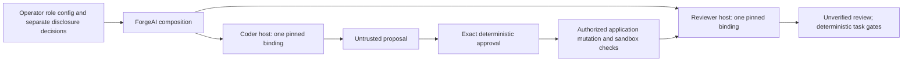

# LEGOAI-ROLE-MODEL-BINDINGS-DESIGN-REVIEW-1

Status: Proposed design; LOCAL VALIDATION PENDING.
Date: 2026-10-30.
Branch: `br-LegoAI-Comfy-ForgeAI-Gemma4-KISSKI`.
BASE: `7da850c089df8e1e845a2205fc3309a042695a8f` (maintainer-confirmed clean).
Decision owner: maintainer, with Runtime, Engineering and Security/Governance ownership.

This review authorizes no implementation, admission or live execution. Deliverables
are this plan, Proposed ADR-029, its index note and a documentary validator only.
Source observations below describe BASE; future symbols are proposals, not APIs.
Historical evaluation files, results, pins and accepted ADRs remain unchanged.

## Recommendation

Recommend **Option C: Option A first, Option B deferred behind an explicit trigger**.
Use two independent governed hosts in ForgeAI composition, one per role, with a
single application-owned orchestration and mutation boundary. This meets today's
coder/reviewer need without superseding ADR-014 §14.2. Introduce explicit role
configuration and fresh per-role quality evidence before enabling admitted use.
Do not build a general multi-agent framework, provider registry, planner or tester
now. Reconsider Option B only when an independent consumer needs shared host
multi-binding semantics and the added authority/currentness complexity is justified.
That option needs a separately accepted scoped supersession, not an implicit upgrade.

## Verified facts and corrections

### F1 — Both definitions request one logical profile

`packages/legoai-engineering/src/legoai_engineering/coding/definition.py::coding_definition`
and `packages/legoai-engineering/src/legoai_engineering/reviewer/definition.py::reviewer_definition`
both use `engineering-reasoning`. Both behavior versions are currently 1.1.0.
This does not intrinsically require one model: two hosts can resolve the same
logical requirement differently. The current shared host makes them use one route.

### F2 — One selected binding per host

`src/legoai/runtime/api.py::LocalHostConfig` permits 1–16 candidate bindings.
`src/legoai/runtime/local.py::open_local_host` captures a single selection,
finds its exact binding, admits/publishes/constructs only that contribution and
creates one route. `_LocalGovernedHost` builds a router with `(route.selected,)`.
Unselected configured bindings are not standby providers or fallback candidates.
ADR-014 §12a explicitly narrows the older §3.4 description to selected-only admission.
See `src/legoai/runtime/local.py::_LocalGovernedHost` and
`src/legoai/runtime/_composition/model_selection.py::capture_model_selection`.

### F3 — Accepted invariant, not an implementation accident

[ADR-014](../adrs/ADR-014.md) §§3.2, 5, 13.1 and 14.2 establish the public
composition owner, independent host state, captured selection and one binding per
host. §14.17 excludes per-profile selection from its scope.
[ADR-019](../adrs/ADR-019.md) remains **Proposed with scoped implementation
authorization**, not Accepted. [ADR-017](../adrs/ADR-017.md) has that same status
qualification. Neither status may be silently promoted by this review.

### F4 — One selected remote plane; configuration can hold more admissions

`src/legoai/runtime/local.py::_remote_profile` and
`src/legoai/runtime/local.py::_remote_plane` bind the selected credentialed
OpenAI-compatible REMOTE contribution to one plane and disclosure gate.
`src/legoai/runtime/api.py::RemoteModelRuntime` supplies one credential source
participant for that selected binding. However,
`src/legoai/runtime/api.py::RemoteDisclosureConfig` already supports multiple
declarations/admissions (1–16 each), and the source is not architecturally limited
to one identity: `src/legoai/runtime/local.py::_CredentialSource` provisions by
identity. Reprovisioning the same identity retires its earlier revision.
Therefore do not confuse one selected credential association with a universal
one-secret-per-source rule. `examples/forgeai/src/forgeai/remote.py::load_profile`
and `RemoteProfile` currently describe one provider/model and one binding name.

### F5 — Shared ForgeAI runtime and contexts

`examples/forgeai/src/forgeai/composition.py::prepare_run` opens one host and
injects its runtime into both CodingAgent and IndependentReviewer. Authorized
reads, mutation and checks use that host's authorization. The same fresh-context
callback serves review and rework. Separate hosts require distinct context
factories; substituting only a second runtime would fail foreign-context checks.
See `examples/forgeai/src/forgeai/worker.py::RepositoryTaskWorker`.
Guidance discovery is a separate local-only path in
`examples/forgeai/src/forgeai/composition.py::discover_guidance`; it must not
silently gain remote disclosure authority during a role migration.

### F6 — No reusable role-quality register

`scripts/forgeai_kisski_bounded_live_pilot.py::Admission` has no role field;
`scripts/forgeai_kisski_bounded_live_pilot.py::ADMISSIONS` is empty. This is a
pilot-specific quality gate, not a reusable role register. **Correction:** this
does not mean LegoAI lacks admissions generally: Plugin and ADR-024 disclosure
admissions already exist and remain independent.
`scripts/kisski_coding_eval_v3/scoring.py::summarize` makes `coder_score` non-null
only when all tasks qualify. Its reviewer score has a separate calculation, but
neither score writes admission, and `admission_effect` is `NONE`. V3's final
all-task verdict cannot be reinterpreted as coder-only admission.
The requested Agent result name is **AgentResult**, not AgentExecutionResult:
`src/legoai/execution/agent/ports.py::AgentResult` retains definition, route,
execution identity, downstream execution and status.

### F7 — Role bindings do not solve unattended remote credentials

`src/legoai/runtime/api.py::CredentialSource` requires hidden interactive
provisioning; `examples/forgeai/src/forgeai/composition.py::bind_remote` calls it,
and `remote_credentials` opens the public S1 source. No environment, file, pipe
or credential flag fallback is proposed.
`examples/forgeai/batch.py::load_tasks` permits only replay/local Ollama.
[ADR-028](../adrs/ADR-028.md) is Proposed and excludes REMOTE pending a separate
batch-scoped admission decision. **Correction:** [ADR-027](../adrs/ADR-027.md)
is Deferred specifically for an attended Generative Media purpose-bound probe,
with a concrete provider-contract reopen trigger. It is not an unattended Model
credential decision and cannot be repurposed by analogy. A separate Model
credential decision under ADR-010/023 is required; ADR-027 stays Deferred.

### F8 — Role asymmetry is evidence for a new question, not admission

[V3 results](FORGEAI-KISSKI-CODING-MODEL-EVALUATION-3-RESULTS.md) record Gemma's
coding passes, but 0_OF_2 for both held-out reviewer tasks and a final
MODEL_NOT_QUALIFIED verdict. [V2 results](FORGEAI-KISSKI-CODING-MODEL-EVALUATION-2-RESULTS.md)
record DeepSeek coding passes and six malformed responses on reviewer tasks.
**Denominator correction:** six of **18 total outputs**, not 18 reviewer outputs
(four phase-A coding outputs plus fourteen phase-B outputs). These results
motivate independent role evaluation. They admit neither role nor a paired system.
Prompt tuning on the exposed held-out security tasks remains stopped.

## Option A — One governed host per role

### Proposed file and symbol changes

| Owner / existing anchor | Proposed change in a separately authorized slice |
| --- | --- |
| `examples/forgeai/src/forgeai/composition.py::ForgeAIConfig` | Add immutable role-to-host configuration, with exact named bindings and separate remote runtime participants. Keep legacy single-binding input as an explicit compatibility mode. |
| `examples/forgeai/src/forgeai/composition.py::prepare_run` | Open coder and reviewer hosts once, construct separate runtimes and context factories, reject incomplete/mismatched roles before calls. No private Core imports. |
| `examples/forgeai/src/forgeai/composition.py::local_profile` | Derive role-specific least-privilege operator grant sets. Coder host carries the existing application mutation/check authority; reviewer host carries Chat and bounded reviewer read authority only. |
| `examples/forgeai/src/forgeai/composition.py::bind_remote` | Scope credential identities, revisions and custody directories per role; never provision the same identity twice and retire the first role's credential accidentally. |
| `examples/forgeai/src/forgeai/composition.py::remote_credentials` | Own one source per remote role for the initial implementation; close every source on all exits, including partial preparation failure. |
| `examples/forgeai/src/forgeai/worker.py::RepositoryTaskWorker` | Split the existing fresh-context callback into explicit coding/review factories; inject a reviewer reader distinct from coding context reads. Preserve the existing bounded state machine. |
| `examples/forgeai/src/forgeai/remote.py::RemoteProfile` | Parameterize binding identity and consumer attribution from validated role configuration; keep provider condition checks and one-hour maximum windows. |
| `examples/forgeai/src/forgeai/report.py::run_report` | Add bounded per-role/per-attempt binding and quality evidence attribution, preserving redaction and report size limits. |
| `examples/forgeai/batch.py::run_batch` | Later local/replay role configuration only, after attended parity tests; REMOTE rejection remains. |

No Core API, ModelPort or provider wire change is necessary. Engineering
definitions may keep the same requirement during this compatibility stage.
The application owns selection; model output never selects another role/provider.

### Authority, lifecycle and budgets

Each host independently constructs grants from operator configuration and owns
its registries, Catalog, Coordinator and evidence custody. Sharing a principal
or correlation ID does not share authority. Do not transfer SecurityContext,
ExecutionContext, permits or invocation claims between hosts. Mint the next
context on its destination host, carrying same-tenant correlation/causation as
attribution only; foreign contexts still fail closed.

Keep one WorkspaceGuard covering the entire task and both roles. A single
per-proposal exact mutation approval remains in ForgeAI; neither model host gains
an approval API. Mutation/check Ports stay application-owned and authorized on
every effect. Reviewer reads cover changed targets only, use reviewer-host read
authority, and never acquire coder-only context or new paths from feedback.
Rework reacquires current candidate content under the coder's authority. Denials,
expiry or reviewer failure stop with existing retained-change/effect semantics.

Two remote roles mean two isolated planes, two S1 provisions per run, two
explicit disclosure previews/decisions and per-binding ADR-024 admissions. Even
the same provider/model in both roles initially uses separate source identities
and custody. No shared raw-token cache or credential deduplication is introduced.
Declining either disclosure prevents the first model call; secret provisioning
never substitutes for disclosure consent. Checks remain local. Preparation failure
closes already opened sources and does not report a completed task.

The existing `local_profile` sets `max_executions=16`; this is host lifetime
capacity, **not** the worker's four-call run limit. For new role hosts cap each
at two model executions and retain explicit task-wide ceilings: at most four
chats, two applies, two check batches, two reviews, one rework. Count failed and
uncertain attempts; do not replenish capacity by opening replacement hosts.
Discovery is separately admitted and budgeted, never a hidden extra chat.

Create and use both hosts on one thread and one event loop. Execute sequentially;
do not use one `asyncio.run` per role. Existing `_require_thread`, `_enter_async`
and invoke-once checks remain binding. Cancellation stops future work; it does
not prove zero disclosure or reverse an earlier mutation.

### Tests, risk and cost

Test distinct model/provider sentinel outputs; wrong-role and foreign-context
refusals; no reviewer mutation/check grant; context isolation; unchanged no-op,
CRLF, approval identity, rework and rollback semantics; shared WorkspaceGuard;
four-call aggregate ceiling under faults; per-role expiry; wrong thread/loop;
second disclosure decline; source-close on partial setup; credential/custody
cross-wiring refusal; canary-safe attribution. Use replay/FakeSandbox and fake
HTTPS transports only unless live qualification is separately authorized.
Risks: duplicated setup, two credential prompts, partial preparation and grants
expiring independently, plus confusing configuration compatibility. Avoid a new
Port: two explicit application callbacks and existing owner Ports suffice.
Rough cost: 3–4 implementation slices for attended configuration/composition,
disclosure/attribution and qualification; admission/evaluation/batch work is extra.

## Option B — Role-routed multi-binding host

### Proposed file and symbol changes

| Existing anchor | Proposed future change |
| --- | --- |
| `src/legoai/runtime/api.py::LocalHostConfig` | Versioned immutable per-requirement selection contract with bounded selected bindings; retain exact legacy single-selection mode. |
| `src/legoai/runtime/api.py::RemoteModelRuntime` | Bounded binding-keyed trusted participant mapping, never credential material in serialized data. |
| `src/legoai/runtime/_composition/model_selection.py::capture_model_selection` | Add an explicit versioned capture path for requirement-to-binding selections; no heuristic recognition or default route. Pin one configuration revision and exact requirement/binding identities. |
| `src/legoai/runtime/local.py::open_local_host` | Validate the complete selection, then admit, activate, publish and compose each selected contribution exactly once; return no usable host on partial failure. |
| `src/legoai/runtime/local.py::_LocalGovernedHost` | Router over selected requirements; private binding-to-governed-association dispatch; execution minting pins intended requirement/route and rejects later substitution. Aggregate host capacity, not one resettable budget per role. |
| `src/legoai/runtime/local.py::_remote_profile` | Validate each selected remote binding and its exact source/ref/admission association. |
| `src/legoai/runtime/local.py::_remote_plane` | One independent plane and disclosure gate per remote binding, preserving invalidator ordering and distinct custody. |
| `src/legoai/intelligence/model/routing.py::ModelRouteDecision` | Preserve exact-match/no-match/ambiguous semantics; no ranking or fallback. Change only if an approved contract proof identifies a missing field. |
| `src/legoai/execution/agent/ports.py::AgentDefinition` | Preserve logical requirement, not a provider ID. No model-selected route argument. |
| `examples/forgeai/src/forgeai/composition.py::prepare_run` | Compose logical role contexts against the host's frozen selections instead of independent hosts, while preserving application authority boundaries. |

The existing router already represents multiple logical profiles. The missing
work is governed composition and exact dispatch association, not a new routing
algorithm. See [model routing](../docs/model-routing.md).

Every selected binding needs its own Plugin admission/lifecycle/Catalog entry.
Multiple offers with the same Chat capability do not justify choosing the first:
resolve the pinned contribution identity and preserve conflict detection. For
remote bindings, require exact matching ADR-024 admission and immutable disclosure
declaration per execution. If separate credential sources have separate ordering
domains, a single shared grant/policy registry cannot simply be attached to one
arbitrary domain. The Runtime/Security review must prove that each relevant
invalidation participates in its plane's final ordering. Defer B if that proof is
missing; never solve it with an unprotected adapter dictionary.

**Embedding interaction:** ADR-014 §3.5 uses the same selected binding for Chat
and embedding. Keep legacy mode unchanged. In a future multi-selection mode,
require an explicit configured embedding owner binding (or explicitly none),
never infer it from the last Agent role or choose the first embedding-capable
provider. This is additional scoped supersession of §3.5, not just §14.2.
Direct governed_chat also needs an unambiguous configured logical requirement;
caller task data must not supply provider choice. Fail closed for an omitted
purpose/requirement in multi-selection mode.

### Consumer impact, tests, risk and cost

| Consumer | Impact and mandatory regression |
| --- | --- |
| DocuMind | `examples/documind/src/documind_app/composition.py::DocuMindRuntime` uses one host for Chat and embedding. Preserve legacy selection, both model identities, combined lifetime budget and failure categories; run mocked transport and packaging regressions. |
| Generative Media | `packages/legoai-generative-media/src/legoai_generative_media/local_host.py::prepare_local` uses `open_governed_execution`, not the Model host. No role migration; regress shared facade boundaries and preserve remote/media credential refusals. |
| ForgeAI | Full worker/policy/report/context/rework tests plus role isolation, per-binding disclosure/credential expiry, same-provider different-model wiring and mixed local/remote execution. |
| Evaluation harnesses | V1–v3 and dev-screen remain historical, unchanged. `scripts/kisski_coding_eval_v3/runner.py::live` opens a host per model, not per role. New harnesses opt into the new API; reproduce old harnesses at pinned commits rather than editing manifests. |

Negative tests must cover wrong revision/binding/tenant/requirement, duplicate
selections, ambiguous Catalog matches, foreign contexts, source retirement,
cross-provider token leakage, partial host open, unknown effects, wrong loop,
unsupported embeddings and no retry/fallback. Core local-host, routing,
model-selection, remote/Secret/disclosure, architecture and packaging suites are
all required; success of ForgeAI alone is insufficient.
Risk: broad public-contract and currentness change for one immediate consumer;
scope creep into selection frameworks; credential-domain coupling; hidden
compatibility defaults. Rough cost: 6–8 host/API/security/consumer qualification
slices, plus the shared admission/evaluation work. B is blocked until scoped
supersession and security design acceptance, not authorized by this proposal.

## Option C — A now, conditional migration to B

Adopt A's implementation boundaries first, with an application-owned immutable
role map and safe role-attributed report schema. Treat host placement as trusted
composition, not a user-selectable strategy or a new generic Port. Keep definition
identities, exact approvals and report role names stable across a later migration.

Migration trigger: a second independent consumer demonstrates the same role
selection and governed-dispatch semantics, or measured operational evidence shows
two-host costs justify the broader change. Then decide B's context minting,
embedding and multi-source ordering contracts in a new acceptance review. Migrate
one consumer at a time under parity tests; never route a running task to a new
host/revision. Rollback changes configuration only for a new run and retains
prior effect/custody facts. No requirement to implement B is implied.

Risks: indefinitely supporting both composition modes and duplicated documentation.
Keep one application configuration meaning and one rule register; do not build an
adapter abstraction for hypothetical migration. Test A now and require B parity
later. Rough cost: A's 3–4 slices plus one migration decision; if B is approved,
its additional 6–8 slices remain separate, not discounted as a trivial refactor.

### ADR effects by option

| ADR | Option A | Option B | Option C |
| --- | --- | --- | --- |
| 014 (Accepted) | Preserve §§3.2, 5, 13.1, 14.2: one binding per independent host. | Needs explicit scoped supersession of §14.2 and related §3.5/§14.17 selection semantics; same composition owner, no live reload. | Preserve now; no supersession unless B later accepted. |
| 017 (Proposed, scoped implementation) | Existing one-step runtime/Agent-owned Chat Port unchanged. | Preserve one-step semantics; qualify multiple pinned associations behind the same Port. | Same; no Team/Workflow qualification implied. |
| 019 (Proposed, scoped implementation) | Capture one revision/binding independently per host. | New approved capture contract required; record replacement terms in a successor decision, do not rewrite history in this slice. | Legacy capture until migration decision. |
| 024 (Accepted) | Per-binding admission and per-provider run confirmation; no widening. | Per-binding gates within host; shared host does not merge admissions. | Same in both stages; batch exception separate. |
| 027 (Deferred media probe) | Unchanged; not an unattended Model credential prerequisite that this work resolves. | Unchanged; multiple sources do not authorize unattended provisioning. | Unchanged; separate Model credential decision required. |
| 028 (Proposed batch) | Local/replay role support only after qualification. REMOTE excluded. | Same exclusion, independent of host architecture. | Separate batch-scoped remote decision before any remote batch. |

## D1 — Role vocabulary and compatibility

Use application role names `coder` and `reviewer`; reserve no operational planner
or tester roles yet. Unknown roles fail, rather than dynamically loading Agents.
For A's initial implementation retain `engineering-reasoning` in both definitions
and configure that exact requirement in each independent host. This is explicit
compatibility, **not** a router alias: ModelRequirement matching is case-sensitive
and exact. Roles and their quality admissions remain distinct despite equal
requirement strings. See `src/legoai/intelligence/model/routing.py::ModelRequirement`.

A later role-vocabulary slice may version Engineering definitions to
`engineering-coding` and `engineering-review` when independent consumers or B need
them. Do not silently replace a failed role route with engineering-reasoning.
Legacy definitions require a separately selected compatibility mode, not fallback.
Changing either definition file invalidates v3 verification at HEAD by design,
even if instruction strings remain identical: its manifest pins source files.
Keep v3 immutable and reproducible at its historical commit; freeze new evaluation
evidence for the changed definitions before admission.

## D2 — Role-based quality admission

Propose a versioned source-controlled **ForgeAI application quality register**,
separate from Core Plugin admission and ADR-024 disclosure. Its semantic owner is
ForgeAI; consumers are attended composition and the bounded batch tool, with the
same exact role-eligibility meaning. Use pure records and lookup, no new Port or
service. A future separately reviewed pilot migration can consume the register;
the existing pilot tuple and all historical evaluations remain untouched here.

Each entry must include provider, exact model, role, evaluation ID, manifest
digest, pack digest, phase report digests, human admission reviewer, decision
date, not-before/expiry, and admission-rule version. Also pin Agent definition
identity/version, instruction digests, request settings and supported deployment/
capability envelope so a mutable model alias or changed prompt cannot inherit
stale evidence. Human reviewer identity is not the model's reviewer role.
Duplicate/conflicting, missing, expired, revoked or mismatched entries refuse.
An explicit new reviewed revision is required for changes; no CLI override.
The register is reviewed source, not cryptographic proof of provider weights.

Preregister **v4 per-role rules before any new live evidence**: coder covers all
coding dimensions and repeated coding tasks; reviewer covers correct/incorrect,
security, abstention and false-positive controls with new held-out material and
2_OF_2 per applicable task. Freeze fixtures, prompts, settings, stopping rules,
denominators and incomplete-run treatment. No post-hoc pooling of partial runs.
**Fresh runs are mandatory**: v2/v3 results cannot be scored under this new rule
to grant role admission. V3 verdict remains final. New role passes confer only
eligibility for separate human admission review; admission_effect remains NONE.
Pair integration qualification must additionally prove disclosures, bounded
orchestration and mutation safety; two role passes do not prove a safe pair.

## D3 — Configuration surface

Propose one explicitly operator-selected `models.toml` outside repository-controlled
task input. Versioned closed schema: configuration revision, exact role mapping,
bounded named binding records and per-remote-binding processor/admission records.
Initially exactly coder/reviewer; unknown keys, duplicate/missing roles or binding
references fail before provisioning or model calls. Remote policy content can
reuse existing types, but the new file must not overload old `remote.toml` silently.
Legacy single-binding mode is explicit and mutually exclusive with the role file.

Allow only existing supported implementations: local Ollama, trusted replay and
credentialed OpenAI-compatible REMOTE providers. Distinct remote providers are
explicit binding records, not a dynamic plugin language. A new protocol requires
separate adapter admission and qualification. No imports, factories, credentials,
environment substitution, provider selection from task text, defaults to another
role, automatic fallback or model discovery-driven selection. A loopback tunnel
to remote processing stays REMOTE; replay is test evidence, not quality admission.

Show the operator the complete immutable role/provider/model/configuration map,
quality status and each provider's exact disclosure envelope before the first
call. Require a separate default-No decision for each remote role/provider;
changing either invalidates the run's confirmation. Local mutation approval
remains separate. Both remote approvals must succeed before any role sends data.

## D4 — Disclosure and attribution

| Invocation | Required material classes and bounded content |
| --- | --- |
| First coder | PLATFORM_INSTRUCTION, TASK_TEXT, REPOSITORY_CONTENT: instructions, objective/constraints, exact targets and confirmed read-only context. |
| Rework coder | Above plus DERIVED_DIAGNOSTIC: current candidates and bounded check/reviewer feedback; no newly discovered context. |
| Reviewer | All four classes: its instructions, objective/criteria, changed files and bounded proposal/check material. No unrelated coder read-only context. |

`examples/forgeai/src/forgeai/remote.py::classes` and `disclosure_preview` implement
the current distinction; ADR-024 §8 describes conservative all-four-class run
admission. Preserve that admission requirement per remote binding initially,
while truthfully previewing the per-invocation payload. Do not silently narrow
policy to make a provider eligible. Cross-provider reviewer feedback returning to
the coder retains repository/derived restrictions: both admissions must allow the
flow. Redaction is not declassification. Provider discovery has its own admission
and cannot grant content disclosure or change the configured model.

Per-provider previews and approval remain mandatory even when a role is quality
admitted. Invocation-time expiry/revision/recipient/class/Secret checks remain
mandatory after approval. Model result NONE does not prove no disclosure or cost.
Keep UNKNOWN effects, exact recipient facts and owner-local custody attribution.

Reports should record role, definition/version, configured binding/provider/model,
configuration revision, quality admission/rule reference, execution ID, status,
effect and applicable custody/admission references per call. Use
`src/legoai/execution/agent/ports.py::AgentResult` route attribution; do not infer
the producing model from a top-level label. Do not mislabel configured identity
as independent verification of immutable weights. Preserve existing safe report
bounds; never copy raw prompts, credentials, headers or exception messages.

## D5 — Unattended remote use stays blocked

Role bindings solve selection, not credential provisioning or autonomous
disclosure. ADR-028 requires a separate batch-scoped remote admission ADR; ADR-024
excludes unattended use. A distinct Model credential decision under ADR-010/023
must define the supported principal/account/deployment, purpose/recipient binding,
provisioning authority, renewal/expiry/revocation, source teardown, exact-use
ordering, durable custody, cancellation and crash/UNKNOWN treatment. Obtain
authoritative provider/account contracts and Security/Runtime acceptance first.
Do not design a credential store here, and do not reopen ADR-027 without its
media-specific trigger. No unattended launch, environment token workaround or
pre-provisioned secret file is authorized by this review.

## D6 — Follow-up slices and gates

Each row requires explicit maintainer authorization; acceptance of ADR-029 alone
does not authorize code or live execution. Validators listed here are required
gate categories, not new files delivered in this documentary slice.

| Order | Slice / acceptance criteria | Maintainer validator gates |
| --- | --- | --- |
| 1 | Decide ADR-029 and role vocabulary. Approve A-first compatibility, exact schema, authority split and blocked B scope. No definition change in initial stage; any later new profiles require versioning and historical-pin note. | Documentary scope/preservation/citation checks; architecture decision review. |
| 2 | ForgeAI local/replay role composition. Two exact bindings, two context factories, least-privilege readers, one WorkspaceGuard, unchanged approvals/no-op/rework and aggregate ceilings. | Role positive/negative contracts; architecture, worker/context/policy/report/line-ending regressions; typing/lint/format; offline install checks as separately authorized. |
| 3 | Attended remote role configuration and safe attribution. Two explicit disclosure decisions, isolated source identities/custody, cleanup on failure; no remote batches. | Fake HTTPS disclosure/Secret denial and canary matrix; wrong-loop/context/source tests; existing single-binding and local regressions. Live use separately authorized only after these pass. |
| 4 | Versioned role-quality register, initially empty. Exact rule/definition/configuration matching; no implicit admissions. Wire readiness refusals into prospective role mode without silently redefining current attended DP policy. | Pure lookup positive/negative controls, expiry/revocation/duplicate tests; mutation/disclosure gates independent; no historical file edits. |
| 5 | Per-role evaluation v4 preregistration and freeze, then separately authorized fresh runs and human admission review. New held-outs, no tuning on exposed tasks; eligibility never writes register. | Synthetic scoring, manifest refusal, repeatability, pacing, 429/503 stop, canary/custody, historical preservation; then separately authorized live evidence and register review. |
| 6 | Local/replay role-aware batch integration and pair qualification. Every success still needs checks plus ACCEPT; exact task/clone isolation and stop-on-failure. | Batch snapshots, no-op/no-commit, forbidden Git operations, ceilings and attribution; REMOTE remains rejected. |
| 7 | Separate batch-scoped remote admission decision. Define finite tasks, exact role/provider/repository/classes/windows and renewal/stop policy without yet enabling remote execution. | Document/security acceptance; prove no weaker interpretation of ADR-024/028. |
| 8 | Separate unattended Model credential decision and only then authorized implementation/qualification. Both credential and batch-disclosure decisions must be accepted before any remote batch. | Source/authority/currentness/custody/crash/cancellation proof and negative controls; no environment/file fallback; separate live authorization. |
| Conditional | Option B trigger review. Decide per-requirement minting, embedding owner and multi-domain invalidation before Core edits; migrate with compatibility parity. | ADR supersession acceptance; full Core and all-consumer regression/packaging gates described under B. |

Rough total for the A-first path: eight staged decisions/implementation/evaluation
groups above, with 3–4 implementation slices for the attended role feature itself.
Counts are planning estimates, not effort or qualification guarantees.

## Review limits and stop boundary

Source inspection supports the distinctions above; no tests, validators, models,
providers, builds or installs were run. No provider terms or live custody reports
were fetched; evidence observations use the checked-in results records. This is
a single-agent design review, not an independent security review. Unresolved B
currentness/API semantics, fresh role evidence and unattended credential authority
are explicit gates, not assumptions hidden in configuration. No new Port is
proposed: reuse existing Model/Agent/authorization Ports and application composition.
The documentary validator checks structure and source citation existence, not
the truth of every architectural claim or acceptance by an owner.
